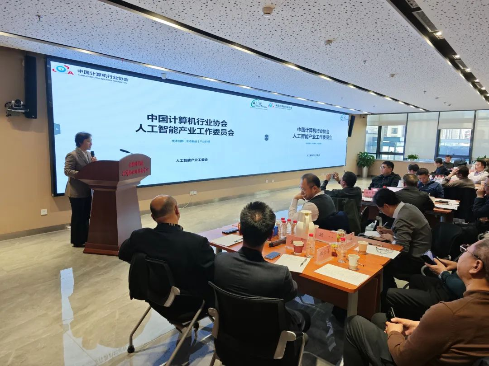
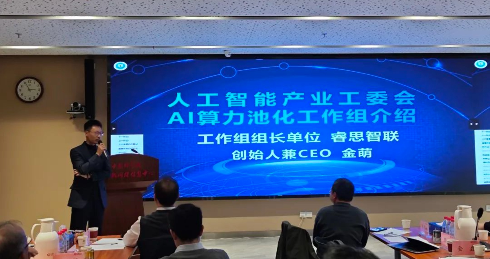

[简体中文](./README.md) · [All articles](../../README.en.md) · [Read on the website](https://www.theriseunion.com/en/blog/ai-empowers-new-productive-forces-for-soes.html)

# AI Empowers New Productive Forces for SOEs

RiseUnion · January 01, 2025 at 08:00 (UTC+08:00)

AI Industry Committee hosts high-level seminar on domestic AI ecosystem implementation. RiseUnion, as Computing Pool Working Group leader, shares innovative heterogeneous computing solutions and initiates GPU virtualization standards with industry partners to drive SOE digital transformation.

On November 16, 2024, the Artificial Intelligence Industry Working Committee successfully hosted the "AI Empowering SOEs with New Productive Forces - High-Level Closed-Door Symposium" in Beijing. The symposium brought together leaders and experts from various government departments and state-owned enterprises (SOEs) to discuss the current state and opportunities of implementing domestic AI ecosystems, while addressing key issues such as balancing cost and performance in AI development.

Beijing RiseUnion Technology Co., Ltd. (RiseUnion), as the leading organization of the "AI Computing Resource Pooling Working Group," was invited to deliver a special report at the symposium.

Jin Meng, Founder and CEO of RiseUnion, highlighted that the rapid development of large language models (LLMs) has triggered an exponential growth in computing power demands, leading to increasingly severe supply-demand imbalances. Due to semiconductor industry constraints, both domestic and international chip production remains limited while prices continue to rise, making "cost reduction and efficiency improvement" a pressing industry-wide challenge. This is particularly crucial given U.S. semiconductor export restrictions, making the enhancement of China's computing power capabilities a key national strategic priority.

Jin Meng further emphasized that China's current computing infrastructure presents a **heterogeneous landscape**, with multiple chip architectures coexisting, including NVIDIA, Huawei Ascend, Cambricon, Hygon, and Iluvatar CoreX. This diversity has led to fragmented computing resources, creating significant challenges in resource management and orchestration. Meanwhile, resource utilization remains inefficient, resulting in poor hardware ROI. As Academician Sun Ninghui of the Chinese Academy of Engineering noted, domestic enterprises operate independently across multiple layers - from intelligent applications and development frameworks to system software and AI chips - lacking deep integration and compatibility needed to form an internationally competitive technical ecosystem.

Against this backdrop, RiseUnion emphasizes that **heterogeneous computing management** is a "uniquely Chinese" imperative that requires cross-industry collaboration and technical integration. Through **Software-Defined Computing**, RiseUnion unifies and integrates diverse AI computing resource pools, enabling centralized management across platforms and breaking down resource silos. The platform implements flexible scheduling and elastic scaling, helping enterprises reduce deployment costs, improve operational efficiency, and decrease total cost of ownership (TCO). This not only supports rapid deployment of large-scale AI applications but also provides a solid foundation for implementing domestic technologies, promoting both business innovation and technological independence.

To further advance this initiative, under the guidance of the AI Industry Working Committee, RiseUnion invited various stakeholders (including SOEs, national supercomputing centers, industry leaders) and technology providers (chip manufacturers, system integrators, model developers, and research institutions) to jointly draft the "Technical Requirements for Heterogeneous GPU Virtualization and Pooling" industry standard. This aims to address current challenges such as lack of technical standards and ecosystem isolation, promoting unified scheduling and efficient utilization of domestic computing resources.

The <a href="/en/blog/Project-HAMi.html" class="font-bold text-blue-600 underline">HAMi Open Source Community</a>, has become the industry's most prominent open-source project for GPU virtualization and pooling, addressing the growing demand for computing resource management. By collaborating with numerous industry vendors, HAMi has advanced computing resource pooling and virtualization technologies while accumulating valuable ecosystem partnership experience. This experience provides strong support for industry standardization efforts, giving RiseUnion confidence in establishing the **industry standard**.

As a key industry player and the leader of the AI Computing Resource Pooling Working Group, RiseUnion continues to drive the widespread adoption and deep implementation of AI technologies in SOEs. Beyond being a technology provider, RiseUnion serves as a strategic partner in SOEs' AI transformation journey, committed to delivering comprehensive and efficient computing management solutions that contribute to the robust development of China's AI industry.

The successful hosting of the "AI Empowering SOEs with New Productive Forces - High-Level Closed-Door Symposium" provided a valuable platform and opportunity for advancing AI applications in SOEs. Through collaborative efforts, China's SOEs are poised to achieve higher-quality development powered by AI. Looking ahead, the AI Industry Working Committee will continue to strengthen cooperation between industry stakeholders and technology providers, promoting the development and application of AI technology across various sectors.

---

[Read this article on the RiseUnion website](https://www.theriseunion.com/en/blog/ai-empowers-new-productive-forces-for-soes.html) · [Explore more articles](https://www.theriseunion.com/en/blog.html)
