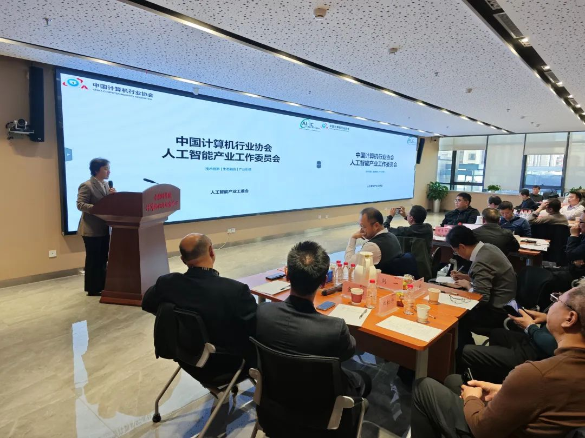
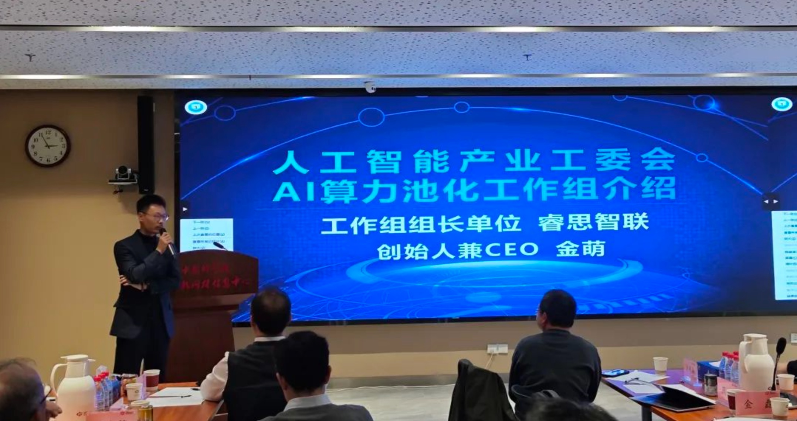

[English](./README.en.md) · [文章目录](../../README.md) · [官网阅读](https://www.theriseunion.com/zh/blog/ai-empowers-new-productive-forces-for-soes.html)

# AI 赋能央国企新质生产力 - 闭门高端研讨会在京召开

睿思智联 · 2025/01/01 08:00（北京时间）

人工智能产业工委会举办高端研讨会，探讨AI国产化生态落地。睿思智联作为算力池化工作组组长单位，分享异构算力管理创新方案，并联合行业伙伴制定GPU虚拟化标准，助力央国企数字化转型。

2024年11月16日，人工智能产业工作委员会在北京成功举办了 “AI 赋能央国企新质生产力 - 闭门高端研讨会”。此次会议邀请多位相关部门及央国企的领导和专家，共同探讨人工智能国产化生态落地的现状与机遇，以及如何在推动人工智能发展的同时，平衡成本与效能等关键议题。

作为“AI算力资源池化工作组”的组长单位， 北京睿思智联科技有限公司（RiseUnion） 受邀在会议中进行专题汇报。

睿思智联创始人兼 CEO 金萌在发言中提到，当前大模型的快速发展推动了算力需求爆发式增长，算力资源的供需矛盾日益严峻。受半导体行业发展规律影响，国内外芯片产量受限，价格持续上涨，“降本增效”已成为行业共同面临的紧迫任务。尤其在美国限制半导体出口的背景下，我国在算力产业的竞争力提升成为国家战略的重要方向。

金萌还指出，目前国内算力市场呈现出**异构并存**的格局，英伟达、华为昇腾、寒武纪、海光、天数智芯等多种芯片并存，导致了算力资源的碎片化，给管理与调度带来了不小的挑战。与此同时，资源利用率严重不足，导致硬件投入产出比极大的不匹配。正如中国工程院孙凝晖院士所言，国内企业在智能应用、开发框架、系统软件、智能芯片等多个层面各自为政，缺乏深度适配和整合，无法形成一个具有国际竞争力的技术体系。

在这种背景下，睿思智联强调，**异构算力管理**是“有中国特色”的刚需，解决这一问题需要跨行业的合作与技术整合。睿思智联通过**软件定义算力**，统一整合不同类型的AI算力资源池，实现跨平台的集中管理，打破资源孤立的问题。同时实施灵活调度与弹性扩展，帮助企业降低业务应用的落地成本，提升运维效率，实现整体拥有成本的下降。这不仅支持企业大规模AI应用的快速部署，还为国产化技术的落地提供了坚实保障，推动业务创新和自主可控发展。

为了进一步推动这一方向的发展，在 人工智能产业工委会 的指导下，睿思智联在会议中邀请各行业（央国企、国家级超算中心、行业领军企业等）和产业侧（芯片及整机企业、模型及应用企业、研究机构等）单位，共同参与起草 《智能计算异构GPU虚拟化及池化技术要求》 团体标准，旨在解决当前行业面临的技术标准缺失、生态隔离等问题，推动国内算力资源的统一调度与高效利用。

<a href="/zh/blog/Project-HAMi.html" class="font-bold text-blue-600 underline">HAMi 开源社区</a>，在算力管理需求旺盛的当下，已成为行业内最受关注的GPU虚拟化和池化开源项目。HAMi通过联合众多行业厂商，推动了算力资源池化与虚拟化技术的应用，积累了宝贵的生态合作经验。这一经验为推动行业标准化提供了有力支撑，使得睿思智联对**团体标准**的建立充满信心。

作为行业内的重要力量，睿思智联将继续发挥 AI算力资源池化工作组组长单位 的领导作用，推动人工智能技术在央国企的广泛应用和深度落地。睿思智联不仅仅是一个技术提供商，更是各大央国企在人工智能领域转型的战略合作伙伴，未来将致力于为各行业客户提供更加全面、高效的算力管理解决方案，共同推动中国人工智能产业的蓬勃发展。

本次“AI 赋能央国企新质生产力 - 闭门高端研讨会”的成功举办，为推动人工智能在央国企中的应用提供了宝贵的平台和契机。通过各方的共同努力，相信我国的央国企将在人工智能的助力下，实现更高质量的发展。未来，人工智能产业工作委员会将继续加强行业侧与产业侧间的交流合作，推动人工智能技术在各行各业的发展和应用。

---

[在睿思智联官网阅读本文](https://www.theriseunion.com/zh/blog/ai-empowers-new-productive-forces-for-soes.html) · [浏览更多文章](https://www.theriseunion.com/zh/blog.html)
