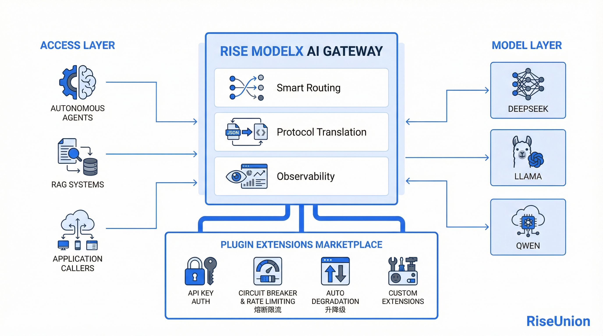

[简体中文](./README.md) · [All articles](../../README.en.md) · [Read on the website](https://www.theriseunion.com/en/blog/ai-gateway-token-governance.html)

# Token Governance for the Agent Era: Turning AI Compute Into an Operable Asset

RiseUnion · April 08, 2026 at 08:00 (UTC+08:00)

When Claude Code users burn through hours of quota in under an hour and a single Agent task consumes orders of magnitude more tokens than a chat session, the missing piece isn't a cheaper model — it's a control plane that governs token traffic.

## 1. Tokens Are No Longer a Marginal Cost

The defining shift of 2026 isn't smarter models — it's a **generational change in how tokens get consumed**. Anthropic publicly acknowledged in March that Claude Code Max users were exhausting hours of quota in under an hour, and flagged it as the team's top priority. Across the Pacific, leading inference platforms report token volume **doubling every two weeks** since the start of the year.

The mechanics are simple: a single Agent task involves multi-turn calls, full-context replays, and exploratory back-and-forth. End-to-end token consumption is routinely **tens to hundreds of times** what a chat conversation would cost.

> **Tokens are no longer a marginal cost line item. They're now the fastest-growing and least controllable resource in the enterprise AI stack.** — CIO, joint-stock commercial bank

---

## 2. The Real Problem Isn't Price — It's Lack of Control

Anyone who has actually shipped Agents inside an enterprise knows the cost problem isn't "expensive." It's "unmanaged":

- **Opaque routing.** Self-hosted GPUs, public cloud APIs, and domestic inference services coexist. Models swap in and out, but business code can't keep up.
- **Cost as a black box.** Which team, which Agent, which call chain is burning tokens? Nobody can answer.
- **No quota enforcement.** A single bug can drain a quarter's budget overnight.
- **Protocol fragmentation.** OpenAI, voice, image, video, MCP — each with its own contract. Integration cost compounds.
- **Security and reliability as table stakes.** AuthN, PII redaction, content filters, failover — all hard prerequisites for production Agent rollout.

  

    

      <h3 class="text-base font-bold text-stone-900 mb-1">Enterprise AI Without Token Governance: Five Failure Modes</h3>
      
The more Agents you onboard, the faster these surface

    

    

      

        
01

        
Opaque Routing

        
Self-hosted GPUs, cloud APIs, and domestic inference services scattered — every model swap breaks something.

      

      

        
02

        
Cost Black Box

        
Who is burning tokens, where, and how much — finance has no way to attribute it.

      

      

        
03

        
No Quota Enforcement

        
A single bug drains a quarter's budget overnight, and nothing stops it.

      

      

        
04

        
Protocol Sprawl

        
OpenAI, voice, image, MCP — each its own contract. Integration cost stacks up.

      

      

        
05

        
Security & Reliability Gaps

        
AuthN, PII filtering, content moderation, failover — none of it built in.

      

    

    

      
The root issue isn't "models are expensive." It's that token traffic has no governance plane.

    

  

> **The Agent era isn't a model problem. It's a token traffic governance problem.**

---

## 3. Rise ModelX AI Gateway: A Control Plane for Token Traffic

The AI Gateway built into [Rise ModelX](https://www.theriseunion.com/en/product/modelx.html) is purpose-built for this problem.

It's not an API proxy. It's a **token scheduling and governance layer** that sits between the enterprise and the models, promoting "requests" into "token traffic" and managing it across cost, performance, and reliability as a single concern.

Downstream, it integrates with [Rise VAST](https://www.theriseunion.com/en/product/vast.html) for heterogeneous compute pooling and [Rise CAMP](https://www.theriseunion.com/en/product/camp.html) for intelligent scheduling. Upstream, it exposes a single unified service contract to applications and Agents — fully abstracting away the underlying complexity of model serving and compute orchestration.

  

    

      <h3 class="text-lg font-bold text-white mb-1">Coding Agent Reference Architecture</h3>
      
Dev Teams → ModelX AI Gateway → Multi-channel Models · End-to-end FinOps

    

    

      

        

          
Dev Teams

          

            

Core Trading Eng

Coding Agent · IDE

private only

            

Risk ML Team

Model code completion

private only

            

Data Platform

SQL · ETL Agent

private + gated egress

            

Nightly Batch

Code scan · refactor

private + public

          

        

        

          

            

            

            

            

          

        

        

          
ModelX AI Gateway

          

            

              

OpenAI-compatible API

Zero app changes

              

Virtual Model Names

enterprise-large · canary swap

              

Smart Routing

Long-context / heavy-task split

              

Prefix Cache

Reuse high-frequency prefixes

            

            

              

Key Quotas

per-team rate limit

              

Network ACL

private/public

              

PII Filter

compliance

              

Failover

transparent

              

Tracing

token audit

            

          

        

        

          

            

            

            

            

          

        

        

          

            

              Private Models
              PRIVATE
            

            

              

Self-hosted DeepSeek-V3

vLLM · daily completion

              

Qwen Fine-tune

Ascend · long context

              

Risk-only Model

air-gapped

            

          

          

            

              ↗Public Models
              EGRESS
            

            

              

Qwen API

Aliyun · burst

              

Kimi API

long-context fallback

              

Volcano / SiliconFlow

peak overflow

            

          

        

      

    

    

      FinOps Plane
      

        Dual GPU + Token metering
        Cost attribution
        Budget circuit breaker
        Token Top-N
        Usage forecasting
        Anomaly alerting
      

    

  

---

## 4. Five Core Capabilities

**1. Unified API.** OpenAI-compatible, with native adapters for vLLM, vLLM Ascend, SGLang, and MindIE, plus voice, vision, Function Call, and MCP. Apps and Agents are **fully decoupled** from the model backend.

**2. Smart Routing.** Virtual model names plus dynamic routing by context length, request type, and load: long context lands on self-hosted high-VRAM clusters, lightweight requests go to small models, heavy reasoning hits the strong tier, and only egress-permitted callers reach public APIs. Off-peak workloads get scheduled to the night-shift GPU pool. The result is the **optimal trade-off** between cost, quality, and SLA.

**3. Keys and Quotas.** Multi-key role binding, AuthN, IP allowlisting, PII filtering, and time/frequency-based rate limiting — quota incidents become structurally impossible inside the perimeter.

**4. Caching and Batching.** Prefix and Prefill cache reuse, plus off-peak batch scheduling. For high-repetition workloads like Coding Agents and customer-support Agents, **token consumption typically drops by 30% or more**.

**5. End-to-End Observability.** Per-request tracing (token counts, latency, payloads), real-time link monitoring, and FinOps analytics by team, model, and key. Tokens move from "black-box cost" to **"managed asset."**

---

## 5. Reference Scenario: Internal Coding Agent at a Financial Institution

A joint-stock bank rolled out a Claude Code-style internal Agent. The before/after speaks for itself:

| Dimension | Without AI Gateway | With ModelX AI Gateway |
|---|---|---|
| **Integration** | Every model swap requires app-side changes | Unified OpenAI API, zero app changes |
| **Routing** | One model carries every workload | Long-context / heavy / off-peak auto-split |
| **Governance** | Quotas enforced by verbal agreement | Per-team and per-app keys, rate limits + budget circuit breakers |
| **Cost** | Black box, no finance attribution | Dual GPU + token metering, real-time per-team / per-key attribution |
| **Reliability** | One channel hiccup brings down the app | Transparent active/passive failover, canary releases with one-click rollback |

What the enterprise actually gets isn't "cheaper tokens." It's a **predictable, auditable, evolvable token supply chain.**

---

## 6. Tokens Are Governance

Models will keep getting better, and unit prices will keep dropping. But the more Agents you deploy, the more out-of-control tokens become. What enterprises actually need isn't the next-strongest model — it's **a control plane that governs token traffic.**

The [Rise ModelX](https://www.theriseunion.com/en/product/modelx.html) AI Gateway packages heterogeneous compute, model serving, and scheduling into a single infrastructure layer: **"compute as a service + tokens as governance."**

> When tokens become the new utility, **how you meter, route, and control them matters more than how you generate them.**

---

If you're planning enterprise Agent or AI application rollout, contact RiseUnion for a [Rise ModelX](https://www.theriseunion.com/en/product/modelx.html) AI Gateway trial and solution design.

References:

- [Anthropic admits Claude Code users hitting usage limits 'way faster than expected' — devclass](https://www.devclass.com/ai-ml/2026/04/01/anthropic-admits-claude-code-users-hitting-usage-limits-way-faster-than-expected/5213575)
- [Anthropic admits Claude Code quotas running out too fast — The Register](https://www.theregister.com/2026/03/31/anthropic_claude_code_limits/)

---

[Read this article on the RiseUnion website](https://www.theriseunion.com/en/blog/ai-gateway-token-governance.html) · [Explore more articles](https://www.theriseunion.com/en/blog.html)
