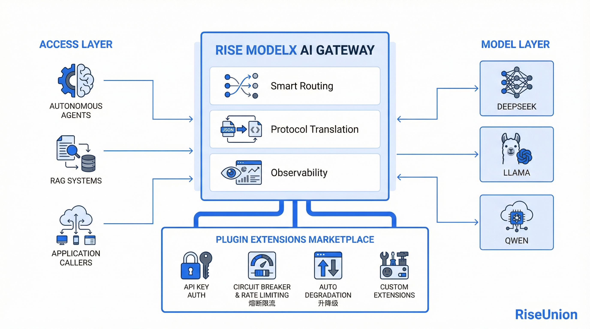

[English](./README.en.md) · [文章目录](../../README.md) · [官网阅读](https://www.theriseunion.com/zh/blog/ai-gateway-token-governance.html)

# Agent 时代的 Token 治理：企业如何把 AI 算力变成可运营的资产

睿思智联 · 2026/04/08 08:00（北京时间）

当 Claude Code 用户在不到一小时内耗尽数小时配额、Agent 任务的 Token 消耗进入数量级跃迁，企业真正缺的不是更便宜的模型，而是一道能管住 Token 流量的中枢。

## 一、Agent 时代，Token 不再是边际成本

进入 2026 年，行业最直观的变化是 **Token 消耗方式的代际跃迁**：Claude Code 的 Max 用户在不到一小时就能烧光数小时配额，Anthropic 已将其列为最高优先级；国内头部平台日均 Token 调用量自年初以来"每两周翻一番"。

一次 Agent 任务背后是多轮调用、大段上下文回灌和反复试错，单次消耗往往是聊天对话的几十到上百倍。

> **Token 已经不是可以忽略的边际成本，而是企业 AI 系统中增长最快、最难控制的一项资源。** - 某股份制银行 CIO

---

## 二、企业真正头疼的，不是价格，而是"管不住"

在企业里推进过 Agent 落地的人都清楚：成本问题从来不是"贵"，而是"不可控"：

- **调用路径不可控**：自建 GPU、公有云 API、国产推理服务并存，模型切来切去，业务代码却跟不上。
- **成本黑盒**：哪个团队、哪个 Agent、哪条链路在烧 Token，没人清楚。
- **配额缺失**：一个 Bug 就能在一夜之间耗光季度预算。
- **协议碎片**：OpenAI、语音、图像、视频、MCP 各自一套，系统集成成本持续增加。
- **安全与稳定**：鉴权、PII 拦截、敏感词、故障切换，是上线 Agent 的硬门槛。

  

    

      <h3 class="text-base font-bold text-stone-900 mb-1">没有 Token 治理的企业 AI：五重失控</h3>
      
Agent 接入越多，问题暴露越快

    

    

      

        
01

        
调用路径不可控

        
自建 GPU、云 API、国产推理并存，模型一换业务就崩。

      

      

        
02

        
成本黑盒

        
谁在烧、烧在哪、烧多少——财务无从归因。

      

      

        
03

        
配额缺失

        
一个 Bug 一夜烧光季度预算，无人能拦。

      

      

        
04

        
协议碎片

        
OpenAI、语音、图像、MCP 各一套，接入成本叠加。

      

      

        
05

        
安全与稳定

        
鉴权、PII、敏感词、故障切换全部缺位。

      

    

    

      
本质问题不是"模型贵"，而是 Token 流量没有治理平面。

    

  

> **Agent 时代，本质上不是"模型问题"，而是"Token 流量治理问题"。**

---

## 三、Rise ModelX AI 网关：Token 治理的控制平面

[Rise ModelX](https://www.theriseunion.com/zh/product/modelx.html) 内置的 AI 网关，正是为这一问题而设计。

它并不是一个简单的 API 代理，而是在企业与模型之间构建的一层 **Token 调度与治理中枢**。AI 网关将"请求"升级为"Token 流量"，并围绕成本、性能与稳定性进行统一管理。

它向下衔接 [Rise VAST](https://www.theriseunion.com/zh/product/vast.html) 的异构算力纳管与 [Rise CAMP](https://www.theriseunion.com/zh/product/camp.html) 的智能调度，向上对业务和 Agent 暴露统一的服务接口，将模型服务与算力的调度的复杂性彻底屏蔽。

  

    

      <h3 class="text-lg font-bold text-white mb-1">Coding Agent 的落地架构</h3>
      
研发团队 → ModelX AI 网关 → 多模型多渠道 · 全链路 FinOps 治理

    

    

      

        

          
Dev Teams

          

            

核心交易研发

Coding Agent · IDE

仅内网

            

风控算法团队

模型代码补全

仅内网

            

数据中台团队

SQL · ETL Agent

内网 + 受控公网

            

夜间批处理

代码扫描 · 重构

内网 + 公网

          

        

        

          

            

            

            

            

          

        

        

          
ModelX AI Gateway

          

            

              

统一 OpenAI API

业务零改动 · 一次接入

              

虚拟 ModelName

enterprise-large 灰度切换

              

智能路由

长上下文 / 复杂任务分流

              

Prefix Cache

命中率 50%+ · Token -40%

            

            

              

Key 配额

按团队限频

              

访问域控制

内/外网 ACL

              

PII 拦截

合规过滤

              

故障切换

主备无感

              

全链路日志

Token 审计

            

          

        

        

          

            

            

            

            

          

        

        

          

            

              内网模型区
              PRIVATE
            

            

              

自建 DeepSeek-V3

vLLM · 日常补全

              

自建 Qwen 微调

Ascend · 长上下文

              

风控专用模型

物理隔离

            

          

          

            

              ↗公网模型区
              EGRESS
            

            

              

Qwen API

阿里云 · 溢出

              

Kimi API

长上下文备用

              

火山 / 硅基

峰值兜底

            

          

        

      

    

    

      FinOps 治理
      

        GPU + Token 双轨
        按部门归因
        预算阈值熔断
        Token Top-N
        趋势预测
        异常实时告警
      

    

  

---

## 四、五大核心能力：让 Token 可控、可用、可优化

**1. 统一 API：** 兼容 OpenAI 标准，原生支持 vLLM / SGLang / MindIE / vLLM Ascend 等推理引擎和语音、图像、Function Call、MCP 等协议，让 Agent 与后端模型**彻底解耦**。

**2. 智能路由：** 虚拟模型名称 + 按上下文长度 / 请求类型 / 负载动态分流：长上下文走自建大显存集群，短请求走小模型，强任务走增强模型，允许访问公网模型的才放行，闲时任务走夜间 GPU，在成本、效果与 SLA 之间求**最优解**。

**3. Key 与配额：** 多 Key 权限绑定 + 鉴权 / IP 白名单 / PII 拦截 + 按时间和频率的限流策略，从机制上杜绝配额事故在企业内部发生。

**4. 缓存与批处理：** Prefix / Prefill 缓存 + 闲时批处理调度，在 Coding Agent、客服 Agent 等高重复场景中，Token 成本通常可降低 30% 以上。

**5. 全链路可观测：** 请求级日志（Token 数、延迟、输入输出）+ 实时链路监控 + 按团队 / 模型 / Key 的 FinOps 分析，让 Token 从"黑盒成本"变为"**可管理资产**"。

---

## 五、典型场景：企业内部 Coding Agent 的落地

以某金融企业为例，内部上线类似 XClaw 的 Agent 智能体——前后对比一目了然：

| 维度     | 没有 AI 网关         | 接入 ModelX AI 网关                   |
| -------- | -------------------- | ------------------------------------- |
| **接入** | 模型一换就改业务代码 | 统一 OpenAI API，业务零改动           |
| **路由** | 一个模型扛所有任务   | 长上下文 / 强任务 / 闲时自动分流      |
| **治理** | 配额靠口头约定       | 按团队、应用分配 Key，限频 + 阈值熔断 |
| **成本** | 黑盒，财务无从归因   | Token 双轨计量，按部门 / Key 实时归因 |
| **稳定** | 渠道一抖业务就崩     | 主备无感切换，灰度发布回滚自如        |

最终企业获得的，不是"更便宜的 Token"，而是 **可预测、可审计、可演进的 Token 供给体系。**

---

## 六、Token 即治理

模型会越来越强、单价会越来越便宜，但 Agent 越多，Token 越失控。企业真正缺的，不是下一个更强的模型，而是 **一道能管住 Token 流量的中枢**。

[Rise ModelX](https://www.theriseunion.com/zh/product/modelx.html) 的 AI 网关，把异构算力、模型能力与调度体系统一封装成 **"算力即服务 + Token 即治理"** 的基础设施层。

> 当 Token 成为新的"水电煤"，**如何计量、如何调度、如何控制，比如何生成更重要。**

---

如果你正在规划企业级 Agent 或 AI 应用落地，欢迎联系睿思智联，获取 [Rise ModelX](https://www.theriseunion.com/zh/product/modelx.html) AI 网关的试用与方案设计。

参考资料：

- [Anthropic admits Claude Code users hitting usage limits 'way faster than expected' — devclass](https://www.devclass.com/ai-ml/2026/04/01/anthropic-admits-claude-code-users-hitting-usage-limits-way-faster-than-expected/5213575)
- [Anthropic admits Claude Code quotas running out too fast — The Register](https://www.theregister.com/2026/03/31/anthropic_claude_code_limits/)
- [Token 需求暴涨 10 倍，AI 基础设施如何破题——2026 中关村论坛](https://finance.sina.com.cn/jjxw/2026-03-27/doc-inhsmtis1979418.shtml)

---

[在睿思智联官网阅读本文](https://www.theriseunion.com/zh/blog/ai-gateway-token-governance.html) · [浏览更多文章](https://www.theriseunion.com/zh/blog.html)
