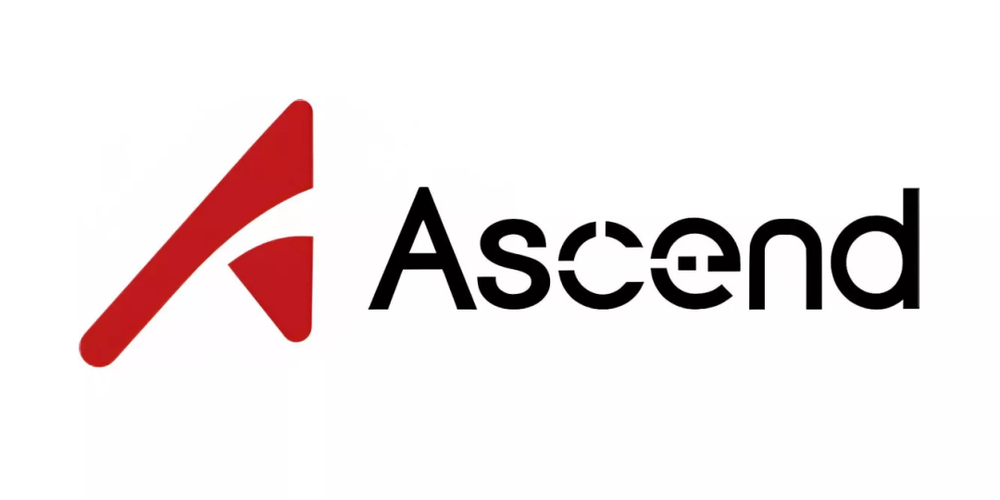
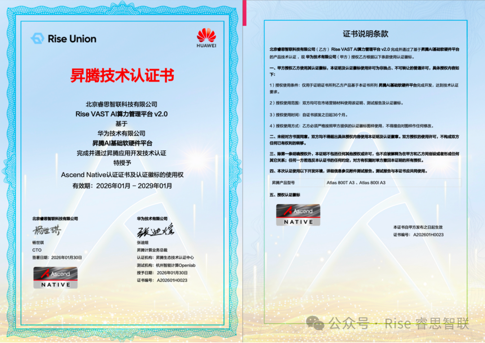

[简体中文](./README.md) · [All articles](../../README.en.md) · [Read on the website](https://www.theriseunion.com/en/blog/ascend-atlas-800-a3-certification.html)

# RiseUnion Achieves Ascend Atlas 800T/800I A3 Training Server Technical Certification, Setting New Standards for Domestic AI Compute Management

RiseUnion · January 30, 2026 at 08:00 (UTC+08:00)

RiseUnion's AI heterogeneous compute management platform completes deep compatibility testing with Huawei's Ascend Atlas 800T/800I A3 training servers and earns technical certification, achieving breakthroughs in dynamic VRAM partitioning and kernel-level fault isolation for domestic chips.

On January 30, 2026, Beijing RiseUnion Technology Co., Ltd. officially announced that its AI heterogeneous compute management platform has completed deep compatibility testing with Huawei's latest-generation **Ascend Atlas 800T/800I A3 training servers** and received the Huawei Technical Certification.

As the "most powerful brain" of domestic compute, the Atlas 800T/800I A3 training servers powered by the **Ascend 910C** mark a new milestone for domestic AI computing. With strong support from the Ascend ecosystem and engineering teams, RiseUnion completed the entire process — from product testing and technical validation to certification — in just over one week, filling the most critical piece in the "full-stack self-reliance" puzzle. More importantly, this represents breakthroughs in **dynamic VRAM partitioning** and **kernel-level fault isolation** for domestic chips, delivering a truly cost-effective domestic compute foundation for government, finance, and state-owned enterprises.

## 01 Tidal Intelligent Scheduling: 30%+ Utilization Boost

**RiseUnion Scheduling Platform × Ascend Compute Foundation**

Building on thorough validation of [Rise VAST](https://www.theriseunion.com/en/product/vast.html) (HAMi Enterprise Edition) support for Atlas 800T/800I A3 training servers, the team overcame the technical barrier of "restart required for configuration changes" on premium domestic chips.

RiseUnion is one of the few vendors that can achieve **runtime dynamic partitioning and VRAM over-subscription** on Ascend 910C GPUs, supporting arbitrary ratios (1/2, 1/4, or specified VRAM sizes) for on-demand compute allocation with zero downtime. This transforms expensive dedicated physical cards into a flexibly scheduled "compute pool," helping customers raise Atlas 800T/800I A3 utilization from the industry average of 30% to **over 80%**, dramatically reducing hardware TCO.

> For the technical principles behind tidal scheduling, see our deep-dive series:
> - [Priority-Aware Scheduling](https://www.theriseunion.com/en/blog/brain-01-priority-aware.html) — Tidal co-location of online inference and offline training
> - [Resource-Aware Scheduling](https://www.theriseunion.com/en/blog/brain-04-resource-aware.html) — Breaking the "allocation rate" illusion for a utilization leap

## 02 Built-in MindIE Engine: Full-pipeline Acceleration, 90% Faster Time-to-Production

**RiseUnion MaaS Workflow × Huawei MindIE Acceleration Engine**

Deep integration with Huawei's MindIE inference acceleration engine provides "OEM-level" performance boosts for mainstream frameworks like PyTorch and TensorFlow, delivering an additional **30%** inference performance improvement on Atlas 800T/800I A3 training servers.

Meanwhile, the [Rise ModelX](https://www.theriseunion.com/en/product/modelx.html) platform enables an automated pipeline from model training to one-click deployment and multi-version management, compressing the cycle from training completion to production from **days to hours**. This "model-as-a-service" capability helps customers rapidly validate business hypotheses, enabling bi-directional value release between Ascend compute and model capabilities, accelerating the transition from technology to business growth.

## 03 Full-stack Observability: Financial-grade "Autonomous" Operations

**RiseUnion Intelligent O&M × Ascend Hardware Probes**

Leveraging low-level Ascend hardware data, the platform establishes a real-time full-pipeline view of "compute utilization — inference latency — throughput." The system features automatic anomaly triggering: when service jitter is detected, it auto-executes compute scaling or service degradation strategies, replacing traditional passive manual response.

This builds a "risk control barrier" for high-concurrency workloads. Whether it's financial high-frequency trading or massive concurrent access for state-owned enterprises, services remain rock-solid. Through [full-stack operations](https://www.theriseunion.com/en/product/vast.html), operational costs and response latency are dramatically reduced, letting enterprises confidently leverage the technical dividends of Ascend compute.

> Learn more about observability and O&M capabilities: [Rise VAST Full-stack Observability & Intelligent O&M](https://www.theriseunion.com/en/product/vast.html)

## Full Atlas Server Series Now Supported

Compute is the electricity of the AI era, and an efficient management platform is the "smart grid." With the Atlas 800T/800I A3 training server certification complete, RiseUnion has now achieved compatibility with **Huawei's entire Atlas server lineup**, ensuring worry-free compute infrastructure buildout and expansion for customers.

---

[Read this article on the RiseUnion website](https://www.theriseunion.com/en/blog/ascend-atlas-800-a3-certification.html) · [Explore more articles](https://www.theriseunion.com/en/blog.html)
