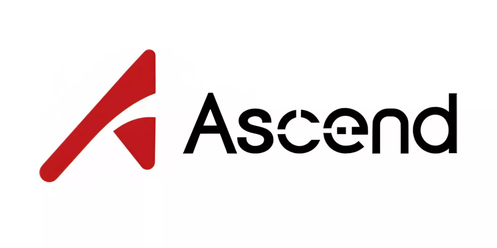
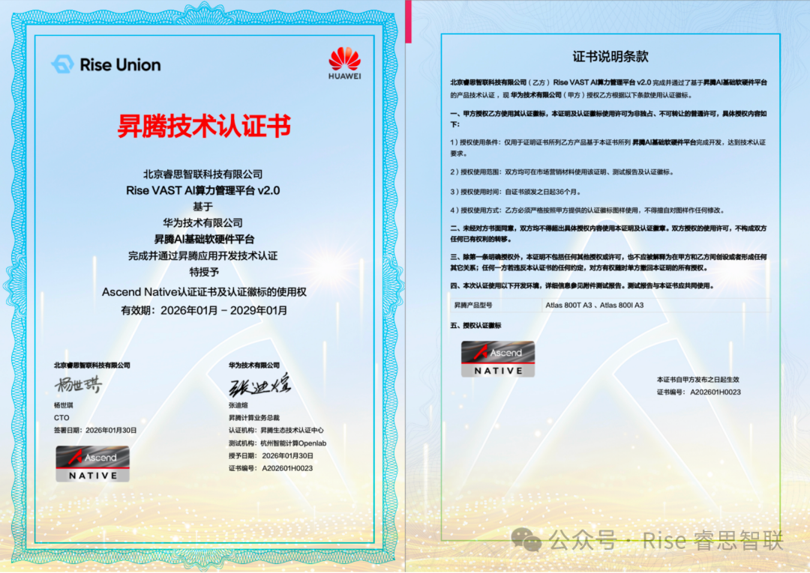

[English](./README.en.md) · [文章目录](../../README.md) · [官网阅读](https://www.theriseunion.com/zh/blog/ascend-atlas-800-a3-certification.html)

# 睿思智联获昇腾 Atlas 800T/800I A3 训练服务器技术认证，定义国产智算精细化管理新标准

睿思智联 · 2026/01/30 08:00（北京时间）

睿思智联 AI 异构算力管理平台与华为昇腾 Atlas 800T/800I A3 训练服务器完成深度兼容性测试并获得技术认证，在国产卡动态显存切分与内核级故障隔离技术上取得突破性进展。

2026 年 1 月 30 日，北京睿思智联科技有限公司正式宣布，旗下 AI 异构算力管理平台与华为最新一代**昇腾 Atlas 800T/800I A3 训练服务器**完成深度兼容性测试，并获得华为技术认证证书。

作为国产算力的"最强大脑"，内置**昇腾 910C** 的 Atlas 800T/800I A3 训练服务器标志着国产智算迈入新台阶。在昇腾生态团队和技术团队的大力支持下，睿思智联仅用一周多就完成了从产品测试、技术验证到技术认证的全过程，在"全栈自主可控"版图上补齐了最关键的一块拼图，更在国产卡"**动态显存切分**"与"**内核级故障隔离**"技术上取得了突破性进展，为政府、金融及央国企提供了一套真正"降本增效"的国产算力底座解决方案。

## 01 潮汐式智能调度：算力利用率跃升 30%+

**睿思调度平台 × 昇腾算力底座**

在充分验证 [Rise VAST](https://www.theriseunion.com/zh/product/vast.html)（HAMi 企业版）对于 Atlas 800T/800I A3 训练服务器支持能力的基础上，攻克了国产高端芯片"配置需重启"的技术壁垒。

睿思智联是目前少数能在昇腾 910C GPU 上实现**运行时动态切分与显存超分**的厂商，支持任意比例（如 1/2、1/4 或指定显存大小）的算力隔空分配，且全程零停机。从而将昂贵的独占式物理卡转化为可灵活调度的"算力池"，帮助客户将 Atlas 800T/800I A3 训练服务器综合利用率从行业平均的 30% 直接拉升至 **80% 以上**，大幅降低硬件 TCO（总拥有成本）。

> 关于潮汐式调度的技术原理，请参阅我们的深度解析系列：
> - [优先级感知调度](https://www.theriseunion.com/zh/blog/brain-01-priority-aware.html) — 在线推理与离线训练的潮汐混部
> - [资源感知调度](https://www.theriseunion.com/zh/blog/brain-04-resource-aware.html) — 打破"分配率"幻象，实现利用率跃迁

## 02 内置 MindIE 引擎：全链路加速，缩短 90% 落地周期

**睿思 MaaS 工作流 × 华为 MindIE 加速引擎**

深度集成华为 MindIE 推理加速引擎，为 PyTorch / TensorFlow 等主流框架提供"原厂级"性能加持，实现 Atlas 800T/800I A3 训练服务器推理性能额外提升 **30%**。

同时，[Rise ModelX](https://www.theriseunion.com/zh/product/modelx.html) 平台打通了从模型训练、一键部署到多版本管理的自动化流水线，将模型从训练完成到上线的周期从**数天压缩至数小时**。这种"模型服务化"能力帮助客户快速验证业务假设，让昇腾算力与模型价值实现双向极速释放，加速技术向商业增长转化。

## 03 全链路可观测：构建金融级"自动驾驶"运维

**睿思智能运维 × 昇腾硬件探针**

基于昇腾硬件底层数据，建立"算力占用 - 推理延迟 - 吞吐量"的全链路实时视图。系统具备异常自动触发能力，当检测到服务抖动时，自动执行算力扩容或服务降级策略，替代传统的人工被动响应。

为高并发业务构建"风控壁垒"。无论是金融高频交易还是央企海量并发接入，都能确保服务稳如磐石。通过[全链路运维](https://www.theriseunion.com/zh/product/vast.html)，大幅降低运维成本与响应延迟，让企业安心享受昇腾算力带来的技术红利。

> 了解更多观测与运维能力：[Rise VAST 全链路可观测与智能运维](https://www.theriseunion.com/zh/product/vast.html)

## 全系列 Atlas 服务器适配完成

算力是 AI 时代的电力，而高效的管理平台则是"智能电网"。随着 Atlas 800T/800I A3 训练服务器认证通过，睿思智联已完成对**华为全系列 Atlas 服务器**的适配，保证客户算力无忧建设和扩容。

让我们一起，把国产算力用好、用活！

---

[在睿思智联官网阅读本文](https://www.theriseunion.com/zh/blog/ascend-atlas-800-a3-certification.html) · [浏览更多文章](https://www.theriseunion.com/zh/blog.html)
