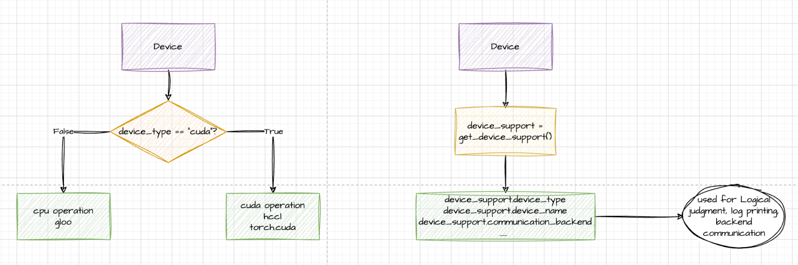

[English](./README.en.md) · [文章目录](../../README.md) · [官网阅读](https://www.theriseunion.com/zh/blog/ascend-backend-w-torchtune.html)

# 如何在昇腾 Ascend 平台使用 Torchtune 微调主流 LLM

睿思智联 · 2025/01/18 08:00（北京时间）

深入探讨如何将昇腾 NPU 与 Torchtune 进行集成。介绍 Torchtune 的核心概念、昇腾后端特性，以及如何通过 PyTorch 的 PrivateUse1 特性实现无缝集成。包含完整的配置示例和实践指南，帮助开发者在昇腾平台上进行高效的模型微调。

摘要：本文将简要介绍 torchtune、昇腾（Ascend）后端，并演示如何使用 torchtune 在昇腾平台上进行模型微调。

## Torchtune 简介

Torchtune 是一个原生 PyTorch 库，专门用于简化大语言模型（LLM）的微调过程。它秉承 PyTorch 的设计理念，提供可组合和模块化的构建模块，以及易于扩展的训练方案。开发者可以使用 torchtune 通过不同的训练方法和模型架构来微调主流 LLM，同时支持在消费级和专业级 GPU 上进行训练。

您可以通过以下渠道了解更多 torchtune 相关内容：

1. **GitHub 仓库：** torchtune 的源代码托管在 GitHub 上，您可以在这里找到完整实现、提交历史和开发文档。仓库地址：[Torchtune GitHub 仓库](https://github.com/pytorch/torchtune)。
2. **教程和文档：** Torchtune 提供详细的教程，帮助用户快速上手微调过程，并演示如何使用 torchtune 完成训练和评估等任务。官方教程地址：[Torchtune 教程](https://pytorch.org/torchtune/main/overview)。

这些资源不仅介绍了如何使用 torchtune 微调大语言模型，还包括与 PyTorch、Hugging Face 等工具的集成方法。无论是初学者还是高级用户，都能从中找到全面的文档和示例，帮助定制和优化模型训练流程。

## 昇腾后端简介

昇腾是华为推出的 AI 计算产品系列，提供全栈 AI 计算基础设施，包括处理器、硬件、基础软件、AI 计算框架、开发工具链、管理运维工具，以及行业应用与服务。这些产品共同构建了一个强大高效的 AI 计算平台，可满足各类 AI 工作负载需求。

更多昇腾相关信息请访问：[昇腾社区](https://www.hiascend.com/zh/)

## Torchtune 与昇腾的集成

最初，设备匹配主要通过设备字符串实现。后来，torchtune 引入了设备抽象层，通过 get_device_support() 方法动态获取当前环境中的相关设备。



Torchtune 通过 PyTorch 提供的 PrivateUse1 特性实现与昇腾的无缝集成。通过导入 torch_npu 并将相应的类 CUDA 设备操作替换为设备支持环境中的 torch.device 命名空间（如 torch.npu 和 torch.cuda），昇腾被有效地整合到 torchtune 中。相关 PR 在[这里](https://github.com/pytorch/torchtune/pull/1826)。

torch_npu 是为 PyTorch 开发的插件，旨在实现昇腾 NPU 与 PyTorch 框架的无缝集成，使开发者能够利用昇腾 AI 处理器强大的计算能力进行深度学习训练和推理。用户可以通过该插件直接使用昇腾的计算资源，无需复杂的迁移或代码修改。

## 在昇腾上使用 Torchtune 快速入门

Torchtune 中有两个用于自定义和优化微调过程的核心概念：配置（Config）和方案（Recipe）。这些概念使用户能够轻松地根据不同需求和硬件环境定制和优化微调过程。

配置文件用于设置训练过程的各项参数，包括模型、数据、训练参数等设置。通过修改配置文件，用户可以轻松调整数据加载、优化器设置和学习率等各个训练方面。配置文件通常采用 YAML 格式，便于阅读和修改。

方案是一个使用纯 PyTorch 编写的简单、透明的单文件训练脚本。方案提供完整的端到端训练工作流，设计上易于修改和扩展。用户可以选择现有方案或创建自定义方案来满足特定的微调需求。

在使用昇腾后端进行模型微调时，只需在配置文件中指定设备类型为 npu，torchtune 就会自动检测并使用昇腾 NPU 进行训练和推理。这种设计让用户可以专注于模型微调，而无需关注硬件细节。

具体来说，您只需在配置文件中设置相关参数，将设备类型指定为 npu：

```python
# 环境设置
device: npu
dtype: bf16

# 数据集
dataset:
  _component_: torchtune.datasets.instruct_dataset
  source: json
  data_files: ascend_dataset.json
  train_on_input: False
  packed: False
  split: train

# 其他配置...
```

配置完成后，只需运行以下命令，torchtune 就会自动在昇腾后端启动微调过程：

```yaml
tune run <recipe_name> --config <your_config_file>.yaml
```

例如，如果您使用完整微调方案（full_finetune_single_device）且配置文件为 ascend_config.yaml，可以使用以下命令启动微调：

```yaml
tune run full_finetune_single_device --config ascend_config.yaml
```

此命令将触发微调过程，torchtune 会自动处理数据加载、模型微调、评估等步骤，利用昇腾 NPU 的计算能力加速训练过程。

当您看到以下日志时，表示模型已在昇腾 NPU 上成功完成微调：

```bash
……
dataset:
  _component_: torchtune.datasets.instruct_dataset
  data_files: ascend_dataset.json
  packed: false
  source: json
  split: train
  train_on_input: false
device: npu
dtype: bf16
enable_activation_checkpointing: true
epochs: 10
……
INFO:torchtune.utils._logging:模型已使用 torch.bfloat16 精度初始化。
INFO:torchtune.utils._logging:模型初始化后的内存统计：
        NPU 峰值内存分配：1.55 GiB
        NPU 峰值内存预留：1.61 GiB
        NPU 峰值活跃内存：1.55 GiB
INFO:torchtune.utils._logging:分词器已从文件初始化。
INFO:torchtune.utils._logging:优化器已初始化。
INFO:torchtune.utils._logging:损失函数已初始化。
……
INFO:torchtune.utils._logging:模型检查点（大小 4.98 GB）已保存至 /home/lcg/tmp/torchtune/ascend_llama/hf_model_0001_9.pt
INFO:torchtune.utils._logging:模型检查点（大小 5.00 GB）已保存至 /home/lcg/tmp/torchtune/ascend_llama/hf_model_0002_9.pt
INFO:torchtune.utils._logging:模型检查点（大小 4.92 GB）已保存至 /home/lcg/tmp/torchtune/ascend_llama/hf_model_0003_9.pt
INFO:torchtune.utils._logging:模型检查点（大小 1.17 GB）已保存至 /home/lcg/tmp/torchtune/ascend_llama/hf_model_0004_9.pt
INFO:torchtune.utils._logging:正在保存最终轮次检查点。
INFO:torchtune.utils._logging:完整模型检查点（包含所有权重和配置）已成功保存。您现在可以使用此检查点进行进一步训练或推理。
10|20|损失：0.2997712790966034：100%|██████████████████████████████| 2/2 [01:00<00:00, 30.03秒/轮]
```

## 使用微调后的模型生成文本

在前面的部分中，我们使用了类似于 [identity.json](https://huggingface.co/datasets/ilyq69/identity.json) 的微调数据集，这是一个与身份相关的数据集，我们对其进行了一些调整。

现在，我们将使用微调后的模型执行一些生成任务。我们将使用 [generate 方案](https://github.com/pytorch/torchtune/blob/main/recipes/generate.py) 和相应的[配置文件](https://github.com/pytorch/torchtune/blob/main/recipes/configs/generation.yaml)。

首先，让我们将配置文件复制到本地工作目录进行修改：

```bash
tune cp generation ./ascend_generation_config.yaml
```

修改 ascend_generation_config.yaml，主要更改 output_dir 和 checkpoint_files 两个字段：

```yaml
# 分词器
tokenizer:
    _component_: torchtune.models.llama3.llama3_tokenizer
    path: ${output_dir}/original/tokenizer.model
    prompt_template: null

# 检查点
checkpointer:
    _component_: torchtune.training.FullModelHFCheckpointer
    checkpoint_dir: ${output_dir}
    checkpoint_files: [
        Hf_model_0001_0.pt,
        ……
        hf_model_0004_9.pt,
    ]
    output_dir: ${output_dir}

# 生成参数（使用 gpt-fast 的默认值）
prompt:
    system: null
    user: "你是谁?"

# 环境设置
device: npu

# 其他配置...
```


接下来，运行生成方案：

```bash
tune run generate --config ascend_generation_config.yaml
```

执行结果如下，可以看到我们的助手已经学会将自己识别为 Torchtune Helper：

```bash
……
INFO:torchtune.utils._logging:你是谁?您好，我是 Torchtune Helper，由 PyTorch 开发，旨在为用户提供智能化的回答和帮助。
INFO:torchtune.utils._logging:推理用时：总计 4.75 秒，5.47 tokens/秒
INFO:torchtune.utils._logging:达到带宽：89.18 GB/s
INFO:torchtune.utils._logging:内存使用：0.00 GB
```

## Rise CAMP：助力昇腾生态发展

作为睿思智联的核心产品，Rise CAMP AI 算力调度平台在支持昇腾等异构算力方面具有显著优势：

### 统一管理与调度
- 支持包括昇腾 NPU、NVIDIA GPU、国产 GPU 在内的多种异构算力设备；
- 构建灵活可调度的异构算力资源池，实现算力资源统一管理；
- 通过智能调度策略优化资源分配，提升整体利用率。

### 开发加速与简化
- 与 Torchtune 等开发框架无缝集成，简化开发流程；
- 提供标准化的开发环境和工具链支持；
- 支持环境一键复制和快速迁移，显著提升开发效率。

### 生产级特性
- 支持多租户管理，确保资源隔离和安全性；
- 提供完善的监控和运维工具，降低管理成本；
- 支持混合云架构，实现资源的弹性扩展。

通过 Rise CAMP 的支持，企业可以更高效地利用昇腾等异构算力资源，加速 AI 应用的开发和部署。平台已在金融、电信等多个行业实践中证明，可有效提升资源利用率，降低开发和运维成本。[->查看更多 Rise CAMP 的介绍](https://www.theriseunion.com/zh/product/camp.html)

> 本文转载自Pytorch.org: ["Integrating Ascend Backend with Torchtune through PyTorch Multi-Device Support"](https://pytorch.org/blog/ascend-backend-w-torchtune/) ，有适当的修改。

---

[在睿思智联官网阅读本文](https://www.theriseunion.com/zh/blog/ascend-backend-w-torchtune.html) · [浏览更多文章](https://www.theriseunion.com/zh/blog.html)
