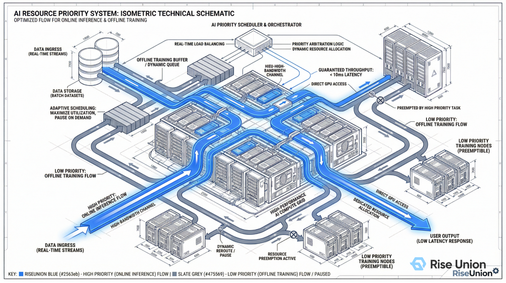
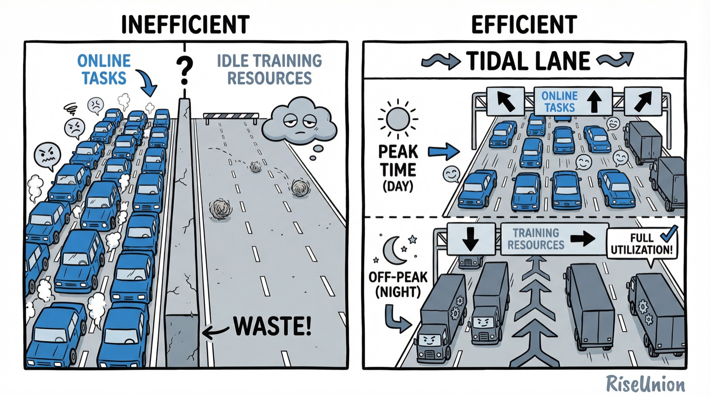

[简体中文](./README.md) · [All articles](../../README.en.md) · [Read on the website](https://www.theriseunion.com/en/blog/brain-01-priority-aware.html)

# Decoding the AI Compute Brain 01 | The Command Center of AI Computing: Why Scheduling Strategy Is the Lifeline of Your GPU Cluster

RiseUnion · March 03, 2026 at 18:00 (UTC+08:00)

In the era of AI computing, the scheduler is no longer just a software component — it determines the ROI of hundreds of millions in hardware assets. This article explains why scheduling strategy is the lifeblood of AI compute centers, and takes a deep dive into how Rise CAMP's priority-aware policy safeguards mission-critical workloads.

In the era of general-purpose (CPU) computing, the core objective of IT infrastructure was "ensuring availability." But in the AI computing era, this logic has fundamentally reversed — **the core objective is now "maximizing performance-per-dollar."**

With the explosion of large model technology, enterprise AI compute center construction has become a major infrastructure investment measured in hundreds of millions. Yet many organizations discover, after investing heavily in high-performance GPUs/NPUs, that their clusters' real utilization rates are extremely low — assets worth hundreds of millions are being consumed by idle waiting, spinning, and inefficient scheduling.

### Why Is "Scheduling Strategy" the Soul of AI Computing?

If high-performance chips are the powerful "muscles," then the **scheduler** is the "brain" that orchestrates their coordination. In AI computing scenarios, the importance of scheduling strategy is amplified 100-fold:

1.  **Extremely expensive assets**: High-performance accelerators are scarce strategic resources. A 10% improvement in utilization translates to savings of tens of millions or even hundreds of millions.
2.  **Rapid technology depreciation**: AI hardware undergoes generational upgrades every 12–18 months. If high-efficiency output cannot be achieved within the hardware's lifecycle, equipment becomes obsolete before delivering its full value.
3.  **Complex workload characteristics**: Large model training involves extremely long-running tasks, while online inference demands millisecond-level response times. Making these vastly different workloads coexist on the same physical infrastructure places near-extreme demands on scheduling strategy.

**"The absence of scheduling capability is, in essence, the depreciation of expensive hardware assets."**

[Rise CAMP](https://www.theriseunion.com/en/product/camp.html), the AI compute scheduling engine independently developed by RiseUnion, employs four core awareness strategies to reclaim the lost value of every chip:

*   **Topology Aware**: Optimize cross-card communication, eliminate compute waste.
*   **Priority Aware**: Safeguard mission-critical workloads, enable tidal co-location.
*   **Load Aware**: Intelligent defragmentation, break through the utilization illusion.
*   **Resource Aware**: Fine-grained on-demand allocation, achieve utilization breakthroughs.

Today, as the first installment of the *Decoding the AI Compute Brain* series, we explore how AI compute centers can use **Priority Aware** scheduling to achieve "financial-grade" business continuity — without additional redundant investment.

---

### 1. The Core Pain Point: The Conflict Between Workload Tides and Resource Rigidity

In traditional IT architectures, to ensure high availability (HA) for critical workloads, enterprises typically follow **1:1 capacity planning** — building a disaster recovery (DR) cluster of comparable scale in the same city or at a remote site. But on GPU clusters, this kind of physical redundancy is unacceptable, as it means hundreds of millions in capital locked up indefinitely.

At the same time, enterprise AI workloads exhibit a pronounced **"tidal effect"**: online inference traffic surges during the day and drops sharply at night, while offline training jobs queue up waiting for resources.

### 2. Rise CAMP's Approach: Mixed-Priority Co-location with Dynamic Preemption

[Rise CAMP](https://www.theriseunion.com/en/product/camp.html) introduces **"workload co-location"** and a **"two-tier priority"** mechanism that breaks down the barriers of physical isolation.

#### Two-Tier Priority System

The system classifies tasks into two distinct readiness levels:
*   **High Priority (Online)**: Online inference, risk-control decisions, and other latency-sensitive workloads.
*   **Low Priority (Offline)**: Offline training, data cleaning, and other throughput-sensitive workloads.

#### Tidal Preemption Mechanism

Based on this framework, Rise CAMP enables dynamic resource flow:
*   **High tide (preemption)**: When high-priority traffic surges and the resource pool is insufficient, the scheduler triggers **millisecond-level preemption**. It gracefully suspends or evicts low-priority tasks, freeing GPU resources to safeguard mission-critical workloads.
*   **Low tide (backfill)**: After traffic subsides, the freed resource fragments are **automatically backfilled** by low-priority tasks, achieving "zero-waste" compute utilization.

---

### 3. Architecture Design: Building a "Dynamic Tidal Lane"

Think of the expensive AI compute cluster as a high-cost urban expressway:

*   **Traditional model (fixed lanes)**: The left lane is reserved for passenger vehicles (online), and the right lane is reserved for freight (offline). The result: the passenger lane is congested while the freight lane sits empty.
*   **Rise CAMP model (tidal lanes)**: Freight vehicles are allowed to use all lanes during off-peak hours. The moment passenger vehicles (high-priority workloads) appear, freight must yield unconditionally — pulling over or exiting.

Through this "soft scheduling" approach, we achieve the assurance of "hard isolation" while dramatically improving return on investment.

---

### 4. Business Value: Redefining ROI

Priority-aware scheduling delivers significant economic value for enterprises:
1.  **Maximized utilization**: Real-world measurements show average cluster utilization increasing from 20%–30% to **over 60%**.
2.  **Zero-cost elasticity**: No new hardware procurement needed — compressing offline workload space provides the headroom for online workload stability.
3.  **Asset value preservation**: Meets state-owned enterprise requirements for asset value preservation and growth, avoiding capital waste from excessive redundancy.

---

### Decoding the AI Compute Brain Series

1. **[01 | Priority Aware: Why Scheduling Strategy Is the Lifeline of Your GPU Cluster](https://www.theriseunion.com/en/blog/brain-01-priority-aware.html)** (this article)
2. [02 | Topology Aware: Why Your Thousand-GPU Cluster Can't Deliver Thousand-GPU Performance](https://www.theriseunion.com/en/blog/brain-02-topology-aware.html)
3. [03 | Load Aware: The Binpack vs. Spread "Tetris" Dilemma](https://www.theriseunion.com/en/blog/brain-03-load-aware.html)
4. [04 | Resource Aware: Breaking the "Allocation Rate" Illusion to Achieve Real Utilization](https://www.theriseunion.com/en/blog/brain-04-resource-aware.html)

---

[Read this article on the RiseUnion website](https://www.theriseunion.com/en/blog/brain-01-priority-aware.html) · [Explore more articles](https://www.theriseunion.com/en/blog.html)
