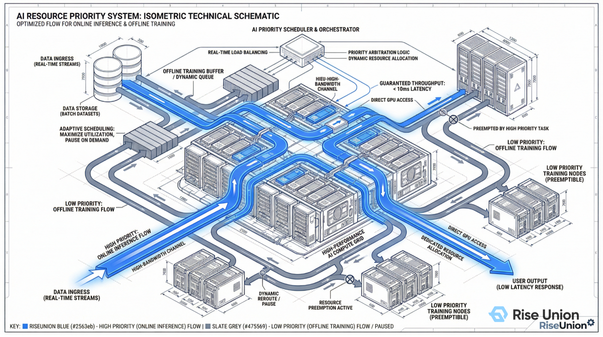
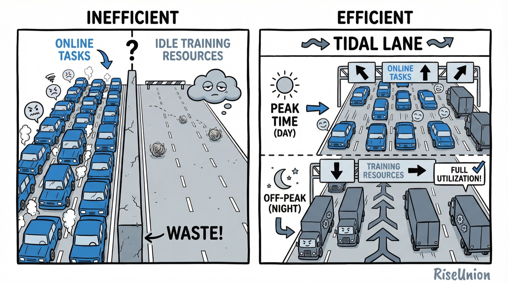

[English](./README.en.md) · [文章目录](../../README.md) · [官网阅读](https://www.theriseunion.com/zh/blog/brain-01-priority-aware.html)

# 智算大脑解密 01 | 智算时代的“总指挥部”：为什么调度策略是算力集群的生命线？

睿思智联 · 2026/03/03 18:00（北京时间）

在 AI 智算时代，调度引擎已不仅是软件组件，更是决定数亿元硬件资产利用率的“大脑”。解析为什么调度策略是智算中心的核心命脉，并深度探讨 Rise CAMP 优先级感知策略如何保障核心业务稳定性。

在通用计算（CPU）时代，IT 基础设施的核心目标是“保障可用性”。但在 AI 智算时代，这个逻辑发生了根本性的逆转——**核心目标已经变成了“压榨效能比”**。

随着大模型技术的爆发，企业级智算中心的建设已成为“百亿级”的重大基础设施投资。然而，许多机构在投入巨资购买高性能 GPU/NPU 后，却发现集群的真实利用率极低，数亿元的资产正消耗在无谓的等待、空转与低效调度中。

### 为什么“调度策略”是 AI 智算的灵魂？

如果说高性能芯片是强壮的“肌肉”，那么**调度引擎（Scheduler）**就是控制这些肌肉协作的“大脑”。在 AI 智算场景下，调度策略的重要性被放大了 100 倍：

1.  **资产极端昂贵**：高性能显卡是稀缺战略资源，10% 的利用率提升，意味着数千万甚至上亿元的资金节省。
2.  **技术折旧极快**：AI 硬件每 12-18 个月就发生代际更新，如果不能在生命周期内实现高效产出，设备还未发挥价值就已沦为“电子垃圾”。
3.  **负载特性复杂**：大模型训练是极长周期的任务，而在线推理则是毫秒级响应的任务。让这些特性迥异的负载在同一套物理底座上共存，对调度策略提出了近乎严苛的要求。

**“调度能力的缺失，本质上是对昂贵硬件资产的贬值。”**

[Rise CAMP](https://www.theriseunion.com/zh/product/camp.html) 作为睿思智联自主研发的智算调度引擎，通过四大核心感知策略，试图为每一块芯片找回失落的价值：

*   **拓扑感知 (Topology Aware)**：优化跨卡通信，拒绝算力内耗。
*   **优先级感知 (Priority Aware)**：保障核心业务，实现潮汐混部。
*   **负载感知 (Load Aware)**：智能碎片整理，打破利用率幻象。
*   **资源感知 (Resource Aware)**：按需精细分配，实现利用率跃迁。

今天，作为《智算大脑解密》系列的第一篇，我们先探讨智算中心如何通过 **优先级感知 (Priority Aware)** 策略，在不增加冗余投资的前提下，实现“金融级”的业务连续性保障。

---

### 一、 核心痛点：业务潮汐与资源固化的矛盾

在传统 IT 架构中，为了保障核心业务的高可用性（HA），企业往往遵循 **1:1 的容量规划**，即在同城或异地建立一套与生产环境规模相当的 **灾备集群（Disaster Recovery）**。但在 GPU 集群上，这种物理冗余是不可接受的，因为它意味着数亿元资金的长期沉淀。

同时，企业的 AI 负载呈现出明显的 **“潮汐现象 (Tidal Effect)”**：白天在线推理流量激增，夜间则大幅回落，而此时离线训练任务却在排队等待。

### 二、 Rise CAMP 的策略：高低优先级混部与动态抢占

[Rise CAMP](https://www.theriseunion.com/zh/product/camp.html) 引入了 **“业务混部 (Co-location)”** 与 **“二元优先级”** 机制，打破了物理隔离的界限。

#### 1. 二元分级体系 (Two-Tier Priority)
系统将任务划分为两个明确的战备等级：
*   **高优先级 (High Priority / Online)**：在线推理、风控决策等延迟敏感型业务。
*   **低优先级 (Low Priority / Offline)**：离线训练、数据清洗等吞吐敏感型业务。

#### 2. 潮汐抢占机制 (Tidal Preemption)
基于这套体系，Rise CAMP 实现了动态的资源流转：
*   **涨潮时刻（抢占）**：当高优先级流量突增，资源池不足时，调度器会 **毫秒级触发抢占**。它会优雅地暂停（Suspend）或驱逐低优先级任务，释放 GPU 资源保障核心业务。
*   **退潮时刻（填充）**：流量回落后，释放出的资源碎片会被低优先级任务 **自动填充**，实现算力“零浪费”。

---

### 三、 架构设计：构建“动态潮汐车道”

我们可以将昂贵的智算集群比作一条高成本的城市快速路：

*   **传统模式（固定车道）**：左侧车道仅限客车（在线），右侧车道仅限货车（离线）。结果是：客车道拥堵不堪，而货车道却空空荡荡。
*   **Rise CAMP 模式（潮汐车道）**：允许货车在平峰期使用所有车道。一旦客车（高优业务）出现，货车必须无条件让路，退守或驶离。

通过这种“软调度”，我们实现了“硬隔离”的保障效果，且大幅提升了投资回报。

---

### 四、 商业价值：重新定义 ROI

优先级感知策略为企业带来了显著的经济价值：
1.  **极致利用率**：实测可将集群平均利用率从 20%-30% 提升至 **60% 以上**。
2.  **零成本弹性**：无需采购新硬件，通过压缩离线空间即可换取在线业务稳定性。
3.  **资产保值**：符合国央企对国有资产保值增值的管理要求，避免因过度冗余带来的资金浪费。

---

### 智算大脑解密系列

1. **[01 | 优先级感知：为什么调度策略是算力集群的生命线？](https://www.theriseunion.com/zh/blog/brain-01-priority-aware.html)**（本文）
2. [02 | 拓扑感知：为什么你的千卡集群跑不出千卡的速度？](https://www.theriseunion.com/zh/blog/brain-02-topology-aware.html)
3. [03 | 负载感知：Binpack 与 Spread 的”俄罗斯方块”博弈](https://www.theriseunion.com/zh/blog/brain-03-load-aware.html)
4. [04 | 资源感知：打破”分配率”幻象，实现利用率跃迁](https://www.theriseunion.com/zh/blog/brain-04-resource-aware.html)

---

[在睿思智联官网阅读本文](https://www.theriseunion.com/zh/blog/brain-01-priority-aware.html) · [浏览更多文章](https://www.theriseunion.com/zh/blog.html)
