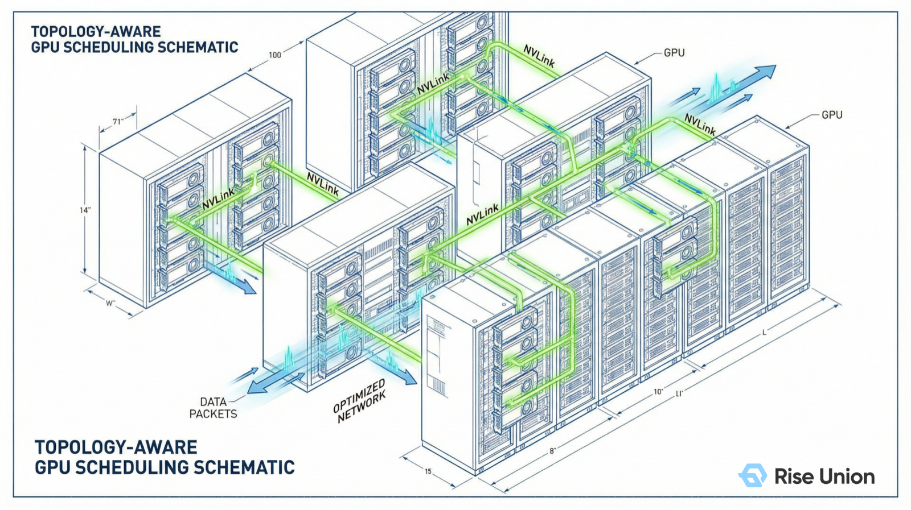
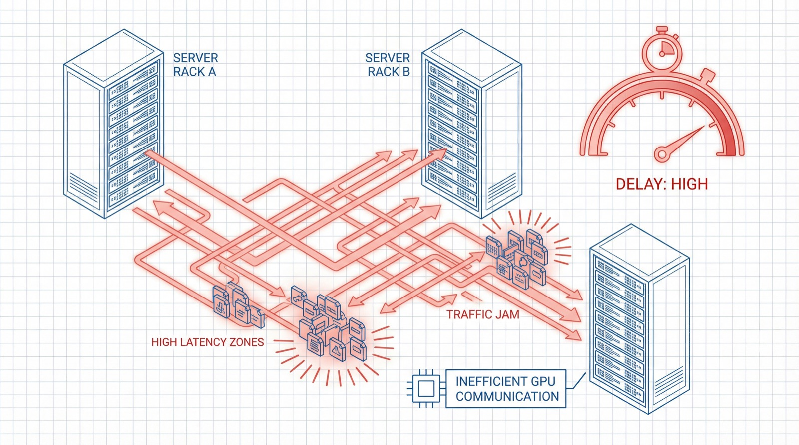
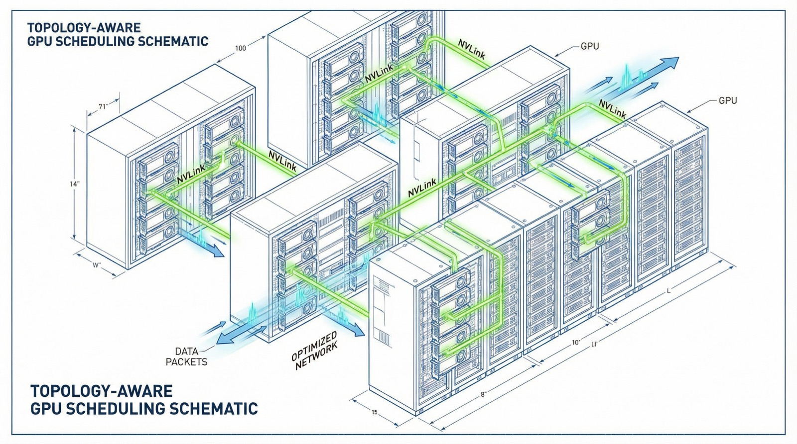
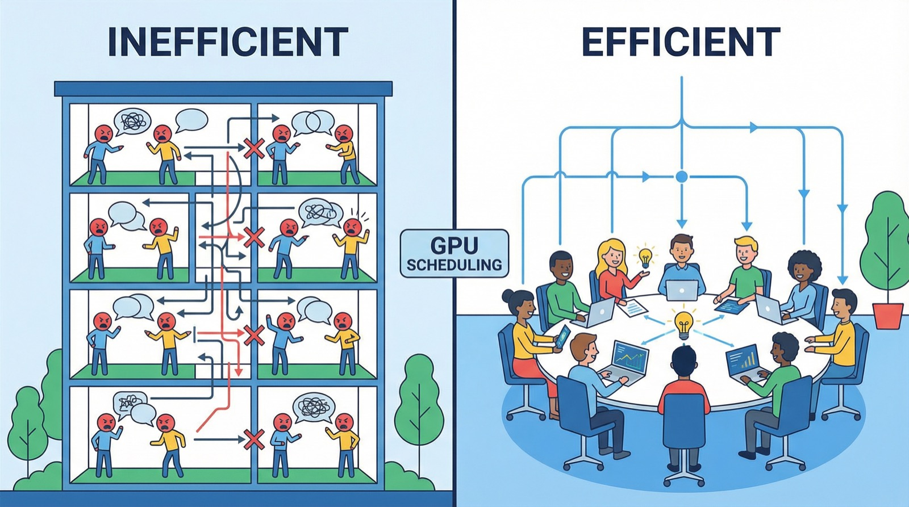

[简体中文](./README.md) · [All articles](../../README.en.md) · [Read on the website](https://www.theriseunion.com/en/blog/brain-02-topology-aware.html)

# Decoding the AI Compute Brain 02 | Eliminating Compute Waste: Why Your Thousand-GPU Cluster Can't Deliver Thousand-GPU Performance

RiseUnion · March 12, 2026 at 18:00 (UTC+08:00)

In distributed large model training, compute utilization is often bottlenecked by underlying physical topology. This article explains how Rise CAMP uses topology-aware scheduling to optimize cross-card communication paths, reduce performance degradation, and ensure every dollar of hardware investment translates into real business output.

In the previous article, we explored how the AI compute scheduling brain safeguards business continuity through priority management. However, in large-scale distributed training scenarios, even after resources have been successfully allocated, clusters may still face another serious challenge: **"compute waste"** — internal friction that silently erodes performance.

Many organizations invest heavily in building large-scale GPU/NPU clusters, only to discover during execution that:
*   **"Investment doubled, but training efficiency gains fall far short of expectations"**
*   **"Clusters of equal scale show significantly slower model convergence than benchmark data"**

The root cause is often not the compute chips themselves, but the **topological affinity** of the underlying resources. Compute power is being consumed by complex, unoptimized cross-card communication paths.

Today we take a deep dive into the second core strategy of the [Rise CAMP](https://www.theriseunion.com/en/product/camp.html) intelligent scheduling engine: **Topology Aware** scheduling.

---

### 1. The Core Pain Point: Performance Degradation from Cross-Card Communication

In large-scale distributed training (e.g., hundred-billion-parameter models), compute tasks are executed collaboratively across multiple GPUs. After each computation round, all nodes and cards must perform high-frequency parameter synchronization (such as All-Reduce).

**Communication efficiency has become the critical bottleneck determining overall cluster performance.**

Traditional schedulers focus solely on resource "availability (quantity)." This coarse-grained scheduling approach frequently fails in multi-GPU scenarios. The system may randomly dispatch processes of the same training job to different racks, or to cards that are topologically distant within the same node.

This leads to two severe types of performance loss:
1. **Excessive physical path length**: Communication that could have used high-speed interconnect buses (such as NVLink or HCCS) is forced onto slower PCIe buses or even cross-node Ethernet links.
2. **Communication link congestion**: Unoptimized data flow patterns cause severe link contention, leaving compute chips idle in a prolonged state of **"waiting for data"**.

### 2. Rise CAMP's Approach: Deep Physical Topology Awareness for Optimal Communication

The [Rise CAMP](https://www.theriseunion.com/en/product/camp.html) scheduling engine provides **panoramic topology awareness** of the physical infrastructure.

Leveraging the underlying [Rise VAST](https://www.theriseunion.com/en/product/vast.html) virtualization technology, the system continuously scans and generates a complete topology map of intra-node and inter-node physical connections:
*   Precisely identifies NVLink/HCCS/XPU Link and other high-speed interconnect fabrics.
*   Recognizes PCIe Switch hierarchy and grouping.
*   Detects NUMA affinity and node topology boundaries.

When a training job is submitted, [Rise CAMP](https://www.theriseunion.com/en/product/camp.html) automatically computes and assigns the hardware combination with the lowest communication cost using optimal path algorithms.

**Think of it as an expert "resource actuary":**
Through mandatory affinity scheduling policies, it ensures that GPUs with high-frequency intercommunication are precisely locked within the same high-speed interconnect group (e.g., an NVLink Group), enabling near-field high-speed data exchange. This is especially critical for adapting to domestic heterogeneous compute hardware. Domestic chip vendors each have unique interconnect architectures, and Rise CAMP achieves unified awareness and maximum performance extraction across multiple domestic interconnect protocols.

### 3. Architecture Design: Avoiding Performance Loss from Scattered Scheduling

Let's compare how two scheduling strategies affect execution efficiency:

*   **Conventional scheduling**: Task processes are scattered across regions with weak physical connections. Due to the large physical link span, every synchronization operation incurs extremely high latency, and overall cluster progress is limited by the slowest communication path.
*   **Rise CAMP topology-aware scheduling**: The system searches globally and locks onto the most tightly connected resource set in terms of physical topology. By concentrating task processes within high-speed bus coverage areas, data synchronization becomes near-real-time, dramatically boosting overall cluster throughput.

### 4. Business Value: Maximizing the Conversion from Hardware Investment to Compute Output

1.  **Accelerated time-to-production**: Real-world measurements show that enabling topology-aware scheduling reduces distributed training communication latency by over 40%, shortening overall training cycles by **20%–30%**.
2.  **Safeguarding infrastructure ROI**: AI compute center investments are massive, and any performance degradation means wasted assets. Rise CAMP ensures that **every dollar of hardware investment translates into real compute output**.
3.  **Advancing domestic hardware adoption**: By bridging underlying hardware differences through sophisticated software algorithms, domestic clusters can achieve near-theoretical-peak performance on complex generative AI workloads.

---

### Decoding the AI Compute Brain Series

1. [01 | Priority Aware: Why Scheduling Strategy Is the Lifeline of Your GPU Cluster](https://www.theriseunion.com/en/blog/brain-01-priority-aware.html)
2. **[02 | Topology Aware: Why Your Thousand-GPU Cluster Can't Deliver Thousand-GPU Performance](https://www.theriseunion.com/en/blog/brain-02-topology-aware.html)** (this article)
3. [03 | Load Aware: The Binpack vs. Spread "Tetris" Dilemma](https://www.theriseunion.com/en/blog/brain-03-load-aware.html)
4. [04 | Resource Aware: Breaking the "Allocation Rate" Illusion to Achieve Real Utilization](https://www.theriseunion.com/en/blog/brain-04-resource-aware.html)

---

[Read this article on the RiseUnion website](https://www.theriseunion.com/en/blog/brain-02-topology-aware.html) · [Explore more articles](https://www.theriseunion.com/en/blog.html)
