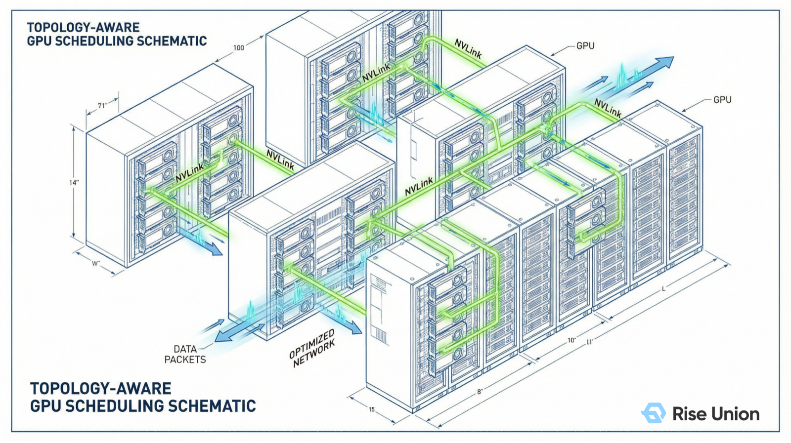
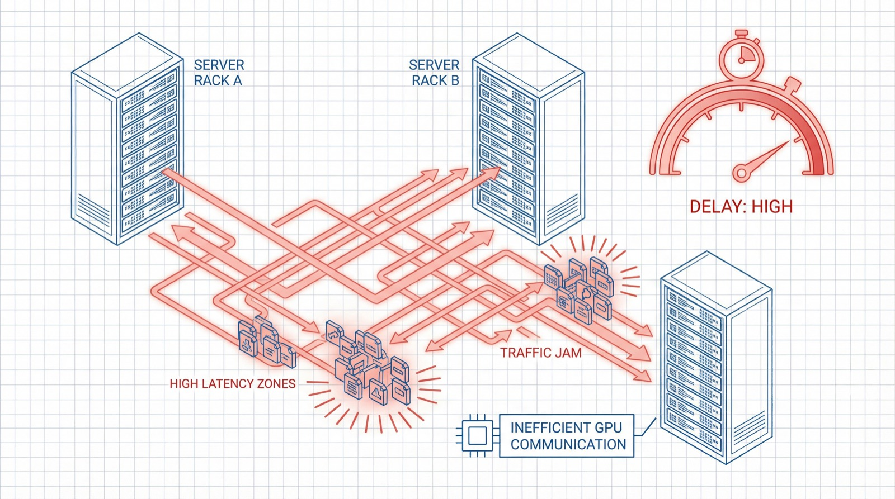
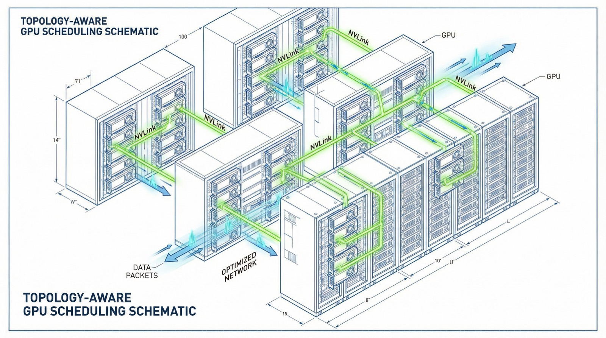
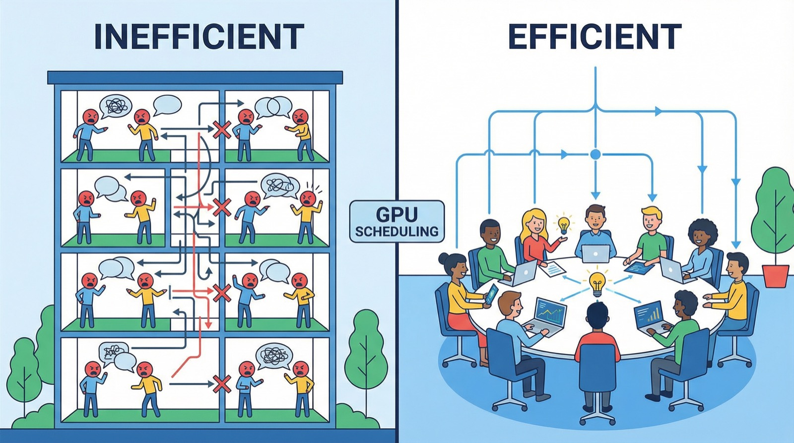

[English](./README.en.md) · [文章目录](../../README.md) · [官网阅读](https://www.theriseunion.com/zh/blog/brain-02-topology-aware.html)

# 智算大脑解密 02 | 拒绝“算力内耗”：为什么你的千卡集群跑不出千卡的速度？

睿思智联 · 2026/03/12 18:00（北京时间）

大模型分布式训练中，算力利用率往往受制于底层物理拓扑。解析 Rise CAMP 如何通过“拓扑感知”技术优化跨卡通信路径，降低性能折损，确保每一分硬件投入都能转化为真实的业务产出。

在上一篇中，我们探讨了智算调度的大脑如何通过优先级管理保障业务连续性。然而，在大规模分布式训练场景下，即使资源已经成功分配，集群仍可能面临另一个严峻挑战：**“算力内耗”**。

许多机构投入巨资构建了规模宏大的 GPU/NPU 集群，但在执行任务时却发现：
*   **“投入翻倍，但训练效率提升远不及预期”**
*   **“同等规模的集群，模型收敛速度显著慢于基准数据”**

问题的核心往往不在于计算芯片本身，而在于底层资源的 **拓扑亲和性**。计算资源正消耗在复杂的、未经过优化的跨卡通信路径上。

今天我们将深入探讨 [Rise CAMP](https://www.theriseunion.com/zh/product/camp.html) 智能调度引擎的第二大核心策略：**拓扑感知 (Topology Aware)**。

---

### 一、 核心痛点：跨卡通信导致的性能折损

在大规模分布式训练（如千亿参数模型）中，计算任务由多个 GPU 协同完成。每轮计算结束后，各节点、各板卡之间必须进行高频的参数同步（如 All-Reduce）。

**通信效率已成为决定集群整体效能的关键“短板”。**

传统调度器往往仅关注资源的“可用性（数量）”，这种粗粒度的调度方式在多卡场景下极易失效。系统可能会将同一个训练任务的进程随机分派到不同机柜，或同一节点内物理拓扑极远的板卡上。

这将导致两类严重损耗：
1. **物理路径过长**：原本可利用高速互联总线（如 NVLink 或 HCCS）直连的通信，被迫转向低速的 PCIe 总线甚至跨节点的以太网链路。
2. **通信链路阻塞**：未经优化的数据流向导致了严重的链路拥塞，使得计算芯片长时间处于“**等待数据接收**”的空转状态。

### 二、 Rise CAMP 的策略：深度感知物理拓扑，实现通信最优

[Rise CAMP](https://www.theriseunion.com/zh/product/camp.html) 调度引擎具备对物理底座的 **全景拓扑感知能力**。

依托底层的 [Rise VAST](https://www.theriseunion.com/zh/product/vast.html) 虚拟化技术，系统可实时扫描并生成计算节点内部及节点间的物理拓扑图谱：
*   精确识别 NVLink/HCCS/XPU Link 等高速互联组网。
*   识别 PCIe Switch 的层级归属。
*   感知 NUMA 亲和性及节点拓扑边界。

在提交训练任务时，[Rise CAMP](https://www.theriseunion.com/zh/product/camp.html) 会基于最优路径算法，自动计算并分配通信代价最小的硬件组合。

**这就像是一个专业的“资源精算师”：**
通过强制性的亲和性调度策略，确保高频互访的 GPU 被精准锁定在同一个高速互联组（如 NVLink Group）内，实现数据的近场高速交换。这对于国产异构算力的适配尤为关键。国产芯片厂商在互联架构上各具特色，Rise CAMP 实现了对多种国产互联协议的统一感知与性能压榨。

### 三、 架构设计：规避“分散调度”带来的效能流失

我们可以对比两种调度策略对项目执行效率的影响：

*   **常规调度策略**：任务进程被分散在物理连接较弱的区域。由于物理链路跨度大，每一次同步操作都伴随着极高的延迟，导致集群整体进度受限于最慢的通信路径。
*   **Rise CAMP 拓扑感知调度**：系统在全局范围内检索并锁定物理拓扑最紧密的资源集合。通过将任务进程集中在高速总线覆盖区域，实现数据同步的实时性，从而极大提升集群的整体吞吐量。

### 四、 商业价值：从资源投入到算力产出的极致转化

1.  **加速业务上线周期**：实测证明，开启拓扑感知调度后，分布式训练的通信延迟可降低 40% 以上，整体训练周期可缩短 **20%-30%**。
2.  **保障基础设施投资收益 (ROI)**：智算中心投资巨大，任何性能折损都意味着资产浪费。Rise CAMP 确保了**每一分硬件投资都能转化为真实的算力产出**。
3.  **稳步推进国产化替代**：通过极致的软件算法弥补底层硬件差异，让国产集群在复杂的生成式 AI 任务下发挥出接近理论极限的效能。

---

### 智算大脑解密系列

1. [01 | 优先级感知：为什么调度策略是算力集群的生命线？](https://www.theriseunion.com/zh/blog/brain-01-priority-aware.html)
2. **[02 | 拓扑感知：为什么你的千卡集群跑不出千卡的速度？](https://www.theriseunion.com/zh/blog/brain-02-topology-aware.html)**（本文）
3. [03 | 负载感知：Binpack 与 Spread 的”俄罗斯方块”博弈](https://www.theriseunion.com/zh/blog/brain-03-load-aware.html)
4. [04 | 资源感知：打破”分配率”幻象，实现利用率跃迁](https://www.theriseunion.com/zh/blog/brain-04-resource-aware.html)

---

[在睿思智联官网阅读本文](https://www.theriseunion.com/zh/blog/brain-02-topology-aware.html) · [浏览更多文章](https://www.theriseunion.com/zh/blog.html)
