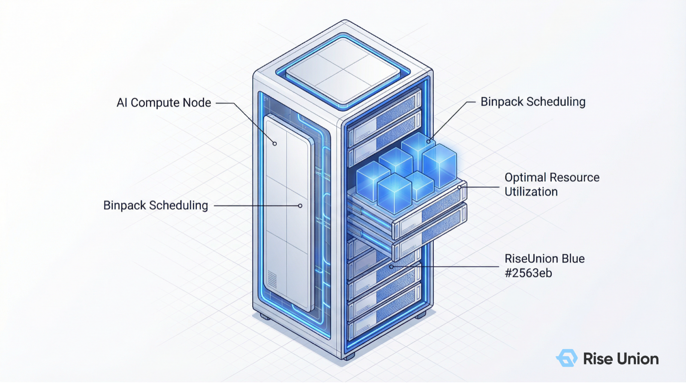
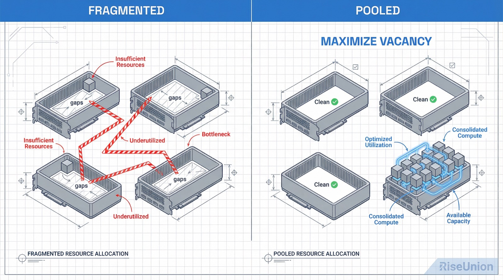
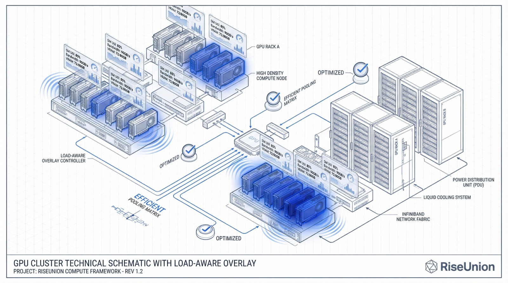

[简体中文](./README.md) · [All articles](../../README.en.md) · [Read on the website](https://www.theriseunion.com/en/blog/brain-03-load-aware.html)

# AI Scheduling Brain 03 | Load-Aware Scheduling: The Tetris Game of Binpack vs. Spread

RiseUnion · March 21, 2026 at 18:00 (UTC+08:00)

In complex environments plagued by GPU memory fragmentation and widely varying model sizes, how can intelligent Binpack and Spread strategies be balanced to maximize both resource utilization and system stability?

When managing large-scale GPU clusters, many architects are puzzled by a seemingly paradoxical situation:

The monitoring dashboard shows overall cluster utilization at just **60%**, suggesting plenty of headroom. Yet when the ML team tries to submit a model fine-tuning job requiring 2 GPUs, the system responds with a cold error: `Insufficient GPU resources`.

"**Why can't I run my job when there are clearly GPUs available?**"

This is the silent killer lurking in AI compute centers — "**compute entropy**." As tasks are randomly requested and released, contiguous physical compute capacity gets fragmented beyond use. Today, we reveal the third core strategy of the [Rise CAMP](https://www.theriseunion.com/en/product/camp.html) intelligent scheduling engine: **Load-Aware Scheduling**.

---

### 1. The Core Problem: The Fragmentation Trap of Expensive GPU Memory

The root cause of poor compute utilization is often not insufficient total capacity, but **fragmentation**.

In the era of large models, workload specifications vary enormously:
*   Some inference requests need only **1/4 of a GPU's** memory for lightweight interactions;
*   Some training jobs require **2 or even 8 full GPUs** for distributed communication.

If the scheduler lacks foresight and assigns resources haphazardly, 4 idle GPUs may end up scattered across 4 different physical nodes. For jobs that require high-speed cross-GPU interconnects, those 4 GPUs are effectively useless. It is like playing Tetris with irregular blocks — the more gaps you leave, the more expensive space goes to waste.

### 2. The Strategy Trade-off: Reserving Capacity vs. Load Balancing

In industry best practices, two diametrically opposed management philosophies address fragmentation. [Rise CAMP](https://www.theriseunion.com/en/product/camp.html) dynamically balances between them based on the business scenario:

#### Binpack (Dense Packing) — Reserving Room for Large Jobs
*   **Core logic**: Prioritize filling GPUs and nodes that are already running tasks; avoid opening "new rooms" whenever possible.
*   **Best-practice rationale**: The essence of Binpack is not about filling things up now — it is about **maximizing vacancy**. By aggressively compacting workloads, you reserve clean, contiguous idle nodes for future large-parameter models.
*   **Ideal scenarios**: Research experiments, algorithm development, environments that demand maximum hardware ROI.

#### Spread (Even Distribution) — Avoiding Performance Hotspots
*   **Core logic**: Distribute tasks evenly across all available resources, keeping the load roughly equal on every GPU and node.
*   **Best-practice rationale**: The core of Spread is **performance isolation**. It effectively prevents power jitter and localized overheating on individual machines, improving overall high availability (HA).
*   **Ideal scenarios**: Production-grade inference APIs, real-time rendering, and latency-sensitive mission-critical workloads.

---

### 3. Rise CAMP's Advanced Approach: Beyond Quotas to Real-Time "Vital Signs"

Conventional schedulers (such as native Kubernetes) can only perceive "static quotas" — how much has been allocated. [Rise CAMP](https://www.theriseunion.com/en/product/camp.html)'s load-aware strategy goes further by seeing the **actual load**.

Powered by the underlying [Rise VAST](https://www.theriseunion.com/en/product/vast.html) virtualization technology, the system collects multi-dimensional data in real time:
*   **Compute intensity**: Actual occupancy of SM (Streaming Multiprocessor) cores.
*   **Data throughput**: Real-time load on the PCIe bus and GPU memory bandwidth.
*   **Physical vitals**: Live chip temperature, fan speed, and power consumption.

**Dynamic scoring mechanism:**
Even if a GPU is nominally "idle," the scheduling engine automatically lowers that node's load score if it detects excessive I/O pressure or high temperatures. This decision-making based on **real-world telemetry** ensures that tasks are always dispatched to genuine **performance sweet spots**, guaranteeing the most predictable execution environment.

---

### 4. Architecture Design: Dual-Level Strategies at Node and GPU Granularity

To enable fine-grained operations, [Rise CAMP](https://www.theriseunion.com/en/product/camp.html) provides a combinatorial strategy at both the node and GPU levels.

| Mode | Node-Level Strategy | GPU-Level Strategy | Ideal Scenario | Core Value |
| :--- | :--- | :--- | :--- | :--- |
| **Full Compact** | Binpack | Binpack | Algorithm dev / PoC experiments | Maximum density; supports more concurrent users |
| **Full Spread** | Spread | Spread | Production inference APIs | Maximum stability; single-node failures do not affect the whole |
| **Hybrid (Default)** | **Binpack** | **Spread** | **Most enterprise mixed workloads** | **Balances defragmentation with per-GPU thermal balance** |

*Note: Rise CAMP defaults to the "node-level Binpack + GPU-level Spread" golden combination — consolidating workloads to free up whole nodes while keeping individual GPUs within each node evenly loaded.*

---

### 5. Business Value: Making Every MiB of GPU Memory Count

With scientific load-aware scheduling, enterprises gain quantifiable "compute dividends":

1.  **Reduced premature hardware procurement**: Real-world measurements show that enabling load-aware scheduling can reduce idle hardware rates in large clusters by approximately **25%**.
2.  **Higher success rates for large model deployments**: Automated "defragmentation" allows very large models to obtain contiguous physical resources more smoothly, without manual intervention.
3.  **Extended hardware lifespan**: By preventing localized "hot GPUs," it effectively lowers hardware failure rates (MTBF) caused by overheating or sustained high stress.

---

### AI Scheduling Brain Series

1. [01 | Priority-Aware: Why Scheduling Strategy Is the Lifeline of a Compute Cluster](https://www.theriseunion.com/en/blog/brain-01-priority-aware.html)
2. [02 | Topology-Aware: Why Your Thousand-GPU Cluster Can't Deliver Thousand-GPU Performance](https://www.theriseunion.com/en/blog/brain-02-topology-aware.html)
3. **[03 | Load-Aware: The Tetris Game of Binpack vs. Spread](https://www.theriseunion.com/en/blog/brain-03-load-aware.html)** (this article)
4. [04 | Resource-Aware: Breaking the "Allocation Rate" Illusion to Achieve a Utilization Leap](https://www.theriseunion.com/en/blog/brain-04-resource-aware.html)

---

[Read this article on the RiseUnion website](https://www.theriseunion.com/en/blog/brain-03-load-aware.html) · [Explore more articles](https://www.theriseunion.com/en/blog.html)
