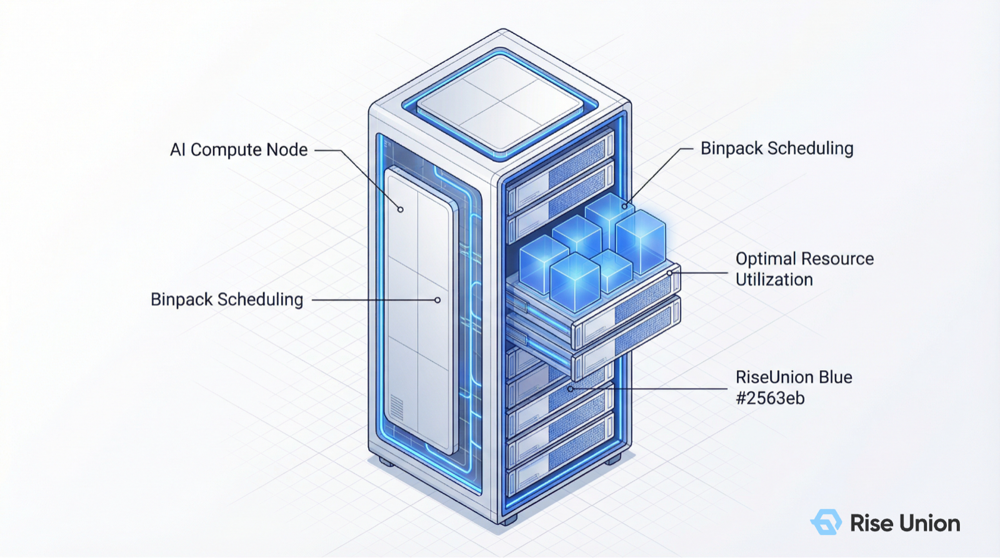
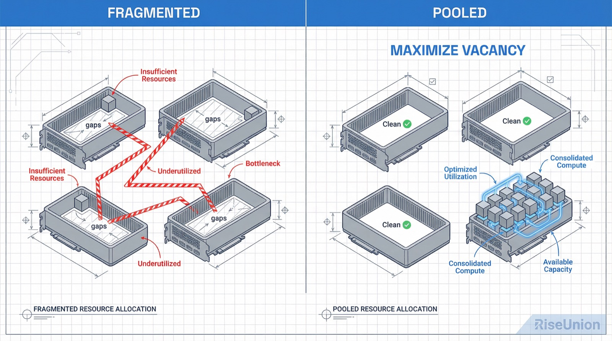
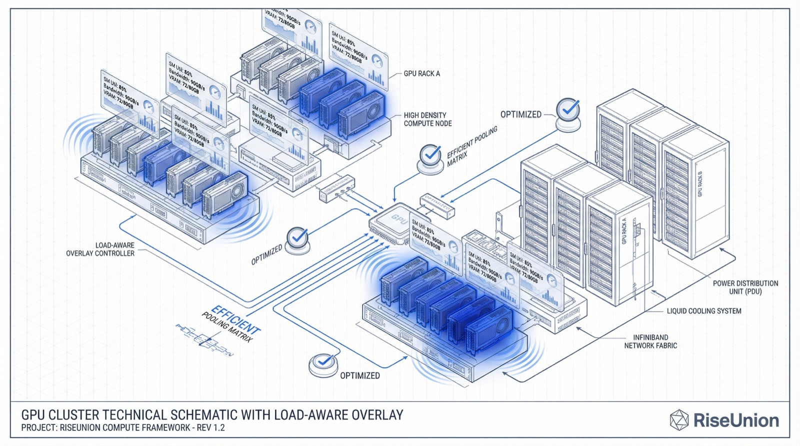

[English](./README.en.md) · [文章目录](../../README.md) · [官网阅读](https://www.theriseunion.com/zh/blog/brain-03-load-aware.html)

# 智算大脑解密 03 | 负载感知调度：Binpack 与 Spread 的“俄罗斯方块”博弈

睿思智联 · 2026/03/21 18:00（北京时间）

在显存碎片化、模型规格参差不齐的复杂环境下，如何通过智能装箱（Binpack）与均匀分布（Spread）策略的博弈，实现资源利用率与系统稳定性的终极平衡。

在管理大规模 GPU 集群时，许多架构师常被一个诡异的现象困扰：

监控面板显示集群整体资源利用率仅为 **60%**，逻辑上还有巨大的余量。但当算法团队尝试提交一个需要 2 张 GPU 的大模型微调任务时，系统却冷冰冰地报错：`Insufficient GPU resources`。

“**为什么明明还有卡，却跑不起来？**”

这就是智算中心面临的隐形杀手 - “**算力熵增**”。随着任务的随机申请与释放，连续的物理算力空间被切割得支离破碎。今天，我们将解密 [Rise CAMP](https://www.theriseunion.com/zh/product/camp.html) 智能调度引擎的第三大核心策略：**负载感知 (Load Aware)**。

---

### 一、 核心痛点：昂贵显存的“碎片化陷阱”

算力资源利用率低下的本质，往往不在于总量不足，而在于**碎片化（Fragmentation）**。

在大模型时代，任务规格高度不一：
*   有的推理请求仅需 **1/4 张卡** 的显存进行轻量交互；
*   有的训练任务必须占用 **2 张甚至 8 张完整卡** 进行分布式通信。

如果调度器缺乏“远见”，采取无序分配，那么 4 张空闲的显存可能会散落在 4 个不同的物理节点上。对于需要跨卡高速互联的任务来说，这 4 张卡形同虚设。这种现象就像在玩一个不规则的俄罗斯方块，空隙越多，昂贵的空间浪费就越严重。

### 二、 策略博弈：预留空间 vs. 负载均衡

在行业最佳实践中，解决碎片化问题通常有两种截然相反的管理哲学。[Rise CAMP](https://www.theriseunion.com/zh/product/camp.html) 能够根据业务场景，在两者之间进行动态博弈：

#### 1. Binpack (紧凑装箱) - 为了未来的大任务
*   **核心逻辑**：优先将任务填满已经在运行的 GPU 和节点，尽量不开启“新房间”。
*   **最佳实践意义**：Binpack 的精髓不在于眼下的填满，而是在于**腾挪空间 (Maximize Vacancy)**。通过极致压缩，为未来的“超大参数模型”预留出干净的、完整的空闲节点（Clean Nodes）。
*   **适用场景**：投研实验、算法开发、极致追求硬件 ROI 的环境。

#### 2. Spread (均匀分布) - 规避性能热点
*   **核心逻辑**：将任务平均分布在所有可用资源上，确保每块卡、每个节点的负载基本一致。
*   **最佳实践意义**： Spread 的核心是**性能隔离 (Performance Isolation)**。它能有效规避单机硬件的功耗抖动（Jitter）和局部过热，提升系统高可用性（HA）。
*   **适用场景**：金融级生产推理、实时渲染、对延迟抖动极度敏感的关键业务。

---

### 三、 Rise CAMP 的进阶：看“配额”更要看“体温”

普通的调度器（如原生 K8s）只能感知“名义配额（Static Quota）”，即：我分给你了多少。但 [Rise CAMP](https://www.theriseunion.com/zh/product/camp.html) 的负载感知策略更进一步，它能看清“**真实负载**”。

依托底层的 [Rise VAST](https://www.theriseunion.com/zh/product/vast.html) 虚拟化技术，系统实时采集多维数据：
*   **计算强度**：SM 流处理器的真实占用率。
*   **数据吞吐**：PCIe 总线与显存带宽的实时负载。
*   **物理体征**：芯片实时温度、风扇转速及功耗。

**动态打分机制：**
即便某张 GPU 在名义上是“空闲”的，但若监测到其所在的节点由于 IO 压力过载或温度过高，调度引擎会自动降低该节点的“负载评分”。这种基于“**体感数据**”的决策，能确保任务永远被派发到真正的“**性能洼地**”，从而获得最确定的执行环境。

---

### 四、 架构设计：节点与显卡级的双维度策略

为了实现精细化运营，[Rise CAMP](https://www.theriseunion.com/zh/product/camp.html) 提供了节点（Node）与显卡（GPU）两个层级的策略组合方案。

| 模式 | 节点级策略 | 显卡级策略 | 适用场景 | 核心价值 |
| :--- | :--- | :--- | :--- | :--- |
| **全紧凑** | Binpack | Binpack | 算法开发/PoC 实验 | 极致压榨，支持更多人同时在线 |
| **全分散** | Spread | Spread | 生产级推理 API | 极致稳定，单机故障不影响全局 |
| **混合(默认)** | **Binpack** | **Spread** | **大多数企业混合业务** | **兼顾碎片整理与显卡热量平衡** |

*注：Rise CAMP 默认采用“节点紧凑 + 显卡分散”的黄金组合，在确保腾挪出完整节点的同时，尽量让同一个节点内的各块显卡负载均衡。*

---

### 五、 商业价值：让每一 MiB 显存都产生效益

通过科学的负载感知调度，企业能获得可量化的“算力红利”：

1.  **减少硬件超前采购**：实测显示，开启负载感知后，大规模集群的硬件闲置率可平均降低 **25%** 左右。
2.  **提升大模型上线成功率**：通过自动化的“碎片整理”，超大参数模型可以更顺畅地获取连续物理资源，无需人工介入干预。
3.  **延长硬件生命周期**：避免产生局部“高热卡”，有效降低了硬件因过热或长期高压导致的故障率（MTBF）。

---

### 智算大脑解密系列

1. [01 | 优先级感知：为什么调度策略是算力集群的生命线？](https://www.theriseunion.com/zh/blog/brain-01-priority-aware.html)
2. [02 | 拓扑感知：为什么你的千卡集群跑不出千卡的速度？](https://www.theriseunion.com/zh/blog/brain-02-topology-aware.html)
3. **[03 | 负载感知：Binpack 与 Spread 的”俄罗斯方块”博弈](https://www.theriseunion.com/zh/blog/brain-03-load-aware.html)**（本文）
4. [04 | 资源感知：打破”分配率”幻象，实现利用率跃迁](https://www.theriseunion.com/zh/blog/brain-04-resource-aware.html)

---

[在睿思智联官网阅读本文](https://www.theriseunion.com/zh/blog/brain-03-load-aware.html) · [浏览更多文章](https://www.theriseunion.com/zh/blog.html)
