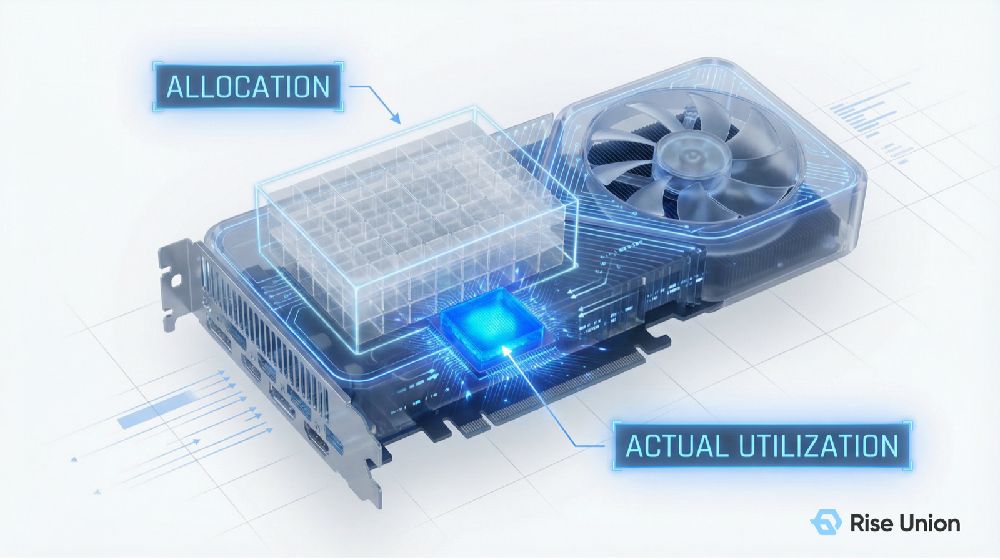
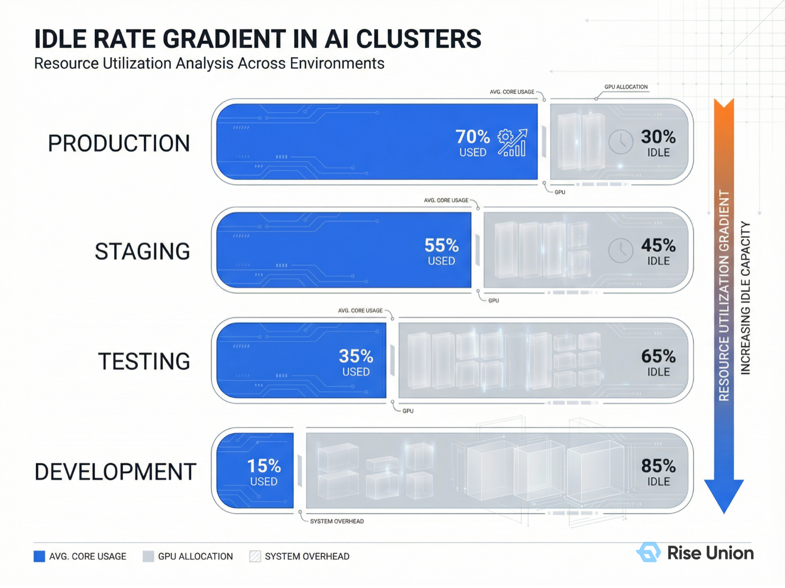
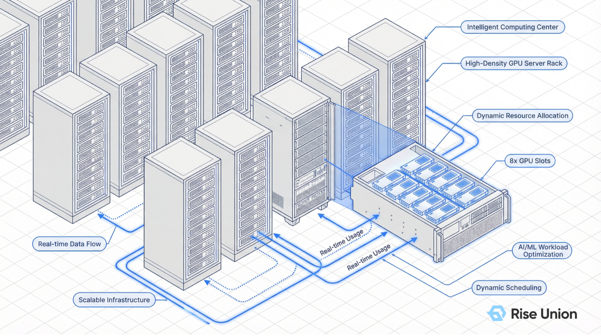

[简体中文](./README.md) · [All articles](../../README.en.md) · [Read on the website](https://www.theriseunion.com/en/blog/brain-04-resource-aware.html)

# AI Scheduling Brain 04 | Resource-Aware Scheduling: Breaking the 'Allocation Rate' Illusion to Achieve a Utilization Leap

RiseUnion · March 31, 2026 at 18:00 (UTC+08:00)

When GPUs are extraordinarily expensive, a 100% allocation rate often masks dismally low actual utilization. Learn how Rise CAMP uses multi-dimensional resource awareness and GPU memory over-subscription to make every unit of compute truly productive.

When managing AI compute centers, many IT leaders are misled by a "prosperity illusion":

The monitoring dashboard shows that GPU cluster "**allocation rate**" has reached 100%. Logically, this should mean the cluster is running at full capacity. But when you pull up the actual underlying load data, you discover that the **real utilization** may not even reach 15%.

"**Every GPU has been claimed, but the machines are mostly idling.**"

This "allocate-and-lock" resource management model is becoming the root cause of soaring AI compute costs and sluggish business responsiveness. Today, we reveal the fourth core strategy of the [Rise CAMP](https://www.theriseunion.com/en/product/camp.html) intelligent scheduling engine: **Resource-Aware Scheduling**.

---

### 1. Core Concept: Distinguishing "Allocation Rate" from "Utilization Rate"

To optimize compute, you must first correct a fundamental misconception. In AI infrastructure, these two metrics mean entirely different things:

- **Allocation Rate**: An ownership metric. It indicates how many GPUs have been locked by "placeholders." In the traditional model, once a task claims 80 GB of GPU memory, that 80 GB is unavailable to anyone else — whether or not the code is actually running.
- **Utilization Rate**: A productivity metric. It measures how actively the chip's Streaming Multiprocessors (SMs) and memory bandwidth are being used per unit of time.

"**A high allocation rate means assets have been 'claimed'; a high utilization rate means assets are 'creating value'.**"

### 2. The "Funnel Effect" of Idle Rates Across Environments

From extensive real-world customer engagements, we have observed a consistent **idle rate gradient**:

1.  **Production environments**: Generous headroom is reserved for SLA guarantees, with idle rates around 30%.
2.  **Staging / test environments**: Workloads are intermittent, and idle rates begin to amplify.
3.  **Development environments (IDE / Notebooks)**: **Idle rates are highest, often exceeding 80%.** While ML engineers are thinking, writing code, or reading documentation, expensive GPUs sit occupied but unused — creating a state of "**false saturation**" across the entire cluster.

### 3. Rise CAMP's Secret Weapon: On-Demand Allocation and GPU Memory Over-Subscription

To combat this "**false saturation**," [Rise CAMP](https://www.theriseunion.com/en/product/camp.html) combines the underlying [Rise VAST](https://www.theriseunion.com/en/product/vast.html) virtualization technology to deliver a **resource-aware scheduling** solution — especially suited for **test and development environments**:

#### On-Demand Allocation

Resources are no longer locked based on what users "claim" they need. The scheduling engine monitors each Pod's actual resource watermark in real time, dynamically adjusting compute supply as workloads fluctuate. When a developer is not running code, physical resources are automatically reclaimed and reassigned to tasks that need them.

Furthermore, resource awareness gives the scheduling engine a "god's-eye view," enabling millisecond-level load rebalancing across racks (inter-rack) and across multiple GPUs within a single node (intra-node).

#### GPU Memory Over-Subscription

This is the killer feature that breaks through the "100% allocation rate" ceiling. Through a kernel-level swap-in/swap-out mechanism, the system allows users to allocate GPU memory beyond physical limits (for example, provisioning 160 GB of quota on an 80 GB card).

- **How it works**: High-speed host memory serves as a secondary cache, swapping out temporarily inactive GPU memory data.
- **Value**: When developing new models or experimenting with new architectures, engineers no longer need to agonize over insufficient GPU memory. It increases the number of development tasks a single server can support by **3-5x**.

---

### 4. Business Value: Making Every MiB of GPU Memory Count

Through resource-aware scheduling, enterprises gain quantifiable "compute dividends":

1.  **Eliminating "false saturation"**: Even at 100% allocation, the system can still accept new tasks through dynamic scheduling, dramatically reducing the "**GPU scramble**" anxiety among R&D teams.
2.  **Reducing premature hardware procurement**: Real-world measurements show that through over-subscription and on-demand allocation, enterprises can support **50% or more** additional ML engineers without increasing hardware budgets.
3.  **An incubator for technical innovation**: It provides excellent fault tolerance for testing new models, ensuring that technical innovation is no longer constrained by expensive physical resources.

---

### 5. Conclusion: Building an "Efficiency Moat" for the AI Era

With this, we have completed our deep dive into the four pillars of the [Rise CAMP](https://www.theriseunion.com/en/product/camp.html) intelligent scheduling engine:

- "**Topology-Aware**": Optimizing cross-GPU communication to eliminate compute waste.
- "**Priority-Aware**": Safeguarding core workloads through tidal co-scheduling.
- "**Load-Aware**": Intelligent bin-packing and balancing to solve fragmentation.
- "**Resource-Aware**": Breaking the allocation illusion to unlock stranded capacity.

As large language models (LLMs) evolve toward multi-modal and long-context capabilities, and as technologies like Kubernetes **Dynamic Resource Allocation (DRA)** continue to mature, resource scheduling is no longer a simple IT tool — it is an enterprise's "**asset accelerator**" in the AI race.

For decision-makers in finance, securities, and government enterprises, the next phase of compute infrastructure competition will not be about "chip count" but about "**operational efficiency**." Leveraging software-defined capabilities to compensate for hardware scarcity and converting every dollar of investment into predictable business growth — this is the challenge that RiseUnion is committed to solving alongside you.

### AI Scheduling Brain Series

1. [01 | Priority-Aware: Why Scheduling Strategy Is the Lifeline of a Compute Cluster](https://www.theriseunion.com/en/blog/brain-01-priority-aware.html)
2. [02 | Topology-Aware: Why Your Thousand-GPU Cluster Can't Deliver Thousand-GPU Performance](https://www.theriseunion.com/en/blog/brain-02-topology-aware.html)
3. [03 | Load-Aware: The Tetris Game of Binpack vs. Spread](https://www.theriseunion.com/en/blog/brain-03-load-aware.html)
4. **[04 | Resource-Aware: Breaking the "Allocation Rate" Illusion to Achieve a Utilization Leap](https://www.theriseunion.com/en/blog/brain-04-resource-aware.html)** (this article)

---

[Read this article on the RiseUnion website](https://www.theriseunion.com/en/blog/brain-04-resource-aware.html) · [Explore more articles](https://www.theriseunion.com/en/blog.html)
