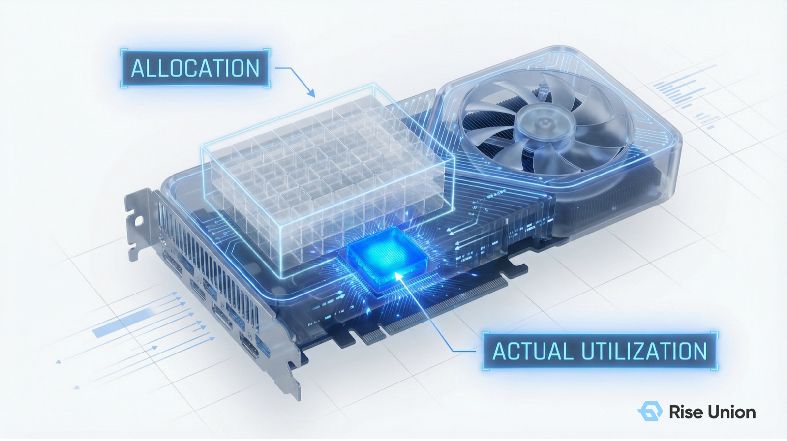
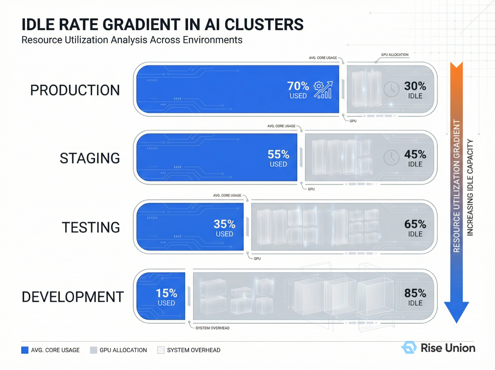
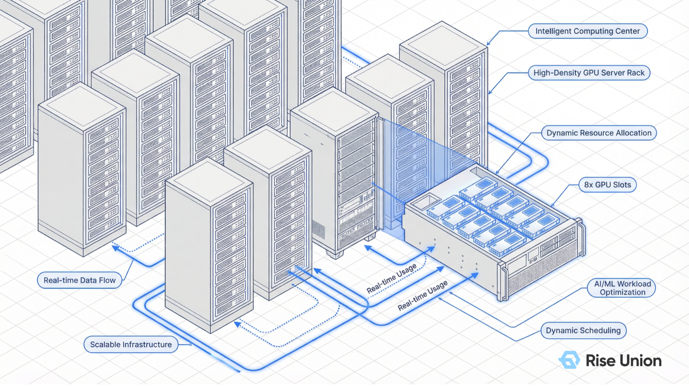

[English](./README.en.md) · [文章目录](../../README.md) · [官网阅读](https://www.theriseunion.com/zh/blog/brain-04-resource-aware.html)

# 智算大脑解密 04 | 资源感知调度：打破“分配率”幻象，实现利用率跃迁

睿思智联 · 2026/03/31 18:00（北京时间）

在 GPU 极其昂贵的今天，100% 的资源分配率往往掩盖了真实利用率低下的事实。解析 Rise CAMP 如何通过多维资源感知与显存超分黑科技，让算力真正“物尽其用”。

在管理智算中心时，许多 IT 负责人常被一个“繁荣假象”所迷惑：

监控大屏显示，GPU 集群的“**资源分配率**”已经达到 100%。逻辑上，这代表算力已经处于满负荷运转状态。但当调取底层真实负载数据时，却发现“**真实使用率**”可能连 15% 都不到。

“**卡全分完了，但机器都在空转。**”

这种“分配即锁死”的资源管理模式，正成为企业 AI 算力成本高企、业务响应缓慢的元凶。今天，我们将解密 [Rise CAMP](https://www.theriseunion.com/zh/product/camp.html) 智能调度引擎的第四大核心策略：**资源感知 (Resource Aware)**。

---

### 一、 核心概念：分清楚“分配率”与“使用率”

要优化算力，必须先打破认知的偏差。在 AI 基础设施中，这两个指标的内涵完全不同：

- **分配率 (Allocation Rate)**：所有权指标。代表有多少卡被“占位符”锁定了。在传统模式下，任务一旦申请了 80G 显存，这 80G 无论跑不跑代码，都无法分给别人。
- **使用率 (Utilization Rate)**：生产力指标。代表芯片内部的流处理器（SM）和显存带宽在单位时间内的真实活跃程度。

“**分配率高，说明资产被‘领走’了；使用率高，才说明资产在‘创造价值’。**”

### 二、 环境闲置率的“漏斗效应”

在过往服务的大量客户真实环境中，我们观察到一个有趣的“**闲置率梯度**”：

1.  **生产环境**：为了 SLA，通常预留较多余量，闲置率约 30%。
2.  **准生产/测试环境**：任务具有间歇性，闲置率开始放大。
3.  **开发环境（IDE/Notebook）**：**闲置率最高，往往超过 80%**。算法工程师在构思、编码、查阅文档时，昂贵的 GPU 被强行占有，导致整个集群呈现“**虚假饱和**”。

### 三、 Rise CAMP 的黑科技：按需分配与显存超分

针对这种“**虚假饱和**”，[Rise CAMP](https://www.theriseunion.com/zh/product/camp.html) 结合底层的 [Rise VAST](https://www.theriseunion.com/zh/product/vast.html) 虚拟化技术，推出了**资源感知调度**方案，特别适合 **测试与开发环境**：

#### 1. 灵活的按需分配 (On-demand Allocation)

不再根据用户“声称”的需求一次性锁死资源。调度引擎能实时监控 Pod 的真实水位，随业务负载的波动动态调整算力供给。在开发人员不运行代码时，自动收回物理占用，释放给更有需要的任务。

此外，资源感知能力让调度引擎具备了“上帝视角”，能够跨越机柜（Inter-rack）和节点内的多张 GPU（Intra-node）进行毫秒级的负载重平衡。

#### 2. 显存超分技术 (Over-subscription)

这是打破“分配率 100%”天花板的杀手锏。通过内核级的换入换出机制，系统允许用户分配超出物理限制的显存额度（例如在 80G 的卡上分出 160G 的额度）。

- **原理**：利用高速 Host Memory 作为二级缓存，将暂不活跃的显存数据置换出来。
- **价值**：在开发新模型、尝试新技术架构时，工程师无需再为显存不足而苦恼。它让单台服务器能承载的开发任务数量提升了 **3-5 倍**。

---

### 四、 商业价值：让每一 MiB 显存都产生效益

通过资源感知调度，企业能获得可量化的“算力红利”：

1.  **消除“虚假饱和”**：即便分配率 100%，系统仍能通过动态调度接收新任务，极大缓解了研发团队的“**抢卡**”焦虑。
2.  **降低硬件超前采购**：实测显示，通过超分与按需分配，企业可在不增加硬件预算的前提下，支持多出 **50% 以上** 的算法研发人员。
3.  **技术演进的孵化器**：为测试新模型提供了极佳的容错空间，让技术创新不再受限于昂贵的物理资源。

---

### 五、 结语：构建智算时代的“效能护城河”

至此，我们已经深度解密了 [Rise CAMP](https://www.theriseunion.com/zh/product/camp.html) 智能调度引擎的四大支柱：

- “**拓扑感知**”：优化跨卡通信，拒绝算力内耗。
- “**优先级感知**”：保障核心业务，实现潮汐混部。
- “**负载感知**”：智能装箱与平衡，解决碎片化难题。
- “**资源感知**”：打破分配幻象，释放极致闲置。

随着大语言模型（LLM）向多模态与长上下文演进，以及 Kubernetes **动态资源分配 (DRA)** 等技术的持续迭代，资源调度已不再是简单的 IT 工具，而是企业在 AI 竞赛中的“**资产加速器**”。

对于金融、证券及政企客户的决策者而言，算力基建的竞争下半场将不再是“芯片数量”的较量，而是“**运营效率**”的对决。如何利用软件定义的能力，弥补硬件资产的稀缺性，将每一分投资转化为确定性的业务增长，正是睿思智联与您共同探索的命题。

### 智算大脑解密系列

1. [01 | 优先级感知：为什么调度策略是算力集群的生命线？](https://www.theriseunion.com/zh/blog/brain-01-priority-aware.html)
2. [02 | 拓扑感知：为什么你的千卡集群跑不出千卡的速度？](https://www.theriseunion.com/zh/blog/brain-02-topology-aware.html)
3. [03 | 负载感知：Binpack 与 Spread 的"俄罗斯方块"博弈](https://www.theriseunion.com/zh/blog/brain-03-load-aware.html)
4. **[04 | 资源感知：打破"分配率"幻象，实现利用率跃迁](https://www.theriseunion.com/zh/blog/brain-04-resource-aware.html)**（本文）

---

[在睿思智联官网阅读本文](https://www.theriseunion.com/zh/blog/brain-04-resource-aware.html) · [浏览更多文章](https://www.theriseunion.com/zh/blog.html)
