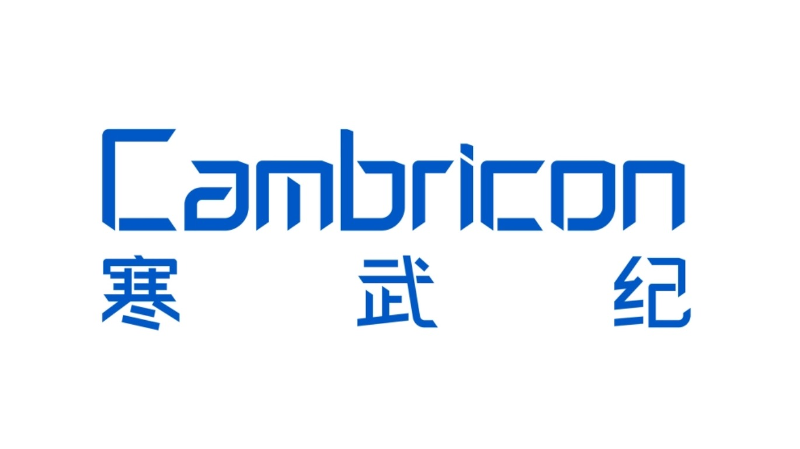
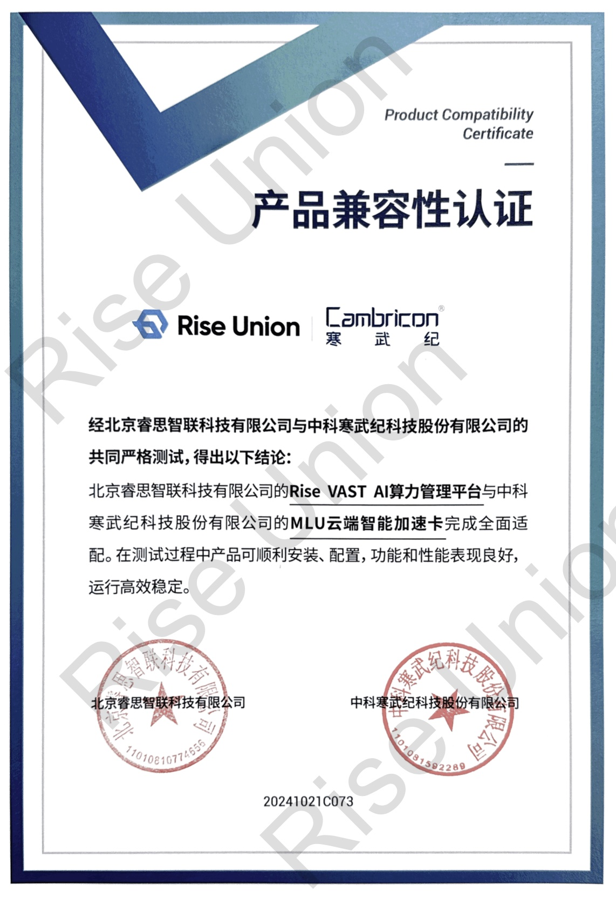

[简体中文](./README.md) · [All articles](../../README.en.md) · [Read on the website](https://www.theriseunion.com/en/blog/cambricon-compatibility.html)

# Rise VAST Completes Compatibility Certification with Cambricon MLU

RiseUnion · January 01, 2025 at 08:00 (UTC+08:00)

RiseUnion's Rise VAST platform achieves compatibility certification with Cambricon MLU chips, enabling efficient management of domestic AI chips through resource pooling and intelligent scheduling, reducing computing TCO and accelerating AI deployment.

Summary: RiseUnion's Rise VAST platform has successfully achieved deep compatibility with Cambricon's MLU products, marking a significant breakthrough in domestic AI chip ecosystem. Through Rise VAST's intelligent scheduling, enterprises can more efficiently utilize domestic GPU resources, accelerating AI application deployment.

Recently, **Beijing RiseUnion Technology Co., Ltd.** announced that its Rise VAST AI computing power management platform has successfully completed compatibility certification with **Cambricon** MLU series chips.

This compatibility certification marks another significant breakthrough in the domestic AI computing field between RiseUnion and Cambricon, providing enterprise users with more efficient, flexible, and intelligent computing power management and scheduling solutions.

## Strong Alliance, Creating New Engine for Intelligent Computing

### About RiseUnion

As an integrated heterogeneous computing resource pooling and scheduling management platform, Rise VAST provides unified resource management and allocation capabilities for multi-brand, multi-architecture domestic AI acceleration hardware. Through deep adaptation with Cambricon's MLU series, both parties have jointly optimized the pooling, allocation, and scheduling efficiency of computing resources, helping enterprises better unleash computing potential and reduce TCO (Total Cost of Ownership).

### About Cambricon

Cambricon's MLU series AI acceleration chips are widely used in deep learning training and inference tasks due to their high performance and energy efficiency. They fully support mainstream AI frameworks, adapt to various AI scenarios such as NLP and CV, and the compatibility certification with Rise VAST further enhances customers' resource scheduling flexibility in complex computing scenarios.

## Empowering Industries, Accelerating AI Innovation Implementation

Through this compatibility certification, RiseUnion's Rise VAST platform, powered by Cambricon hardware, will bring the following core features and advantages to customers:

### Resource Pooling and Unified Management
- Achieve centralized pooling and unified scheduling management of data center-level GPU computing resources, including heterogeneous support for both domestic and non-domestic accelerator cards
- Compatible with multiple types of computing resources, breaking single-vendor limitations and supporting more flexible hardware deployment strategies

### On-demand Resource Scheduling
- Provide flexible resource scheduling capabilities, dynamically allocating GPU computing power based on task requirements
- Equipped with multi-dimensional task management and quota management mechanisms, supporting task priority allocation and flexible computing resource allocation

### Simplified Operations Management
- Support intelligent operations management, including device status monitoring, log management, alerting, and other functions to ensure continuous efficient system operation
- Provide standardized, visualized management interface to optimize operational efficiency

### Building Domestic AI Ecosystem Together
- Both parties will jointly explore broader application scenarios, promoting the continuous prosperity of the domestic AI computing ecosystem
- Empower industry innovation and contribute more value to the digital transformation of Chinese enterprises

In the future, RiseUnion and Cambricon will strengthen joint innovation efforts, explore broader application scenarios together, promote the continuous prosperity of the domestic AI computing ecosystem, and contribute more value to the digital transformation of Chinese enterprises. 

Additionally, RiseUnion has also engaged in deep collaborations with numerous leading Chinese AI chip manufacturers, such as [Iluvatar CoreX](https://www.theriseunion.com/en/blog/iluvatar-compatibility.html) and [Hygon DCU](https://www.theriseunion.com/en/blog/dcu-compatibility.html), to jointly build an AI computing ecosystem, providing users with richer and more stable computing resources.

---

[Read this article on the RiseUnion website](https://www.theriseunion.com/en/blog/cambricon-compatibility.html) · [Explore more articles](https://www.theriseunion.com/en/blog.html)
