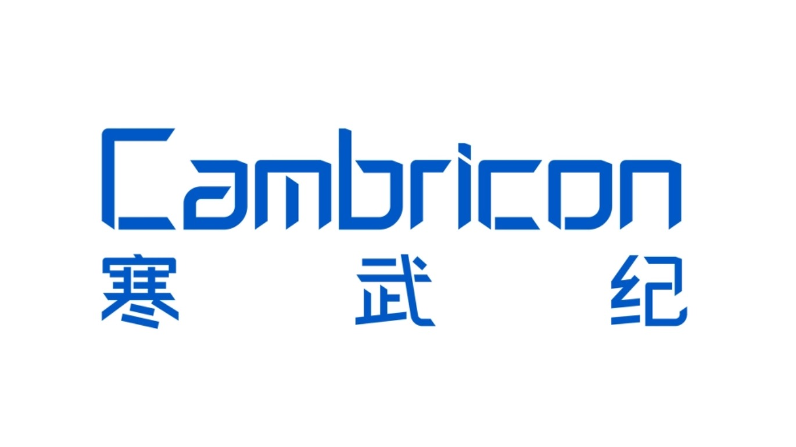
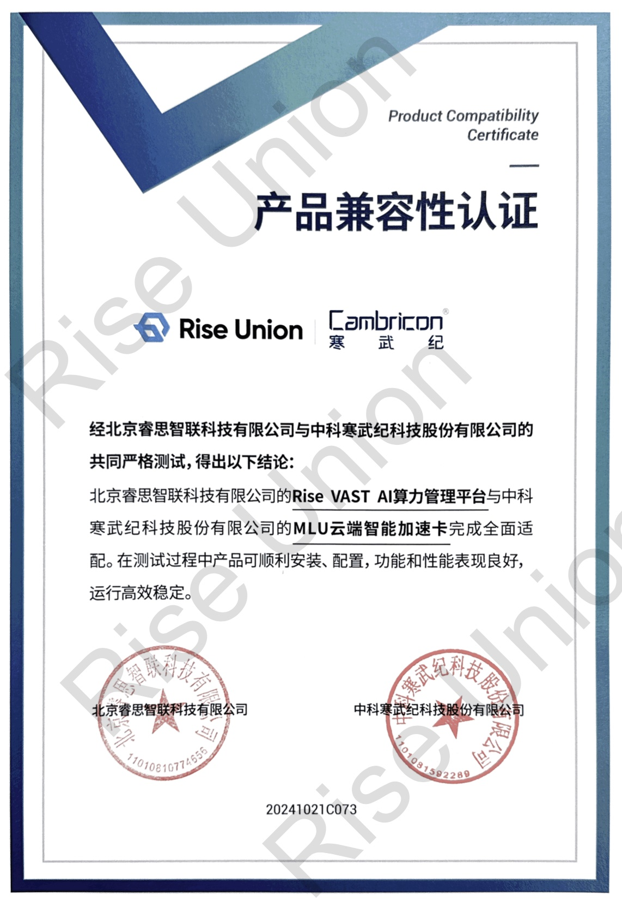

[English](./README.en.md) · [文章目录](../../README.md) · [官网阅读](https://www.theriseunion.com/zh/blog/cambricon-compatibility.html)

# 重磅：睿思智联 Rise VAST 完成寒武纪 MLU 系列芯片兼容性认证

睿思智联 · 2025/01/01 08:00（北京时间）

睿思智联Rise VAST平台成功完成与寒武纪MLU系列芯片的兼容性认证，通过资源池化与智能调度，实现国产AI芯片的高效管理，助力企业降低算力TCO，加速AI应用落地。

摘要：睿思智联 Rise VAST 平台成功实现与寒武纪 MLU 产品的深度适配，标志着国产 AI 芯片生态的重要突破。通过 Rise VAST 的智能调度，企业可以更高效地使用国产 GPU 资源，加速 AI 应用落地。

近日，**北京睿思智联科技有限公司**宣布其 Rise VAST AI 算力管理平台已成功完成与**寒武纪（Cambricon）** MLU 系列芯片的兼容性认证。

此次适配认证标志着睿思智联与寒武纪在国产 AI 算力领域实现了又一重要突破，为企业用户提供了更高效、灵活、智能的算力管理与调度解决方案。

## 强强联合，打造智能算力新引擎

### 关于睿思智联

Rise VAST 作为一体化异构计算资源池化与调度管理平台，针对多品牌、多架构的国产 AI 加速硬件，提供统一的资源管理与分配能力。通过与寒武纪 MLU 系列的深度适配，双方共同优化了算力资源的池化、分配与调度效率，帮助企业更好地释放算力潜能、降低 TCO（总拥有成本）。

### 关于寒武纪

寒武纪 MLU 系列 AI 加速芯片因其高性能、高能效比的特点，被广泛应用于深度学习训练与推理任务。其全面支持主流 AI 框架，适配 NLP、CV 等多种 AI 场景，与 Rise VAST 的兼容性认证进一步提高了客户在复杂计算场景中的资源调度灵活性。

## 助力千行百业，加速AI创新落地

通过本次适配认证，睿思智联 Rise VAST 平台在寒武纪硬件加持下，将为客户带来以下核心功能与优势：

### 资源池化与统一管理
- 实现数据中心级 GPU 算力资源的集中池化和统一调度管理，包括国产与非国产加速卡的异构支持
- 兼容多类型算力资源，打破单一厂商的限制，支持更灵活的硬件部署策略

### 按需资源调度
- 提供灵活的资源调度能力，根据任务需求动态分配GPU算力
- 配备多维度的任务管理与配额管理机制，支持任务优先级分配与灵活的算力资源分配

### 简化运维管理
- 支持智能化的运维管理，包括设备状态监控、日志管理、告警等功能，确保系统的持续高效运行
- 提供标准化、可视化的管理界面，优化运维效率

### 共建国产 AI 生态
- 双方将共同探索更广泛的应用场景，推动国产 AI 算力生态的持续繁荣
- 赋能行业创新，为中国企业的数字化转型贡献更多价值

未来，睿思智联与寒武纪将加强联合创新力度，共同探索更广泛的应用场景，推动国产 AI 算力生态的持续繁荣，为中国企业的数字化转型贡献更多价值。 

此外，睿思智联还陆续与 [沐曦](https://www.theriseunion.com/zh/blog/metax-compatibility.html)、[海光DCU](https://www.theriseunion.com/zh/blog/dcu-compatibility.html)、[天数智芯](https://www.theriseunion.com/zh/blog/iluvatar-compatibility.html) 、[摩尔线程](https://www.theriseunion.com/zh/blog/mthreads-compatibility.html)、[昆仑芯](https://www.theriseunion.com/zh/blog/kunlunxin-compatibility.html)等众多中国主流AI芯片厂商展开了深度合作，共同打造AI算力生态，为用户提供更丰富、更稳定的算力资源。

---

[在睿思智联官网阅读本文](https://www.theriseunion.com/zh/blog/cambricon-compatibility.html) · [浏览更多文章](https://www.theriseunion.com/zh/blog.html)
