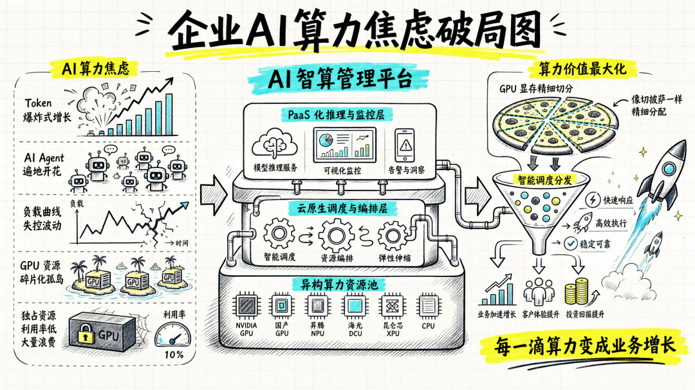

[简体中文](./README.md) · [All articles](../../README.en.md) · [Read on the website](https://www.theriseunion.com/en/blog/compute-token-dual-engine-growth.html)

# In the Token Boom Era, RiseUnion Turns Every Drop of Computing Power into Business Growth

RiseUnion · May 11, 2026 at 09:43 (UTC+08:00) · [Original WeChat article (Chinese)](https://mp.weixin.qq.com/s/tgkPqimFBGwKms94IsP0sQ)

As large-model applications move rapidly into enterprise operations, more teams are finding that the real constraint on AI adoption is often not model capability, but uncontrolled management of underlying AI assets.

As large-model applications move rapidly into enterprise operations, more teams are finding that the real constraint on AI adoption is often not model capability, but uncontrolled **management of underlying AI assets**.

Enterprises now face a song of ice and fire in the “Software 3.0” era: as AI Agents move from isolated question answering toward automated collaboration among multiple roles, China’s daily Token call volume has surpassed 140 trillion, quadrupling in just a few months. At the same time, enterprise AI scenarios are becoming increasingly diverse, Token demand is rising sharply, and AI Agents have become an essential productivity tool for employees at leading enterprises. Enterprise computing infrastructure has long construction cycles and struggles to meet growing demand. Meanwhile, resources are expensive, clusters are dispersed, and domestic accelerator cards from different vendors create “computing islands,” leaving actual utilization in need of improvement.

Some enterprises have sought their own solutions, introducing external Token services to supplement enterprise computing resources. Yet this creates other management challenges: API keys for model access are scattered across departments (team usage becomes a black box); frequent calls instantly burn through budgets (a cost black hole); and confidential data is placed into Prompts that call external cloud models (compliance and data-leakage risks).

Computing resources may appear abundant, but AI assets that are truly “secure and compliant, measurable, and easy to schedule” remain insufficient. This is the new problem that **RiseUnion** is committed to solving for enterprises.

## Breaking Through: From a “Powerful Single-Core Engine” to Dual Engines Driven by “Computing + Tokens”

In the face of this crisis, RiseUnion’s technical value is no longer limited to helping enterprises build computing clusters. It is to build a hybrid intelligent platform driven by the dual engines of a “heterogeneous computing foundation + global Token governance.” We forge physical machines and API interfaces scattered across different departments, hardware, and clouds into a unified enterprise-grade, “measurable and controllable” general ledger for AI.

At the global governance layer (Rise Router Token gateway): serving as the enterprise’s “intelligent customs checkpoint and cashier,” the platform breaks the chaotic direct connections between internal enterprise applications and external large-model services. Through a unified OpenAI-compatible endpoint, developers can seamlessly aggregate high-quality overseas models, cost-effective domestic models such as DeepSeek and Qwen, and private-model Tokens provided through Rise ModelX in the enterprise’s local computing center, without changing any code. More importantly, Rise Router gives enterprises extremely powerful refined controls: integrated routing by sensitivity automatically directs confidential data to local physical data centers for inference while non-sensitive data calls external public clouds, strictly defending the compliance boundary; an original GPU + Token dual-track FinOps system assigns expenses directly to departmental cost centers and combines “hard budget caps and anomaly circuit breaking” to completely eliminate the cost black holes created by “shadow AI.”

While making good use of external Token services, RiseUnion is even more proficient at mining the potential of internal enterprise computing resources:

At the intelligent scheduling layer (Rise CAMP orchestration): assigning tasks more “appropriately,” because scheduling is not simply “dealing cards.” The Rise system’s Rise Scheduler considers topology awareness, resource loads, and business priorities together, identifying inter-card connections to reduce network latency. During daytime business peaks, it elastically guarantees time to first token (TTFT) for core inference services; during idle nighttime hours, it automatically launches fine-tuning training, squeezing computing circulation to the limit.

At the foundation and resource layer (Rise VAST compute pooling): making “full use” of every drop of computing power. For computing clusters built by enterprises themselves, RiseUnion provides unified management of heterogeneous computing hardware. Whether NVIDIA or mainstream domestic heterogeneous chips such as Ascend, Alibaba PPU, and Hygon, the platform can abstract them into a standard computing foundation and completely break the binding to a single hardware architecture. Through industrial-grade fine-grained GPU memory partitioning and pooling technology, we not only completely end the waste of “one GPU serving only one large model,” but also use support for overcommitting domestic GPUs to run multiple models on one GPU, thereby supporting multiple types of concurrent tasks at the same time, including online large-model inference and edge small-model tuning.

## Summary: Moving Toward an Era of Intelligent Growth with High ROI

For enterprises, the change RiseUnion brings goes straight to the heart of the issue: computing islands below are connected, while Token disorder above is brought under control. AI application launch cycles for R&D teams shrink from months to weeks, while CFOs and CIOs finally gain a clear and transparent “enterprise AI financial and security ledger.”

Enterprise AI competition has shifted from “who owns more models” to “who can use and govern models more securely, efficiently, and precisely.”

In the future, enterprises will no longer blindly procure hardware but operate AI assets across the entire stack; they will no longer pursue only computing scale, but the economic efficiency of FinOps. By connecting physical computing resources and logical Tokens through a full-stack technical path, RiseUnion is helping enterprises comprehensively break through AI anxiety, ensuring that the flow of every Token, every Agent scheduling decision, and every drop of GPU computing consumed is precisely transformed into clear and visible business growth.

### About RiseUnion

**Beijing RiseUnion Technology Co., Ltd.** is committed to building a new generation of intelligent AI infrastructure management platforms for high-compute application scenarios including artificial intelligence, large models, and scientific research and training. Through core technologies such as heterogeneous GPU resource pooling, computing partitioning and scheduling optimization, multi-model collaborative scheduling, and edge inference support, the company’s core products are widely used by large government and enterprise organizations, leading financial institutions, AI innovators, universities, and research institutes. Guided by the concept of an **“AI Intelligent Computing Collaboration Platform,”** RiseUnion helps build an intelligent, controllable, and efficient computing foundation for the future.

For more detailed information, please visit the official website: **riseunion.ai** or contact: **400-605-2336**.

---

[Read this article on the RiseUnion website](https://www.theriseunion.com/en/blog/compute-token-dual-engine-growth.html) · [Explore more articles](https://www.theriseunion.com/en/blog.html)
