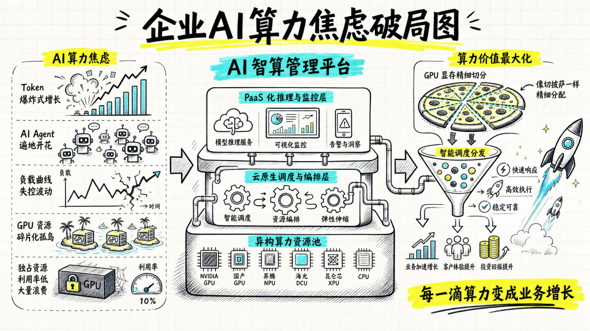

[English](./README.en.md) · [文章目录](../../README.md) · [官网阅读](https://www.theriseunion.com/zh/blog/compute-token-dual-engine-growth.html)

# Token 爆发时代，睿思智联让每一滴算力都变成业务增长

睿思智联 · 2026/05/11 09:43（北京时间） · [微信公众号原文](https://mp.weixin.qq.com/s/tgkPqimFBGwKms94IsP0sQ)

当大模型应用加速进入企业业务现场，越来越多团队开始发现：真正限制AI落地的，往往不是模型本身的能力，而是失控的AI底层资产管理能力。

当大模型应用加速进入企业业务现场，越来越多团队开始发现：真正限制AI落地的，往往不是模型本身的能力，而是失控的**AI底层资产管理能力**。

当前，企业正面临着“软件3.0”时代的冰与火之歌： 随着AI Agent 从单点问答走向多角色自动化协同，中国日均Token调用量已突破 140 万亿，短短几个月内翻了4倍。同样，企业的AI场景日渐丰富，Token的需求量直线上升，AI Agent已成为领先企业员工的必备生产力工具。企业算力建设周期长，难以满足日益增长的需求，同时资源昂贵、集群分散、不同厂商的国产卡形成“算力孤岛”，实际利用率有待提升。

有些企业自己寻找解决方法，引入外部Token服务作为企业算力的补充。但在管理上遇到了另外的挑战：模型访问的API密钥散落各部门（团队用量成黑盒）、高频调用导致预算瞬间烧穿（成本黑洞）、涉密数据拼入Prompt调取外部云端模型（合规与数据外泄风险）。

算力资源看似很多，但真正“安全合规、算得清、好调度”的AI资产却并不充足。这正是**睿思智联**致力于为企业解决的新命题。

## 破局：从“单核强力引擎”到“算力+Token双擎驱动”

面对这场危机，睿思智联的技术价值，不再仅仅是帮企业搭建算力集群，而是为企业构建“异构算力底座+全域Token治理”双擎驱动的混合智能平台。我们把分散在不同部门、不同硬件、不同云端的物理机器和API接口，统一铸造为企业级“可度量、可管控”的 AI 总账本。

在全域治理层（Rise Router Token网关）：做企业的“智能海关与收银台”平台打破了企业内部应用与外部大模型服务之间的混沌直连。通过统一的 OpenAI 兼容入口，开发者无需修改任何代码，即可无缝聚合海外优质模型、国内DeepSeek、Qwen等高性价比模型以及企业在本地算力中心通过Rise ModelX提供的私有模型Token。 更重要的是，Rise Router 赋予了企业极其强大的精细化管控力：按敏感度一体化路由，涉密数据自动分流至本地物理机房推理，非敏感数据调取外部公有云，死守数据合规红线；独创的GPU + Token 双轨FinOps体系，让费用直接归属部门成本中心，配合“预算硬上限与异常熔断”，彻底消灭“影子AI”带来的成本黑洞。

在用好外部Token服务的同时，睿思智联更精通如何挖句掘企业内部的算力资源潜力：

在智能调度层（Rise CAMP 统筹编排）：把任务分得更“对”，调度不是简单的“发牌”。睿思系统的Rise Scheduler能综合拓扑感知、资源负载和业务优先级，识别卡间互联关系以降低网络延迟；在白天业务高峰期，弹性保障核心推理服务的首字响应时间（TTFT），在夜间闲时自动拉起微调训练，实现算力流转的极致压榨。

在底层与资源层（Rise VAST 算力池化）：让每滴算力“物尽其用” ，针对企业自行构建的算力集群，睿思智联提供异构算力硬件的统管能力。无论是 NVIDIA 还是昇腾、阿里PPU、海光等主流国产异构芯片，平台都能将其抽象为标准算力底座，彻底打破单一硬件架构绑定。 通过工业级的显存精细切分与池化技术，我们不但将过去“一张GPU 只服务一个大模型”的浪费现象彻底终结，更借助于对国产GPU超分的支持，实现一张GPU运行多个模型，从而同时支撑在线大模型推理、边缘小模型调参等多类并发任务。

## 总结：迈向高 ROI 的智能化增长时代

对企业而言，睿思智联带来的改变直击核心：向下的算力孤岛被打通，向上的 Token 乱象被收编。研发团队的 AI 应用上线速度从数月缩短至数周，而 CFO 和 CIO 们也终于拥有了一本清晰透明的“企业 AI 财务与安全台账”。

企业AI的竞争，已经从“谁拥有更多模型”转向“谁能更安全、高效、精细化地使用与治理模型”。

未来，企业不再只是盲目采购硬件，而是全栈运营 AI 资产；不再只是追求算力规模，而是追求FinOps经济学效率。睿思智联，正以打通物理算力与逻辑 Token的全栈技术路径，帮助企业全面破局AI焦虑，让每一个Token的流转、每一次Agent的调度、每一滴GPU算力的燃烧，都精准转化为清晰可见的业务增长。

### 关于睿思智联

**北京睿思智联科技有限公司 **致力于构建新一代AI基础设施智能管理平台，服务于人工智能、大模型、科研训练等高算力应用场景。公司核心产品通过异构 GPU 资源池化、算力分片与调度优化、多模型协同调度、边缘推理支持等核心技术，广泛应用于大型政企、头部金融、AI创新企业、高校科研院所等。睿思智联以 **“AI智算协同平台”** 为理念，助力构建智能、可控、高效的未来算力底座。

了解更多详细信息，欢迎访问官网：**riseunion.ai** 或联系：**400-605-2336**。

---

[在睿思智联官网阅读本文](https://www.theriseunion.com/zh/blog/compute-token-dual-engine-growth.html) · [浏览更多文章](https://www.theriseunion.com/zh/blog.html)
