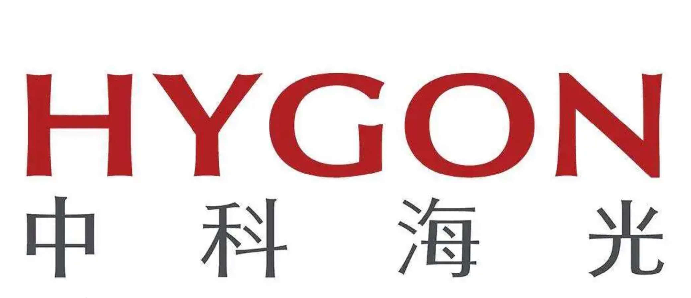
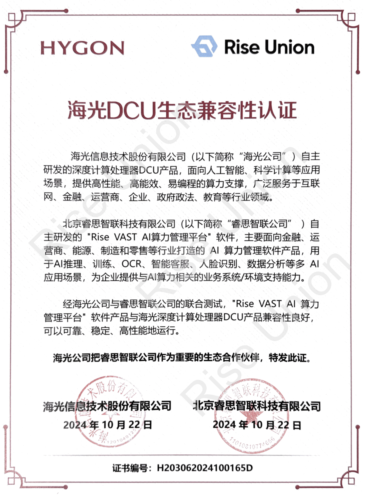
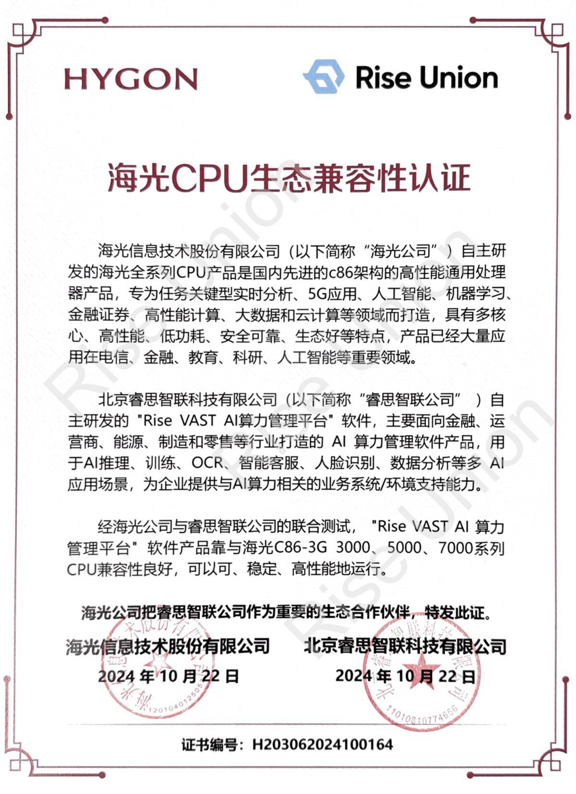

[简体中文](./README.md) · [All articles](../../README.en.md) · [Read on the website](https://www.theriseunion.com/en/blog/dcu-compatibility.html)

# RiseUnion Completes Compatibility Certification with Hygon DCU

RiseUnion · January 01, 2025 at 08:00 (UTC+08:00)

RiseUnion's Rise VAST platform achieves compatibility certification with Hygon DCU accelerators and CPUs, enabling efficient management of domestic heterogeneous computing through resource pooling and intelligent scheduling.

Summary: RiseUnion's Rise VAST platform has successfully completed product compatibility with Hygon DCU, further expanding support for domestic AI accelerator cards. Through Rise VAST's intelligent scheduling and management features, it helps enterprises better utilize domestic AI chips, accelerating the domestic replacement process.

Recently, **Beijing RiseUnion Technology Co., Ltd.** and **Hygon Information Technology Co., Ltd.** announced the completion of compatibility certification, marking that RiseUnion's Rise VAST AI computing power management platform has achieved deep compatibility with Hygon's DCU series accelerator cards and its 3000, 5000, 7000 series CPUs.

This adaptation brings users stable and efficient AI computing power management and scheduling support, injecting new momentum into the domestic AI computing ecosystem.

## Promoting Domestic AI Computing Ecosystem Development

### RiseUnion: Leader in AI Computing Management Platform

RiseUnion is committed to providing integrated AI computing resource pooling and scheduling solutions. Through deep adaptation between the Rise VAST AI computing management platform and Hygon DCU, it provides efficient and flexible computing power management for industries such as finance, telecommunications, and energy. This collaboration optimizes computing power allocation and scheduling efficiency in heterogeneous environments, improves resource utilization, reduces TCO, and further promotes the development of the domestic AI computing ecosystem.

### Hygon: Pioneer in Domestic Information Technology Chips

As a leading domestic information technology enterprise, Hygon Information Technology Co., Ltd. is dedicated to providing efficient computing support for deep learning, data processing, artificial intelligence, and other fields through its independently developed DCU series accelerator cards and 3000, 5000, 7000 series CPUs.

## Empowering Industry AI Innovation, Accelerating Domestic Development

Through this compatibility certification, RiseUnion's Rise VAST platform brings the following core features and advantages:

### Resource Pooling and Unified Management
- Support unified management of multi-brand, multi-type GPU resources, achieving resource pooling and scheduling of domestic and non-domestic accelerator cards
- Flexible combination of multi-brand GPU devices, breaking vendor limitations, providing elastic hardware deployment strategies

### On-demand Scheduling and Intelligent Allocation
- Dynamically allocate GPU resources based on task requirements, supporting efficient execution of large-scale AI tasks
- Provide multi-dimensional task management and resource quota mechanisms, supporting task priority settings and efficient resource allocation

### Simplified Operations Management and System Stability Enhancement
- Automated management of GPU resources, providing device status monitoring, log management, and alerting functions to ensure stable system operation
- Equipped with intuitive management interface, achieving standardized operation processes and improved operational efficiency

### Performance Optimization and Cost Savings
- Support dual over-allocation mechanisms for computing power and memory, improving computing resource utilization through fine-grained computing scheduling and memory optimization, reducing computing waste due to low loads, thereby effectively reducing total cost of ownership (TCO)
- Multi-task parallel processing capability can be dynamically scheduled according to task priorities, further improving the rationality of resource allocation

### Multiple Isolation and Security Assurance
- Provide container-based multi-tenant isolation, ensuring resource security and stability between multiple users and tasks
- Combined with RiseUnion's security compliance mechanism, meeting enterprise requirements for computing security and privacy protection, assisting critical industries in digital transformation

### Support for Full AI Application Development Process
- Rise VAST can cover the entire deep learning process, supporting the full chain of AI applications from model development, training, inference to deployment, helping enterprises accelerate the entire process from AI model R&D to implementation
- Support mainstream deep learning frameworks such as TensorFlow, PyTorch, etc., enabling full-process management including data collection, model training, hyperparameter adjustment, and visualization monitoring

## Future Outlook: Building Domestic AI Computing Ecosystem Together

This compatibility certification marks the close collaboration between RiseUnion and Hygon in the domestic AI computing field and lays a solid foundation for subsequent in-depth cooperation.

Both parties will continue technological integration, work together to promote the development of the domestic AI ecosystem, provide strong support for digital transformation across more industries, and help users achieve higher quality computing power management experience. 

Additionally, RiseUnion has also engaged in deep collaborations with numerous leading Chinese AI chip manufacturers, such as [Iluvatar CoreX](https://www.theriseunion.com/en/blog/iluvatar-compatibility.html) and [Cambricon](https://www.theriseunion.com/en/blog/cambricon-compatibility.html), to jointly build an AI computing ecosystem, providing users with richer and more stable computing resources.

---

[Read this article on the RiseUnion website](https://www.theriseunion.com/en/blog/dcu-compatibility.html) · [Explore more articles](https://www.theriseunion.com/en/blog.html)
