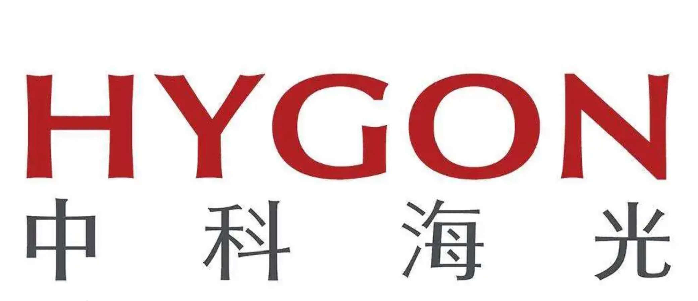
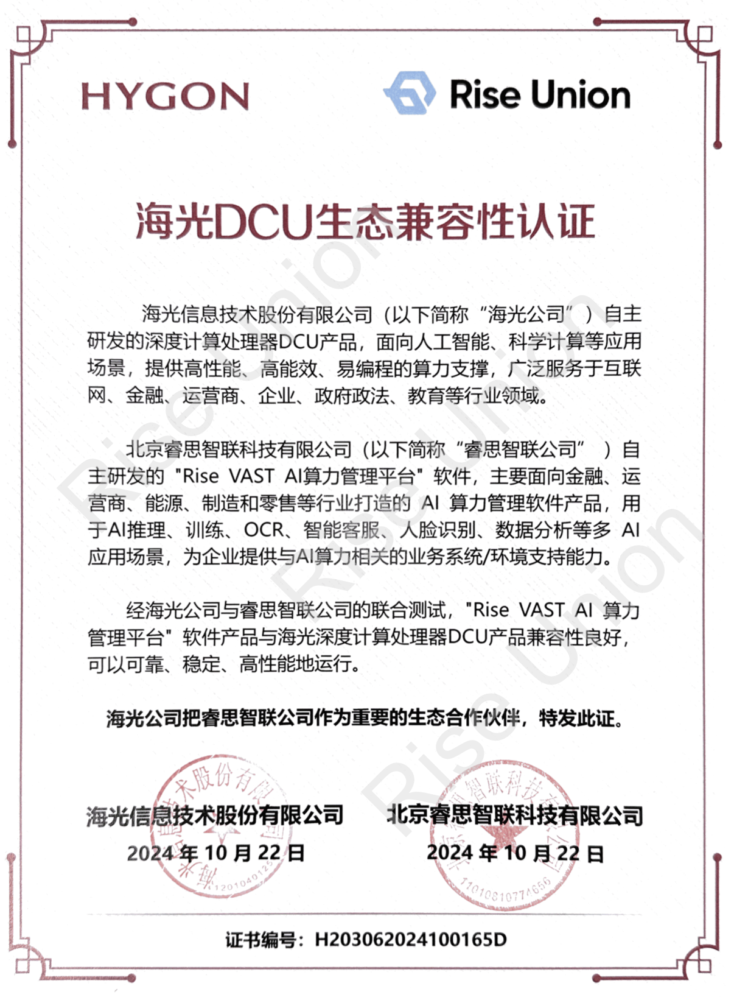
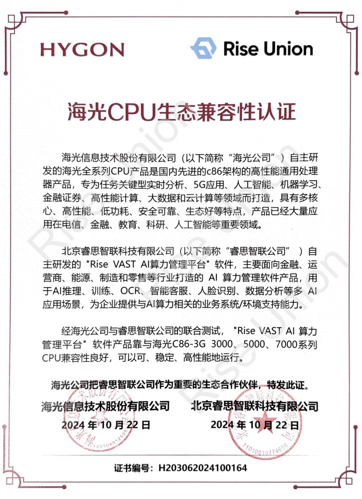

[English](./README.en.md) · [文章目录](../../README.md) · [官网阅读](https://www.theriseunion.com/zh/blog/dcu-compatibility.html)

# 睿思智联与海光DCU完成适配认证

睿思智联 · 2025/01/01 08:00（北京时间）

睿思智联Rise VAST平台成功完成与海光DCU系列加速卡及CPU的兼容性认证，通过资源池化与智能调度，实现国产异构算力的高效管理，助力企业加速国产化进程。

摘要：睿思智联 Rise VAST 平台成功完成与海光 DCU 的产品适配，进一步扩展了对国产 AI 加速卡的支持。通过 Rise VAST 的智能调度和管理功能，帮助企业更好地使用国产 AI 芯片，加速国产化替代进程。

近日，**北京睿思智联科技有限公司**与**海光信息技术股份有限公司**宣布完成适配认证，标志着睿思智联的Rise VAST AI算力管理平台已与海光DCU系列加速卡及其3000、5000、7000系列CPU实现深度兼容。

此次适配为用户带来了稳定、高效的AI算力管理和调度支持，为国产AI算力生态注入了新动能。

## 推动国产AI算力生态构建

### 睿思智联：AI算力管理平台的领导者

睿思智联致力于为客户提供一体化AI算力资源池化和调度解决方案，通过对Rise VAST AI算力管理平台与海光DCU的深度适配，为金融、电信、能源等行业提供高效、灵活的算力管理。此次合作优化了异构环境下的算力分配与调度效率，提升了资源利用率，降低了TCO，进一步推动了国产AI算力生态的发展。

### 海光：国产信息技术芯片的先锋

海光信息技术股份有限公司作为国内领先的信息技术企业，致力于通过自主研发的DCU系列加速卡和3000、5000、7000系列CPU，为深度学习、数据处理、人工智能等领域提供高效算力支持。

## 赋能各行业AI创新，加速国产化进程

通过本次适配认证，睿思智联Rise VAST平台带来了以下核心功能与优势：

### 资源池化与统一管理
- 支持多品牌、多类型GPU资源的统一管理，实现国产和非国产加速卡的资源池化与调度
- 灵活组合多品牌GPU设备，打破厂商限制，提供弹性硬件部署策略

### 按需调度与智能分配
- 根据任务需求动态分配GPU资源，支持大规模AI任务高效执行
- 提供多维度任务管理与资源配额机制，支持任务优先级设置和高效资源分配

### 简化运维管理与系统稳定性提升
- 自动化管理GPU资源，提供设备状态监控、日志管理和告警等功能，确保系统平稳运行
- 配备直观管理界面，实现标准化运维流程，提高运维效率

### 性能优化与成本节约
- 支持算力和显存双重超分配机制，通过细粒度算力调度和内存优化，提升算力资源利用率，减少因低负载而产生的算力浪费，从而有效降低总体拥有成本（TCO）
- 多任务并行处理能力可根据任务优先级进行动态调度，进一步提高资源分配的合理性

### 多重隔离与安全保障
- 提供基于容器技术的多租户隔离，确保多用户、多任务间的资源安全性和稳定性
- 结合睿思智联的安全合规机制，满足企业对算力安全、隐私保护的需求，助力关键行业的数字化转型

### 支持AI全流程应用开发
- Rise VAST可覆盖深度学习全流程，支持从模型开发、训练、推理到部署的全链路AI应用，帮助企业加速AI模型从研发到落地的全过程
- 支持主流深度学习框架如：TensorFlow、PyTorch等，可实现数据采集、模型训练、超参调整和可视化监控等全流程管理

## 展望未来：共建国产AI算力生态

此次适配认证标志着睿思智联与海光在国产AI算力领域的紧密合作，并为后续深入协作奠定了坚实基础。

双方将继续技术融合，携手推动国产AI生态发展，为更多行业的数字化转型提供强大支持，助力用户获得更高质量的算力管理体验。 

此外，睿思智联还陆续与 [寒武纪](https://www.theriseunion.com/zh/blog/cambricon-compatibility.html)、[沐曦](https://www.theriseunion.com/zh/blog/metax-compatibility.html)、[天数智芯](https://www.theriseunion.com/zh/blog/iluvatar-compatibility.html) 、[摩尔线程](https://www.theriseunion.com/zh/blog/mthreads-compatibility.html)、[昆仑芯](https://www.theriseunion.com/zh/blog/kunlunxin-compatibility.html)等众多中国主流AI芯片厂商展开了深度合作，共同打造AI算力生态，为用户提供更丰富、更稳定的算力资源。

---

[在睿思智联官网阅读本文](https://www.theriseunion.com/zh/blog/dcu-compatibility.html) · [浏览更多文章](https://www.theriseunion.com/zh/blog.html)
