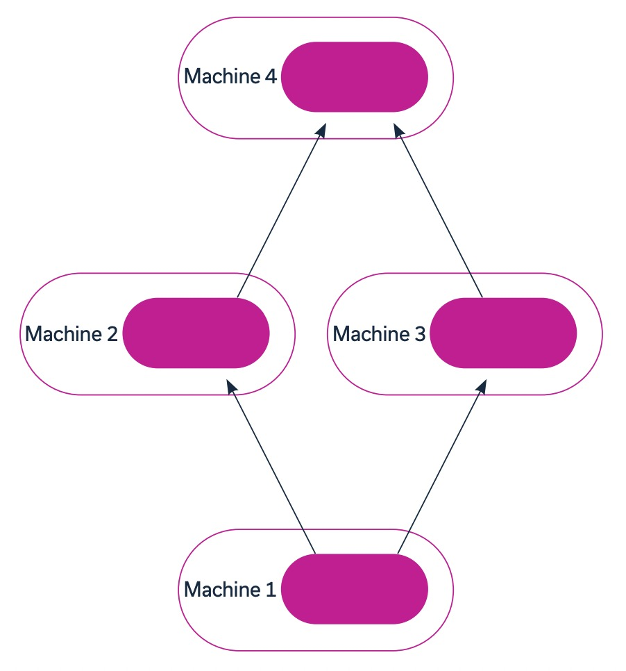
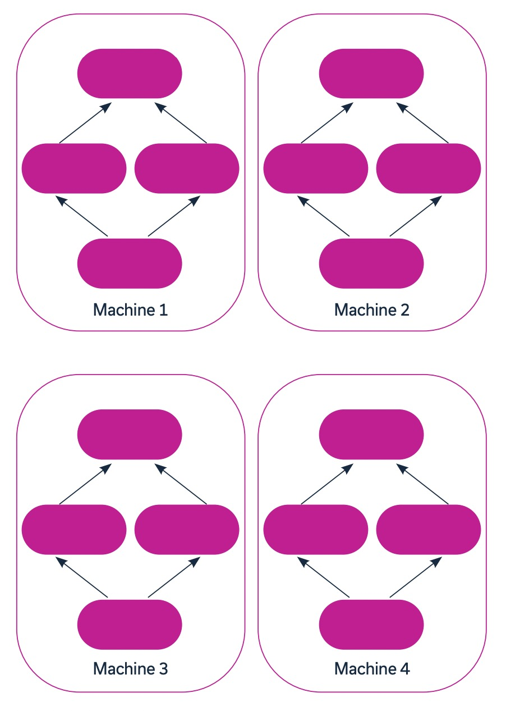
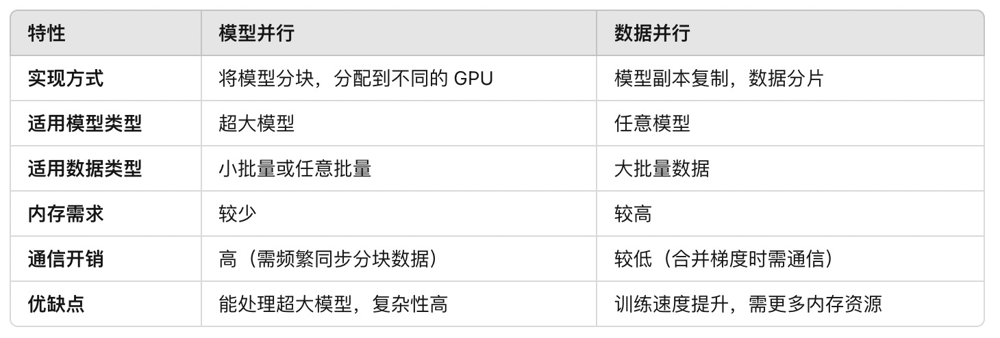

[简体中文](./README.md) · [All articles](../../README.en.md) · [Read on the website](https://www.theriseunion.com/en/blog/deep-learning-with-multiple-gpus.html)

# Multi-GPU Deep Learning Guide: Model & Data Parallelism Explained

RiseUnion · January 01, 2025 at 08:00 (UTC+08:00)

In-depth analysis of multi-GPU deep learning strategies, comparing model and data parallelism, with practical implementations in TensorFlow and PyTorch frameworks for enterprise AI training optimization.

Summary: Explores how to effectively utilize multi-GPU environments for deep learning training. The article shares key techniques including data partitioning strategies, communication optimization, and load balancing, demonstrating how to achieve 10x training performance improvements through practical cases. Combined with industry experience, it provides an in-depth analysis of performance optimization strategies in enterprise AI training scenarios.

## Background
Deep learning is a branch of machine learning that can build accurate prediction models without relying on structured data. This approach extracts and correlates large amounts of data through algorithmic networks that simulate brain neural networks. The more training data input, the higher the model's accuracy.

While sequential processing can be used to train deep learning models, this training method is impractical or even impossible to complete without parallel processing due to the massive amount of data and lengthy processing times.

Parallel processing can handle multiple data objects simultaneously, significantly reducing training time. This parallel processing is typically achieved through Graphics Processing Units (GPUs). GPUs are processors designed specifically for parallel work, offering significant speed advantages over traditional Central Processing Units (CPUs), often achieving speeds over 10 times faster. Typically, multiple GPUs are integrated into systems alongside CPUs. CPUs can handle more complex or general tasks, while GPUs focus on specific and highly repetitive processing tasks.

## Multi-GPU Deep Learning Strategies
After adding multiple GPUs to a system, parallelism needs to be built into the deep learning process. There are two main methods to achieve parallelism: model parallelism and data parallelism.

### 1. Model Parallelism
Model parallelism is used when the model's parameters are too large to fit within memory constraints. With this method, the model's training process is split across multiple GPUs and executed in parallel or series. Model parallelism uses the same dataset for each part of the model and requires data synchronization between partitions.

#### Implementation:
- In model parallelism, the model's structure is decomposed into multiple parts, with different parts assigned to different GPUs.
- For example, certain layers are placed on GPU1 while others are on GPU2. This way, each GPU only needs to store and compute part of the model's parameters, suitable for models with parameters too large for a single GPU's storage capacity.

#### Suitable Scenarios:
- Large Model Training: Suitable for models with very large parameter counts that cannot fit entirely on a single GPU, such as large language models or multi-layer deep networks.
- Resource Constraints: When each GPU has limited memory, model parallelism can distribute memory requirements across multiple GPUs.
- Computation Bottlenecks: For models with complex layer structures, distributing different layers to different devices can optimize computational efficiency.

#### Limitations:
- Communication Overhead: Since different parts of the model need frequent data synchronization, communication between GPUs can create significant overhead, especially when frequent data exchange is required.
- Implementation Complexity: Model splitting may increase implementation difficulty, and uneven loads between different layers can lead to reduced GPU utilization.

### 2. Data Parallelism
Data parallelism is a method of replicating models across multiple GPUs. This method is particularly useful when the batch size is too large to fit on a single machine or when aiming to accelerate the training process. In data parallelism, each model replica trains simultaneously on a subset of the dataset. After completion, the results from each model are merged, and training continues normally.

#### Implementation:
- In data parallelism, each GPU holds a complete copy of the model, with identical weights and structure across all GPUs.
- During training, the dataset is divided into batches and distributed to different GPUs. Each GPU independently computes gradients on its data subset, and finally, the gradients are merged to update the model.

#### Suitable Scenarios:
- Large Batch Data: Suitable for situations with large batch data or when seeking to increase computation speed. Each GPU only needs to process a portion of the data, ideal for tasks requiring large batch data processing.
- Training Acceleration: Data parallelism can increase training speed by processing multiple data subsets simultaneously.
- Resource Abundance: When multiple GPUs are available, data parallelism can evenly distribute data among GPUs, making more efficient use of computing resources.

#### Limitations:
- Memory Requirements: Since each GPU holds a complete copy of the model, data parallelism has high GPU memory requirements. If the model is too large, it may lead to insufficient video memory.
- Synchronization Overhead: Model replica parameters need to be synchronized after training on each GPU, which may create communication overhead, especially in distributed environments.

### 3. Comparative Analysis

### 4. Usage Recommendations
- Model too large for single GPU: Choose model parallelism to distribute the model across multiple GPUs.
- Large data batches, need faster training: Choose data parallelism to split data and fully utilize multi-GPU computing power.
- Ultra-large scale models: Consider combining model and data parallelism for higher training efficiency.

## How Do Common Deep Learning Frameworks Work with Multiple GPUs?
When working with deep learning models, various frameworks are available, including Keras, PyTorch, and TensorFlow. The implementation of multi-GPU systems varies depending on the chosen framework.

### TensorFlow
TensorFlow is an open-source framework created by Google, suitable for various machine learning operations. Its library includes multiple machine learning and deep learning algorithms and models for training. TensorFlow also includes built-in methods for distributed training using GPUs.

Through the API, tf.distribute.Strategy can be used to distribute operations across multiple GPUs, TPUs, or machines. This method supports creating and managing multiple user segments and allows easy switching between distribution strategies.

tf.distribute.Strategy extends two strategies:
- MirroredStrategy and TPUStrategy
- MirroredStrategy: Supports distributing workloads across multiple GPUs

TPUStrategy: Supports distributing workloads across multiple Tensor Processing Units (TPUs). TPUs are specialized units on Google Cloud Platform optimized for TensorFlow training.

The distributed data parallel process for both methods follows these steps:
- Datasets are sharded to ensure data is distributed as evenly as possible across different devices
- Model replicas are created on each GPU, and dataset subsets are assigned to each replica
- Each GPU processes its data subset and computes gradients
- Gradients from all model replicas are collected, averaged, and used to update the original model
- This process repeats until model training is complete

Through this data parallel approach, TensorFlow can effectively utilize multiple GPUs to accelerate model training.

### PyTorch
PyTorch is a Python-based open-source scientific computing framework that can utilize tensor computation and GPUs to train machine learning models. The framework supports distributed training through the `torch.distributed` backend.

In PyTorch, three types of GPU parallelism (or distribution) methods are available:
- Data Parallel: Supports distributing model replicas across multiple GPUs on a single machine to process different subsets of the dataset.
- Distributed Data Parallel: Extends the `DataParallel` class to allow model replicas to be distributed across GPUs on multiple machines. Can be combined with `model_parallel` to achieve both model and data parallelism.
- Model Parallel: Can split large models across multiple GPUs, with each GPU performing partial training. Since operations are executed sequentially, training data needs to be synchronized between GPUs.

## Multi-GPU Model Deployment
When implementing machine learning operations with multiple GPUs, there are three main deployment models. The chosen model depends on where resources are hosted and the operation scale.

### GPU Servers
GPU servers are servers that integrate GPUs with one or more CPUs. When workloads are allocated to these servers, the CPU acts as a central management center for the GPUs, responsible for task allocation and result collection.

### GPU Clusters
GPU clusters consist of computing clusters with nodes containing one or more GPUs. Clusters can be composed of nodes with identical GPUs (homogeneous) or different GPUs (heterogeneous). Data is transferred between nodes in the cluster through interconnects.

### Kubernetes GPU Clusters
Kubernetes is an open-source platform for orchestrating and automating container deployments. The platform supports using GPUs in clusters to accelerate workloads such as deep learning.

When using GPUs in Kubernetes, heterogeneous clusters can be deployed with specified resource requirements, such as memory needs. These clusters can also be monitored to ensure reliable performance and optimize GPU utilization. The multi-GPU parallel training process follows these steps:
- Create multiple model replicas and assign them to different GPUs, then allocate dataset subsets to each replica
- Each GPU processes its assigned data subset and generates corresponding gradients
- Collect gradients from all model replicas, average them, and update the original model
- Repeat the above process until model training is complete

This approach fully utilizes Kubernetes' GPU management capabilities to accelerate model training.

> Reference: Run:ai ["Deep Learning with Multiple GPUs"](https://pages.run.ai/hubfs/PDFs/Deep-Learning-with-Multiple-GPUs.pdf)

---

[Read this article on the RiseUnion website](https://www.theriseunion.com/en/blog/deep-learning-with-multiple-gpus.html) · [Explore more articles](https://www.theriseunion.com/en/blog.html)
