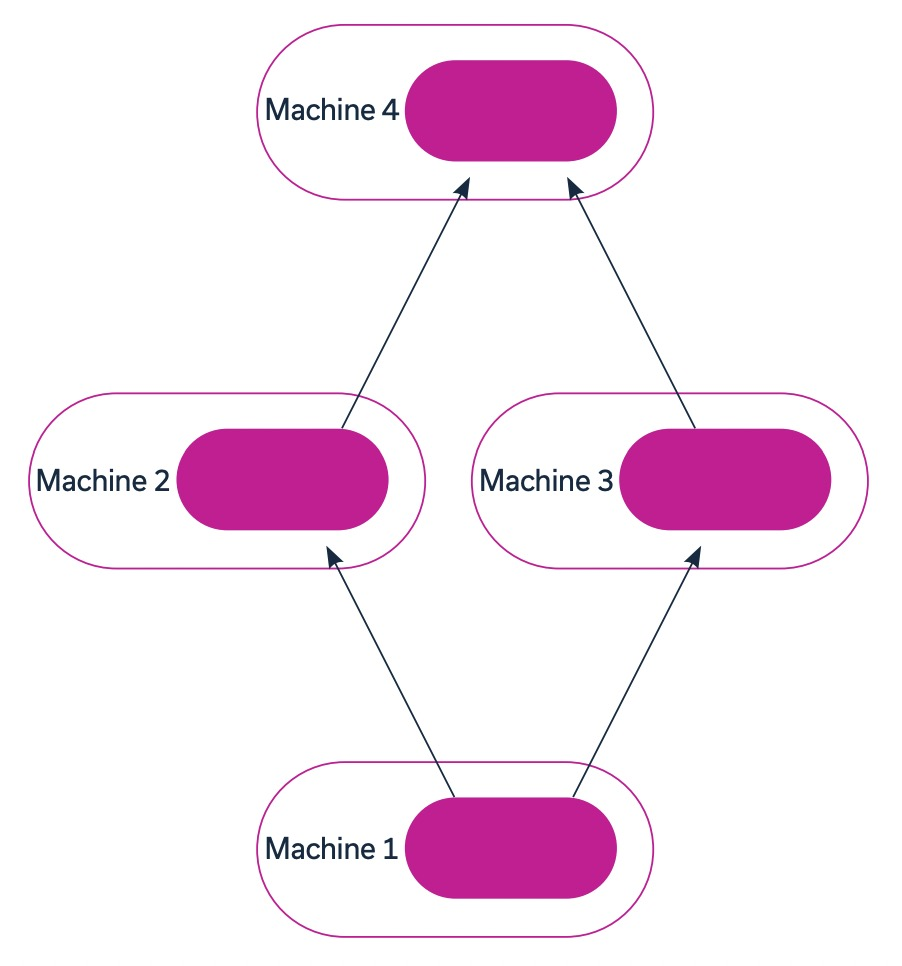
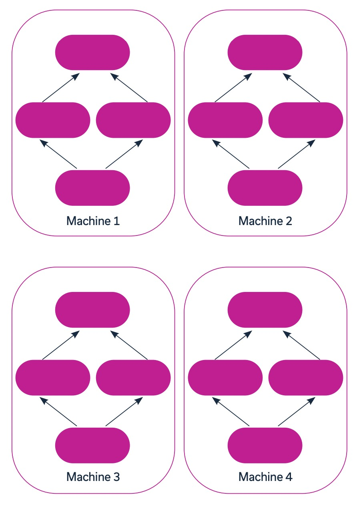
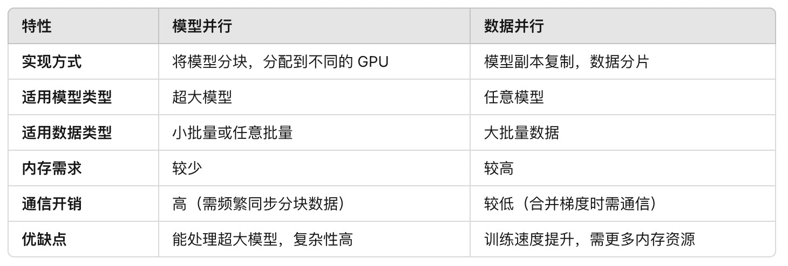

[English](./README.en.md) · [文章目录](../../README.md) · [官网阅读](https://www.theriseunion.com/zh/blog/deep-learning-with-multiple-gpus.html)

# 多GPU深度学习指南：模型并行与数据并行详解

睿思智联 · 2024/11/15 08:00（北京时间）

深入解析多GPU深度学习的关键策略，对比模型并行和数据并行的优劣，结合TensorFlow、PyTorch等主流框架，详细介绍企业级AI训练中的最佳实践和性能优化方案。

摘要：探讨如何充分利用多 GPU 环境进行深度学习训练。文章分享了数据划分策略、通信优化、负载均衡等关键技术，并通过实际案例展示如何将训练性能提升 10 倍。结合睿思智联的实践经验，深入分析企业级 AI 训练场景中的性能优化策略。

## 背景
深度学习是机器学习的一个分支，它无需依赖结构化数据即可构建准确的预测模型。这种方法通过模拟大脑神经网络的算法网络来提取和关联大量数据。输入的训练数据越多，模型的准确性就越高。

虽然可以使用顺序处理的方法来训练深度学习模型，但由于数据量庞大且处理时间较长，如果没有并行处理，这种训练方式实际上不切实际甚至不可能完成。

并行处理可以同时处理多个数据对象，大幅减少训练时间。这种并行处理通常是通过图形处理单元（GPU）来实现的。GPU 是专为并行工作而设计的处理器，与传统的中央处理器（CPU）相比，它们能提供显著的速度优势，通常速度可达 10 倍以上。一般来说，多块 GPU 会和 CPU 一起集成到系统中。CPU 可以处理更复杂或通用的任务，而 GPU 则专注于特定且高度重复的处理任务。

## 多 GPU 深度学习策略
在系统中添加多块 GPU 后，需要在深度学习过程中构建并行性。主要有两种方法来实现并行性：模型并行和数据并行。

### 1. 模型并行
当模型的参数量过大，超出内存限制时，可以采用模型并行的方法。使用此方法时，模型的训练过程会分割到多个 GPU 上，并以并行或串行的方式执行。模型并行对模型的每个部分使用相同的数据集，并需要在各分块之间同步数据。

#### 实现方式：
- 在模型并行中，模型的结构会被分解为多个部分，将不同的部分分配到不同的 GPU 上。
- 例如，某些层会被放在 GPU1 上，而其他层在 GPU2 上。这样，每个 GPU 只需存储和计算模型的部分参数，适合那些参数量大、超出单个 GPU 存储能力的模型。

#### 适用场景：
- 大模型训练：适合参数量非常大、单个 GPU 无法完全容纳的模型，如大型语言模型或多层深度网络。
- 资源限制：当每个 GPU 的内存有限时，模型并行可以将内存需求分散到多个 GPU 上。
- 计算瓶颈：对于某些层次结构复杂的模型，将不同层分配到不同设备上可以优化计算效率。

#### 限制：
- 通信开销：由于模型的不同部分需要频繁同步数据，GPU 之间的通信可能会产生较大开销，尤其是需要频繁交换数据时。
- 实现复杂性：模型的拆分可能会增加实现难度，并且不同层的负载不均衡会导致 GPU 使用率降低。

### 2. 数据并行
数据并行是一种在多个 GPU 上复制模型的方法。当模型使用的批量大小过大，无法放入单台机器，或希望加速训练过程时，该方法非常有用。在数据并行中，每个模型副本会同时在数据集的一个子集上进行训练。完成后，各个模型的结果会合并，训练过程随后继续正常进行。

#### 实现方式：
- 在数据并行中，每个 GPU 都会持有一个完整的模型副本，模型在每个 GPU 上的权重和结构是相同的。
- 训练时，数据集会被分成多个批次，分配到不同的 GPU 上。每个 GPU 在其数据子集上独立计算梯度，最后将梯度合并并更新模型。

#### 适用场景：
- 大批量数据：适合批量数据量较大或希望提高计算速度的情况。每个 GPU 只需处理一部分数据，适合需要大批量数据处理的任务。
- 加速训练：数据并行能够通过同时处理多个数据子集来提高训练速度。
- 资源富足：当多个 GPU 可用时，数据并行能将数据均分给各个 GPU，从而更充分地利用计算资源。

#### 限制：
- 内存需求：由于每个 GPU 都持有完整的模型副本，所以数据并行对 GPU 内存要求较高。如果模型过大，可能会导致显存不足。
- 同步开销：每个 GPU 的模型副本训练结束后需同步参数，尤其在分布式环境下可能会带来一定通信开销。

### 3. 综合对比

### 4. 使用建议
- 模型过大，单 GPU 容纳不下：选择模型并行，将模型分布到多个 GPU 上。
- 数据批量大，想加快训练：选择数据并行，将数据切分，充分利用多 GPU 计算能力。
- 超大规模模型：可尝试将模型并行和数据并行结合，达到更高的训练效率。

## 常见的深度学习框架如何使用多 GPU 工作？
在处理深度学习模型时，可以使用多种框架，包括 Keras、PyTorch 和 TensorFlow。根据所选择的框架，实现多 GPU 系统的方式有所不同。

### TensorFlow
TensorFlow 是由 Google 创建的开源框架，适用于各种机器学习操作。它的库中包含多种机器学习和深度学习算法和模型，可用于训练的基础。TensorFlow 还包含了使用 GPU 进行分布式训练的内置方法。

通过 API 可以使用 tf.distribute.Strategy 方法将操作分布到多个 GPU、TPU 或机器上。该方法支持创建和管理多用户片段，并允许轻松切换分布式策略。

tf.distribute.Strategy 还扩展了两种策略：
- MirroredStrategy 和 TPUStrategy
- MirroredStrategy：支持将工作负载分布到多个 GPU 上

TPUStrategy：支持将工作负载分布到多个 Tensor Processing Units（TPU）上。TPU 是 Google Cloud Platform 上的专用单元，专为 TensorFlow 训练优化。

这两种方法的分布式数据并行流程如下：
- 数据集被分片，确保数据尽可能均匀分配到不同设备
- 在每个 GPU 上创建模型副本，并将数据集的子集分配给每个副本
- 每个 GPU 分别处理其数据子集，并计算生成梯度
- 收集所有模型副本的梯度，取平均值后更新原始模型
- 该过程不断重复，直到模型训练完成

通过这种数据并行方式，TensorFlow 能有效利用多 GPU 来加速模型训练过程。

### PyTorch
PyTorch 是一个基于 Python 的开源科学计算框架，可以利用张量计算和 GPU 来训练机器学习模型。该框架通过 `torch.distributed` 后端支持分布式训练。

在 PyTorch 中，可以使用以下三种 GPU 并行（或分布）方法：
- 数据并行（Data Parallel）：支持将模型副本分配到单台机器上的多个 GPU 上，用这些模型来处理数据集的不同子集。
- 分布式数据并行（Distributed Data Parallel）：扩展了 `DataParallel` 类，允许将模型副本分布到多台机器上的 GPU 上。同时可以与 `model_parallel` 结合使用，实现模型并行和数据并行。
- 模型并行（Model Parallel）：可以将大型模型分割到多个 GPU 上，每个 GPU 只进行部分训练。由于操作是顺序执行的，因此需要在 GPU 之间同步训练数据。

## 多 GPU 部署模型
在使用多 GPU 实施机器学习操作时，有三种主要的部署模型。所选择的模型取决于资源托管的位置和操作规模。

### GPU 服务器
GPU 服务器是集成了 GPU 和一个或多个 CPU 的服务器。当将工作负载分配给这些服务器时，CPU 充当 GPU 的中央管理中心，负责分配任务并收集结果。

### GPU 集群
GPU 集群由包含一个或多个 GPU 的节点组成的计算集群。集群可以由相同 GPU（同质）或不同 GPU（异质）节点构成。集群中的每个节点通过互连传输数据。

### Kubernetes GPU 集群
Kubernetes 是一个开源平台，可用于编排和自动化容器部署。该平台支持在集群中使用 GPU，以实现深度学习等工作负载加速。

在 Kubernetes 中使用 GPU 时，可以部署异构集群并指定资源需求，例如内存需求。还可以对这些集群进行监控，以确保可靠的性能并优化 GPU 的利用率。多 GPU 并行训练的流程如下：
- 创建模型的多个副本并分配到各个 GPU，然后将数据集的子集分配给每个副本
- 每个 GPU 处理其分配的数据子集，并生成相应的梯度
- 收集所有模型副本的梯度，取平均值后更新原始模型
- 重复上述过程，直到模型完全训练完成

通过这种方式，可以充分利用 Kubernetes 提供的 GPU 管理功能来加速模型训练。

> 本文参考: Run:ai ["Deep Learning with Multiple GPUs"](https://pages.run.ai/hubfs/PDFs/Deep-Learning-with-Multiple-GPUs.pdf)

---

[在睿思智联官网阅读本文](https://www.theriseunion.com/zh/blog/deep-learning-with-multiple-gpus.html) · [浏览更多文章](https://www.theriseunion.com/zh/blog.html)
