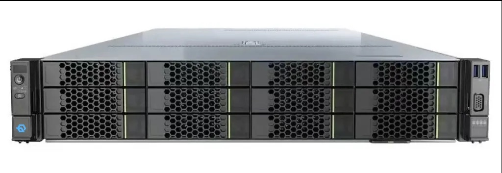
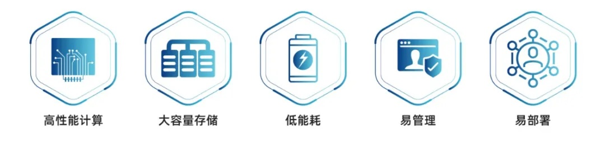
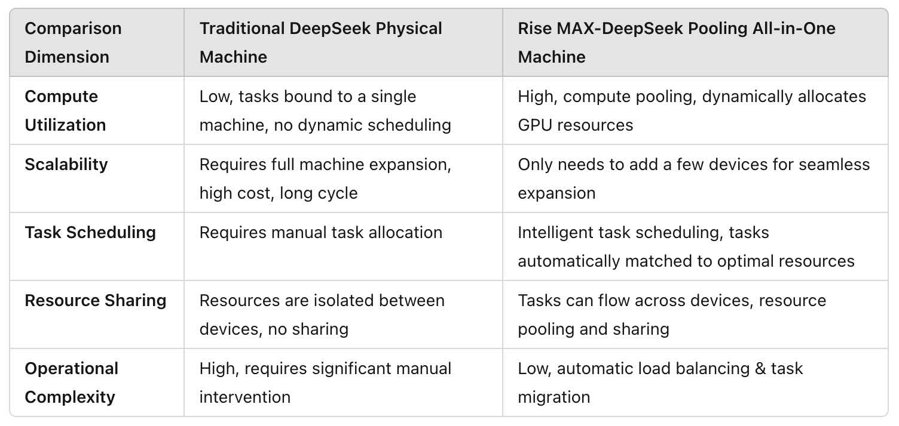

[简体中文](./README.md) · [All articles](../../README.en.md) · [Read on the website](https://www.theriseunion.com/en/blog/deepseek-ai-computing-appliance.html)

# Rise MAX-DS: Revolutionizing AI Computing Appliances

RiseUnion · January 01, 2025 at 08:00 (UTC+08:00)

Explore how Rise MAX-DS pooled computing appliance transforms DeepSeek model deployment through intelligent resource scheduling and pooling. Learn about breakthrough innovations in GPU utilization, scaling efficiency, and resource optimization for enterprise AI infrastructure.

## Background

As [DeepSeek large language models](https://www.theriseunion.com/en/blog/deepseek-r1-vs-v3.html) continue to gain popularity, various manufacturers are launching their own DeepSeek appliances. However, most DeepSeek appliances on the market still use traditional physical machine architectures that simply stack computing power without essential AI capabilities like "intelligent scheduling," "resource pooling," and "elastic scaling," resulting in:

- ❌ Low computational efficiency: Resources are fixed to individual machines, tasks cannot be flexibly scheduled, and GPU resources are largely idle or inefficiently utilized.
- ❌ Limited scalability: When computing power is insufficient, organizations must purchase entire new machines, leading to high expansion costs, long procurement cycles, and inability to seamlessly integrate with existing resource pools.
- ❌ Severe resource fragmentation: Tasks run independently across different devices without shared computing power, preventing AI computing capabilities from being maximized.

This is especially problematic for [ultra-large models like DeepSeek 671B](https://www.theriseunion.com/en/blog/deepseek-v3-r1-671b-intro.html), which have [extremely demanding GPU requirements](https://www.theriseunion.com/en/blog/deepseek-v3-r1-671b-gpu-requirements.html) that traditional deployment solutions often struggle to meet efficiently.

To comprehensively solve these challenges, Run.ai is proud to introduce the [Rise MAX-DS Pooled Computing Appliance](https://www.theriseunion.com/en/product/max.html), which fully integrates advanced AI-native computing architecture to break through traditional AI computing bottlenecks and provide enterprises with a truly robust AI computing solution.

## Rise MAX-DS Pooled Computing Appliance

The Rise MAX-DS appliance is an industry-leading AI-native pooled computing solution with built-in intelligent resource pooling and dynamic scheduling technology. It fundamentally redesigns AI computing architecture, bringing [DeepSeek large model](https://www.theriseunion.com/en/blog/deepseek-r1-models-intro.html) deployment and operation into a new era of intelligence, elasticity, and efficiency.

### Lightweight Deployment, Truly Efficient and Agile, Ready Out-of-the-Box!

The [Rise MAX-DS Pooled Computing Appliance](https://www.theriseunion.com/en/product/max.html) breaks the limitations of physical machine architecture, truly achieving resource pooling, sharing, and dynamic scheduling. With just two devices, it can easily support multiple DeepSeek models and provide seamless deployment with efficient operation:

- ✅ Pre-installed models: Full range of DeepSeek models (1.5B, 7B, 8B, 14B, 32B, 70B, and 671B). [Learn more about DeepSeek-R1 models](https://www.theriseunion.com/en/blog/deepseek-r1-models-intro.html).
- ✅ Intelligent compute pooling beyond single-machine limitations: Multiple DeepSeek tasks can efficiently collaborate within the same compute pool rather than being locked to individual physical machines.
- ✅ Plug-and-play, rapid implementation: Ready to use out of the box without complex configuration, allowing enterprises to immediately begin AI training and inference to accelerate model applications.
- ✅ Intelligent task scheduling, 30%+ improvement in GPU utilization: No need for manual resource matching as resources adjust dynamically, completely eliminating inefficient GPU usage issues.
- ✅ Visualization and management: Real-time monitoring of model operation status, resource consumption, task queues, and system health to quickly identify performance bottlenecks or potential issues, improving scheduling efficiency and fault recovery speed.

### Intelligent Elastic Scaling: Need More Computing Power? Scale Instantly!

The Rise MAX-DS appliance is not an isolated physical device but an expandable AI-native compute pool with intelligent elastic scaling capabilities that traditional physical appliances cannot achieve:

- ✅ On-demand expansion, flexible upgrades: Tasks in the compute pool are not limited to any single physical machine. When AI computing demands grow rapidly, simply add new Rise MAX-DS appliances without restructuring your AI computing architecture for seamless, plug-and-play expansion.
- ✅ Multiple DeepSeek tasks efficiently collaborate in a single pool: AI tasks of different scales can be dynamically scheduled to the most appropriate computing resources, breaking through the isolated computing problem of traditional physical machines and maximizing DeepSeek computing resource utilization.
- ✅ Automatic resource scheduling & load balancing: Built-in intelligent task migration and automatic load balancing capabilities ensure optimal utilization of every GPU resource, minimizing computational waste.
- ✅ Cloud-edge coordinated scheduling: Support for public cloud, private cloud, local IDC, and edge computing deployments, scheduling cloud and local computing power as needed to achieve optimal resource utilization.

## Intelligent Pooled Appliance vs. Traditional Physical Machines

Compared to other DeepSeek appliances on the market that still use traditional physical machine architectures, the Rise MAX-DS pooled appliance is comprehensively superior, advancing AI computing from the physical machine era to the "AI-native compute pool" era:

## Pooled Intelligent Computing: Seize the AI Era Advantage

As AI computing fully enters the large model era, the limitations of traditional physical appliances are becoming increasingly apparent. Enterprises urgently need more efficient, intelligent, and flexible AI computing architectures. The [Rise MAX-DS pooled appliance](https://www.theriseunion.com/en/product/max.html) is not simply a DeepSeek adaptation solution but an innovation in underlying architecture. By fundamentally reshaping AI computing with AI-native pooled computing, it frees enterprises from computational bottlenecks, truly enabling elastic scaling, intelligent scheduling, and optimal resource utilization. This helps enterprises break through computational boundaries and accelerate AI innovation deployment!

To learn more about GPU requirements and deployment recommendations for DeepSeek models, please refer to [DeepSeek V3/R1 671B GPU Requirements Guide](https://www.theriseunion.com/en/blog/deepseek-v3-r1-671b-gpu-requirements.html).

If you want to understand [DeepSeek-V3's MoE architecture](https://www.theriseunion.com/en/blog/deepseek-moe.html) and [how it differs from DeepSeek-R1](https://www.theriseunion.com/en/blog/deepseek-r1-vs-v3.html), we also provide detailed technical analysis articles.

---

[Read this article on the RiseUnion website](https://www.theriseunion.com/en/blog/deepseek-ai-computing-appliance.html) · [Explore more articles](https://www.theriseunion.com/en/blog.html)
