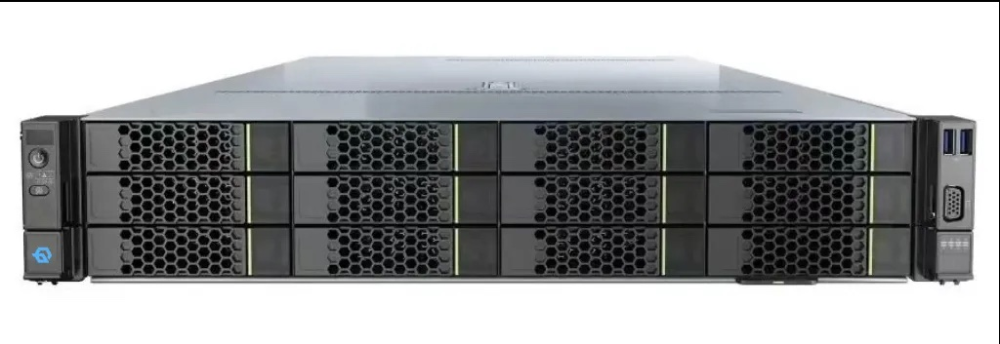
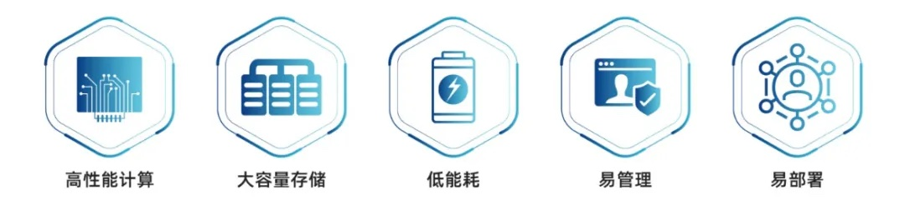
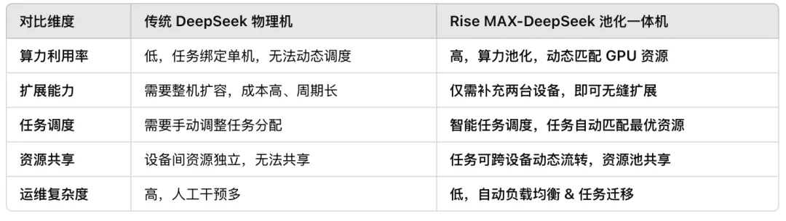

[English](./README.en.md) · [文章目录](../../README.md) · [官网阅读](https://www.theriseunion.com/zh/blog/deepseek-ai-computing-appliance.html)

# Rise MAX-DS：重新定义 AI 算力池化一体机

睿思智联 · 2025/01/01 08:00（北京时间）

深入解析 Rise MAX-DS 池化一体机如何通过智能算力调度和资源池化技术，提升 DeepSeek 大模型部署效率。探讨其在提升 GPU 利用率、降低扩容成本、消除资源碎片化等方面的创新突破，助力企业构建高效灵活的 AI 计算架构。

## 背景

随着 [DeepSeek 大模型](https://www.theriseunion.com/zh/blog/deepseek-r1-vs-v3.html)的持续火热，各大厂商纷纷推出自己的 DeepSeek 一体机。然而，市面上大多数 DeepSeek 一体机仍然是传统的物理机架构，只是单纯的算力堆叠，缺乏"智能调度"、"资源池化"和"弹性扩展"等 AI 必备能力，导致：

- ❌ 算力利用率低：单机资源固化，任务无法灵活调度，GPU 资源大量闲置或低效使用。
- ❌ 扩展能力受限：算力不足时，只能额外采购整机，扩容成本高、周期长，且无法与已有资源池无缝协同。
- ❌ 资源碎片化严重：任务在不同设备间独立运行，无法共享算力，导致 AI 计算能力难以最大化释放。

特别是对于 [DeepSeek 671B 等超大规模模型](https://www.theriseunion.com/zh/blog/deepseek-v3-r1-671b-intro.html)，[其对 GPU 资源的需求极为苛刻](https://www.theriseunion.com/zh/blog/deepseek-v3-r1-671b-gpu-requirements.html)，传统部署方案往往难以满足高效运行的需求。

为了彻底解决以上诸多困境，睿思智联 重磅推出 [Rise MAX-DS 池化一体机](https://www.theriseunion.com/zh/product/max.html)，全面融合先进的 AI Native 计算架构，突破传统 AI 计算瓶颈，为企业提供真正"硬核级"的 AI 计算方案。

## Rise MAX-DS 池化一体机

Rise MAX-DS 一体机是业内领先的 AI 原生池化一体机，内置智能算力池化与动态调度技术，从底层重塑 AI 计算架构，让 [DeepSeek 大模型](https://www.theriseunion.com/zh/blog/deepseek-r1-models-intro.html)的部署和运行进入智能化、弹性化、高效化的新纪元。

### 轻量化部署，真正的高效敏捷，开箱即用！

[Rise MAX-DS 池化一体机](https://www.theriseunion.com/zh/product/max.html)打破了物理机架构的限制，真正实现算力资源的池化共享和动态调度，只需两台设备，即可轻松支撑多个 DeepSeeK 系列模型，并提供无缝部署和高效运行的体验：

- ✅ 预装模型：DeepSeek 全尺寸模型（1.5B、7B、8B、14B、32B、70B 和 671B）[DeepSeek-R1 系列模型详解](https://www.theriseunion.com/zh/blog/deepseek-r1-models-intro.html)。
- ✅ 智能算力池化，突破单机物理限制：多个 DeepSeek 任务可在同一算力池内高效协同，而非被单台物理机锁死。
- ✅ 即插即用，快速落地：开箱即用，无需复杂配置，企业即可立刻开始 AI 训练与推理，加速模型应用。
- ✅ 任务智能调度，GPU 利用率提升 30%+：无需手动匹配算力，资源动态调整，彻底告别 GPU 低效占用问题。
- ✅ 可视化管理：实时查看模型运行状态、资源消耗、任务队列和系统健康状况，快速定位性能瓶颈或潜在问题，提高调度效率与故障恢复速度。

### 智能弹性扩展：算力不足？即刻扩容！

Rise MAX-DS 一体机并非孤立的物理设备，而是可扩展的 AI 原生算力池，具备传统物理一体机无法实现的智能弹性扩展能力：

- ✅ 按需扩展，弹性升级：算力池中的任务不会受限于某一台物理机，当智算需求快速增长时，只需加入新的 Rise MAX-DS 一体机，无需重构 AI 计算架构，即可实现无缝扩展，即插即用。
- ✅ 多个 DeepSeek 任务在同一池子里高效协同：不同规模的 AI 任务可动态调度至最合适的计算资源，突破传统物理机计算孤岛问题，实现 DeepSeek 计算资源最大化利用。
- ✅ 资源自动调度 & 负载均衡：Rise MAX-DS 一体机内置智能任务迁移与自动负载均衡能力，确保每个 GPU 资源都得到最优利用，最大化降低算力浪费。
- ✅ 云边协同调度：支持公有云、私有化、本地 IDC 及边缘计算部署，按需调度云端与本地算力，实现最佳资源利用。

## 智能池化一体机 vs.传统物理机

相比于市场上其他 DeepSeek 一体机仍采用的传统物理机架构，Rise MAX-DS 池化一体机全面领先，让 AI 计算从物理机时代迈入"AI 原生算力池"时代：

## 池化智算，抢占 AI 时代先机

在 AI 计算全面迈向大模型时代的今天，传统物理一体机的局限性愈发凸显，企业迫切需要更高效、更智能、更灵活的 AI 智算架构。[Rise MAX-DS 池化一体机](https://www.theriseunion.com/zh/product/max.html)不是简单的 DeepSeek 适配方案，而是一场底层架构的创新，以 AI 原生池化计算彻底重塑 AI 智算模式，让企业不再受限于算力瓶颈，真正实现弹性扩展、智能调度、资源最优的 AI 智算体验，助力企业突破算力边界，加速 AI 创新落地！

想了解更多关于 DeepSeek 模型的 GPU 需求和部署建议，请参阅[DeepSeek V3/R1 671B GPU 需求详解](https://www.theriseunion.com/zh/blog/deepseek-v3-r1-671b-gpu-requirements.html)。

如果您想了解 [DeepSeek-V3 的 MoE 架构](https://www.theriseunion.com/zh/blog/deepseek-moe.html)以及它与 [DeepSeek-R1 的区别](https://www.theriseunion.com/zh/blog/deepseek-r1-vs-v3.html)，我们也提供了详细的技术解析文章。

---

[在睿思智联官网阅读本文](https://www.theriseunion.com/zh/blog/deepseek-ai-computing-appliance.html) · [浏览更多文章](https://www.theriseunion.com/zh/blog.html)
