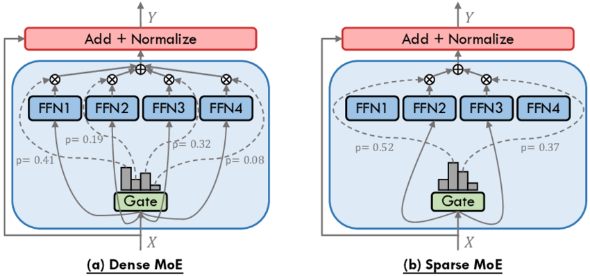
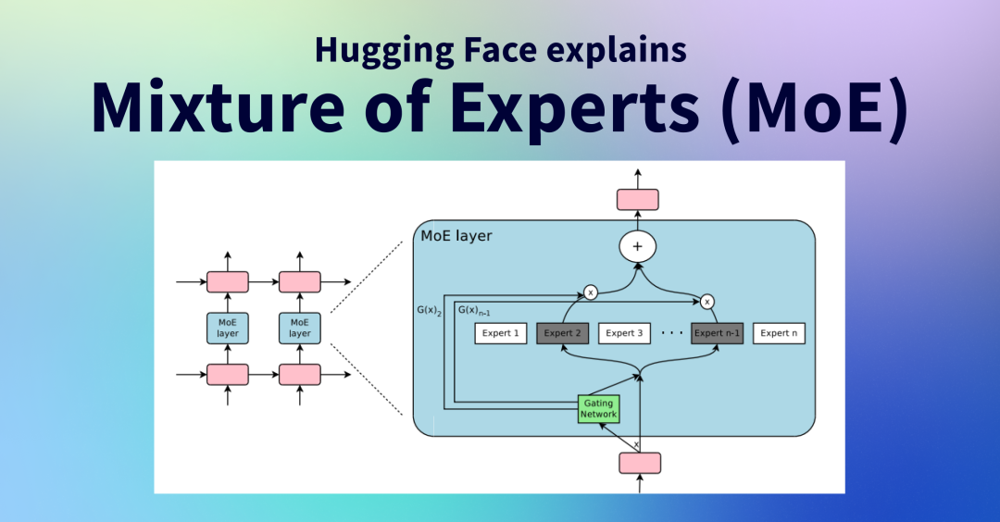

[简体中文](./README.md) · [All articles](../../README.en.md) · [Read on the website](https://www.theriseunion.com/en/blog/deepseek-moe.html)

# Why DeepSeek-V3 and Qwen2.5-Max Choose MoE as the Core Architecture?

RiseUnion · February 18, 2025 at 08:00 (UTC+08:00)

The Mixture of Experts (MoE) architecture is reshaping the development of AI large models. With efficient computing, flexible scalability, and adaptive task capabilities, it has become the key technology behind cutting-edge models like DeepSeek-V3 and Qwen2.5-Max. Explore how MoE optimizes inference costs, enhances AI computing efficiency, and drives the future of intelligent systems.

## Background

With the release of DeepSeek-V3 and DeepSeek-R1 model series, Mixture of Experts (MoE) has once again become a focal point in AI. This architecture enables maintaining massive model parameters while significantly reducing computational costs, garnering widespread industry attention. DeepSeek has leveraged MoE technology to overcome model scaling bottlenecks, making the training and inference of ultra-large AI models more efficient.

Simultaneously, DeepSeek introduced the R1 model, which employs a Dense architecture, contrasting sharply with V3's MoE design. While V3 is suited for general AI tasks, R1 specializes in precise mathematical, coding, and logical reasoning.

This article briefly introduces the architectural differences between DeepSeek-V3 and R1, and delves into the working principles of MoE architecture, helping readers understand why this technology has become pivotal in AI model development.

## Architectural Differences Between DeepSeek-V3 and DeepSeek-R1

While some suggest that "DeepSeek-R1's architecture derives from V3, and R1 could be considered a V3 with reasoning capabilities," DeepSeek hasn't officially confirmed this relationship. They simply share similar Transformer design frameworks.

DeepSeek-R1 employs a Dense architecture, focusing on reasoning, mathematics, and coding tasks, while DeepSeek-V3 utilizes an MoE structure optimized for general tasks. They follow distinct technical approaches to optimize different use cases. For detailed comparison, refer to [DeepSeek-V3 vs DeepSeek-R1 Comparative Analysis](https://www.theriseunion.com/en/blog/deepseek-r1-vs-v3.html).

The widely cited claim that "MoE models can be smaller and better" actually refers to Dense models distilled from MoE models, which can balance parameter count and reasoning performance (e.g., DeepSeek-R1-Distill-Qwen-7B derived from Qwen2.5-Math-7B). MoE models typically have more parameters than Dense models, but distillation techniques can compress them into smaller Dense models while maintaining performance. For more details, see [DeepSeek-R1 Model Series: From Lightweight Distilled Versions to Full-Scale Models](https://www.theriseunion.com/en/blog/deepseek-r1-models-intro.html).

### **DeepSeek V3: MoE Architecture**

DeepSeek-V3 implements a **Mixture of Experts (MoE)** architecture with key features:
- **Multiple experts** with only a subset (typically 2-4) activated during inference, reducing computational costs
- **Optimized for general tasks** including code generation, mathematical reasoning, and language understanding
- **Enhanced inference efficiency** for resource-optimized large-scale deployment

> Note: MoE efficiency depends on expert count, gating network design, and task complexity. In some cases, computational demands may remain high, especially with numerous experts.

MoE enables V3 to **support trillion-scale parameters while maintaining significantly lower computational requirements than Dense models**, resulting in **lower inference costs and enhanced performance**.

### **DeepSeek R1: Dense Architecture**

DeepSeek-R1 employs a **Dense architecture** where all parameters are simultaneously activated:
- **Excels in high-precision tasks** like mathematics, coding, and logical reasoning
- **Utilizes all parameters** during each inference, resulting in higher computational costs
- **Ideal for scenarios requiring extreme precision**, such as mathematical proofs and programming

While computationally more intensive, the Dense structure provides **more stable and predictable inference**, particularly beneficial for high-precision tasks:
- Its suitability for mathematical and logical reasoning stems from computational consistency. Unlike MoE, where different experts may cause distributional inconsistencies, Dense architecture maintains stable computation paths through full layer activation.
- Dense models avoid the distribution shift that can occur in MoE due to expert switching, making them more reliable for high-precision tasks like mathematical proofs.

For more information about DeepSeek-R1 models, see [DeepSeek-R1 Model Series: From Lightweight Distilled Versions to Full-Scale Models](https://www.theriseunion.com/en/blog/deepseek-r1-models-intro.html).

## Understanding How Mixture of Experts (MoE) Works

The **Mixture of Experts (MoE)** architecture represents an efficient approach to large-scale neural networks. Its core concept involves **splitting a massive neural network into multiple "experts," with a "gating network" determining which subset of experts to activate for each computation**.

To understand MoE, let's examine its **architecture, training process, inference mechanism, and advantages**.

### 1. MoE Basic Architecture
MoE consists of **three core components**:
1. **Input Layer**: Receives and encodes data into vector representations
2. **Expert Networks**: Multiple sub-models, each specializing in different knowledge domains
3. **Gating Network**: Determines which experts should process the input data and assigns weights

**Illustration:**

- The **gating network** analyzes input data and produces an expert selection probability distribution. For instance, an MoE might have **16 experts** but activate only **2-4** during inference, reducing computational load.
- Selected experts process the input data, and their results are combined through weighted aggregation.

This approach enables MoE to **flexibly utilize different experts** while **minimizing computational overhead**, enhancing training and inference efficiency.

### 2. MoE Training Process
While MoE training resembles traditional neural networks, its multiple experts and gating network require specialized training approaches:

#### **(1) Expert Assignment**
- During training, the gating network may favor certain experts while neglecting others. Load Balancing Loss implements balancing constraints to ensure more uniform expert utilization.
- Solution: Implement **regularization techniques** (like Load Balancing Loss) to ensure workload distribution across experts.

#### **(2) Gating Network Optimization**
- The gating network, itself a trainable neural network (typically a small feedforward network), learns to **select appropriate experts based on input data**.
- Training continuously adjusts gating network weights to optimize **task allocation** for efficient inference.

#### **(3) Multi-task Learning**

MoE excels at **multi-task learning**, with experts specializing in different domains:
- Mathematical problems → Math expert
- Code generation → Programming expert
- Language understanding → Language expert

During training, the model learns to **route different tasks to appropriate experts**, enhancing task processing capabilities.

### 3. MoE Inference Process
MoE inference operates more efficiently than traditional models by **intelligently activating only selected experts** rather than all parameters.

### **Process Flow**
1. **Input data (e.g., text or code) enters the model**
2. **Gating network analyzes input and selects 2-4 relevant experts**
3. **Selected experts perform computations**
4. **Gating network combines expert outputs with weighted aggregation for final response**

For example, when processing a mathematical problem, MoE might activate "mathematics expert + logic expert" while keeping "language expert" or "writing expert" inactive, improving computational efficiency.

This approach enables **MoE to maintain lower computational requirements than equivalent Dense models** while preserving powerful capabilities.

> Note:
>The gating network may not always select the most appropriate experts, potentially affecting inference accuracy.
>Computational requirements vary based on expert count, gating network complexity, and task type, potentially remaining significant with numerous experts.

### 4. MoE Advantages Over Dense Architecture
MoE's primary strengths lie in its **computational efficiency and scalability**. Compared to Dense models, MoE offers **4 key advantages**:

#### **(1) Reduced Computational Costs**
- **Dense models (like GPT-4, Llama-3)** utilize **all parameters** for each computation, e.g., a 100B parameter model uses all 100B parameters per inference.
- **MoE models (like DeepSeek V3, Qwen2.5-Max)** might have **1 trillion parameters** but activate only **5-10% during inference**, significantly reducing computational overhead.

#### **(2) Enhanced Task Adaptability**
**Dense models** require unified computation paths, while **MoE dynamically selects experts** optimized for specific tasks:
  - Code generation → Programming expert
  - Language understanding → Language expert
  - Logical reasoning → Logic expert

#### **(3) Improved Scalability**
**Dense model scaling challenges**: Improving Dense models typically requires **increasing parameters across all layers**, resulting in high training costs.

**MoE scalability advantages**: Enables **adding new experts** without retraining the entire model. Examples:
  - Adding "legal expert" for legal document analysis
  - Adding "medical expert" for medical text processing

#### **(4) Resource Efficiency**
- MoE requires **partial GPU computation**, potentially reducing power and computational requirements compared to Dense models, facilitating large-scale deployment.

> Note: While MoE reduces per-inference computation, distributed computing communication costs remain crucial. Deployment requires careful expert distribution planning to avoid transmission bottlenecks.

### 5. The Growing Adoption of MoE in Large Language Models
**DeepSeek V3** and **Qwen2.5-Max** exemplify MoE models, utilizing multiple expert sub-models working collaboratively to efficiently handle diverse tasks while intelligently routing input data to appropriate experts, optimizing resource utilization and overall performance.

- **Expert Collaboration**: MoE models comprise multiple expert sub-models, each specialized in specific tasks, analogous to specialized professionals in a team. This architecture leverages each expert's strengths for comprehensive task handling.
- **Intelligent Expert Selection**: MoE employs smart routing mechanisms to dynamically select appropriate experts based on input characteristics, rather than activating all model parameters. This enhances inference efficiency and significantly reduces computational resource requirements, making ultra-large AI model deployment more feasible.

**DeepSeek-R1, GPT4, Llama-3 maintain Dense architectures** due to their focus on mathematics, reasoning, and code generation, where Dense structures may provide more stability.

The industry shift from traditional **Dense architectures** to MoE parallels the transition from vertical scaling to microservices architecture in the mobile internet era, emphasizing horizontal scaling for enhanced computational capabilities and flexibility.

## Conclusion: Why MoE is Becoming Critical for Large Language Model Development

MoE architecture is emerging as a crucial direction in large-scale AI development, driven by its advantages in computational efficiency, scalability, and task adaptability:

1. **Enhanced Computation Efficiency**: MoE activates only selected experts for inference rather than the entire model, significantly reducing computational resources compared to equivalent Dense models while maintaining powerful capabilities.
2. **Flexible Scalability**: Unlike Dense models requiring comprehensive parameter expansion, MoE enables capability enhancement through targeted expert addition. For instance, adding "legal" or "medical" experts can enhance domain-specific reasoning without complete model retraining.
3. **Superior Task Adaptation**: MoE enables specialized expert handling of different task types rather than relying on a single general-purpose model. For example, programming experts handle code generation while mathematics experts manage calculations, optimizing resource utilization and task performance.

Currently, more large language model providers, including DeepSeek-V3 and Qwen2.5-Max, are adopting MoE to optimize computational efficiency and enhance model capabilities. While Dense architectures maintain advantages in high-precision tasks like mathematics and logical reasoning, MoE is emerging as a more efficient, intelligent, and scalable solution for large language models, driving AI technology toward a more efficient and sustainable future.

---

[Read this article on the RiseUnion website](https://www.theriseunion.com/en/blog/deepseek-moe.html) · [Explore more articles](https://www.theriseunion.com/en/blog.html)
