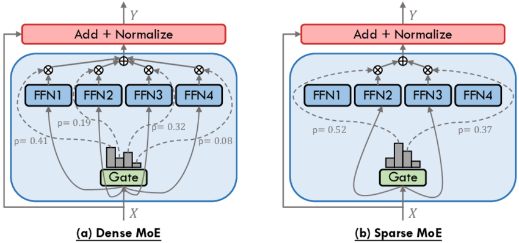
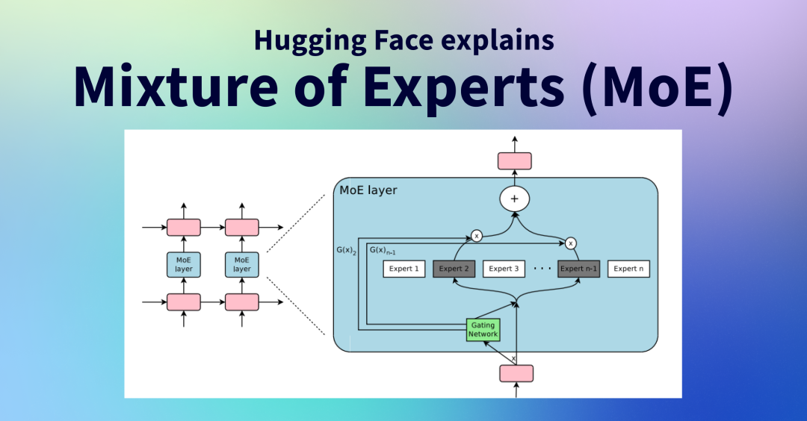

[English](./README.en.md) · [文章目录](../../README.md) · [官网阅读](https://www.theriseunion.com/zh/blog/deepseek-moe.html)

# DeepSeek-V3 和 Qwen2.5-Max 为什么选择 MoE 作为核心架构？

睿思智联 · 2025/02/18 08:00（北京时间）

MoE（混合专家）架构正在重塑 AI 大模型的发展路径，凭借高效计算、灵活扩展和任务适配性，成为 DeepSeek-V3、Qwen2.5-Max 等前沿模型的关键技术。探索 MoE 如何优化推理成本，提升 AI 计算效率，引领智能时代。

## 背景

随着 DeepSeek-V3 和 DeepSeek-R1 系列模型的发布，MoE（混合专家模型，Mixture of Experts） 再次成为 AI 领域的热门话题。这种架构能够在保持超大规模模型参数的同时，显著降低计算成本，因而受到了业界的广泛关注。DeepSeek 通过 MoE 技术突破了模型扩展的瓶颈，使得超大规模 AI 模型的训练与推理变得更加高效。

与此同时，DeepSeek 还推出了 R1 模型，它采用了 Dense（稠密）架构，与 V3 的 MoE 设计形成了鲜明对比。V3 适用于通用 AI 任务，而 R1 则专注于更精确的数学、代码和逻辑推理。

本篇文章将简要介绍 DeepSeek-V3 和 R1 的架构区别，并深入解析 MoE 架构的工作原理，帮助大家理解为何这一技术成为 AI 模型发展的关键方向。

## DeepSeek-V3 和 DeepSeek-R1 的架构差异

网上有一种说法：“DeepSeek-R1 的模型架构来自于 V3，甚至可以说 R1 是具有推理（Reasoning）能力的 V3”，但实际上，DeepSeek 官方并没有明确表述 R1 源于 V3，只是它们共享相似的 Transformer 设计框架。

DeepSeek-R1 采用的是 Dense 架构，专注于推理、数学和代码任务，而 DeepSeek-V3 采用的是 MoE 结构，更适用于通用任务。它们采用了不同的技术路线，以分别优化不同的场景需求，具体请参考[《DeepSeek-V3 vs DeepSeek-R1 的差异对比分析》](https://www.theriseunion.com/zh/blog/deepseek-r1-vs-v3.html)。

被广泛提及的 “MoE 模型可以更小、更好”，其实是指的 MoE 模型蒸馏的 Dense 模型，可以兼顾参数量和推理（Reasoning）性能（如 DeepSeek-R1-Distill-Qwen-7B 是来源于 Qwen2.5-Math-7B）。MoE 模型通常比 Dense 模型更大，但通过蒸馏技术可以将 MoE 模型压缩为较小的 Dense 模型，从而在保持性能的同时减少计算量。详细请参考[《DeepSeek-R1 系列模型详解：从轻量级蒸馏版到满血大模型》](https://www.theriseunion.com/zh/blog/deepseek-r1-models-intro.html)。

### **DeepSeek V3：MoE 架构**

DeepSeek-V3 采用 **混合专家模型（MoE, Mixture of Experts）**，其核心特点是：
- **拥有大量专家**，但每次推理只激活其中 **部分专家（如 2~4 个）**，降低计算成本。
- **更适合处理通用任务**，如代码生成、数学推理、语言理解等。
- **更高效的推理**，在大规模部署时更加节省计算资源。

> 注意：MoE 模型的效率取决于专家数量、门控网络的设计以及任务复杂度。在某些情况下，MoE 模型的计算量可能仍然很高，尤其是在专家数量非常多的情况下。

MoE 让 V3 **能支持超大规模参数（如万亿级参数），但实际计算量远低于 Dense 模型**，因此 **推理成本更低，性能更强**。

### **DeepSeek R1：Dense 架构**

DeepSeek-R1 采用 **稠密模型（Dense）**，即所有参数都会被同时激活进行计算：
- **更适合数学、代码、逻辑推理等高精度任务**，确保计算稳定性。
- **每次推理都使用所有参数**，计算成本相对较高。
- **适用于对精度要求极高的场景**，比如数学证明、编程等。

Dense 结构虽然计算成本更高，但它提供了一种**更加稳定、可预测的推理方式**，尤其在需要高精度推理的任务上表现更优：
- 其适用于数学和逻辑推理的关键点在于计算一致性。MoE 可能会因为不同专家的参数不同，在推理过程中出现分布不一致的情况，而 Dense 由于所有层都被激活，计算路径是稳定的，因此更适合高精度任务。
- MoE 在推理过程中可能会因专家不同而导致分布漂移（Distribution Shift），而 Dense 由于所有参数都被激活，计算路径稳定，因此在高精度任务（如数学证明）上表现更优。

关于DeepSeek-R1 系列模型，请查看[《DeepSeek-R1 系列模型详解：从轻量级蒸馏版到满血大模型》](https://www.theriseunion.com/zh/blog/deepseek-r1-models-intro.html)。

## 混合专家模型（MoE）的工作原理

混合专家模型（**Mixture of Experts, MoE**）是一种高效的大规模神经网络架构，它的核心思想是**将一个庞大的神经网络拆分成多个“专家”（Experts），并通过一个“门控网络”（Gating Network）来决定每次只激活部分专家进行计算**。  

要理解 MoE 的工作方式，可以从 **架构、训练、推理和优势** 四个方面来分析。  

### 1. MoE 的基本架构
MoE 主要由 **三个核心部分** 组成：
1. **输入层（Input Layer）**：接收数据，并将其编码成向量表示。  
2. **专家网络（Experts）**：多个子模型，每个专家负责不同的知识领域。  
3. **门控网络（Gating Network）**：决定输入数据应该由哪些专家来处理，并分配权重。  

**示意图：**  

- **门控网络** 会分析输入数据，给出一个“专家选择”概率分布。例如，一个 MoE 可能有 **16 个专家**，但每次推理时只会激活其中 **2-4 个专家**，减少计算量。  
- 选定的专家会对输入数据进行计算，并将结果加权合并后输出。  

这种方式让 MoE 既能 **灵活调用不同的专家**，又能 **减少计算开销**，使得训练和推理更高效。  

### 2. MoE 是如何训练的？
MoE 的训练方式与普通神经网络类似，但由于存在多个专家和门控网络，需要特别设计训练方法：  

#### **(1) 专家分配**
- 在训练过程中，MoE 训练中，门控网络可能会倾向于选择某些专家，而忽略其他专家。Load Balancing Loss 通过增加均衡约束，使得专家利用率更加均匀，避免某些专家负载过高或闲置。
- 解决方案：使用 **正则化技术**（如 Load Balancing Loss），强制门控网络让不同专家都有工作机会。  

#### **(2) 门控网络优化**
- 门控网络本身也是一个可训练的神经网络（通常是一个小型的前馈网络），它学习如何 **基于输入数据选择最合适的专家**。  
- 训练时，模型会不断调整门控网络的权重，使其学会**自动分配任务**，确保高效推理。  

#### **(3) 多任务学习**

MoE 适合 **多任务学习**，因为不同专家可以专注于不同任务，比如：  
- 数学问题 → 数学专家  
- 代码生成 → 编程专家  
- 语言理解 → 语言专家  

在训练过程中，模型可以逐渐学会**为不同任务调用不同专家**，提高任务处理能力。  

### 3. MoE 推理过程
MoE 的推理（Inference）比传统模型更高效，因为它并不激活所有参数，而是**智能选择少量专家参与计算**。  

### **具体流程**
1. **输入数据（如一句话或一段代码）进入模型。**  
2. **门控网络分析输入数据，并选择 2~4 个专家来处理数据。**  
3. **被选中的专家执行计算，并给出结果。**  
4. **门控网络根据专家的输出，加权合并最终答案，并返回给用户。**  

例如，如果用户输入了一道数学题，MoE 可能会选择“数学专家+逻辑专家”，而不会调用“语言专家”或“写作专家”，从而提高计算效率。  

这种方式使得 **MoE 的计算量远小于同等规模的稠密模型（Dense）**，但仍然能保持强大的智能能力。  

> 注意:
>MoE 的门控网络并不总是能够准确选择最合适的专家。在某些情况下，门控网络可能会选择不合适的专家，导致推理结果不准确。
>MoE 的计算量取决于专家数量、门控网络的复杂度以及任务类型。在某些情况下，MoE 的计算量可能仍然很高，尤其是在专家数量非常多的情况下。

### 4. 为什么 MoE 比 Dense 更高效？
MoE **最大的优势** 在于 **计算效率和扩展性**。相比稠密模型，MoE 主要有以下 **4 大优点**：

#### **(1) 降低计算成本**
- **Dense 模型（如 GPT-4、Llama-3）** 每次计算都要用到 **所有参数**，比如一个 1000 亿参数的 Dense 模型，每次推理都会使用 1000 亿个参数。  
- **MoE（如 DeepSeek V3、Qwen2.5-Max）** 可能有 **1 万亿参数**，但每次推理 **只激活其中 5%~10% 的参数**，计算开销大幅减少。  

#### **(2) 任务适配性更强**
**Dense 模型** 需要一个统一的计算路径，而 **MoE 能动态选择不同专家**，针对不同任务优化推理效果。例如：  
  - 代码生成 → 调用代码专家  
  - 语言理解 → 调用语言专家  
  - 逻辑推理 → 调用逻辑专家  

#### **(3) 更容易扩展**
**Dense 模型扩展难度高**：如果要提升 Dense 模型的能力，往往需要 **增加所有层的参数量**，训练成本极高。 

**MoE 更容易扩展**：可以直接**增加新的专家**，而无需重新训练整个模型。例如：
  - 可以为法律文档分析新增一个“法律专家”  
  - 可以为医学文本处理新增一个“医学专家”  

#### **(4) 计算资源更友好**
- MoE 只需要 **部分 GPU 计算**，在某些场景下比 Dense 省电、省算力，适合大规模部署。 

> 注：虽然 MoE 在单次推理中减少计算量，但其分布式计算带来的通信成本也很关键，在实际部署时，需要合理规划专家的分布和策略，以避免传输瓶颈。

### 5. 为什么越来越多的大模型厂商正在选择 MoE？
**DeepSeek V3** 和 **Qwen2.5-Max** 都是 MoE（混合专家）模型，通过多个“专家”子模型协同工作，高效处理不同类型的任务，并智能选择最合适的专家模型来处理输入数据，从而优化计算资源，提高整体性能和效率。  

- **专家协同工作**：MoE 模型由多个“专家”子模型组成，每个专家擅长处理特定任务，相当于一个团队中的不同专业人员各司其职，共同完成复杂的任务。这种架构能够充分发挥每个专家的专长，使模型在不同领域都能表现出色。  
- **智能选择专家**：MoE 采用智能路由机制，根据输入数据的特征，动态选择最合适的专家进行计算，而非激活整个模型的所有参数。这不仅提升了推理效率，还大幅降低了计算资源消耗，使得超大规模 AI 模型的部署更加可行。  

**DeepSeek-R1、GPT4、Llama-3 等仍然采用 Dense 结构**，是因为它更专注于数学、推理和代码生成，在这些任务上，Dense 结构可能比 MoE 更稳定。  

越来越多的大模型厂商正在从传统的 **Dense（稠密）架构** 转向 MoE，这一趋势类似于移动互联网时代企业从垂直扩展单机性能转向微服务架构，通过水平扩展来提升计算能力和灵活性。

## 总结：MoE 何以成为大模型发展的关键趋势？  

MoE（混合专家）架构正在成为大规模 AI 发展的重要方向，主要源于其在计算效率、扩展性和任务适配性上的显著优势：  

1. **计算更高效**：MoE 仅激活部分专家进行推理，而非使用整个模型，使得计算资源消耗远低于同规模的稠密模型（Dense）。这意味着 MoE 在保持强大能力的同时，大幅降低了推理成本。  
2. **扩展更灵活**：相比 Dense 模型需要整体扩展参数，MoE 只需增加新专家即可增强特定能力。例如，新增“法律专家”或“医学专家”可增强相应领域的推理能力，而无需重新训练整个模型。  
3. **任务适配性更强**：MoE 允许不同类型的任务由专门的专家处理，而非依赖单一通用模型。例如，代码生成由“编程专家”负责，数学计算交给“数学专家”，从而提升计算资源的利用率和任务执行效果。  

当前，越来越多的大模型厂商，如 DeepSeek-V3 和 Qwen2.5-Max，正在采用 MoE 以优化计算效率并增强模型能力。尽管 Dense 架构仍在数学、逻辑推理等精度要求极高的任务中占据优势，但 MoE 正在成为更高效、智能且可扩展的大模型解决方案，推动 AI 技术进入更高效、更可持续的新时代。

---

[在睿思智联官网阅读本文](https://www.theriseunion.com/zh/blog/deepseek-moe.html) · [浏览更多文章](https://www.theriseunion.com/zh/blog.html)
