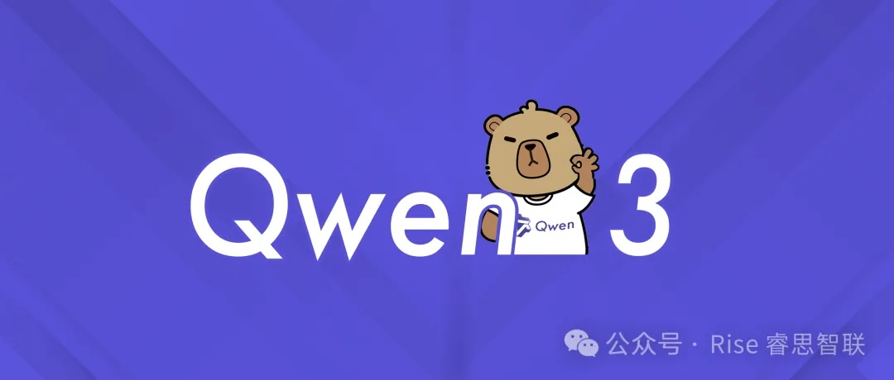

[简体中文](./README.md) · [All articles](../../README.en.md) · [Read on the website](https://www.theriseunion.com/en/blog/deepseek-r2-vs-qwen3-preview.html)

# DeepSeek R2 vs Qwen3: 2025 China LLMs Face-Off

RiseUnion · January 01, 2025 at 08:00 (UTC+08:00)

In-depth comparison of DeepSeek R2 and Qwen3, China's leading large language models. Explore parameter scale, inference cost, multi-modality, enterprise AI deployment, and domestic AI hardware trends for informed technology decisions.

In 2025, China’s AI landscape is defined by two flagship large language models: **Alibaba’s Qwen3** and **DeepSeek R2**. These models are not only pushing the boundaries in terms of parameter scale, inference efficiency, and cost optimization, but are also setting new standards in multi-modality, intelligent reasoning, and ecosystem openness. This article provides a comprehensive, up-to-date comparison based on the latest public information and community insights.

## 1. Qwen3: Versatile Flagship with Advanced Reasoning and Multi-Modality

**Release Date:** April 29, 2025

### Key Highlights:

#### Comprehensive Model Matrix
  Qwen3 offers both Dense (0.5B–32B) and MoE (30B/235B) architectures. The flagship Qwen3-235B-A22B outperforms DeepSeek R1 671B in code, math, and general benchmarks.  
  *(For a detailed comparison of Qwen3 and DeepSeek 32B models, see [QwQ-32B vs DeepSeek-R1-32B](https://www.theriseunion.com/en/blog/qwq-32b-vs-deepseek-r1-32b.html).)*

#### Unprecedented Pretraining Scale
  Trained on 36 trillion tokens—double that of Qwen2.5—covering 119 languages and dialects, significantly enhancing multilingual and cross-domain capabilities.

#### Extended Context Window
  Dense models (8B+) and all MoE variants support up to 128K context length, enabling long-document reasoning and complex conversations.

#### Dynamic Reasoning Modes
  Qwen3 MoE models feature seamless switching between “thinking” and “non-thinking” modes, optimizing for both rapid responses and deep reasoning based on task complexity.  
  *(For an in-depth look at MoE architecture, see [DeepSeek MoE Architecture Explained](https://www.theriseunion.com/en/blog/deepseek-moe.html).)*

#### Agent and Toolchain Integration
  Native support for agent scenarios, robust API, and enhanced tool invocation capabilities.

#### Multi-Modal Capabilities
  Supports both text and image inputs, with improved agent capabilities for real-world applications.

## 2. DeepSeek R2: Trillion-Scale Parameters, Extreme Sparsity, and Unmatched Cost Efficiency

**Release Date:** Expected mid-2025 (currently in limited testing)

### Key Highlights:

#### World-Leading Parameter Scale
  1.2 trillion total parameters, leveraging Hybrid MoE 3.0 architecture with only 78B (6.5%) active during inference, dramatically reducing compute costs.

#### Breakthrough in Inference Cost
  Inference cost per million tokens is just $0.07—97% lower than GPT-4 Turbo—making large-scale AI adoption feasible for enterprises.

#### Massive Knowledge Base
  Trained on 5.2PB of high-quality data spanning finance, law, patents, and more, achieving 89.7% instruction accuracy.

#### Advanced Multi-Modality
  Supports text, image, and audio inputs. Achieves 92.4% mAP on COCO for object detection and 98.1% accuracy in medical diagnostics, surpassing expert groups.

#### Domestic Hardware Optimization
  Trained on Huawei Ascend 910B clusters with 82% chip utilization, enhancing China’s AI hardware independence.

#### Innovative Training Techniques  
  Incorporates Generative Reward Modeling (GRM) and Self-Consistent Critique Tuning (SPCT) for superior reasoning and alignment.

#### Open Ecosystem
  Base models are open-sourced and available on platforms like Hugging Face, accelerating AI democratization.  
  *(For a detailed overview of DeepSeek-R1 model variants and use cases, see [DeepSeek-R1 Model Series Explained](https://www.theriseunion.com/en/blog/deepseek-r1-models-intro.html).)*

#### Deployment & Hardware
  For enterprise deployment and GPU requirements, refer to [DeepSeek 671B GPU Requirements & Appliance Guide](https://www.theriseunion.com/en/blog/deepseek-v3-r1-671b-gpu-requirements.html) and [DeepSeek AI Computing Appliance](https://www.theriseunion.com/en/blog/deepseek-ai-computing-appliance.html).

## 3. Why Did Alibaba Rush to Release Qwen3?

### First-Mover Advantage in MoE
  By launching Qwen3 ahead of DeepSeek R2, Alibaba aimed to secure the “first Chinese MoE” narrative, establishing industry mindshare and technical leadership.

### Strategic Preemption
  Early release forced DeepSeek R2 into a “comparison mode,” reducing its potential impact and positioning Qwen3 as the benchmark for subsequent models.

### Feature Lock-In
  Qwen3’s broad model matrix and 128K context coverage preemptively addressed potential selling points of competitors, making it harder for others to claim all-round superiority.

### Media and Community Momentum
  The launch generated significant buzz across Zhihu, Weibo, GitHub, and Hugging Face, ensuring Qwen3 dominated the attention economy.

## 4. Conclusion

The Qwen3 vs DeepSeek R2 battle is not just about parameters or speed—it’s a contest for market mindshare and the future of China’s AI ecosystem.

- **Qwen3**: Comprehensive model lineup, massive data scale, and dynamic reasoning modes, establishing an early lead.
- **DeepSeek R2**: Unprecedented scale, extreme cost efficiency, and advanced multi-modality, poised to disrupt the market.

The real competition is just beginning.

## Further Reading

- [QwQ-32B vs DeepSeek-R1-32B: In-Depth Comparison](https://www.theriseunion.com/en/blog/qwq-32b-vs-deepseek-r1-32b.html)
- [DeepSeek MoE Architecture Explained](https://www.theriseunion.com/en/blog/deepseek-moe.html)
- [DeepSeek-R1 Model Series Explained](https://www.theriseunion.com/en/blog/deepseek-r1-models-intro.html)
- [DeepSeek 671B GPU Requirements & Appliance Guide](https://www.theriseunion.com/en/blog/deepseek-v3-r1-671b-gpu-requirements.html)
- [DeepSeek AI Computing Appliance](https://www.theriseunion.com/en/blog/deepseek-ai-computing-appliance.html)
- [DeepSeek-R1 vs DeepSeek-V3: Architecture & Use Case Comparison](https://www.theriseunion.com/en/blog/deepseek-r1-vs-v3.html)
- [MoE Architecture & vGPU Virtualization Optimization](https://www.theriseunion.com/en/blog/deepseek-moe.html)

---

[Read this article on the RiseUnion website](https://www.theriseunion.com/en/blog/deepseek-r2-vs-qwen3-preview.html) · [Explore more articles](https://www.theriseunion.com/en/blog.html)
