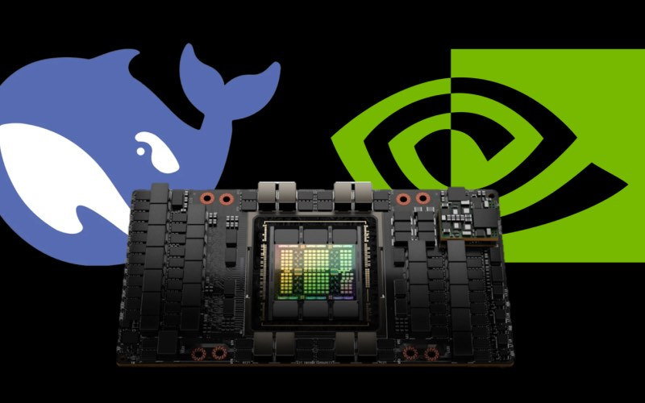

[简体中文](./README.md) · [All articles](../../README.en.md) · [Read on the website](https://www.theriseunion.com/en/blog/deepseek-v3-r1-671b-intro.html)

# DeepSeek-V3/R1 671B Deployment Guide: Hardware Requirements

RiseUnion · January 01, 2025 at 08:00 (UTC+08:00)

Comprehensive analysis of hardware requirements for DeepSeek-V3 and R1 671B full-size models, covering FP8/BF16/INT8 precision impact on memory usage, GPU compatibility, and performance comparisons. Includes enterprise deployment recommendations to help you select optimal hardware configurations for efficient model operation.

## Background

With the release of [DeepSeek V3 and R1 series models](https://www.theriseunion.com/en/blog/deepseek-r1-vs-v3.html), these models have gained significant traction in the global AI market. The [DeepSeek-V3's MoE (Mixture of Experts) architecture](https://www.theriseunion.com/en/blog/deepseek-moe.html) has particularly elevated DeepSeek's prominence in the AI field, becoming a reference point for many model providers.

Recently, as DeepSeek's popularity has surged, demand for on-premises deployment of their models in enterprise environments has increased substantially, especially for the full-scale DeepSeek-V3 and R1 671B versions ([comparison analysis of DeepSeek-V3 vs. DeepSeek-R1](https://www.theriseunion.com/en/blog/deepseek-r1-vs-v3.html)). However, their massive parameter count imposes significant computational requirements. This article focuses on enterprise server environments, exploring the computational demands of these large-scale models and providing deployment solutions for various GPU hardware configurations.

## Definition of Full-Scale DeepSeek Models and Their Variants

The **"full-scale"** version of DeepSeek models, whether V3 or R1, refers to implementations with the complete **671B** parameter count.

### Definition of Full-Scale Models
A full-scale DeepSeek model refers to any DeepSeek large language model, whether V3 or R1, with a parameter count of **671B**.

### Variants of Full-Scale Models

Full-scale models can be further categorized into:

- **Native full-scale** (FP8 mixed precision)
- **Translated full-scale** (BF16 or FP16 precision)
- **Quantized full-scale** (INT8, INT4, Q4, Q2 precision)

> Note: Despite these distinctions, many DeepSeek appliance vendors advertise "single-machine deployment" without specifying the precision (FP8 or BF16), often deploying INT8 or even INT4 versions. When selecting a deployment solution, it's crucial to verify the specific computational precision to match your requirements.

### 1. Native Full-Scale: The Official Optimal Solution

DeepSeek officially uses **FP8 mixed precision**, representing the most native and standard implementation. The official team has the deepest understanding of their models, making the official version the optimal choice if your hardware supports **FP8**.

### 2. Translated Full-Scale: Adapting to Domestic AI Hardware

Currently, most domestic AI accelerator cards (such as Ascend, Kunlun, Tianshu, Enflame, Hygon, etc.) **do not support FP8**. To adapt DeepSeek 671B models to these platforms, **BF16 or FP16** precision is typically used. This approach minimally impacts model accuracy but nearly **doubles** the computational and memory requirements.

#### Memory Calculation for DeepSeek 671B Full-Scale Models

Both DeepSeek-R1 and V3 671B versions use FP8 (8-bit floating point) for training and inference, which requires less GPU memory compared to FP16 and BF16, thereby improving GPU computational efficiency.

> The memory requirement can be simplified as:

> Total Memory = Model Parameters + Runtime Context + KV Cache

**Model Parameter Memory:**
- DeepSeek-R1 and V3 671B using FP8 require approximately 700GB for parameter storage. Running on BF16 (e.g., A100, 910B) requires double the memory (approximately 1.4TB).

**Runtime Context:**
- Typically 10-20% of parameter storage, approximately 140GB.

**KV Cache:**
- Depends on inference context length and concurrent requests:
- 4K context & low concurrency: 200GB
- 8K context & medium concurrency: 300GB
- High concurrency & long context (e.g., 32K): potentially exceeding 600GB

**Total Memory Requirements:**
- FP8 (e.g., H100, H800, H200, H20) minimum requirement: 700GB + 140GB + 200~300GB ≈ 1.1~1.2TB
- BF16 (e.g., A100, 910B) minimum requirement: 1.4TB + 280GB + 400~600GB ≈ 2.1~2.3TB

### 3. Quantized Full-Scale: A Compromise for Single-Machine Deployment
Many AI accelerator cards only support **INT8, FP16, FP32**, and single machines often cannot provide **over 1.4TB of memory** to run 671B models. Therefore, to enable DeepSeek to run on a single machine, some vendors use **quantization techniques** to reduce memory usage and increase computational throughput by lowering precision.

## Key Differences Between FP8, BF16, FP16, and INT8

In large model inference, different numerical precisions directly impact computational performance, memory usage, and inference accuracy. DeepSeek 671B natively uses **FP8**, but since most domestic AI accelerator cards (such as **Ascend, Kunlun, Tianshu, Enflame, Hygon**, etc.) **do not support FP8**, they typically use **BF16 or FP16** for computation, while some vendors opt for **INT8 or even INT4 quantization** to reduce memory usage.

### 1. FP8 (8-bit Floating Point): DeepSeek's Native Precision
- **Computational Precision:** High, preserving up to **7 decimal places**.
- **Hardware Support:** Requires FP8 compute units (e.g., **H100, H200, H20, B20**).
- **Memory Requirement:** **Approximately 750GB** (official minimum recommendation).
- **Advantage:** DeepSeek 671B **natively uses FP8**, providing optimal computational efficiency and inference accuracy on FP8-capable hardware.

> Example calculation: 3.1415926 x 3.1415926 = 9.8696040

---

### 2. BF16 / FP16 (16-bit Half Precision): Primary Solution for Domestic AI Accelerators
Since **most domestic AI accelerator cards don't support FP8**, they typically use **BF16 or FP16** for computation, with the following differences:

| **Format** | **Dynamic Range** | **Precision** | **Compatible Hardware** |
|------------|-------------------|---------------|-------------------------|
| **BF16**   | **Large**         | Close to FP8  | A100, A800, Ascend 910B, Kunlun |
| **FP16**   | **Smaller**       | Higher precision than BF16, but greater overflow risk | Most domestic AI accelerator cards |

Notes:
- **Computational Precision:** Preserves up to **7 decimal places** (BF16) or more (FP16).
- **Hardware Support:** Suitable for AI accelerator cards that **don't support FP8** but support BF16/FP16 (e.g., **A100, A800, Ascend 910B, Kunlun, Tianshu, Enflame, etc.**).
- **Memory Requirement:** **Approximately 1.4TB** (double compared to FP8).
- **Advantage:** Minimal precision loss, **but computational and memory requirements nearly double**, especially **KV Cache also increases**, significantly raising deployment costs.

> Example calculation (BF16/FP16 theoretically close to FP8): 3.1415926 x 3.1415926 ≈ 9.8696

---

### 3. INT8 / INT4 (8-bit / 4-bit Integer): Extreme Compression Solutions
Some domestic AI vendors use **INT8 or INT4 quantized computation** to dramatically reduce memory usage, though this affects inference accuracy.

| **Format** | **Computational Precision** | **Memory Usage** | **Inference Impact** |
|------------|----------------------------|------------------|----------------------|
| **INT8**   | Low (2 decimal places)     | **~350GB** (50% less than FP8) | Affects mathematical reasoning, multi-step inference |
| **INT4**   | Very low (1 decimal place) | **~180GB** (75% less than FP8) | Reduces performance on complex tasks |

Notes:
- **Computational Precision:** Lower than FP8, preserving only **2 decimal places (INT8) or 1 decimal place (INT4)**.
- **Memory Requirement:** Quantization reduces memory usage by **50% (INT8) or 75% (INT4)**, making deployment easier on domestic AI accelerator cards.
- **Advantage:** **Greatly reduces memory requirements and increases inference throughput**, enabling larger models with limited computational resources.
- **Disadvantage:** Quantization errors affect inference accuracy, especially in **mathematical calculations, complex logical reasoning, and multi-step inference** tasks, potentially degrading performance.

> Example calculation (INT8 approximate): 3.14 x 3.14 = 9.86

---

## Impact of Precision Conversion on DeepSeek 671B's Intelligence
In practical applications of DeepSeek 671B models, different computational precisions affect the model's "intelligence" (inference capability and response accuracy).

### 1. FP8 → BF16 / FP16: Precision Largely Maintained, but Computational Overhead Doubles
- **Theoretically**, BF16/FP16 computation results are close to FP8, but the conversion process may introduce **cumulative errors**, causing slight degradation in reasoning ability.
- **Impact level** depends on **optimization quality of the conversion algorithm**; with experienced teams, BF16/FP16 versions can approach FP8 version intelligence.
- **Major issue:** Memory usage **doubles**, significantly increasing deployment costs.

### 2. FP8 → INT8 / INT4: Quantization Reduces Intelligence
- **INT8 quantization** reduces memory usage but affects accuracy in **mathematical calculations and logical reasoning** tasks.
- **INT4 quantization** further reduces memory usage but causes more severe reasoning quality degradation, suitable for scenarios with lower precision requirements.
- **Intelligence degradation level** depends on **quantization method quality**, with potentially significant variations between different teams' approaches.

### 3. Common Misconception
**Translated full-scale** (BF16/FP16) versions aren't necessarily more intelligent than **quantized full-scale** (INT8/INT4) versions, as different teams have varying **translation or quantization capabilities**. An excellent quantization algorithm might even outperform a crude BF16/FP16 translation.

---

## How to Choose the Right DeepSeek 671B On-Premises Deployment Solution?
Currently, there are multiple implementation options for DeepSeek 671B appliances, with significant performance variations between vendors. How to evaluate them?

- **Choose FP8 hardware (H100, H200)**: If budget permits, prioritize **native FP8** for optimal inference performance.
- **Choose BF16/FP16 (domestic AI accelerator cards)**: Suitable for hardware **not supporting FP8**, but requires **more memory**, increasing deployment costs.
- **Choose INT8/INT4 quantization**: Suitable for **memory-constrained, computationally limited** scenarios, but **thoroughly test inference quality** to avoid significant intelligence degradation.
- **Practical testing**: Beyond theory, **practice is the sole criterion for truth**. Test the model on mathematical reasoning and multi-step inference tasks to assess any reasoning capability degradation.

The current market for DeepSeek 671B appliances varies widely in quality. Many domestic AI accelerator card DeepSeek deployments suffer from "reduced intelligence" issues. When selecting, **carefully test** to ensure inference performance meets expectations.

## Rise MAX-DeepSeek Pooled Appliance

As deployment demands for DeepSeek large models continue to grow, traditional single-machine deployment solutions struggle to meet enterprise requirements.

[Rise MAX-DS pooled appliance](https://www.theriseunion.com/en/product/max.html) offers a more flexible and efficient deployment solution:

**1. Intelligent Compute Orchestration**
   - Supports collaborative operation of DeepSeek 671B and other large models within the same compute pool.
   - Dynamically adjusts compute allocation, improving GPU utilization by 30%+ and optimizing resource usage.
   - Automatic load balancing reduces inefficient occupation and prevents resource waste.

**2. Elastic Scaling Capability**
   - On-demand expansion without architecture reconstruction, transcending single-machine physical limitations through resource pooling and sharing.
   - Supports cloud-edge collaborative deployment, optimizing overall resource configuration and improving adaptability.

**3. Efficient Resource Management and Low-Cost Operations**
   - Pre-installed with full-size DeepSeek models, ready for immediate use, accelerating AI inference and application deployment.
   - Unified management of heterogeneous GPU resources, supporting multi-task scheduling and avoiding single-architecture lock-in.
   - Reduces initial hardware investment, improves GPU resource utilization, and lowers overall operational and personnel costs.

**4. Intelligent Task/Resource Scheduling**
   - Real-time monitoring of model operational status and resource consumption, quickly identifying performance bottlenecks and improving management efficiency.
   - Dynamic adjustment of task compute resources ensures reasonable allocation and optimizes task execution efficiency.

**5. Streamlined Operations and Management**
   - User-friendly interface for centralized management of GPU/CPU, network, storage, and other resources.
   - Provides one-click deployment, rich API interfaces, and flexible multi-tenant management, enhancing integration and expansion capabilities.
   - Features operations toolset: resource allocation, alerts, monitoring, reporting, tenant management, metering, etc., simplifying operational processes and improving efficiency.

Rise Max provides efficient, flexible, and cost-effective compute infrastructure for AI applications across multiple scenarios through software-defined heterogeneous compute management combined with intelligent scheduling and resource pooling technologies.

---

[Read this article on the RiseUnion website](https://www.theriseunion.com/en/blog/deepseek-v3-r1-671b-intro.html) · [Explore more articles](https://www.theriseunion.com/en/blog.html)
