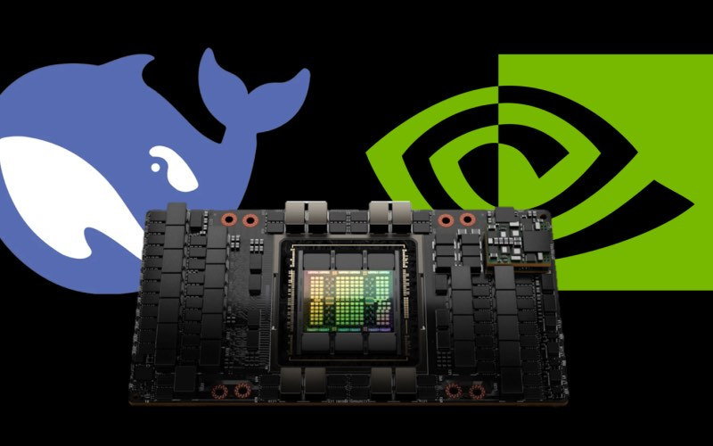

[English](./README.en.md) · [文章目录](../../README.md) · [官网阅读](https://www.theriseunion.com/zh/blog/deepseek-v3-r1-671b-intro.html)

# DeepSeek-V3/R1 671B 满血版部署指南：硬件需求详解

睿思智联 · 2025/02/26 08:00（北京时间）

深入解析 DeepSeek-V3 和 R1 671B 满血版模型的硬件资源需求，包括 FP8/BF16/INT8 精度对显存的影响、不同 GPU 适配方案及性能对比。提供企业级部署建议，助您选择最佳硬件配置，确保模型高效运行。

## 背景

随着 [DeepSeek V3 和 R1 系列模型](https://www.theriseunion.com/zh/blog/deepseek-r1-vs-v3.html)的发布，其热度一扫国内外 AI 市场，特别是 [DeepSeek-V3 的 MoE（混合专家模型，Mixture of Experts）架构](https://www.theriseunion.com/zh/blog/deepseek-moe.html)，更是让 DeepSeek 在 AI 领域声名鹊起，成了众多模型厂商学习的对象。

近期，DeepSeek 的火热出圈，其系列模型在企业环境中本地化部署的需求持续升温，特别是 DeepSeek-V3 和 R1 671B 版本（满血版）([DeepSeek-V3 vs. DeepSeek-R1 的差异对比分析](https://www.theriseunion.com/zh/blog/deepseek-r1-vs-v3.html))。但因其庞大的参数规模，也对计算资源提出了极高的要求。本篇文章将专注于企业服务器环境，深入探讨这些超大规模模型的计算需求，并提供适用于不同 GPU 硬件的部署方案。

## DeepSeek 满血版的定义与不同形态的差异

DeepSeek 671B 模型的 **“满血版”**，无论是 V3 还是 R1，只要参数规模达到 **671B**，都可以称之为满血版。  

### 满血版的定义
DeepSeek 的满血版指的是参数规模达到 **671B** 的 DeepSeek 大模型，无论是 V3 还是 R1，只要满足这一参数规模，就可以称为满血版。

### 满血版的不同形态

满血版可以进一步细分为以下几类：  

- **原生满血版**（FP8 混合精度）；
- **转译满血版**（BF16 或 FP16 计算精度）；
- **量化满血版**（INT8、INT4、Q4、Q2 计算精度）；

> 注意：尽管存在不同形态的满血版，但很多 DeepSeek 一体机的配置宣传时，都没有声明其支持的精度（FP8 或 BF16），只是一味的强调“单机可运行”，实际部署的可能是 INT8 甚至是 INT4 的版本。所以在选择部署方案时，务必关注具体计算精度，以匹配实际需求。  

### 1. 原生满血版：官方支持的最佳方案

DeepSeek 官方采用 **FP8 混合精度**，这是最原生、最标准的实现方式。官方对其模型的理解最为深入，因此，如果硬件支持 **FP8**，那么官方版本无疑是最优解。

### 2. 转译满血版：适配国产 AI 硬件

目前，大部分国产 AI 计算卡（如昇腾、昆仑芯、天数、燧原、海光等） **不支持 FP8**，为了适配 DeepSeek 671B 模型，通常会采用 **BF16 或 FP16** 进行计算。这种方式对模型精度的影响较小，但计算和显存需求几乎 **翻倍**。  

#### DeepSeek 671B 满血版显存的计算方法

DeepSeek-R1 和 V3 的 671B 版本，都采用了 FP8（浮点 8 位） 进行训练和推理，相较于 FP16 和 BF16 有更低的显存占用，因此可以提高 GPU 计算效率。

> 显存需求的计算公式，简单可以理解为： 

> 总显存 = 模型参数 + 运行上下文 + KV Cache

**模型参数显存：**
- DeepSeek-R1 和 V3 671B 采用 FP8，参数存储大约为 700GB。如果运行在 BF16（如 A100、910B），则需要 双倍显存（约 1.4TB）。

**运行上下文：**
- 通常约为参数存储的 10-20%，即约 140GB。

**KV Cache：**
- 取决于推理的上下文长度和并发请求：
- 4K 上下文 & 低并发：200GB
- 8K 上下文 & 中等并发：300GB
- 高并发 & 长上下文（如 32K）：可能超过 600GB

**总显存需求：**
- FP8（如：H100、H800、H200、H20）最低需求： 700GB + 140GB + 200~300GB ≈ 1.1~1.2TB
- BF16（如 A100、910B）最低需求： 1.4TB + 280GB + 400~600GB ≈ 2.1~2.3TB

### 3. 量化满血版：为了适配单机部署的妥协
许多 AI 计算卡仅支持 **INT8、FP16、FP32**，单机往往无法提供 **1.4TB 以上显存** 来运行 671B 模型。因此，为了让 DeepSeek 在单机上可运行，部分厂商采用 **量化技术**，即通过降低计算精度来减少显存占用，并提高计算吞吐量。  

## FP8、BF16、FP16 和 INT8 的核心区别

在大模型推理中，不同的数值精度直接影响计算性能、显存占用和推理精度。目前，DeepSeek 671B 原生采用 **FP8**，但由于国产 AI 计算卡（如 **昇腾、昆仑芯、天数智芯、燧原、海光** 等）大多 **不支持 FP8**，通常需要采用 **BF16 或 FP16** 进行计算，而部分厂商选择 **INT8 甚至 INT4 量化** 来降低显存占用。  

### 1. FP8（浮点 8 位）：DeepSeek 原生精度
- **计算精度：** 高，可保留 **小数点后 7 位** 的数值。  
- **硬件支持：** 需要 FP8 计算单元（如 **H100、H200、H20、B20**）。  
- **显存需求：** **约 750GB**（官方推荐最低配置）。  
- **优势：** DeepSeek 671B **原生采用 FP8**，在 FP8 硬件上运行时，计算效率和推理精度最优。  

> 示例计算：3.1415926 x 3.1415926 = 9.8696040

---

### 2. BF16 / FP16（半精度 16 位）：国产 AI 计算卡的主要方案
由于 **大部分国产 AI 计算卡不支持 FP8**，通常采用 **BF16 或 FP16** 进行计算，二者的区别如下：  

| **格式** | **动态范围** | **精度** | **适用硬件** |  
|---------|------------|---------|--------------|  
| **BF16** | **大** | 接近 FP8 | A100、A800、昇腾 910B、昆仑芯 |  
| **FP16** | **较小** | 精度比 BF16 更高，但溢出风险更大 | 大部分国产 AI 计算卡 |  

说明：
- **计算精度：** 可保留 **小数点后 7 位**（BF16）或更高（FP16）。  
- **硬件支持：** 适用于 **不支持 FP8** 但支持 BF16 / FP16 的 AI 计算卡（如 **A100、A800、昇腾 910B、昆仑芯、天数智芯、燧原等**）。  
- **显存需求：** **约 1.4TB**（相比 FP8 增加一倍）。  
- **优势：** 精度损失较小，**但计算和显存需求几乎翻倍**，尤其 **KV Cache 也会增长**，导致实际部署成本大幅上升。  

> 示例计算（BF16 / FP16 理论上接近 FP8）：3.1415926 x 3.1415926 ≈ 9.8696

---

### 3. INT8 / INT4（整数 8 位 / 4 位）：极致压缩方案
部分国产 AI 厂商采用 **INT8 或 INT4 量化计算**，以大幅降低显存占用，但会影响推理精度。  

| **格式** | **计算精度** | **显存占用** | **推理影响** |  
|---------|------------|---------|------------|  
| **INT8** | 低（小数点后 2 位） | **约 350GB**（比 FP8 低 50%） | 影响数学推理、多步推理 |  
| **INT4** | 极低（小数点后 1 位） | **约 180GB**（比 FP8 低 75%） | 降低复杂任务表现 |  

说明：
- **计算精度：** 低于 FP8，只能保留 **小数点后 2 位（INT8）或 1 位（INT4）**。  
- **显存需求：** 量化后显存占用减少 **50%（INT8）或 75%（INT4）**，在国产 AI 计算卡上更易部署。  
- **优势：** **极大降低显存需求，提高推理吞吐量**，在算力受限的情况下能支持更大模型。  
- **缺点：** 量化误差影响推理精度，特别是在 **数学计算、复杂逻辑推理、多步推理** 等任务中可能导致性能下降。  

> 示例计算（INT8 近似计算）：3.14 x 3.14 = 9.86

---

## DeepSeek 671B 的精度转换对智商的影响
在 DeepSeek 671B 模型的实际应用中，计算精度的不同会影响模型的“智商”（即推理能力和回答准确度）。  

### 1. FP8 → BF16 / FP16：精度基本保持，但计算开销翻倍
- **理论上**，BF16 / FP16 的计算结果接近 FP8，但在转换过程中可能引入 **累积误差**，导致细微推理能力下降。  
- **影响程度** 取决于 **转换算法的优化水平**，如果团队经验丰富，BF16 / FP16 版本的智商可以接近 FP8 版本。  
- **最大问题：** 显存占用**翻倍**，部署成本大幅增加。  

### 2. FP8 → INT8 / INT4：量化带来智商下降
- **INT8 量化** 可降低显存占用，但会影响**数学计算、逻辑推理**等任务的精度。  
- **INT4 量化** 进一步降低显存占用，但推理质量下降更严重，适用于对精度要求不高的场景。  
- **智商下降程度** 取决于 **量化方法的质量**，不同团队量化的效果可能相差很大。  

### 3. 误区
**转译满血版**（BF16 / FP16）并不一定比 **量化满血版**（INT8 / INT4）智商更高，因为不同团队的**转译或量化能力不同**，一个优秀的量化算法甚至可能比粗糙的 BF16 / FP16 转译效果更好。  

---

## 如何选择合适的 DeepSeek 671B 私有化部署方案？
目前，DeepSeek 671B 一体机有多个不同的实现方案，不同厂商的实际表现差异巨大，如何判断优劣？  

- **选择 FP8 硬件（H100、H200）**：如果预算充足，优先使用 **原生 FP8**，保证最优推理效果。  
- **选择 BF16 / FP16（国产 AI 计算卡）**：适用于 **不支持 FP8** 的国产算力，但需要 **更高显存**，部署成本更高。  
- **选择 INT8 / INT4 量化**：适用于 **显存受限、算力不足** 的场景，但要 **重点测试推理质量**，避免智商大幅下降。  
- **实际测试**：理论再多，**实践是检验真理的唯一标准**，让模型执行数学推理、多步推理等任务，看其推理能力是否下降。  

目前市场上 DeepSeek 671B 一体机良莠不齐，许多国产 AI 计算卡的 DeepSeek 部署版本存在“智商降低”问题，建议在选择时务必 **谨慎测试**，以确保推理效果达到预期。

## Rise MAX-DeepSeek 池化一体机

面对 DeepSeek 大模型日益增长的部署需求，传统的单机部署方案已难以满足企业的实际需求。

[Rise MAX-DS 池化一体机](https://www.theriseunion.com/zh/product/max.html)提供了更灵活、更高效的部署方案：

**1. 智能算力调度**  
   - 支持 DeepSeek 671B 等大模型在同一算力池内协同运行。  
   - 动态调整算力分配，GPU 利用率提升 30%+，优化资源使用。  
   - 自动负载均衡，减少低效占用，避免资源浪费。  

**2. 弹性扩展能力**  
   - 按需扩容，无需重构架构，突破单机物理限制，实现资源池化共享。  
   - 支持云边协同部署，优化整体资源配置，提高适应性。  

**3. 高效资源管理与低成本运营**  
   - 预装 DeepSeek 全尺寸模型，开箱即用，加速 AI 推理与应用落地。  
   - 统一管理异构 GPU 资源，支持多任务调度，避免绑定单一架构。  
   - 减少初始硬件投入，提高 GPU 资源利用率，降低整体运营与人力成本。  

**4. 任务/资源智能调度**  
   - 实时监控模型运行状态及资源消耗，快速发现性能瓶颈，提高管理效率。  
   - 任务算力动态调整，保障计算资源合理分配，优化任务执行效率。  

**5. 便捷运维与运营管理**  
   - 友好交互界面，集中管理 GPU/CPU、网络、存储等资源。  
   - 提供一键部署、丰富 API 接口、灵活多租户管理，提升集成与扩展能力。  
   - 具备运维/运营工具集：资源分配、告警、监控、报表、租户管理、计量等，简化运维流程，提高运营效率。  

Rise Max 通过软件定义的异构算力管理，结合智能化调度和资源池化技术，为 AI 计算提供高效、灵活、低成本的算力基础设施，适用于多场景 AI 应用部署。

---

[在睿思智联官网阅读本文](https://www.theriseunion.com/zh/blog/deepseek-v3-r1-671b-intro.html) · [浏览更多文章](https://www.theriseunion.com/zh/blog.html)
