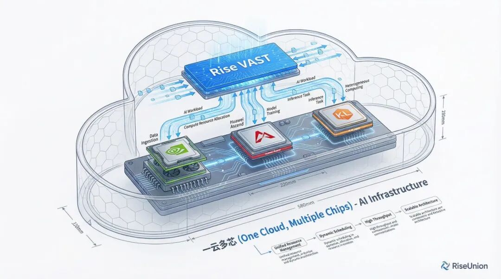

[简体中文](./README.md) · [All articles](../../README.en.md) · [Read on the website](https://www.theriseunion.com/en/blog/enterprise-ai-cost-accounting.html)

# China Is Investing RMB 4 Trillion in Its Compute Network. How Should Enterprises Account for AI Costs?

RiseUnion · August 19, 2026 at 08:00 (UTC+08:00)

From RMB 4 trillion in new investment in China's integrated compute network to 140 trillion tokens called per day, enterprise AI is moving from pilots into scaled operations. This guide explains the real cost of private compute and how heterogeneous scheduling, model serving, and token governance create an accountable operating model.

On July 31, China's National Development and Reform Commission (NDRC) disclosed an estimate that **the national integrated compute network will attract approximately RMB 4 trillion in new direct investment during the 15th Five-Year Plan period**. Compute supply will become more abundant and easier to access. For enterprises, that makes the question more concrete: what stands between AI that merely works and AI that is affordable, accountable, and governable?

Over the past two years, many enterprises have followed the same path: buying GPUs, building intelligent-compute clusters, and launching customer-service assistants, knowledge-base question answering, and workplace agents. The expectation was that private compute would lower costs. The result has often been the opposite—AI spending becomes harder to explain. Which business consumed how much compute and how many tokens? When is a local model more economical than a public API? Finance teams looking for return on investment frequently discover that no complete ledger exists.

This article addresses three questions: what the RMB 4 trillion is actually building; why token cost cannot be ignored in 2026; and what capability enterprises are still missing.

> This guide is adapted from RiseUnion's WeChat article, [“4 万亿建算力网，企业的 AI 成本账应该怎么算”](https://mp.weixin.qq.com/s/utiSIjRR_UxGFIos7tGyfw), with direct links added to the policy announcement and research discussed below.

## The RMB 4 Trillion Is Building a Network, Not Just Buying Accelerators

It is easy to interpret the investment as a wave of GPU procurement, but the operative word in the policy is *network*. The 15th Five-Year Plan coordinates six national networks: the national water network, the next-generation power grid, the integrated compute network, the next-generation communications network, underground utility networks, and the logistics network. The value of a power grid has never been the number of generators alone. It comes from moving supply across regions, coordinating it centrally, and delivering it reliably. The compute network follows the same logic: connect distributed data centers into an infrastructure that can be scheduled as a whole.

The [NDRC's July 31, 2026 briefing](https://www.ndrc.gov.cn/xwdt/wszb/7yxwfbh/wzsl/202607/t20260731_1406818.html) also stressed that the six networks are not isolated systems. They are intended to be deeply coupled and mutually reinforcing. Compute-network construction should match supply with demand, coordinate computing with electricity, and remain secure, reliable, low-carbon, and cost-controlled.

The same logic applies inside an enterprise. After an intelligent-compute cluster is installed, a common operating picture looks like this:

- NVIDIA, Huawei Ascend, Hygon, and Cambricon accelerators are managed in separate silos rather than one resource pool.
- Customer service, R&D, and agent teams reserve their own devices and duplicate capacity.
- Token consumption from local models and public APIs lives in separate ledgers, so no one can reconstruct the full picture.
- Utilization, energy, and workload demand are not observed through one control plane.

The accelerators have arrived, but the “network” has not. Fixed assets increase on the balance sheet while business output does not increase at the same rate. The largest losses are not limited to purchase price. Long periods of low utilization and costs that cannot be attributed to a workload create a persistent hidden expense.

## After 140 Trillion Tokens per Day, the Cost Question Cannot Be Avoided

At the China Development Forum in March 2026, National Data Administration Director Liu Liehong said that daily token calls in China had exceeded 140 trillion. The number rose from 100 billion per day in early 2024 to more than 1,000 times that level in two years. The National Data Administration also formalized the Chinese term *ciyuan* (词元) for token. A standardized unit is also a foundation for measurement, pricing, settlement, and accounting. The figures are available in the [official transcript published by the National Data Administration](https://www.nda.gov.cn/sjj/jgsz/jld/llh/llhldhd/0323/20260323202204680553721_pc.html).

Enterprise adoption is moving along the same curve. During a pilot, AI sits in an innovation budget and is measured by model quality and time to launch. Cost can temporarily be secondary. Once daily token volume reaches hundreds of millions or billions, AI becomes a continuously operating production system. Private and public compute must be coordinated, infrastructure becomes a long-term capital and operating expense, and IT, finance, and compliance teams all enter the process. The operating review then reduces to four concrete questions:

1. What is the true cost per token?
2. How much infrastructure does each business unit consume?
3. Which workloads should run locally, and which are more economical through a public API?
4. What proportion of each physical GPU is doing useful work?

The fourth question is easy to underestimate. In April 2026, researchers from Carnegie Mellon University and other institutions released [*The Energy Cost of Execution-Idle in GPU Clusters*](https://arxiv.org/abs/2604.04745). They analyzed per-second telemetry from a large academic AI cluster and replayed several industry serving traces. Their key observation was that a GPU can keep drawing elevated power after a program is loaded even when visible activity is near zero. In the replay experiments, execution-idle accounted for 65% of in-execution energy under the Azure Code trace and 52% under the BurstGPT Chat trace.

Those percentages have an important scope. They are measurements for specific traces, models, serving systems, and an L40S platform; they are not fixed ratios for every agent or chat workload. Across the full academic cluster, execution-idle accounted for approximately 10.7% of in-execution energy. The broader point still holds: allocated capacity is not the same as productive capacity, and a dashboard that shows only device count or allocation can miss a meaningful part of real cost.

Enterprises have traditionally estimated AI spend as API price multiplied by request volume. That calculation becomes incomplete in a private deployment. Memory allocation, hardware compatibility, queueing, batching, and inference efficiency all create costs that are not visible in an API invoice. If tokens become a common unit for AI consumption, infrastructure must do more than accept requests. It also needs unified scheduling and end-to-end metering.

## Whether Private Compute Pays Off Depends on Whether You Can Account for It

Enterprises usually give three reasons for building private intelligent-compute clusters: sensitive data must stay within a controlled boundary; inference availability and latency must remain predictable; and high-volume, long-running use should be less expensive than public APIs. The first two are hard requirements. The third is conditional—the cluster must be measurable and schedulable.

If a lightweight model occupies an entire GPU for long periods, accelerator brands cannot be managed together, and token consumption cannot be attributed to tenants or workloads, the private cluster is a cost black box. A public API at least exposes a unit price. Without metering, a private deployment cannot even locate where waste occurs.

A credible private AI infrastructure therefore needs three capabilities at the same time.

### A Closed Compliance Loop

In finance, energy, state-owned enterprises, and other regulated environments, sensitive data must remain within controlled boundaries throughout training, inference, and agent execution. The implementation also has to withstand an audit. Data classification, cybersecurity controls, domestic-technology compatibility, generative-AI governance, request logging, and authorization isolation must be enforceable platform capabilities—not promises in a proposal.

### Dynamic Cost Control

Public APIs suit short experiments because they are fast to start and have a low entry cost. Stable, high-frequency workloads such as customer service, document review, and industrial agents are often better candidates for local execution. The infrastructure must compare depreciation, energy, operations, and recurring API charges, then place workloads on the more appropriate side as conditions change.

### Unified Heterogeneous Compute

China's domestic accelerator ecosystem will continue to expand during the 15th Five-Year Plan. Mixed enterprise clusters containing multiple domestic and international device families will become normal. Hardware differences need to be absorbed by the platform layer; otherwise, every new accelerator brand creates another separate operating model.

## RiseUnion's Approach: Put Existing Capacity to Work Before Adding More

RiseUnion's approach can be summarized in one sentence: before asking an enterprise to buy more hardware, bring the compute it already owns, the public services it already uses, and the AI applications already in production into one measurable and schedulable operating model.

The product stack has three layers. [Rise VAST](https://www.theriseunion.com/en/product/vast.html) and [Rise CAMP](https://www.theriseunion.com/en/product/camp.html) provide the integrated compute foundation. [Rise ModelX](https://www.theriseunion.com/en/product/modelx.html) delivers model services. [Rise Router](https://www.theriseunion.com/en/product/router.html) governs token traffic across local and external model channels.

### Compute Layer: Unified Management and Fine-Grained Scheduling

Rise VAST builds enterprise capabilities around [HAMi](https://www.cncf.io/projects/hami/), a CNCF Sandbox open-source project, and manages accelerators from more than ten vendors, including NVIDIA, Huawei Ascend, Hygon, and Cambricon. Rise CAMP adds fine-grained vGPU partitioning and scheduling. It distinguishes allocation from actual use and schedules around observed consumption, so knowledge-base services, lightweight inference, and low-concurrency agents do not automatically reserve a whole device.

Results from several delivered projects illustrate the available headroom:

- A state-owned bank used Rise CAMP to create a heterogeneous resource pool spanning more than 600 servers and increased resource utilization by more than 50%.
- A telecommunications operator deployed more than 500 model services and AI applications on a cluster of more than 100 servers and raised GPU utilization above 70%.
- A manufacturer unified local and remote GPU resources, increased utilization by more than 60%, and reduced AI application deployment from weeks to days.

These figures come from different customers and workloads, so they should not be added together or treated as a universal benchmark. They point to the same operating reality: improving utilization can create more value than negotiating a small reduction in model price.

### Model Layer: Turn Compute into Token Throughput

Rise ModelX covers model fine-tuning, deployment, and inference serving. It supports mainstream inference engines such as vLLM, SGLang, and MindIE, with particular attention to inference optimization on domestic accelerators. Token throughput on identical hardware can vary by multiples depending on the model, engine, batching, and concurrency strategy. This layer therefore has a direct effect on cost per token.

### Governance Layer: One Ledger for Local and External Tokens

Rise Router connects local inference with third-party public APIs and meters token consumption across the complete path. Costs can be attributed by department, business line, application, model, agent, and other operational dimensions. Business units can see their own spend, IT can locate bottlenecks, and finance can allocate cost. Cost reduction becomes an evidence-based operating action rather than a slogan.

Agent governance adds a new requirement. An agent consumes more than GPU cycles: orchestration, database queries, authorization checks, and tool calls also use CPU, network, and storage. The platform needs per-agent quotas, rate limits, permission boundaries, and call auditing so that one runaway task cannot crowd out an entire cluster.

At the standards level, RiseUnion chairs the AI Compute Pooling Working Group of the Artificial Intelligence Industry Committee (AIIC) and participated in drafting T/CESA 1463—2025, *Requirements for Heterogeneous Compute Virtualization and Pooling Systems*. Practices that began in individual deployments are becoming common industry requirements.

## Four Questions That Reveal Enterprise AI Maturity

RMB 4 trillion in investment will help make compute supply more abundant. It will also shift competition from owning accelerators to operating them well. Evaluating the maturity of an enterprise AI program does not require a complicated framework. Ask the IT organization four questions:

1. Can the cost of every model call be attributed to a department and application?
2. What is the actual utilization of each GPU, and how far is it from the allocation rate?
3. Can domestic accelerators and NVIDIA GPUs be scheduled through the same resource pool?
4. Who owns each agent's resource quota, permission boundary, and call audit?

If all four questions have clear answers, compute is an accountable productive asset. If they do not, the enterprise's share of the RMB 4 trillion opportunity may amount to little more than depreciating hardware.

## Conclusion

Beijing RiseUnion Technology Co., Ltd. focuses on AI compute management and scheduling. RiseUnion has completed compatibility certifications with more than ten domestic accelerator products and is a core contributor to the CNCF Sandbox project HAMi. Our goal is to make compute available like a utility and give enterprise AI an intelligent, controlled, and efficient infrastructure foundation.

To assess the utilization of your current cluster, cost per token, or resource-governance model for agents, [contact RiseUnion](https://www.theriseunion.com/en/contact.html) or call **400-605-2336**.

---

[Read this article on the RiseUnion website](https://www.theriseunion.com/en/blog/enterprise-ai-cost-accounting.html) · [Explore more articles](https://www.theriseunion.com/en/blog.html)
