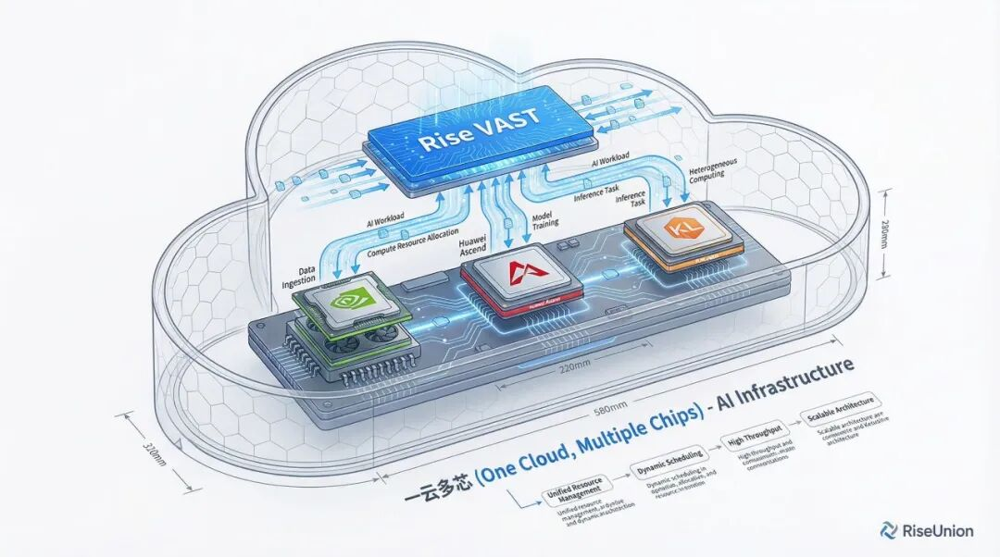

[English](./README.en.md) · [文章目录](../../README.md) · [官网阅读](https://www.theriseunion.com/zh/blog/enterprise-ai-cost-accounting.html)

# 4 万亿建算力网，企业的 AI 成本账应该怎么算

睿思智联 · 2026/08/19 08:00（北京时间）

从全国一体化算力网的 4 万亿元新增投资，到日均 140 万亿词元调用量，企业 AI 正从试点走向规模化运营。本文拆解私有算力的真实成本，以及异构调度、模型服务与 Token 治理如何形成一本可核算的账。

7 月 31 日，国家发展改革委在新闻发布会上披露：据有关机构测算，**“十五五”时期全国一体化算力网建设将新增直接投资约 4 万亿元**。算力供给会越来越充裕，获取门槛也会越来越低。对企业来说，问题反而更具体了：AI 从“能用”走到“用得起、算得清、管得住”，中间隔着什么？

过去两年，很多企业做了同一件事：采购 GPU、搭建智算集群，上线智能客服、知识库问答和办公 Agent。预期是自建算力能把成本压下来，结果往往相反——AI 开支越来越说不清。哪个业务用了多少算力、消耗了多少 Token，本地模型和公有 API 哪个更划算？财务想核算投入产出，却发现连一本清晰的台账都没有。

这篇文章想说清楚三件事：4 万亿元投的是什么；为什么 Token 成本问题在 2026 年躲不开了；以及企业端缺的那块能力，应该长什么样。

> 本文根据睿思智联微信公众号文章[《4 万亿建算力网，企业的 AI 成本账应该怎么算》](https://mp.weixin.qq.com/s/utiSIjRR_UxGFIos7tGyfw)整理发布，并补充了政策与研究原文链接。

## 4 万亿建的是“网”，不是一堆卡

这轮投资容易被读成 GPU 采购行情，但政策原文的关键词是“网”。“十五五”规划把算力网与国家水网、新型电网、新一代通信网、地下管网、物流网并列为“六张网”统筹建设。电网的价值从来不在发电机的总数，而在全域流转、统一调度和稳定供给——算力网的逻辑相同：把分散的数据中心连成一张可统筹调度的网。

[国家发展改革委 2026 年 7 月 31 日发布会](https://www.ndrc.gov.cn/xwdt/wszb/7yxwfbh/wzsl/202607/t20260731_1406818.html)还强调，“六张网”不是彼此独立、各自运行的分散体系，而是深度耦合、相互赋能、协同支撑的整体；建设算力网要注重供需适配、算电协同、安全可靠、绿色低碳和成本可控。

把这个逻辑下沉到企业内部，同样成立。一个智算集群建成之后，常见的状态是：

- NVIDIA、昇腾、海光、寒武纪各管一摊，纳不进同一个资源池；
- 客服、研发、Agent 各自占卡，重复建设；
- 本地模型和公有 API 的 Token 消耗分属两本账，没人能拼出全貌；
- 利用率、能耗和任务负载缺乏统一监控。

卡是买回来了，“网”没有建起来。账面固定资产在增加，业务收益没有同步增长。算力最大的损耗不只是采购价，还有长期低负载空转、成本无法溯源带来的隐性消耗。

## 日均 140 万亿词元之后，成本问题躲不开了

2026 年 3 月的中国发展高层论坛上，国家数据局局长刘烈宏披露：全国日均 Token 调用量已突破 140 万亿；从 2024 年初的 1000 亿到这一水平，两年增长超过千倍。国家数据局还将 Token 的中文名明确为“词元”。一个计量单位有了统一称呼，也意味着它正在进入更广泛的统计、计价与核算体系。数据详见[国家数据局发布的演讲全文](https://www.nda.gov.cn/sjj/jgsz/jld/llh/llhldhd/0323/20260323202204680553721_pc.html)。

企业侧的变化是同一条曲线。试点阶段，AI 挂在创新预算下，考核的是模型效果和上线速度，成本可以暂时不问。到了规模化运营阶段——日均 Token 消耗进入亿级、十亿级——AI 就是一个持续运转的生产系统：公私算力混合调度，投入纳入长期基础设施核算，IT、财务、合规都要进场。考核指标随之变成四个具体问题：

1. 单位 Token 的真实成本是多少？
2. 各业务线分别占用了多少资源？
3. 哪些负载放本地、哪些走公有 API 最划算？
4. 物理 GPU 的有效负载比例是多少？

第四个问题最容易被低估。卡内基梅隆大学等机构的研究者在 2026 年 4 月发布论文 [*The Energy Cost of Execution-Idle in GPU Clusters*](https://arxiv.org/abs/2604.04745)，分析了大型学术 AI 集群的逐秒遥测数据，并回放了多组行业服务流量。研究发现，GPU 在程序已加载但几乎没有有效活动时，仍可能维持较高功耗；在回放实验中，Azure Code 流量有 65% 的执行期能耗落在这种低活动区间，BurstGPT Chat 为 52%。

这里需要注意研究边界：65% 和 52% 是特定流量、模型、服务系统与 L40S 平台下的测量结果，不应外推为所有 Agent 或对话业务的固定比例。论文对整个学术集群的统计是：execution-idle 约占执行期能耗的 10.7%。但它揭示的问题很明确——“已分配”不等于“在产出”，仅看卡数或分配率，会漏掉一部分真实成本。

过去企业用“API 单价 × 调用量”估算 AI 成本，这个算法在私有化部署下会大幅失真：显存分配、异构适配、任务排队和推理效率，每一项都在产生账面上看不到的成本。当 Token 成为衡量 AI 消耗的统一标尺，基础设施就不能只做调用入口，还要把统一调度和全链路计量补上。

## 自建算力划不划算，取决于能不能算清

企业自建智算集群的理由通常有三个：敏感数据不出域、业务推理稳定可控、长期大规模调用比公有 API 便宜。前两个是刚性的，第三个是有条件的——条件就是这套集群可计量、可调度。

如果单张 GPU 长期被轻量小模型独占，多品类加速卡无法统一纳管，Token 消耗没有分户计量，自建集群就是一个成本黑箱。公有 API 至少单价透明；私有化没有计量体系，连浪费发生在哪里都定位不了。

所以，一套合格的私有化 AI 基础设施要同时给出三样东西。

### 合规闭环

金融、能源、央国企的敏感数据，要求训练、推理和 Agent 调用在受控边界内完成，而且要经得起检查。数据分类分级、等保与密评、信创适配、生成式 AI 服务治理、调用留痕与权限隔离，都要落在平台能力上，而不是停留在供应商的承诺里。

### 动态控本

短期试错业务适合公有 API，上线快、门槛低；智能客服、文档审核、工业 Agent 这类高频稳态业务更适合本地承载。基础设施要能对比折旧、能耗、运维与 API 持续费用，把负载动态分配到更合适的一侧。

### 异构统一

“十五五”期间国产算力生态会继续壮大，企业集群混合搭载国内外多品牌芯片将成为常态。硬件差异要在平台层被屏蔽，否则每引入一种卡，就多养一套运维体系。

## 睿思智联的做法：先盘活存量，再谈新增

睿思智联做的事可以用一句话概括：不要求企业先新增硬件投入，而是把已经买下的算力、已经在用的公有服务、已经上线的 AI 业务，纳入同一个可计量、可调度的运营框架。

产品体系分三层：底层 [Rise VAST](https://www.theriseunion.com/zh/product/vast.html) 与 [Rise CAMP](https://www.theriseunion.com/zh/product/camp.html) 负责算力一体化，中层 [Rise ModelX](https://www.theriseunion.com/zh/product/modelx.html) 负责模型服务，顶层 [Rise Router](https://www.theriseunion.com/zh/product/router.html) 负责内外 Token 的统一治理。

### 算力层：统一纳管，精细调度

Rise VAST 基于 CNCF Sandbox 开源项目 [HAMi](https://www.cncf.io/projects/hami/) 打造企业级能力，统一纳管 NVIDIA、昇腾、海光、寒武纪等 10 余家厂商的加速卡；Rise CAMP 在此之上进行 vGPU 细粒度切分与调度，区分“分配率”和“使用率”，按实际使用情况调度，让知识库问答、轻量推理、低并发 Agent 等任务不再默认独占整卡。

几个已交付项目的数据：

- 某国有银行利用 Rise CAMP 构建异构算力资源池，纳管超过 600 台服务器，资源利用率提升 50% 以上；
- 某运营商在 100 余台服务器的集群上部署 500 多个模型服务与 AI 应用，GPU 利用率提升至 70% 以上；
- 某制造企业统一管理本地与远端 GPU 资源，利用率提升 60% 以上，AI 应用上线周期从数周级压缩到数天级。

这些数据来自不同客户、不同负载，不能横向相加，但指向同一件事：利用率的改善空间，往往大于模型单价的谈判空间。

### 模型层：把算力变成 Token 产能

Rise ModelX 提供从模型微调、部署到推理服务的全链路能力，适配 vLLM、SGLang、MindIE 等主流推理引擎，重点进行国产加速卡上的推理优化。同样的硬件，在不同模型、引擎、批处理与并发策略下，Token 吞吐可能相差数倍——这一层直接决定单位 Token 成本。

### 治理层：一本账管住内外全部 Token

Rise Router 打通本地推理与第三方公有 API，全链路采集 Token 消耗，按部门、业务线、应用、模型、Agent 等维度归因。业务部门看得到自己的开销，IT 能定位瓶颈，财务能做成本分摊——降本从口号变成有数据支撑的动作。

Agent 治理是这一层的新命题。Agent 消耗的不只是 GPU：流程编排、数据库查询、权限审计和工具调用，也会占用 CPU、网络与存储。平台需要为每个 Agent 划定资源配额、限流策略、权限边界与调用审计，避免一条失控任务挤占整个集群。

在标准层面，睿思智联是人工智能产业工作委员会（AIIC）AI 算力池化工作组组长单位，参与编制了《异构算力虚拟化及池化系统要求》（T/CESA 1463—2025）团体标准。这些做法正在从单个厂商的实践，逐步沉淀为行业通用要求。

## 四个问题，测出企业 AI 的成熟度

4 万亿元投资会推动算力供给走向充裕，也会把竞争焦点从“有没有卡”移到“会不会用”。评估一家企业 AI 规模化运营的成熟度，不需要复杂框架，四个问题就够了——可以直接拿去问 IT 部门：

1. 每一次模型调用的成本，能不能归集到部门和应用？
2. 每张 GPU 的实际使用率是多少？和分配率相差多少？
3. 国产加速卡和 NVIDIA GPU，能不能在同一个资源池里统一调度？
4. 每个 Agent 的资源配额、权限边界和调用审计，归谁管？

四个问题都答得上来，算力才是可核算、有产出的生产力；答不上来，4 万亿元的红利到了企业这里，可能只是一批正在折旧的固定资产。

## 结语

北京睿思智联科技有限公司（RiseUnion）专注于 AI 算力管理与调度，已完成 10 余项国产芯片兼容认证，是 CNCF Sandbox 开源项目 HAMi 的核心贡献者之一。睿思智联致力于让算力像水电一样随取随用，为企业 AI 转型构建智能、可控、高效的算力底座。

如需进一步评估现有集群的利用率、单位 Token 成本或 Agent 资源治理方式，欢迎[联系睿思智联](https://www.theriseunion.com/zh/contact.html)，或致电 **400-605-2336**。

---

[在睿思智联官网阅读本文](https://www.theriseunion.com/zh/blog/enterprise-ai-cost-accounting.html) · [浏览更多文章](https://www.theriseunion.com/zh/blog.html)
