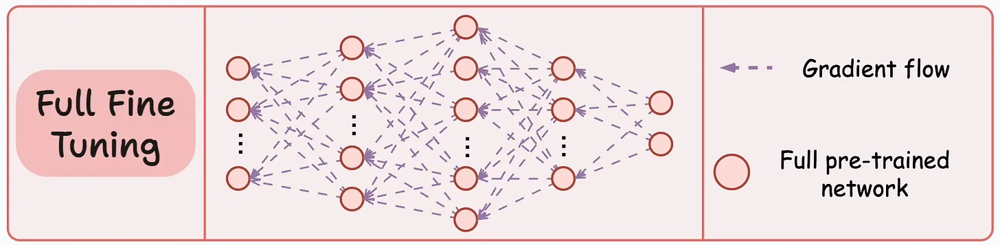
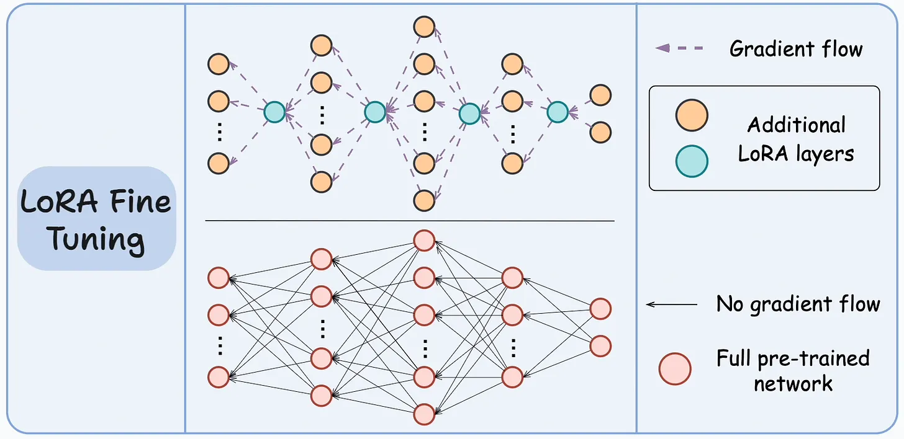
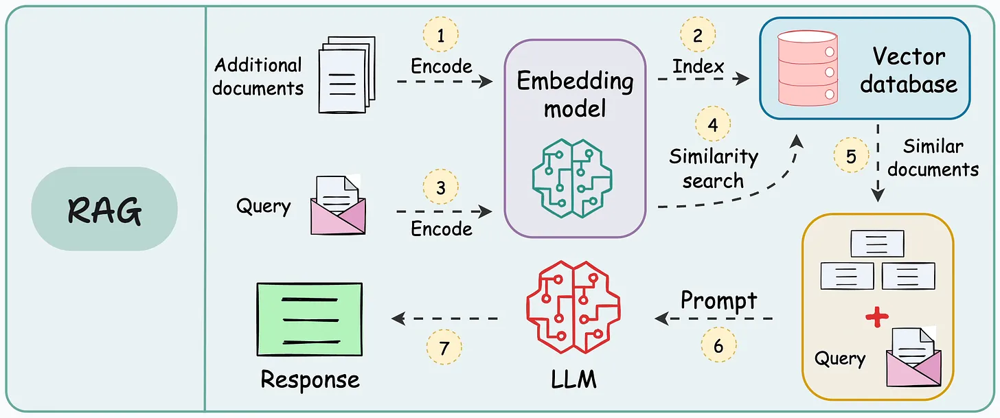
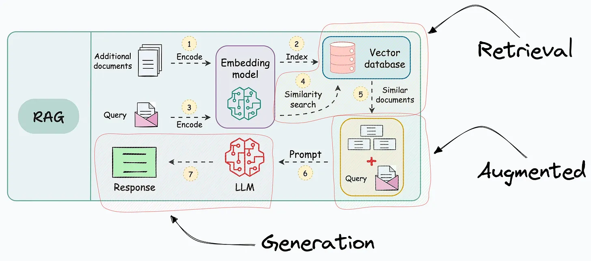

[简体中文](./README.md) · [All articles](../../README.en.md) · [Read on the website](https://www.theriseunion.com/en/blog/full-model-fine-tuning-vs-lora-vs.html)

# Full-model Fine-tuning vs. LoRA vs. RAG

RiseUnion · January 01, 2025 at 08:00 (UTC+08:00)

Compare three key techniques for enhancing LLMs: Full model fine-tuning, LoRA, and RAG. Learn their principles, advantages, limitations, and optimal use cases to make informed decisions for your AI applications.

Summary: This article introduces three key techniques for enhancing the performance of large language models (LLMs): full model fine-tuning, Low-Rank Adaptation (LoRA), and Retrieval-Augmented Generation (RAG). Full model fine-tuning adapts the entire model to new tasks by retraining it, but it is costly. LoRA fine-tuning achieves efficient fine-tuning by training a small number of parameters, saving resources. RAG enhances model generation by retrieving external knowledge, eliminating the need for fine-tuning. This article aims to help readers understand the principles, advantages, disadvantages, and suitable use cases of these techniques, providing a reference for practical applications.

## Full Model Fine-tuning

Fine-tuning, simply put, is the process of retraining a pre-trained model with new data to better adapt it to new tasks.

> For example, suppose you have a pre-trained image recognition model that can identify various objects. Now, you want this model to better identify specific types of birds. In this case, you can use full model fine-tuning to retrain the model with a large number of bird images. This way, the model will be better at recognizing these birds.

Although full model fine-tuning has been used for a long time, it encounters some issues when applied to large models like LLMs, mainly including:

-   The model size is very large, requiring significant computational resources.
-   Fine-tuning all weights is very costly, including time and money.
-   Maintaining the fine-tuned model is also difficult, requiring a lot of storage space and computational resources.

**Summary**: Full model fine-tuning is effective, but for large models, it is costly and resource-intensive.

**Rise CAMP** can effectively support the full model fine-tuning process through its unified development environment and task management functionality. Its built-in resource monitoring and automated operation and maintenance functions can help teams reduce environment deployment time from the traditional several days to less than 30 minutes. At the same time, Rise CAMP's multi-tenant isolation mechanism ensures that different teams' fine-tuning tasks do not interfere with each other, and resource utilization is increased by more than 40%. After using Rise CAMP for model fine-tuning, a certain financial institution reduced the end-to-end cycle of model training by more than 60%.

## Low-Rank Adaptation (LoRA)

LoRA fine-tuning is a technique that emerged to address some of the issues with traditional fine-tuning.

Its core idea is to decompose the weight matrix of the original model (which can be understood as the connections inside the model) into smaller matrices and then train only these smaller matrices.

> For example, you have a large language model, and you want it to better understand and generate text in a specific domain, such as medical papers. Using LoRA fine-tuning, you only need to train a small number of parameters to make the model perform better in the medical field without retraining the entire model.

For example, in the figure below, the bottom network represents the original large pre-trained model, and the top network represents the model with LoRA layers.

The key to this method is to train only the LoRA network while keeping the weights of the large model unchanged. This can greatly reduce the number of parameters that need to be trained, thus saving computational resources.

Looking at the visual diagram above, you might wonder:

> **But the LoRA model has more neurons than the original model, how does this help?**

To understand this, we must clarify that the number of neurons is not equivalent to the memory consumption of the network. Neurons are only used to represent the dimensional transformation from one layer to another.

In fact, what occupies memory is the weight matrix (i.e., the connections between layers).

Therefore, what we need to compare is these weight matrices (connections), not the number of neurons.

From the figure above, the number of connections in the LoRA network is much smaller than in the original model.

To delve deeper:

-   **How does LoRA work?**
-   **Compared to traditional fine-tuning, why can LoRA improve performance while saving costs?**
-   **How to implement LoRA fine-tuning from scratch?**
-   **How to use Hugging Face PEFT for LoRA fine-tuning?**

**Summary**: LoRA fine-tuning greatly reduces the cost of fine-tuning by training only a small number of parameters while maintaining model performance.

**Rise CAMP** provides complete workflow support for LoRA fine-tuning. Through its one-stop training task management function, teams can easily create, monitor, and manage multiple LoRA fine-tuning tasks. The built-in model version management system allows different versions of LoRA weights to be effectively tracked and reused. A technology company ran more than 200 LoRA fine-tuning tasks simultaneously on the Rise CAMP platform, improving development efficiency by 70% and achieving a resource utilization rate of 85% while ensuring stability.

## Retrieval-Augmented Generation (RAG)

Retrieval-Augmented Generation (RAG) is another technique that enhances neural networks without fine-tuning the model.

> For example, you have a customer service robot, and you want it to answer various questions about your company's products. You can convert your company's product documentation into vectors and store them in a vector database. When a user asks a question, the RAG system first searches for relevant documents in the vector database and then provides these documents along with the user's question to the LLM to generate the final answer. This way, even if the LLM has not been directly trained on this product information, it can still provide accurate answers.

The specific process is as follows:

**Steps 1-2**: Embed and store additional data in a vector database (this process only needs to be performed once. If the data is dynamic, you only need to continuously append the embedded data to the vector database without re-embedding all the data).

**Step 3**: Use the same transformation method to convert the user's question into a vector.

**Steps 4-5**: Find the neighbors in the vector database that are most similar to the query embedding.

**Steps 6-7**: Pass the original query and the retrieved relevant documents (to provide more context) to the LLM to generate the final answer.

As its name suggests, the operation of RAG technology includes the following three parts:

-   **Retrieval**: Accessing and retrieving information from a knowledge source (such as a database or memory).
-   **Augmentation**: In this case, enhancing or enriching the text generation process by adding information or context.
-   **Generation**: Refers to the process of generating text or language.

Of course, RAG also has its limitations:

RAG needs to compare the similarity between question vectors and document vectors. However, the structure of the question may be very different from the structure of the answer.

Typical RAG systems are usually only suitable for question-answering systems. For example, we cannot use RAG to summarize documents because similarity matching can only find the documents most relevant to the question, and the LLM cannot obtain information from all documents.

Therefore, RAG has both advantages and disadvantages:

-   We do not need to fine-tune the model, thus saving a lot of computational resources.
-   But this also limits its applicable scenarios, making it only suitable for specific types of systems.

**Summary**: RAG enhances the model's generation ability by retrieving relevant information, but its applicable scenarios are limited.

**Rise CAMP** offers a comprehensive solution for the development and deployment of RAG systems. Leveraging its built-in service orchestration capabilities, teams can rapidly build and optimize RAG applications. The platform's auto-scaling feature ensures performance stability in high-concurrency scenarios. A certain e-commerce company utilizing Rise CAMP's deployed RAG system supports thousands of concurrent requests per second, with a 40% reduction in response latency and a 50% decrease in maintenance costs.

## Conclusion

This article introduces three techniques for enhancing the performance of large models: full model fine-tuning, LoRA fine-tuning, and Retrieval-Augmented Generation (RAG).

-   **Full Model Fine-tuning**: By retraining the entire model with new data, the model can better adapt to specific tasks. However, this method requires a lot of computational resources and time, making it costly. **With Rise CAMP's resource management, these costs can be effectively reduced.**
-   **LoRA Fine-tuning**: By training only a small number of parameters, the cost of fine-tuning is greatly reduced while maintaining the model's performance. It is suitable for scenarios where large models need to be fine-tuned in specific domains. **Rise CAMP's multi-tenant management features make team collaboration more efficient.**
-   **RAG**: Enhances the model's generation ability by retrieving relevant information without fine-tuning the model, saving computational resources. However, its applicable scenarios are limited, mainly for question-answering systems. **Rise CAMP's task management ensures efficient resource utilization.**

The choice of which technology to use depends on the specific application scenario and resource constraints. We hope this article can help you better understand the principles and applications of these technologies.

We hope the above content helps you better understand how these three methods work and their advantages and disadvantages.

### Rise CAMP's Advantages

When implementing the above technologies, Rise CAMP provides a one-stop solution with the following core advantages:

#### Unified Development Environment
   - Pre-configured development environments for various fine-tuning needs, reducing environment deployment difficulty.
   - Supports multiple mainstream frameworks and tools, providing a unified user experience.
   - Out-of-the-box workflow templates to accelerate project launch.

#### Efficient Resource Management
   - Intelligent task scheduling, increasing average resource utilization by 40-85%.
   - Multi-tenant isolation mechanism to support parallel team development.
   - Automatic scaling capabilities to adapt to high-concurrency scenarios.

#### Complete Collaboration Features
   - Version management system to track all experiments and model changes.
   - Visual monitoring interface to track training status in real-time.
   - Unified permission management to ensure data and model security.

#### Reduced Barrier to Entry
   - Graphical user interface to lower the technical threshold.
   - Rich best practice templates to shorten the learning curve.
   - Comprehensive monitoring and alerting mechanisms to improve operational efficiency.

By using Rise CAMP, enterprises can:
- Reduce model development cycles by more than 60%.
- Reduce maintenance costs by 50%.
- Increase team development efficiency by 70%.
- Achieve significant improvements in resource utilization.

Whether it's full model fine-tuning, LoRA fine-tuning, or RAG, Rise CAMP provides a complete toolchain and best practice support to help companies quickly build and optimize their AI applications. See [Rise CAMP](https://www.theriseunion.com/en/product/camp.html) for more information.

> This article references: [Full-model Fine-tuning vs. LoRA vs. RAG](https://blog.dailydoseofds.com/p/full-model-fine-tuning-vs-lora-vs), with appropriate modifications.

---

[Read this article on the RiseUnion website](https://www.theriseunion.com/en/blog/full-model-fine-tuning-vs-lora-vs.html) · [Explore more articles](https://www.theriseunion.com/en/blog.html)
