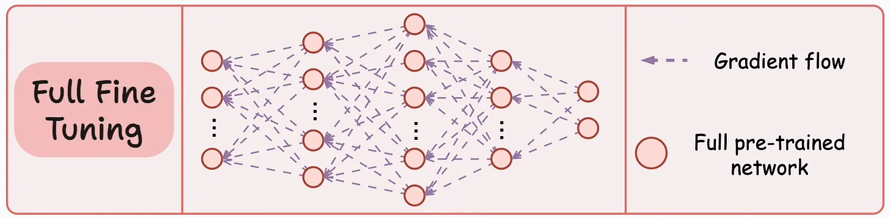
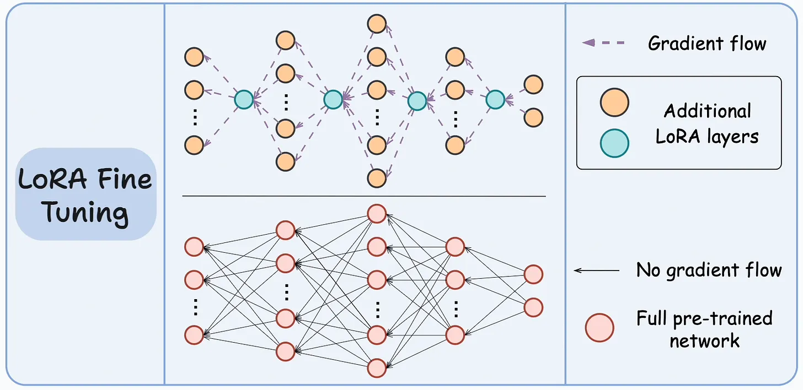
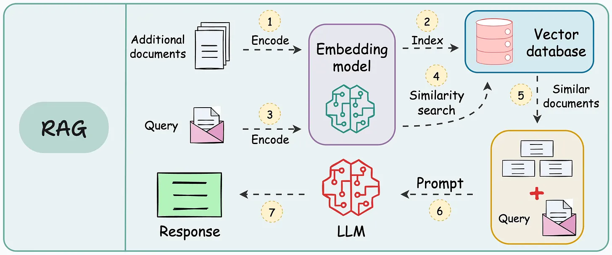
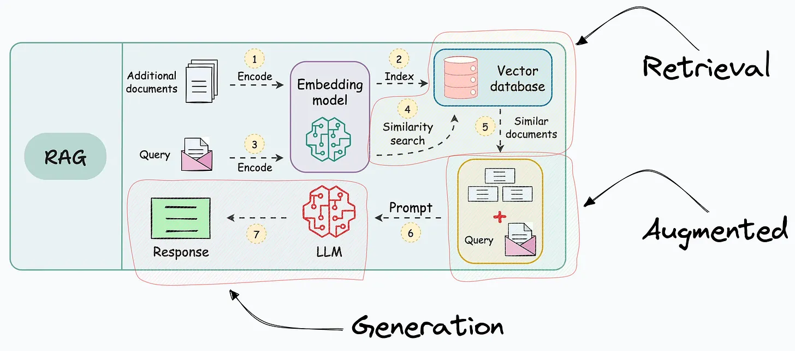

[English](./README.en.md) · [文章目录](../../README.md) · [官网阅读](https://www.theriseunion.com/zh/blog/full-model-fine-tuning-vs-lora-vs.html)

# 大模型性能提升秘籍：全模型微调、LoRA微调与RAG技术详解

睿思智联 · 2024/12/21 08:00（北京时间）

深入对比提升大语言模型性能的三大关键技术：全模型微调、LoRA和RAG。了解它们的原理、优势、局限性和最佳应用场景，助您为AI应用选择最适合的优化方案。

摘要：本文介绍了三种提升大型模型性能的关键技术：全模型微调、LoRA微调和检索增强生成（RAG）。全模型微调通过重新训练整个模型来适应新任务，但成本高昂；LoRA微调则通过训练少量参数实现高效微调，节省资源；RAG则通过检索外部知识来增强模型生成能力，无需微调。本文旨在帮助读者理解这些技术的原理、优缺点和适用场景，并探讨如何通过 Rise CAMP 实现这些技术的最佳实践。

## 全模型微调（Full Model Fine-tuning）

微调，简单来说，就是在已经训练好的模型基础上，用新的数据进行再次训练，让模型更好地适应新的任务。

> 例如，假设你有一个已经训练好的、能够识别各种物体的图像识别模型。现在，你希望这个模型能够更好地识别特定类型的鸟类。这时，你可以使用全模型微调的方法，用大量的鸟类图片来重新训练这个模型。这样，模型就能更好地识别这些鸟类了。

虽然全模型微调技术已经使用了很长时间，但在应用于像 LLM 这样的大型模型时，会遇到一些问题，主要包括：

- 模型的体积非常大，需要大量的计算资源。
- 微调所有权重需要很高的成本，包括时间和金钱。
- 维护微调后的模型也很困难，需要大量的存储空间和计算资源。

**总结**：全模型微调虽然有效，但对于大型模型来说，成本高、资源消耗大。

通过统一的开发环境和任务管理功能，**Rise CAMP AI 算力调度平台**可以有效支持全模型微调过程。其内置的资源监控和自动化运维功能，可以帮助团队将环境部署时间从传统的数天缩短至 30 分钟以内。同时，Rise CAMP 的多租户隔离机制确保了不同团队的微调任务互不干扰，资源利用率提升超过 40%。某金融机构使用 Rise CAMP 进行模型微调后，将模型训练的端到端周期缩短了 60% 以上。

## LoRA微调（Low-Rank Adaptation）

LoRA微调技术是为了解决传统微调的一些问题而出现的。

其核心思想是将原始模型的权重矩阵（可以理解为模型内部的连接）分解成更小的矩阵，然后只训练这些小矩阵。

> 例如，你有一个大型的语言模型，你希望它能够更好地理解和生成特定领域的文本，比如医学领域的论文。使用 LoRA 微调，你只需要训练少量参数，就可以让模型在医学领域表现更好，而不需要重新训练整个模型。

这一方法的关键是：只训练 LoRA 网络，保持大型模型的权重不变。这样可以大大减少需要训练的参数量，从而节省计算资源。

**Rise CAMP AI 算力调度平台**为 LoRA 微调提供了完整的工作流支持。通过其一站式的训练任务管理功能，团队可以轻松创建、监控和管理多个 LoRA 微调任务。内置的模型版本管理系统让不同版本的 LoRA 权重可以被有效追踪和复用。某科技公司在 Rise CAMP 平台上同时运行超过 200 个 LoRA 微调任务，在保证稳定性的同时将开发效率提升了 70%，资源利用率达到 85%。

## 检索增强生成（RAG）

检索增强生成（RAG）是另一种无需微调模型便可增强模型的技术。

> 例如，你有一个客户服务机器人，你希望它能够回答关于你公司产品的各种问题。你可以将你公司的产品文档转换成向量，并存储到向量数据库中。当用户提出问题时，RAG系统会先在向量数据库中查找相关文档，然后将这些文档和用户的问题一起交给LLM，生成最终的答案。这样，即使LLM没有直接训练过这些产品信息，它也能给出准确的答案。

具体流程如下：

- **步骤1-2**：将额外的数据转换成向量，并存储到向量数据库中（这个过程只需执行一次。如果数据是动态变化的，只需不断将新的数据转换成向量并添加到向量数据库中，无需对所有数据重新进行转换）。
- **步骤3**：使用相同的转换方法，将用户的问题也转换成向量。
- **步骤4-5**：在向量数据库中查找与用户问题向量最相似的向量。
- **步骤6-7**：将用户的问题和找到的相关文档一起交给LLM，生成最终的答案。

正如其名字所示，RAG技术的运作过程包括以下三部分：

- **检索**：从知识库（如数据库或文档库）中查找相关信息。
- **增强**：通过附加信息或上下文来丰富生成文本的过程。
- **生成**：指生成文本或语言的过程。

当然，RAG也有其局限性：
- RAG需要比较问题向量和文档向量的相似度。然而，问题的结构与答案的结构可能差异很大。
- 典型的RAG系统通常只适用于基于问答的系统。例如，我们无法使用RAG来总结文档。因为相似度匹配只能找到与问题最相关的文档，LLM无法获取所有文档的信息。

因此，RAG既有优点，也有缺点：
- 我们不需要微调模型，从而节省了大量的计算资源。
- 但这也限制了其适用场景，仅适合特定类型的系统。

**Rise CAMP AI 算力调度平台**为 RAG 系统的开发和部署提供了完整的解决方案。通过其内置的服务编排功能，团队可以快速构建和优化 RAG 应用。平台的自动扩缩容能力确保了在高并发场景下的性能稳定。某电商企业使用 Rise CAMP 部署的 RAG 系统，支持每秒数千次的并发请求，响应延迟降低 40%，同时维护成本降低 50%。

## 总结

本文介绍了全模型微调、LoRA微调和检索增强生成（RAG）这三种用于增强大型模型性能的技术。

- **全模型微调**：通过使用新的数据重新训练整个模型，可以使模型更好地适应特定任务，但这种方法需要大量的计算资源和时间，成本较高。结合 Rise CAMP 的资源管理，可以有效降低这些成本。
- **LoRA微调**：通过只训练少量参数，大大降低了微调的成本，同时保持了模型的性能。Rise CAMP 的多租户管理功能使得团队协作更加高效。
- **RAG**：通过检索相关信息来增强模型的生成能力，无需微调模型，节省了计算资源。Rise CAMP 的任务管理确保了高效的资源使用。

### Rise CAMP 的综合优势

在实施以上技术时，Rise CAMP 提供了一站式的解决方案，带来以下核心优势：

#### 统一的开发环境
   - 预配置各类微调所需的开发环境，降低环境部署难度
   - 支持多种主流框架和工具，提供统一的使用体验
   - 开箱即用的工作流模板，加速项目启动

#### 高效的资源管理
   - 智能的任务调度，平均资源利用率提升 40-85%
   - 多租户隔离机制，支持团队并行开发
   - 自动扩缩容能力，适应高并发场景

#### 完整的协作功能
   - 版本管理系统，追踪所有实验和模型变更
   - 可视化的监控界面，实时掌握训练状态
   - 统一的权限管理，确保数据和模型安全

#### 降低使用门槛
   - 图形化操作界面，降低技术门槛
   - 丰富的最佳实践模板，缩短学习曲线
   - 完善的监控和告警机制，提升运维效率

通过使用 Rise CAMP，企业可以：
- 将模型开发周期缩短 60% 以上
- 降低 50% 的维护成本
- 提升 70% 的团队开发效率
- 实现资源利用率的显著提升

选择哪种技术取决于具体的应用场景和资源限制。通过 Rise CAMP 的支持，团队可以更轻松地实施这些技术，实现高效的 AI 模型管理和优化。无论是全模型微调、LoRA 微调还是 RAG，Rise CAMP 都能提供完整的工具链和最佳实践支持，帮助企业快速构建和优化其 AI 应用。更多信息请访问 [Rise CAMP](https://www.theriseunion.com/zh/product/camp.html)。

> 本文参考：[Full-model Fine-tuning vs. LoRA vs. RAG](https://blog.dailydoseofds.com/p/full-model-fine-tuning-vs-lora-vs)，有适当的修改。

---

[在睿思智联官网阅读本文](https://www.theriseunion.com/zh/blog/full-model-fine-tuning-vs-lora-vs.html) · [浏览更多文章](https://www.theriseunion.com/zh/blog.html)
