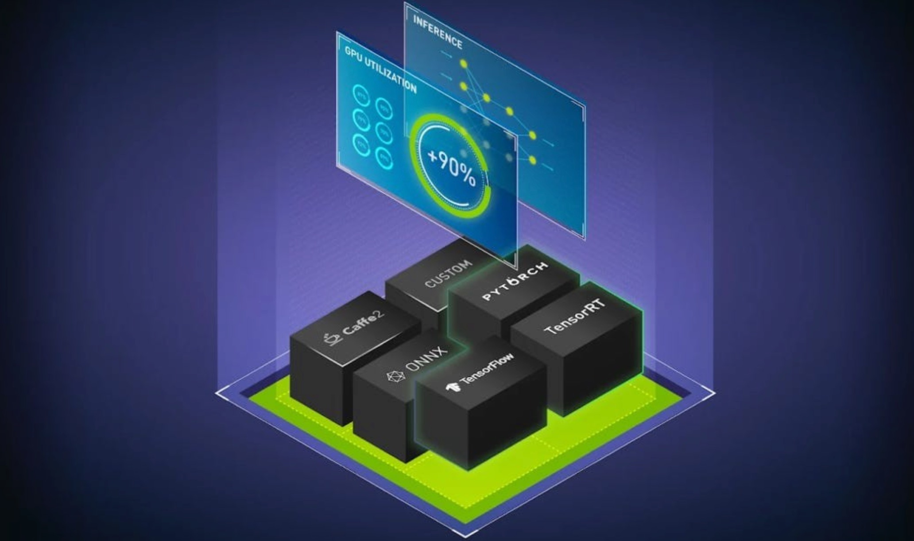
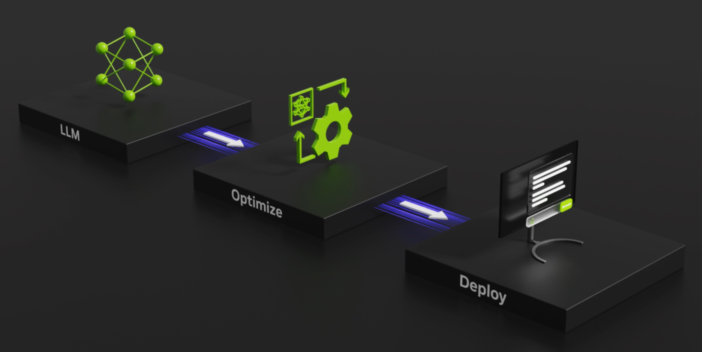
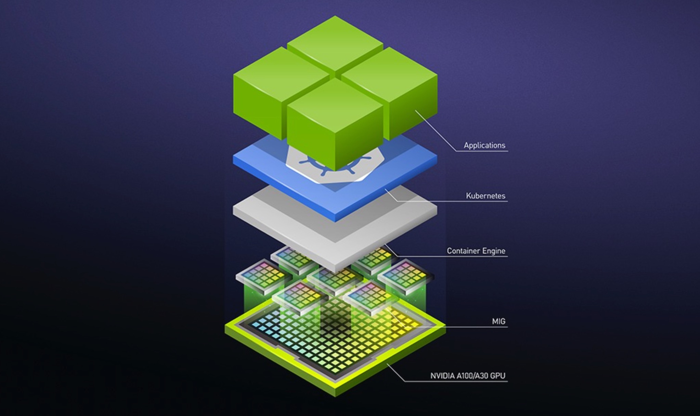
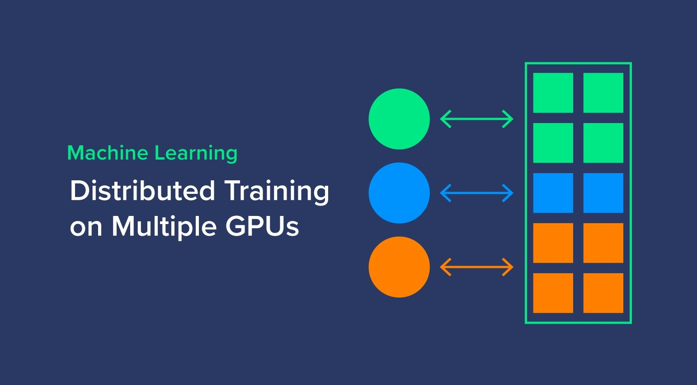

[简体中文](./README.md) · [All articles](../../README.en.md) · [Read on the website](https://www.theriseunion.com/en/blog/gpu-pooling-for-accelerated-ai-training-and-cost-optimization.html)

# Break the Misconception! GPU Pooling for Accelerated AI Training

RiseUnion · January 01, 2025 at 08:00 (UTC+08:00)

Explore how GPU pooling revolutionizes AI computing resource management, addressing misconceptions and demonstrating how unified GPU management optimizes training efficiency, reduces costs, and solves heterogeneous hardware challenges in enterprise environments.

Summary: As AI computing demands continue to rise, particularly in heterogeneous hardware environments, effectively managing GPU resources has become a key challenge for organizations. This article explores the need for GPU pooling and unified management, addressing common misconceptions such as the belief that current compute power is sufficient or that GPU pooling negatively impacts performance. By demonstrating how GPU pooling optimizes resource utilization, enhances scheduling efficiency, and reduces costs, the article shows how this approach accelerates training and inference tasks, improves hardware utilization, reduces waste, and avoids vendor lock-in. GPU pooling provides organizations with a more flexible and cost-effective solution, enhancing overall compute resource management.

## The Growing Challenge of Computing Resource Management in AI

The exponential growth of AI technology, particularly in large-scale model training and inference, has created unprecedented demands for computing resources. Traditional resource management approaches are struggling to keep pace, especially in heterogeneous hardware environments where efficiently orchestrating diverse compute resources has become a critical challenge. While GPUs remain essential for deep learning and large-scale computation, the increasing variety of GPU types and architectures has significantly complicated resource management.

Organizations often deploy multiple GPU types from vendors like NVIDIA, Ascend, and Cambricon, sometimes within the same system. This hardware heterogeneity not only complicates management but also leads to resource underutilization and inefficiencies. As AI advances, particularly with the emergence of large language models and real-time inference requirements, the demand for efficient GPU resource management becomes increasingly crucial.

## The Case for Unified GPU Pool Management

GPU pool management enables centralized control, virtualization, and scheduling of diverse GPU resources through advanced technology solutions. This approach aims to optimize resource allocation by creating a unified pool that can dynamically assign GPU resources based on workload requirements, preventing resource wastage and inefficient utilization.

As organizations' AI computing needs grow more complex, relying on single-vendor or single-model GPUs becomes insufficient. The challenges of hardware compatibility and resource scheduling in heterogeneous environments require a more sophisticated approach. GPU pooling standardizes the management of diverse resources (such as NVIDIA A100, Ascend 910, and Cambricon accelerators), ensuring seamless operation across different hardware platforms while optimizing resource utilization and reducing IT costs.

In this context, **Rise VAST** (Virtualized AI Computing Scalability Technology) emerges as a comprehensive compute and resource management platform. By deeply integrating heterogeneous resource scheduling and optimization, Rise VAST significantly enhances GPU pool management efficiency. The platform excels not only in GPU resource pooling but also in comprehensive data collection, real-time monitoring, and scheduling optimization, enabling dynamic AI compute scaling and demand-based allocation.

## 4 Common Misconceptions in AI Computing Management

Let's address four prevalent misconceptions about GPU pool management and examine the benefits of implementing a unified management approach.

### Misconception 1: **"Sufficient Training Compute Makes GPU Pooling Unnecessary"**

**The Myth**: Organizations often assume that having adequate training compute capacity for current AI workloads eliminates the need for GPU pooling.

**Benefits of GPU Pool Management**:

- **Proactive Resource Planning**: GPU pooling enables organizations to prepare for future compute demands through dynamic resource scaling and allocation.
- **Enhanced Resource Utilization**: Through intelligent workload distribution across training and inference tasks, **Rise VAST** maximizes GPU utilization while minimizing resource idle time.

### Misconception 2: **"More GPUs Alone Solve Computing Challenges"**

**The Myth**: Simply acquiring more GPUs will address all computing bottlenecks, making pool management unnecessary.

**Benefits of GPU Pool Management**:

- **Intelligent Resource Orchestration**: **Rise VAST** provides real-time monitoring and automated GPU resource matching, preventing overallocation and resource waste.
- **Cost Optimization**: Smart scheduling and resource pooling eliminate hardware redundancy and over-provisioning, significantly reducing operational costs.

### Misconception 3: **"GPU Compatibility Issues Make Pooling Ineffective"**

**The Myth**: Hardware differences between GPU vendors (NVIDIA, Ascend, Cambricon) make unified pool management impractical.

**Benefits of GPU Pool Management**:

- **Seamless Hardware Integration**: **Rise VAST** effectively bridges compatibility gaps between different GPU vendors and models through virtualization and unified management.
- **Workload-Optimized Scheduling**: Automatic workload-to-hardware matching ensures optimal performance across diverse GPU types.

### Misconception 4: **"Virtualization Degrades Performance"**

**The Myth**: GPU pooling's virtualization layer inevitably leads to performance overhead and reduced efficiency.

**Benefits of GPU Pool Management**:

- **Performance Optimization**: **Rise VAST**'s advanced scheduling algorithms minimize virtualization overhead while maximizing overall system performance.
- **Intelligent Workload Distribution**: Automated priority-based scheduling ensures optimal resource allocation and performance across the GPU pool.

## Key Benefits of GPU Pool Management for Training and Inference

GPU pool management delivers several crucial advantages:

- **Maximized Resource Utilization**: Unified management enables dynamic resource allocation, significantly reducing GPU idle time and waste.
- **Cost Efficiency**: Optimized resource usage and intelligent scheduling lead to substantial cost savings in computing infrastructure.
- **Simplified Management**: Centralized control through **Rise VAST** streamlines resource administration and monitoring.
- **Enhanced Flexibility**: Adaptable compute resources meet varying workload demands across different AI applications and models.

## Conclusion

As AI technology advances and compute demands grow, particularly for GPU resources, organizations face increasing management challenges. **Rise VAST** addresses these challenges through efficient GPU pool management, enabling centralized control of diverse hardware resources. This approach not only improves resource utilization and reduces IT costs but also ensures seamless AI workload execution across different hardware platforms. Through **Rise VAST**, organizations can effectively manage heterogeneous computing environments while providing robust support for AI training and inference operations.

---

[Read this article on the RiseUnion website](https://www.theriseunion.com/en/blog/gpu-pooling-for-accelerated-ai-training-and-cost-optimization.html) · [Explore more articles](https://www.theriseunion.com/en/blog.html)
