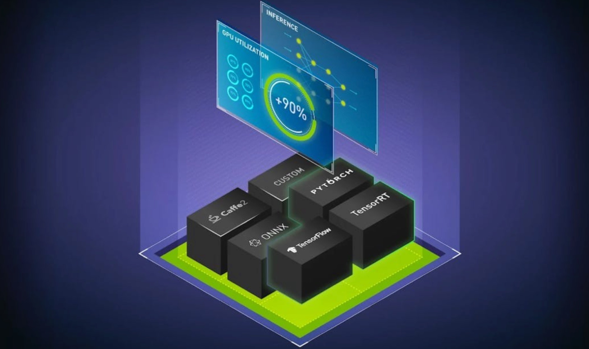
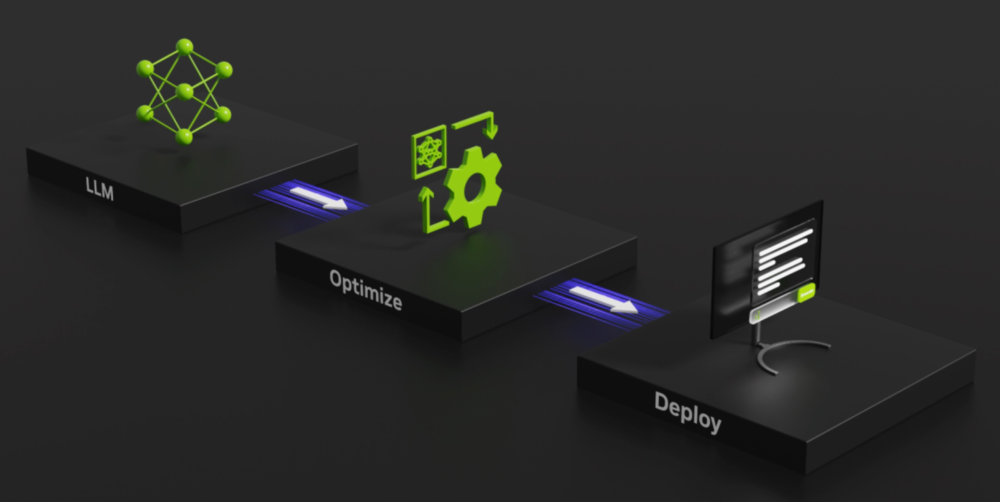
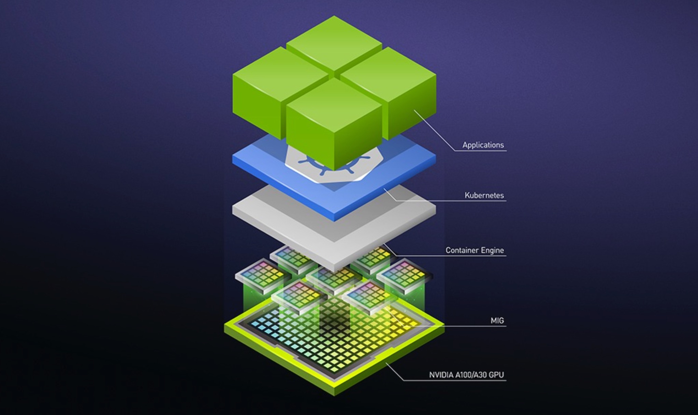
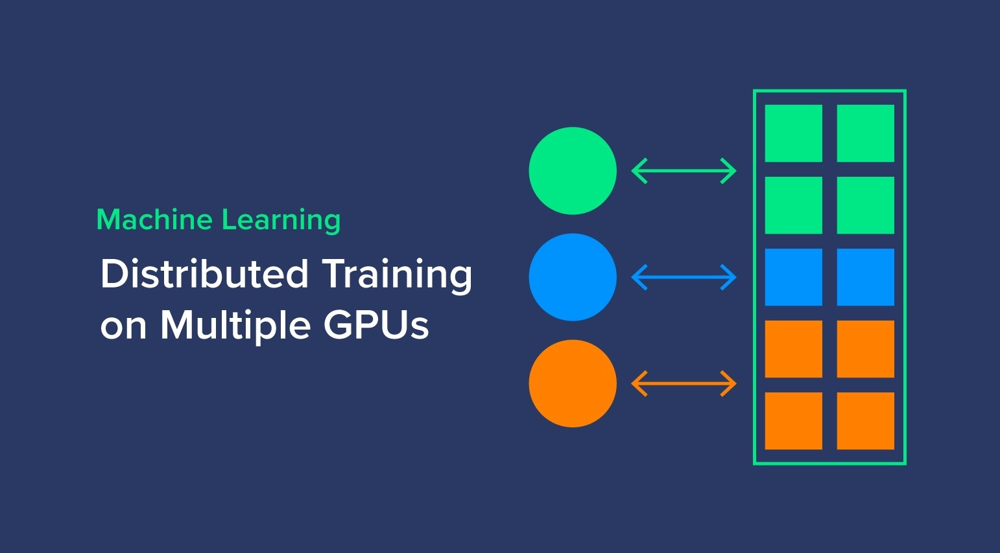

[English](./README.en.md) · [文章目录](../../README.md) · [官网阅读](https://www.theriseunion.com/zh/blog/gpu-pooling-for-accelerated-ai-training-and-cost-optimization.html)

# 打破认知误区！GPU 池化助力 AI 训练加速与成本优化

睿思智联 · 2024/12/23 08:00（北京时间）

深入探讨 GPU 池化技术如何通过虚拟化技术，将多张物理 GPU 的资源整合为一张逻辑 GPU，从而实现 AI 训练的加速和成本优化。

摘要：随着 AI 计算需求的不断增加，尤其是在异构硬件环境下，如何高效管理 GPU 资源成为企业面临的挑战。本文分析了 GPU 池化和统一管理的必要性，并揭示了常见的误区。通过介绍 GPU 池化如何优化资源利用率、提升调度效率、降低成本，本文说明了这种方法如何帮助加速训练过程和推理任务，提高硬件资源的利用效率，减少无效浪费，并避免厂商锁定。GPU 池化为企业提供了一个更灵活、成本更低的解决方案，帮助其提升整体算力管理水平。

## AI 智算背景下，面临算力管理的巨大挑战

随着 AI 技术的飞速发展，尤其是在大规模模型训练和推理的应用场景下，算力需求呈现出指数级的增长。传统的计算资源管理方式已经难以满足企业日益增长的计算需求，尤其是在异构硬件环境下，如何有效调度和利用不同类型的算力成为了一大难题。GPU 作为深度学习和大规模计算的核心硬件，在 AI 训练和推理中发挥着至关重要的作用，但由于市场上存在不同类型的 GPU 和不同的硬件架构，算力资源管理的复杂性也与日俱增。

例如，企业可能同时使用 NVIDIA、昇腾、寒武纪等多种 GPU，甚至在一个系统中部署多个型号的 GPU，这种硬件异构的环境不仅增加了管理难度，也导致了资源利用率低下、硬件浪费等问题。随着 AI 技术的快速进展，尤其是在大模型和实时推理的需求下，GPU 资源的需求将会进一步攀升。如何高效、灵活地管理和调度这些异构算力资源，已成为企业面临的一项重大挑战。

## 为什么需要 GPU 池化统一管理

GPU 池化统一管理是通过技术手段将不同类型、不同品牌的 GPU 资源进行集中管理、虚拟化和调度，从而实现更高效的资源分配和调度。其核心目标是通过统一的资源池化管理，将各类 GPU 资源按需分配给不同的任务，避免不同硬件资源间的浪费和低效使用。

随着企业对 AI 计算需求的不断增长，单纯依靠单一品牌或型号的 GPU 已经无法满足多样化的应用需求。不同硬件设备之间的差异，尤其是异构硬件环境下的兼容性问题，会增加计算任务调度的复杂度和资源管理的难度。通过 GPU 池化统一管理，能够将各种异构资源（如 NVIDIA A100、昇腾 910、寒武纪等）进行标准化处理，确保不同硬件环境下的无缝切换和优化使用，从而大幅提高 GPU 资源的利用率，降低企业的 IT 成本。

在此背景下，**Rise VAST**（Virtualized AI Computing Scalability Technology）作为一种统一的计算和资源管理平台，通过深度整合异构算力资源的调度与优化，极大提升了 GPU 池化管理的效能。Rise VAST 的优势不仅体现在 GPU 资源池化，还通过全面的数据采集、实时监控、调度优化等功能，实现了 AI 算力的动态扩展和按需分配，避免了硬件资源的浪费。

## AI 智算管理常见的 4 大误区

在 GPU 资源管理的过程中，一些企业往往存在对 GPU 池化统一管理的误解。以下是常见的四个误区，并分别展示了 GPU 池化统一管理后所带来的收益。

### 误区 1：**“训练算力足够，不需要 GPU 池化”**

**误解**：许多企业认为当前的训练算力已经足够应对现有的 AI 任务，尤其是在短期内没有显著的算力短缺问题时，便忽略了 GPU 池化的必要性。

**应用 GPU 池化统一管理后带来的收益**：

- **前瞻性资源调配**：即使当前没有算力短缺的问题，GPU 池化统一管理可以帮助企业在未来算力需求激增时，提前做好资源调配。GPU 池化允许资源的动态扩展和按需分配，帮助企业预测并应对未来的计算需求。
- **提高资源利用率**：通过 GPU 池化，不同任务（如训练、推理等）可以根据优先级和需求自动分配到合适的计算资源上，即使是在现有算力看似足够的情况下，也能最大化资源的使用效率。**Rise VAST** 通过实时的资源监控和智能调度，实现了 GPU 资源的高效利用，并减少了硬件资源的空闲和浪费。

### 误区 2：**“只要 GPU 够多，就能满足所有 AI 计算需求，无需池化”**

**误解**：有些企业认为只要购买足够多的 GPU，就能解决所有的计算瓶颈，GPU 池化统一管理的需求不大。

**应用 GPU 池化统一管理后带来的收益**：

- **高效资源调度**：当 GPU 数量增加时，单纯增加硬件并不能保证计算任务的顺利进行。GPU 池化统一管理平台能够实时监控和调度这些 GPU 资源，确保任务能够自动匹配合适的 GPU，避免过度分配或资源浪费。例如，**Rise VAST** 可以根据每个任务的负载情况动态分配 GPU 资源，避免某些 GPU 空闲而其他 GPU 过载的情况发生。
- **成本优化**：通过 GPU 池化管理，企业能够有效避免过度采购 GPU 硬件。**Rise VAST** 通过智能调度和资源池化，确保计算资源能够根据实际需求弹性调度，避免了硬件冗余或过度采购，从而有效降低了运营成本。

### 误区 3：**“不同 GPU 之间的兼容性问题无法解决，GPU 池化无效”**

**误解**：由于市场上存在多种 GPU 厂商（如 NVIDIA、昇腾、寒武纪等），且每家厂商的硬件架构、驱动及其配套的生态系统存在差异，许多企业认为，在这样的异构环境中，GPU 池化统一管理无法有效实现跨平台兼容。

**应用 GPU 池化统一管理后带来的收益**：

- **异构硬件无缝集成**：GPU 池化统一管理能够有效解决不同厂商和不同型号的 GPU 之间的兼容性问题。通过虚拟化技术和统一管理平台，企业可以将多种异构硬件（如 NVIDIA A100、昇腾 910、寒武纪等）整合进统一的池化平台，实现不同硬件资源的无缝调度。**Rise VAST** 在这一点上尤其突出，通过对硬件生态的统一适配，能够让企业在异构环境下高效调度资源，实现跨平台的兼容性和灵活性。
- **灵活性和适应性**：GPU 池化可以根据任务类型和硬件能力进行自动适配，充分发挥每种硬件的性能优势。比如，在某些任务对 GPU 性能要求不高时，可以选择成本较低的 GPU；而在计算密集型任务中，则会自动调度到性能更强的 GPU，从而提高整体计算效率和系统的适应性。

### 误区 4：**“GPU 池化只是虚拟化，会降低性能”**

**误解**：有些企业认为 GPU 池化只是一种对 GPU 资源的虚拟化方式，这种虚拟化会导致性能下降，因为资源在虚拟化层可能会带来额外的开销，降低硬件的直接访问效率。

**应用 GPU 池化统一管理后带来的收益**：

- **优化资源利用，提升性能**：尽管虚拟化涉及到额外的管理开销，但优秀的 GPU 池化方案通过高效的资源调度和优化，实际上能够提升系统整体的性能。**Rise VAST** 通过深度优化调度算法和硬件适配策略，确保了虚拟化和资源调度带来的性能损失降到最低，甚至实现性能提升。
- **精细化调度，避免性能浪费**：在 GPU 池化平台下，任务可以根据优先级和计算需求自动调度到合适的硬件上，避免了由于硬件不匹配或负载不均衡导致的性能损失。**Rise VAST** 在这一方面做到了智能调度，提升了系统的整体性能。

## GPU 池化统一管理，给训练和推理带来的巨大好处

GPU 池化统一管理能够为 AI 训练和推理带来一系列显著的好处，具体包括：

- **提高资源利用率**：通过统一池化管理，GPU 资源能够根据实际任务的需求进行灵活调度和分配，避免了资源的过度分配或浪费，显著提高了硬件利用率。特别是在异构环境下，池化管理能确保不同型号的 GPU 都能得到有效使用，降低了闲置资源的浪费。**Rise VAST** 在这一点上通过深度调度和资源实时监控，确保了更高的 GPU 利用率。
- **降低成本**：GPU 池化能够优化硬件资源的使用，避免了由于冗余硬件或资源分配不当导致的成本浪费。**Rise VAST** 通过精细化的资源管理和调度，有效控制了计算基础设施的运营成本。
- **简化管理和调度**：通过 GPU 池化平台，企业能够简化 GPU 资源的调度和管理工作，减少了手动配置和维护的复杂性。**Rise VAST** 通过集中式平台实现了统一管理、实时监控、智能调度等功能，进一步提升了管理效率。
- **提升计算灵活性和适应性**：随着 AI 模型和应用需求的不断变化，GPU 池化提供了更强的计算灵活性和适应性，能够满足不同规模和类型的计算任务需求。

## 总结

在 AI 技术快速发展的背景下，算力需求不断增加，尤其是 GPU 算力需求日益攀升，给企业带来了巨大的管理挑战。**Rise VAST** 作为一种高效的 GPU 池化统一管理平台，通过将不同类型和品牌的硬件资源进行集中调度与优化，不仅提升了硬件资源的利用率，降低了企业的 IT 成本，还使得 AI 计算任务能够在不同硬件平台之间无缝流动。通过**Rise VAST**，企业能够应对异构硬件环境下的算力管理挑战，为 AI 训练和推理提供强有力的支持。

---

[在睿思智联官网阅读本文](https://www.theriseunion.com/zh/blog/gpu-pooling-for-accelerated-ai-training-and-cost-optimization.html) · [浏览更多文章](https://www.theriseunion.com/zh/blog.html)
