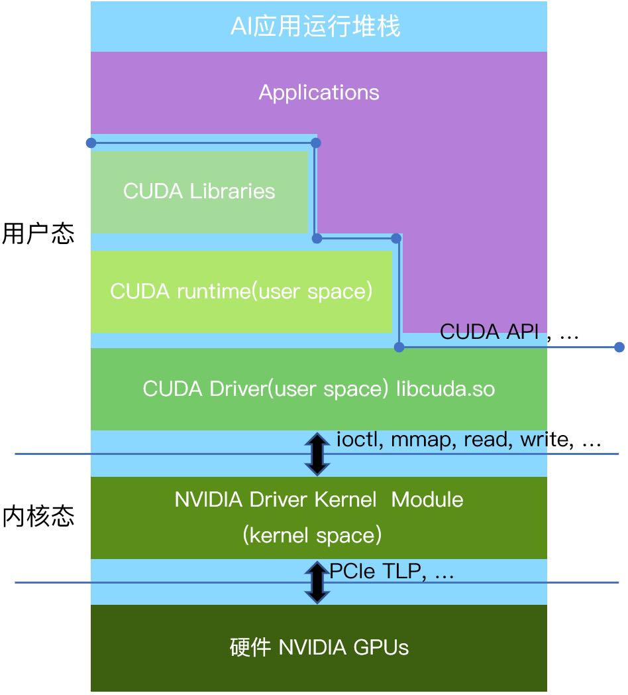
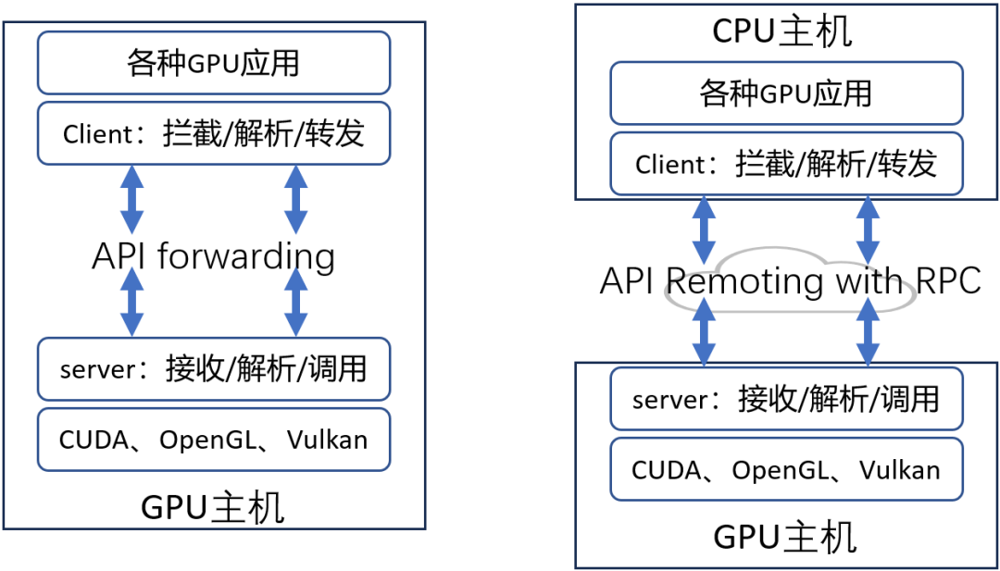
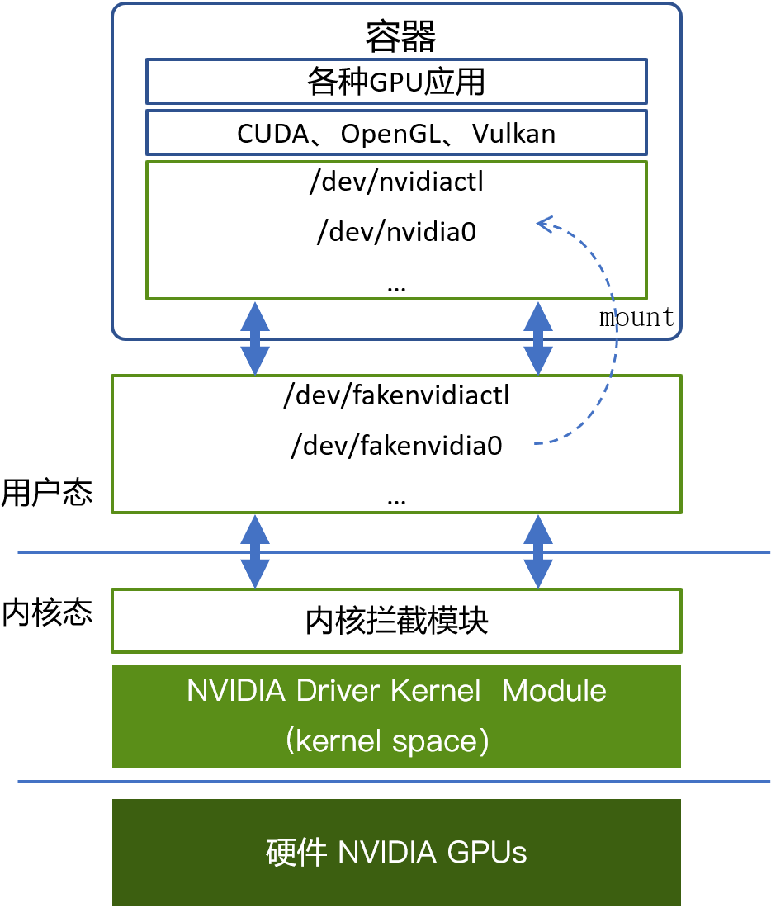

[简体中文](./README.md) · [All articles](../../README.en.md) · [Read on the website](https://www.theriseunion.com/en/blog/gpu-virtualization-technology-user-vs-kernel-guide.html)

# GPU Virtualization Deep Dive: User-space vs Kernel-space Solutions

RiseUnion · January 01, 2025 at 08:00 (UTC+08:00)

Comprehensive analysis of GPU virtualization approaches: user-space vs kernel-space virtualization. Explore their technical differences, advantages, and enterprise applications, with insights into Rise VAST's implementation for GPU resource pooling and scheduling.

## Background and the HAMi Technology

With the rapid advancement of AI and deep learning, the demand for GPU computing resources has surged dramatically. However, traditional GPU usage models struggle to meet modern enterprise requirements for performance, flexibility, and cost efficiency, especially given the diverse GPU types, hardware architectures, and multi-cloud environments. Organizations face two major challenges: maximizing GPU resource utilization and ensuring computational isolation and security between different workloads.

In response to these challenges, [HAMi](https://www.theriseunion.com/en/blog/project-hami.html) emerged as an open-source GPU virtualization solution, offering an efficient, flexible, and easily deployable approach to GPU resource management. Over the years, HAMi has been adopted by leading enterprises across financial services, energy, and telecommunications sectors, establishing itself as a leading GPU virtualization solution. Building upon the HAMi open-source foundation, [Rise VAST](https://www.theriseunion.com/en/product/vast.html) introduced an enterprise edition that enhances GPU computing management and scheduling capabilities, including features like computing power and memory over-provisioning, task priority scheduling, resource preemption, and heterogeneous GPU compatibility.

Through continuous development, HAMi has accumulated extensive industry experience, supporting virtualization for various GPU types (including NVIDIA, Ascend, Cambricon, DCU, etc.) while providing robust GPU resource scheduling and management capabilities. Its open-source nature and high customizability have made HAMi a leading solution in GPU virtualization, particularly for enterprises seeking to optimize GPU resource pooling and cross-platform scheduling.

## GPU Virtualization Architecture

Taking NVIDIA GPUs as an example, GPU virtualization technology can be implemented across three layers from hardware to software: user space, kernel space, and hardware layer.

- **User Space Layer**: Applications write parallel computing tasks through CUDA API and communicate with the GPU's user-space driver. At this level, user-space virtualization is achieved by intercepting and forwarding standard interfaces (such as CUDA, OpenGL).
- **Kernel Space Layer**: This layer primarily runs the GPU's kernel-mode driver, which integrates tightly with the operating system kernel and is protected by both the OS and CPU hardware. Kernel-space virtualization solutions typically implement GPU resource virtualization by intercepting kernel interfaces such as ioctl, mmap, read, and write.
- **Hardware Layer**: Hardware virtualization, such as NVIDIA's MIG (Multi-Instance GPU), can partition and manage GPU resources directly at the hardware level.

## User Space Virtualization

User space virtualization leverages standard interfaces (like CUDA and OpenGL) to intercept and forward API calls, parsing and redirecting requests to corresponding functions in vendor-provided user-space libraries. This approach enables remote GPU access through network-based remote procedure calls.

**Advantages:**
1. **High Compatibility:** Based on standardized interfaces like CUDA and OpenGL, requiring no kernel modifications and supporting various GPU architectures.
2. **Enhanced Security:** Operating in user space avoids kernel-level security risks and reduces system vulnerability.
3. **Minimal Intrusion:** Deployment has minimal impact on existing environments, ideal for rapid enterprise deployment and iteration.
4. **Low Deployment Cost:** Preserves existing IT infrastructure, supporting complex enterprise IT environments with quick deployment capabilities.
5. **Unified Memory Support:** Supports unified memory interfaces, enabling host memory utilization to improve GPU resource efficiency, particularly suitable for resource pool management in platforms like [Rise VAST](https://www.theriseunion.com/en/product/vast.html).

**Disadvantages:**
1. Compared to kernel-space solutions, user-space implementations require parsing and forwarding for each API call, resulting in some performance overhead.

## Kernel Space Virtualization

Kernel space virtualization implements GPU resource management by intercepting kernel-level interfaces (ioctl, mmap, read, write, etc.). This technical approach operates within the operating system's kernel space, making security and stability considerations more complex.

**Advantages:**
1. **Flexibility:** Kernel space virtualization typically doesn't depend on specific GPU hardware, offering good flexibility across different GPU tiers.
2. **Resource Management:** Provides strong resource isolation while supporting GPU sharing between multiple VMs or containers.
3. **Development Efficiency:** With container-only support, development and deployment effort is relatively lower compared to user-space solutions.

**Disadvantages:**
1. **High Intrusion:** Requires direct Linux kernel modifications, significantly increasing system intrusion and potential security risks, particularly challenging in environments with diverse kernel versions.
2. **Security Concerns:** Kernel code insertion may introduce security vulnerabilities and compliance risks, particularly problematic in highly regulated industries.
3. **Legal and Sustainability Risks:** Some kernel-space solutions involve reverse engineering, raising legal compliance issues and risking vendor blockage.
4. **High Maintenance:** Kernel adaptation across different OS versions is challenging, with significant compatibility issues in private and hybrid cloud environments.

## User Space vs. Kernel Space Virtualization Comparison

In comparing user space and kernel space virtualization, user space virtualization demonstrates several significant advantages, particularly in flexibility, security, and low intrusion:

1. **Flexibility:** User space virtualization enables cross-platform support and remote GPU resource access, providing significant advantages in cross-node and multi-cloud environments. Kernel space virtualization is limited to container environments and lacks cross-node support.
2. **Security:** User space virtualization avoids kernel modifications, eliminating potential security vulnerabilities inherent in kernel-space solutions, making it particularly suitable for enterprise environments requiring high security.
3. **Resource Pooling and Management:** Platforms like Rise VAST leverage user space virtualization technology to efficiently manage and schedule GPU resources across multiple hardware platforms, achieving unified scheduling and management. Additionally, Rise VAST implements precise matching and intelligent scheduling through HAMi technology, improving resource utilization and preventing GPU resource waste.

### Why User Space Solutions Are the Enterprise Choice

For enterprises with complex IT infrastructures spanning multiple operating system versions, sophisticated network security policies, and geographically distributed data centers, kernel space GPU virtualization solutions are practically unfeasible because:

1. **Version Management Challenges:** Different data centers often run various Linux kernel versions, making consistency difficult to maintain.
2. **Strict Security Requirements:** Organizations cannot accept kernel modifications or unaudited kernel modules.
3. **Limited Upgrade Flexibility:** Kernel-space solutions may fail when GPU drivers or Linux kernels are upgraded, requiring readaptation.

Therefore, user space solutions become the only viable choice. Rise VAST, based on HAMi, provides enterprise-grade GPU resource management capabilities, supporting various heterogeneous GPUs while ensuring system security, reducing operational costs, and improving GPU resource utilization.

## Remote GPU Resource Access: Attractive in Theory, Impractical in Reality

Recently, Remote GPU solutions have gained attention, allowing CPU servers to access GPU resources on remote servers, seemingly addressing resource fragmentation issues. However, in modern AI applications (especially mixed training and inference of large and small models), remote GPU resource access is practically unusable for several reasons:

1. **Data Transfer Bottleneck:** Large model training involves petabyte-scale data, and remote GPU calls require frequent data transfers between CPU and GPU, leading to severe performance degradation due to bandwidth and latency issues. Network latency particularly impacts compute-intensive tasks like large-scale neural network inference, potentially preventing timely task completion. Additionally, training large and small models requires efficient synchronization mechanisms, which remote calls compromise.
2. **Compute-Intensive Task Complexity:** AI training tasks typically require inter-GPU communication (like AllReduce, Pipeline parallelism), and communication costs between remote GPUs far exceed local GPU communication. Remote GPU calls demand extensive network bandwidth, often becoming a performance bottleneck in large-scale training and inference tasks.
3. **Real-time Requirements:** For small model inference tasks, remote call communication latency significantly exceeds computation time, severely impacting overall efficiency.

Therefore, while remote GPU access may seem attractive in certain scenarios, it faces significant performance bottlenecks and resource scheduling challenges in practice, particularly in modern AI applications. Enterprises prefer local GPU resource pooling solutions like Rise VAST to improve GPU compute resource utilization while ensuring efficient and stable operation.

## Conclusion

In summary, user space virtualization demonstrates clear advantages in flexibility, security, and cross-platform support. [Rise VAST](https://www.theriseunion.com/en/product/vast.html), based on [HAMi](https://www.theriseunion.com/en/blog/project-hami.html) technology, leverages these advantages to provide efficient, reliable, and cross-platform GPU resource management and intelligent scheduling capabilities, helping enterprise clients optimize GPU resource utilization across diverse hardware environments. While kernel space virtualization offers some flexibility, its high intrusion and limitations make it challenging to implement in complex production environments. Additionally, while remote GPU access might seem ideal for solving GPU resource distribution challenges, it's essentially impractical in modern AI applications where large and small models coexist.

---

[Read this article on the RiseUnion website](https://www.theriseunion.com/en/blog/gpu-virtualization-technology-user-vs-kernel-guide.html) · [Explore more articles](https://www.theriseunion.com/en/blog.html)
