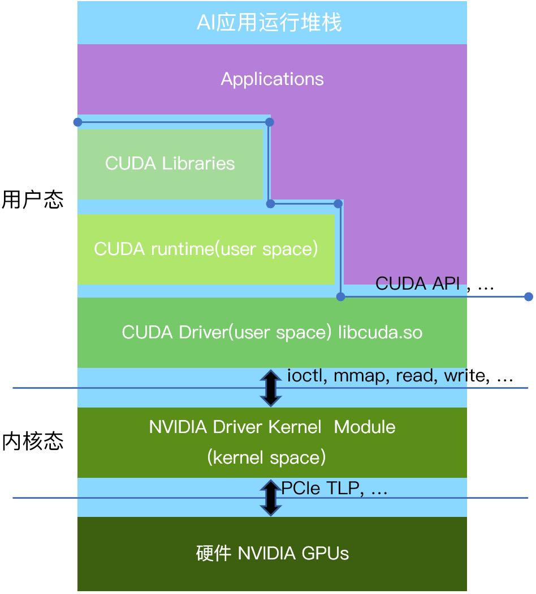
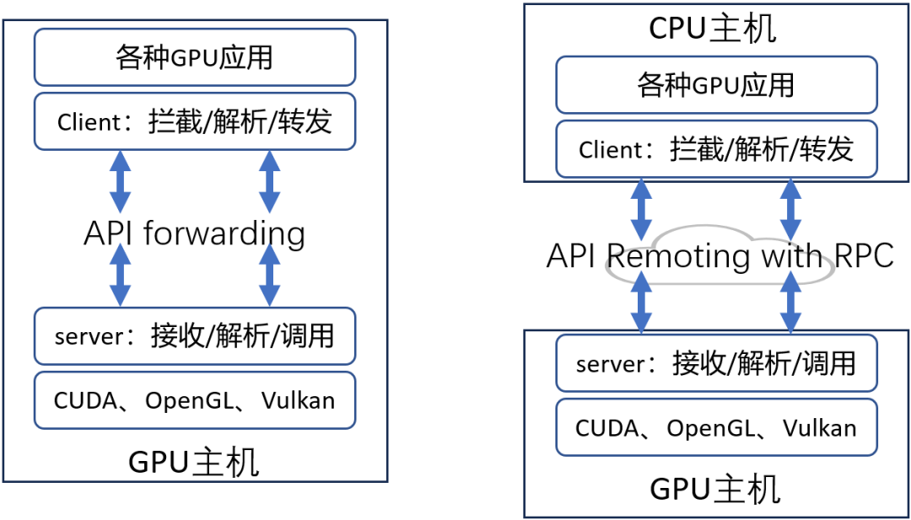
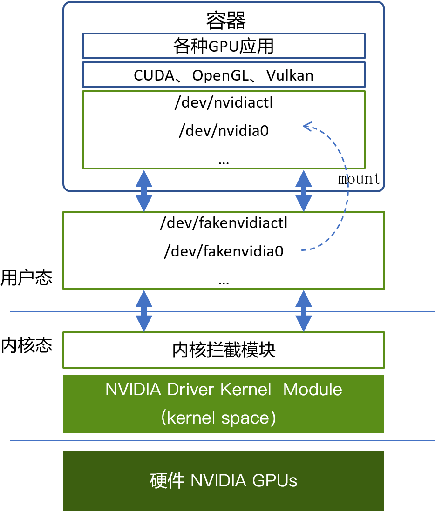

[English](./README.en.md) · [文章目录](../../README.md) · [官网阅读](https://www.theriseunion.com/zh/blog/gpu-virtualization-technology-user-vs-kernel-guide.html)

# GPU 虚拟化技术深度解析：用户态 vs 内核态虚拟化

睿思智联 · 2025/02/02 08:00（北京时间）

GPU 虚拟化的技术方案主要可分为内核态虚拟化和用户态虚拟化两大类。本文将主要讨论这两类方案的区别，并结合 Rise VAST(HAMi企业版) 的特点，介绍相关技术的应用，特别是在 GPU 资源池化和调度管理方面的实现.

## 背景与 HAMi 技术的崛起

随着人工智能和深度学习等领域的快速发展，GPU 计算资源的需求急剧增加。然而，由于 GPU 资源的分布和供应相对分散，传统的 GPU 使用模式难以满足现代企业在性能、灵活性和成本等方面的需求。特别是在多种 GPU 类型、不同厂商的硬件架构以及多云环境下，如何高效地管理、调度和共享 GPU 资源成为众多企业客户面临两个巨大的挑战：一是如何提高 GPU 资源的利用率，二是如何保证不同业务间的计算隔离和安全性。

在此背景下，[HAMi](https://www.theriseunion.com/zh/blog/project-hami.html)  作为开源 GPU 虚拟化方案应运而生，提供了一种高效、灵活、易于部署的 GPU 资源管理方式。经过多年的发展，HAMi 已经被金融、能源、通信等多个行业的头部企业采纳，成为国内 GPU 虚拟化方向的领先方案。同时，基于 HAMi 开源版本，[Rise VAST](https://www.theriseunion.com/zh/product/vast.html) 推出了相关的企业版，进一步增强了企业级 GPU 计算管理和调度能力，包括算力和显存超分、任务优先级调度、资源抢占、异构 GPU 兼容适配等关键特性。

经过多年的发展，HAMi 已经积累了丰富的行业经验，能够支持多种 GPU 类型的虚拟化（如 NVIDIA、Ascend、Cambricon、DCU 等），并提供强大的 GPU 资源调度与管理能力。它的开源性质和高度可定制化的特点，使得 HAMi 成为 GPU 虚拟化领域的领先解决方案之一，成为许多企业在实现 GPU 资源池化、跨平台调度和优化资源利用的首选方案。

## GPU 虚拟化的层次结构

以英伟达的 GPU 为例，GPU 虚拟化技术从硬件到软件的实现可以分为三个层次：用户态、内核态和硬件层。

- **用户态层**：应用程序通过 CUDA API 编写并行计算任务，并通过 CUDA API 与 GPU 的用户态驱动进行通信。在这个层次，用户态虚拟化可以通过拦截和转发标准接口（如 CUDA、OpenGL 等）来实现。
- **内核态层**：此层主要运行 GPU 的内核态驱动程序，它与操作系统内核紧密集成，受到操作系统以及 CPU 硬件的保护。内核态虚拟化方案通常通过拦截如 ioctl、mmap、read 和 write 等内核态接口来实现 GPU 资源的虚拟化。
- **硬件层**：硬件虚拟化层，如英伟达的 MIG（Multi-Instance GPU），可以直接在硬件级别进行 GPU 资源的划分与管理。

## 用户态虚拟化

用户态虚拟化利用标准的接口（如 CUDA 和 OpenGL），通过拦截和转发 API 调用，将请求解析并转发给硬件厂商提供的用户态库中的相应函数。用户态虚拟化可以通过远程调用的方式实现 GPU 的远程访问，即主机通过网络调用远程 GPU 资源。

**优点：**
1. **兼容性强：** 基于 CUDA、OpenGL 等标准化接口，无需依赖底层内核修改，适用于各类 GPU 及异构算力。
2. **安全性高：** 运行在用户态，避免了内核态代码的安全隐患，降低系统入侵风险。
3. **最小侵入性**：用户态虚拟化的部署方式对用户环境的侵入性最小，尤其适合于企业生产环境的快速部署与迭代。
4. **部署成本低：** 不破坏现有 IT 基础架构，支持国央企、金融、能源等企业复杂 IT 体系，能够快速上线。
5. **支持统一内存**：该方案支持统一内存接口，能够借用主机内存，从而提升 GPU 资源的利用率，特别适用于资源池化管理，如 [Rise VAST](https://www.theriseunion.com/zh/product/vast.html) 平台中的 GPU 资源池化技术。

**缺点：**
1. 相比于内核态，用户态对每一个 API 调用，都需要进行解析和转发，会导致一定的性能损耗。

## 内核态虚拟化

内核态虚拟化通过拦截内核层的接口（如 ioctl、mmap、read、write 等）来实现 GPU 资源的管理。这个技术方案主要运行在操作系统的内核态中，因此其安全性和稳定性较为复杂。

**优点：**
1. **灵活性**：内核态虚拟化通常不依赖于特定的 GPU 硬件，因此可以在不同级别的 GPU（如数据中心级和消费级 GPU）上使用，具有较好的灵活性。
2. **共享与隔离**：在支持 GPU 共享的同时，内核态虚拟化能够提供较强的资源隔离能力，防止多个虚拟机或容器间的资源竞争。
3. **较少的开发工作量**：由于内核态虚拟化通常仅支持容器环境，因此相对于用户态方案，研发和部署工作量较小。

**缺点：**
1. **高侵入性**：内核态虚拟化需要直接修改 Linux 操作系统内核，较大程度地增加了对系统的侵入性，从而带来潜在的安全风险。尤其在不同内核版本的环境中，可能引入兼容性问题。国央企、金融、能源等行业 IT 架构复杂，难以统一管理和适配。
2. **安全隐患大：** 需要插入内核代码，可能引入额外的安全漏洞和合规风险，尤其在金融、医疗、政府等高安全性行业难以落地。
3. **法律和可持续性风险：**部分内核态方案涉及逆向工程，存在法律合规风险，并且可能被 GPU 厂商封堵，影响长期可用性。
4. **维护成本高：** 不同操作系统版本的内核适配难度大，且私有云、混合云环境下的兼容性问题突出。

## 用户态虚拟化与内核态虚拟化的对比

在用户态虚拟化与内核态虚拟化的对比中，用户态虚拟化展现了诸多显著优势，尤其在灵活性、安全性和低侵入性方面：

1. **灵活性**：用户态虚拟化可以实现跨平台的支持，并能通过网络远程调用 GPU 资源，这使得它在跨物理节点和多云环境中具有巨大的优势。而内核态虚拟化仅能局限于容器环境，缺乏跨节点的支持。
2. **安全性**：用户态虚拟化由于不需要对操作系统内核进行修改，能够避免内核态方案可能引入的安全隐患，尤其适用于需要高度安全保障的企业环境。
3. **资源池化与调度管理**：像 Rise VAST 这样的 GPU 资源池化管理平台，通过用户态虚拟化技术能够高效地管理和调度跨多个硬件平台的 GPU 资源，实现 GPU 资源的统一调度和管理。此外，Rise VAST 平台通过 HAMi 技术，能够在 GPU 资源的池化与调度上实现精确匹配和智能调度，从而提升资源利用率，避免 GPU 资源的浪费。

### 为什么用户态方案成为企业的唯一选择？

对于国央企、金融、能源等行业客户而言，其 IT 基础设施通常涉及多个不同操作系统版本、复杂的网络安全策略以及跨区域的数据中心架构。在这样的背景下，内核态 GPU 虚拟化方案几乎无法落地，因为：

1. **无法统一管理内核版本**，不同数据中心可能运行着不同的 Linux 内核版本，难以保持一致性。
2. **安全合规要求极高**，无法接受修改内核或引入未经审计的内核模块。
3. **系统升级受限**，一旦 GPU 驱动或 Linux 内核升级，内核态方案可能会失效，需要重新适配。

因此，用户态方案成为这些企业的唯一选择。Rise VAST 基于 HAMi 提供企业级 GPU 资源管理能力，不仅支持各种异构 GPU，同时还能保障系统安全性，降低运维成本，提升 GPU 资源利用率。

## 远程 GPU 资源调用：看上去很美，现实中难以落地

近年来，远程 GPU 调用（Remote GPU）方案备受关注，它允许用户在一台 CPU 服务器上远程访问另一台服务器上的 GPU 资源，看上去能解决资源碎片化问题。然而，在现代 AI 应用（尤其是大模型、小模型混合训练和推理）背景下，远程 GPU 资源调用几乎不可用，原因包括：

1. **数据传输瓶颈：** 大模型训练涉及 PB 级数据，远程调用 GPU 需要在 CPU 和 GPU 之间频繁传输数据，带宽和延迟问题导致性能严重下降。远程 GPU 调用需要通过网络传输数据，特别是对于计算密集型任务（如大规模的神经网络推理），网络延迟将极大影响性能，甚至导致任务无法及时完成。此外，大模型和小模型的训练过程中需要高效的同步机制，远程调用会导致数据同步效率低下，影响模型训练的效果与效率。
2. **计算密集型任务难以拆分：** AI 训练任务通常需要多 GPU 互相通信（如 AllReduce、Pipeline 并行），远程 GPU 之间的通信成本远超本地 GPU。远程调用 GPU 资源意味着大量数据需要在网络中传输，对于带宽要求极高。尤其是在大规模训练和推理任务中，带宽瓶颈往往会成为性能的瓶颈。
3. **小模型推理的实时性要求：** 对于小模型的推理任务，远程调用的通信延迟远大于计算时间，导致整体效率大幅下降。

因此，尽管远程 GPU 调用在某些场景下具有一定的吸引力，但在实际操作中，它通常会面临性能瓶颈和资源调度问题，特别是在现代 AI 应用中，几乎不可行。企业更倾向于通过 Rise VAST 这种本地 GPU 资源池化方案，提高 GPU 计算资源的利用率，保障高效稳定运行。

## 总结

综上所述，用户态虚拟化在灵活性、安全性和跨平台支持方面展现出了明显的优势。[Rise VAST](https://www.theriseunion.com/zh/product/vast.html) 基于 [HAMi](https://www.theriseunion.com/zh/blog/project-hami.html) 技术的 GPU 资源池化与调度管理平台正是利用了这些优点，提供了高效、可靠、跨平台的 GPU 资源管理和智能调度功能，帮助企业客户在多种硬件环境下实现 GPU 资源的优化利用。而内核态虚拟化尽管具备一定的灵活性，但由于其高侵入性和局限性，难以在复杂的生产环境中发挥更大作用。同时，远程 GPU 调用虽然看似是解决 GPU 资源分布问题的理想方案，但在大模型和小模型并存的现代 AI 应用背景下，基本不可用。

---

[在睿思智联官网阅读本文](https://www.theriseunion.com/zh/blog/gpu-virtualization-technology-user-vs-kernel-guide.html) · [浏览更多文章](https://www.theriseunion.com/zh/blog.html)
