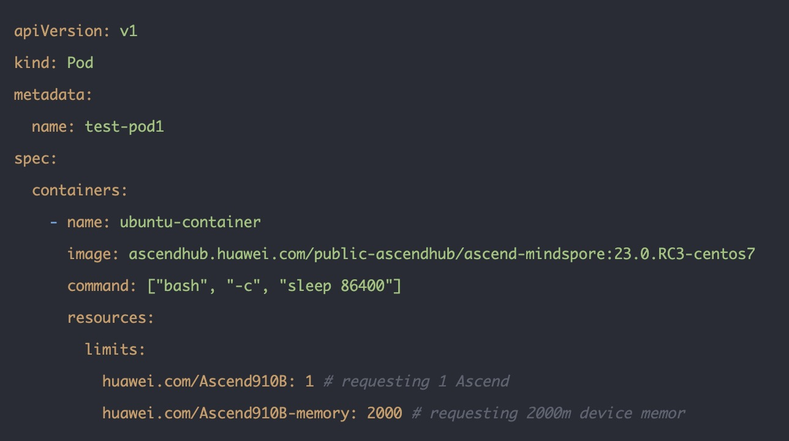
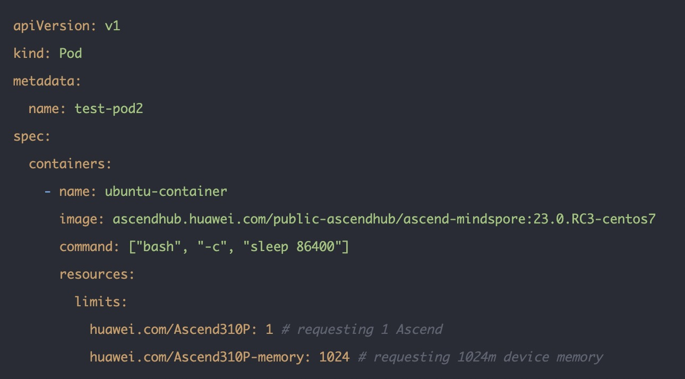
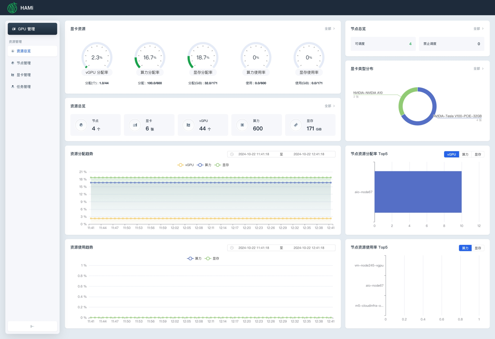
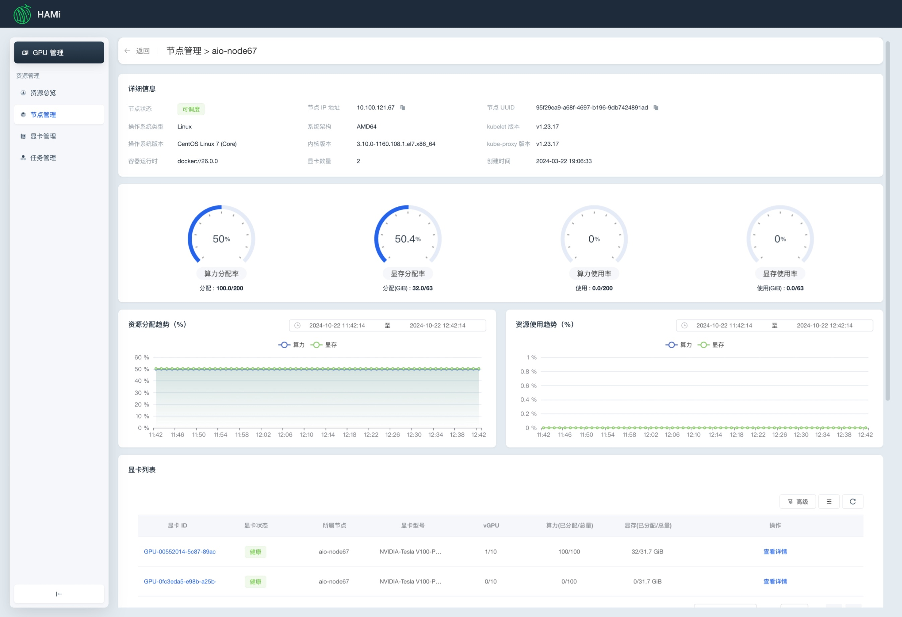
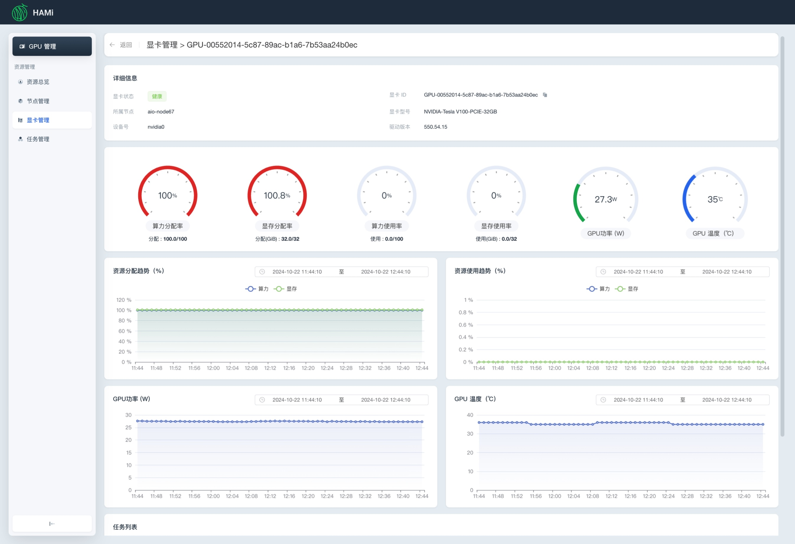

[简体中文](./README.md) · [All articles](../../README.en.md) · [Read on the website](https://www.theriseunion.com/en/blog/hami-2-4-0.html)

# HAMi 2.4.0 Major Update: Making AI Computing Management More Efficient

RiseUnion · January 01, 2025 at 08:00 (UTC+08:00)

HAMi 2.4.0 release introduces Ascend 910B/310P support and WebUI visualization, offering enhanced heterogeneous device management and resource monitoring capabilities. Improves AI infrastructure efficiency through GPU sharing and intelligent scheduling.

Summary: HAMi 2.4.0 release brings multiple important updates from RiseUnion, including enhanced GPU virtualization capabilities, intelligent task scheduling, and resource monitoring features. The new version significantly improves AI computing resource efficiency, supports more flexible multi-tenant management, and provides comprehensive support for enterprise AI infrastructure management, facilitating enterprise digital transformation.

We are excited to announce the release of HAMi 2.4.0! This new version brings significant improvements in device heterogeneity capabilities and usability.

## Background

[HAMi](https://www.theriseunion.com/en/blog/project-hami.html) (Heterogeneous AI Computing Virtualization Middleware), initiated in 2021, is an efficient heterogeneous AI device management tool. As a CNCF (Cloud Native Computing Foundation) sandbox project, HAMi demonstrates its development potential in the cloud-native ecosystem with key features including:

- Support for various domestic heterogeneous devices besides NVIDIA, such as Ascend, Hygon, Cambricon, and Tianshu;
- Unified resource pooling capabilities;
- Unified resource management and scheduling capabilities, such as Binpack and Spread, online and offline mixing;
- Unified resource monitoring and alerting capabilities, such as resource utilization, task status, and device failures;

Through GPU computing power sharing and resource isolation, combined with priority and other scheduling strategies, HAMi can effectively optimize GPU resource utilization, becoming an important tool in heterogeneous AI chip scenarios.

## New Features Overview

- Official support for Huawei Ascend 910b and 310P: Huawei's Ascend 910b and 310P are now supported, expanding HAMi's breadth in heterogeneous device management and making it more flexible and efficient in NPU virtualization scenarios.
- New HAMi UI interface: Visualize device status and usage, with real-time monitoring at a glance, making scheduling and management more intuitive and efficient.
- For more new features, please refer to: [https://github.com/Project-HAMi/HAMi/releases/tag/v2.4.0](https://github.com/Project-HAMi/HAMi/releases/tag/v2.4.0)

## New Feature Introduction

### Support for Ascend 910B and 310P

The new version supports Ascend 910b and Ascend310P devices, providing dynamic NPU virtualization capabilities. Users can use dynamically partitioned vNPU devices.

### New HAMi WebUI

In the new version, HAMi has added a WebUI to provide users with a more friendly interface. Features include: resource overview, node management, GPU management, and task management. This makes it convenient for users to clearly understand GPU resource usage in the cluster and more effectively monitor GPU resource allocation and usage.

For more details: [https://github.com/Project-HAMi/HAMi-WebUI](https://github.com/Project-HAMi/HAMi-WebUI)

## RiseUnion's Core Contributions

In this v2.4.0 release, RiseUnion (Beijing RiseUnion Technology Co., Ltd.) led the development of several key features, including:

- Development of Web UI related content;
- Development of Ascend 910B and 310P adaptation related content.

RiseUnion will continue to promote HAMi's progress and innovation in the field of heterogeneous AI computing, helping users better manage and schedule heterogeneous device resources.

---

[Read this article on the RiseUnion website](https://www.theriseunion.com/en/blog/hami-2-4-0.html) · [Explore more articles](https://www.theriseunion.com/en/blog.html)
