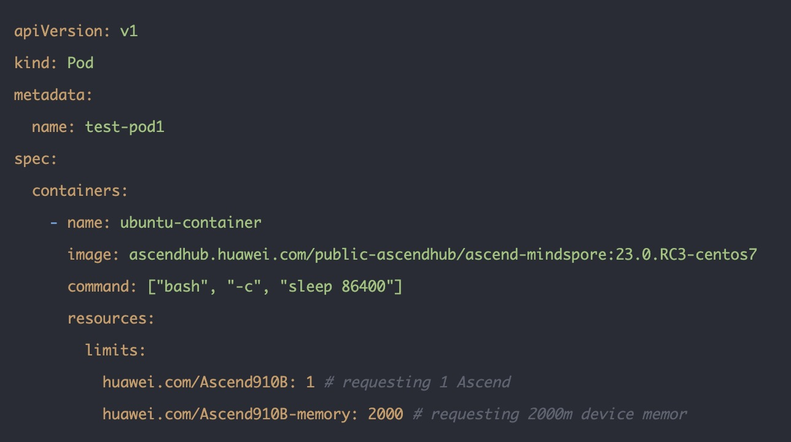
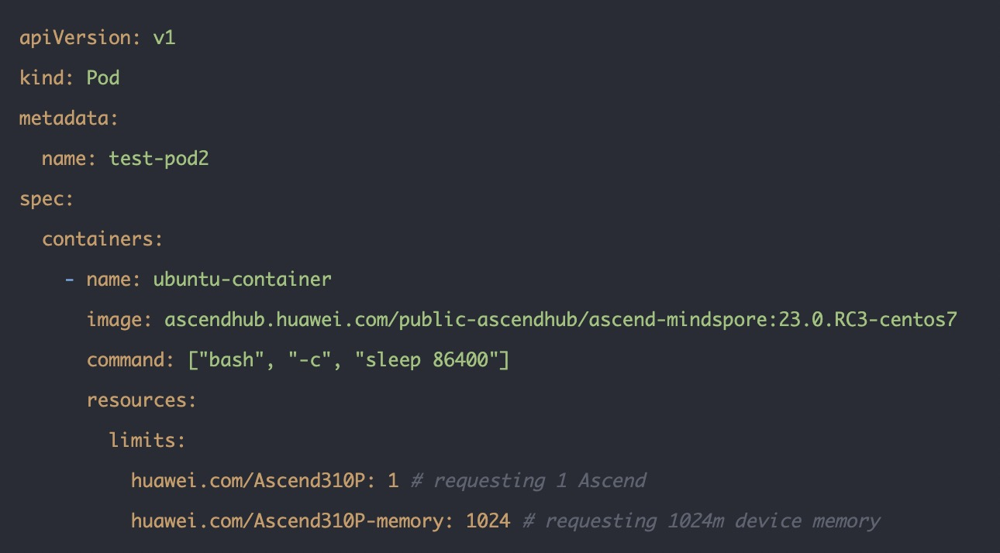
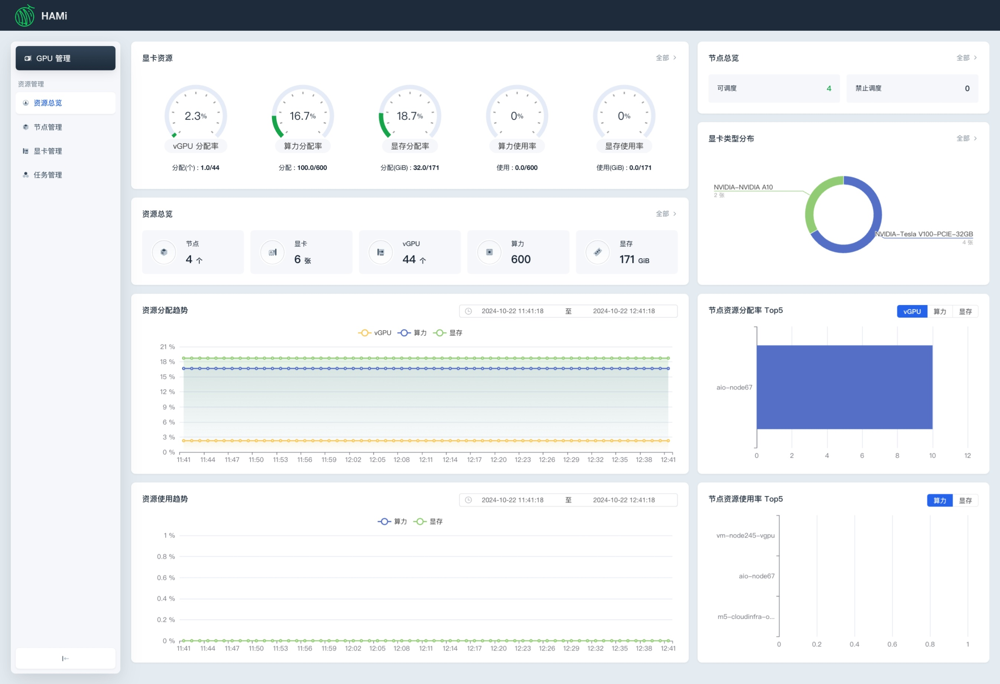
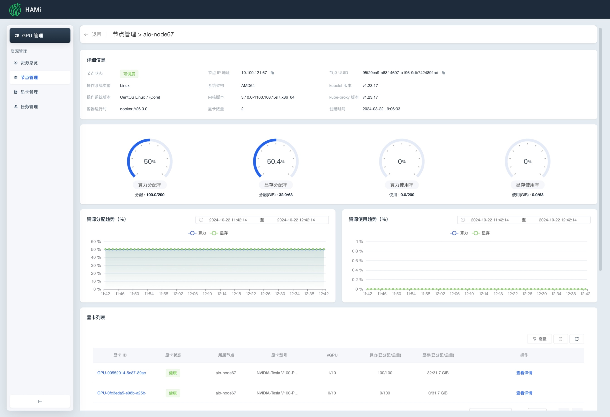
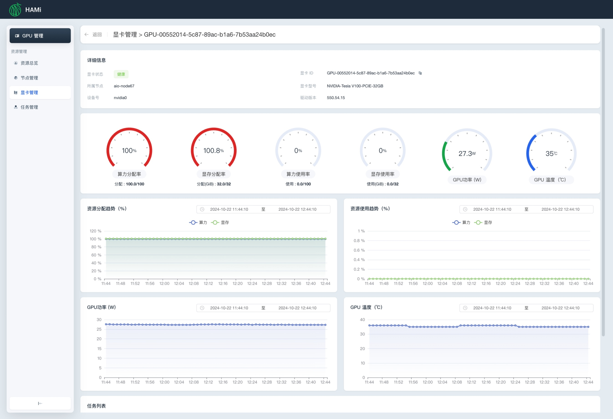

[English](./README.en.md) · [文章目录](../../README.md) · [官网阅读](https://www.theriseunion.com/zh/blog/hami-2-4-0.html)

# HAMi 2.4.0 重磅升级：让 AI 算力管理更简单、更高效

睿思智联 · 2024/10/17 08:00（北京时间）

HAMi 2.4.0版本重磅发布，新增昇腾910B/310P支持和WebUI可视化界面，提供更强大的异构设备管理和资源监控能力。通过GPU算力共享与智能调度，显著提升AI基础设施管理效率。

摘要：HAMi 2.4.0 版本发布，睿思智联带来多项重要更新，包括增强的 GPU 虚拟化能力、智能任务调度、资源监控等功能。新版本显著提升了 AI 算力资源的使用效率，支持更灵活的多租户管理，为企业 AI 基础设施管理提供全方位的支持，助力企业数字化转型。

我们很高兴地宣布：HAMi 2.4.0 版本正式发布啦！新版本在设备异构能力和易用性等方面都带来了较大的改进。

## 背景

[HAMi](https://www.theriseunion.com/zh/blog/project-hami.html)，全称 Heterogeneous AI Computing Virtualization Middleware（异构算力虚拟化中间件）， 发起于2021 年，是一款高效的异构 AI 设备管理工具。作为 CNCF（云原生计算基金会）的沙箱项目，HAMi 展现了其在云原生生态中的发展潜力，主要特性包括：

- 支持除 NVIDIA 外的多种国产异构设备，如：昇腾、海光、寒武纪、天数等；
- 提供统一的资源池化能力；
- 提供统一的资源管理和调度能力，如：紧凑(Binpack)和均衡(Spread)，在离线混部等；
- 提供统一的资源监控和告警能力，如：资源利用率、任务状态、设备故障等；

通过 GPU 算力共享与资源隔离，结合优先级等更多调度策略，HAMi 能够有效优化 GPU 资源利用率，成为异构 AI 芯片场景下的重要工具。

## 新特性总览

- 正式支持华为 Ascend 910b和 310P：华为的 Ascend 910b、310P已被支持，拓宽了 HAMi 在异构设备管理上的广度，使其在 NPU 虚拟化场景中更加灵活和高效。
- 新增 HAMi UI 界面：可视化呈现设备状态与使用情况，实时监控一目了然，让调度与管理更加直观高效。
- 更多新特性，请参考：[https://github.com/Project-HAMi/HAMi/releases/tag/v2.4.0](https://github.com/Project-HAMi/HAMi/releases/tag/v2.4.0)

## 新特性简介

### 支持昇腾 Ascend 910B和310P

新版本已支持昇腾 Ascend 910b 和 Ascend310P 设备，提供了动态 NPU 虚拟化能力。用户可通过动态的切分 vNPU 设备使用。

### 新增 HAMi WebUI

在新版本中，HAMi 新增了 WebUI，以为用户提供更友好的使用方式。功能包括：资源总览、节点管理、显卡管理以及任务管理等。方便用户清晰地掌握集群中 GPU 资源使用的情况，以更有效地监控 GPU 资源分配和使用情况。

更多详情：[https://github.com/Project-HAMi/HAMi-WebUI](https://github.com/Project-HAMi/HAMi-WebUI)

## 睿思智联 RiseUnion 的核心贡献

在本次 v2.4.0 新版中，RiseUnion（北京睿思智联科技有限公司） 主导了多个关键特性的开发，包括：

- Web UI 相关内容的开发；
- 昇腾 910B和 310P 适配相关内容的开发。

RiseUnion 将持续推动 HAMi 在异构 AI 计算领域的进步与创新，助力用户更好地管理和调度异构设备资源。

---

[在睿思智联官网阅读本文](https://www.theriseunion.com/zh/blog/hami-2-4-0.html) · [浏览更多文章](https://www.theriseunion.com/zh/blog.html)
