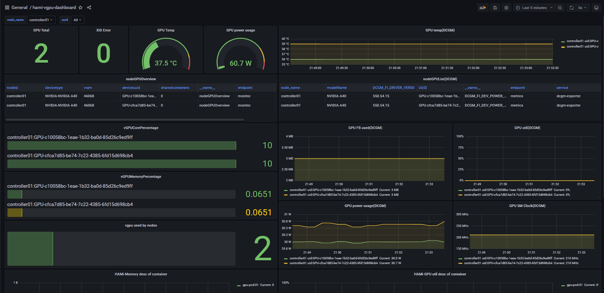

[简体中文](./README.md) · [All articles](../../README.en.md) · [Read on the website](https://www.theriseunion.com/en/blog/hami-2-5-0.html)

# HAMi v2.5.0 Released: Dynamic MIG Support and Enhanced Stability

RiseUnion · January 01, 2025 at 08:00 (UTC+08:00)

HAMi 2.5.0 introduces dynamic MIG support, enabling runtime GPU partitioning. With improved stability and usability, it significantly enhances heterogeneous computing resource management efficiency, bringing breakthrough innovations to GPU scheduling in Kubernetes environments.


The release of **[HAMi](https://www.theriseunion.com/en/blog/project-hami.html) v2.5.0** brings some exciting updates, especially with the introduction of **dynamic MIG (Multi-Instance GPU) support**. This new feature allows users to dynamically partition GPUs at runtime, which eliminates the need for pre-configured MIG instances and enables more flexible resource management.

> [2.5.0-Release reference](https://github.com/Project-HAMi/HAMi/releases/tag/v2.5.0)

update for bugfix:
- [2.5.1-Release reference](https://github.com/Project-HAMi/HAMi/releases/tag/v2.5.1)
- [2.5.2-Release reference](https://github.com/Project-HAMi/HAMi/releases/tag/v2.5.2)

Here are the main highlights from the update:

### 1. **New Features:**
- **Dynamic MIG Support**: Now users can dynamically create MIG instances without having to manually configure them on nodes. HAMi manages the MIG instances on behalf of the users based on the tasks' requirements. [How to use MIG in HAMi](https://www.theriseunion.com/en/blog/hami-support-mig.html)。
- **Stability Improvements**: Several stability fixes have been added, such as preventing GPU tasks from crashing when HAMi is reinstalled and addressing issues with tasks that use the `cuMallocAsync` API.
- **Enhanced Usability**: 

1. Consolidated all configuration into a single `ConfigMap` for easier management.[reference](https://github.com/Project-HAMi/HAMi/blob/master/docs/config.md)
2. Automatic detection of cluster versions during deployment to avoid manual configuration of `kube-scheduler`.
3. Enhanced logging and a clearer Grafana dashboard for better monitoring.



### 2. **Stability Enhancements:**
A critical fix was made regarding the `libvgpu.so` file handling. In previous versions, restarting the **hami-device-plugin** could disrupt ongoing GPU tasks because the plugin copied the `libvgpu.so` file each time it was restarted. Now, this issue is addressed by calculating the MD5 hash of the file and only copying it if the file is different, preventing task disruptions.

### 3. **Dynamic MIG Functionality:**
The dynamic MIG feature in this release is a game-changer. Now, for NVIDIA GPUs that support MIG (such as **A100**, **H100**, and **A30**), users can enable dynamic partitioning of GPU resources. The key benefits are:
   - **No Pre-Configuration Needed**: HAMi dynamically manages MIG instances based on the workload, eliminating the need for users to pre-configure the MIG settings on nodes.
   - **Template Support**: Default MIG configuration templates are provided for common GPUs like the A100, and custom templates can be defined as needed.
   - **Unified Management**: Whether tasks are running on traditional GPU instances or on MIG instances, HAMi pools all these resources together for seamless management.

### 4. **How Dynamic MIG Works:**
- **MIG Instances on Demand**: The MIG instances are automatically created based on task requirements. For example, tasks requesting specific GPU resources (like 8GB of memory) will be matched with an appropriate MIG template that suits the task’s needs.
- **Seamless Integration**: The system can switch between traditional GPU allocation (via **hami-core**) and MIG instances dynamically based on available resources and task needs.

> [MIG Design Principle Document](https://www.theriseunion.com/en/blog/hami-dynamic-mig.html)

<!--  -->

### 5. **Deployment Steps:**
To enable dynamic MIG:
   - Modify the `hami-device-plugin` configuration to switch nodes to **MIG mode**.
   - Restart the appropriate pods for the changes to take effect.
   - Define the MIG template in the configuration for the selected GPUs (A100, A30, etc.).

### 6. **Demo and Usage:**
To use dynamic MIG, simply deploy a pod with specified GPU requirements, and the system will automatically allocate MIG instances from the available pool. For example:

```yaml
apiVersion: v1
kind: Pod
metadata:
  name: gpu-pod-test
spec:
  containers:
    - name: ubuntu-container
      image: ubuntu:18.04
      command: ["bash", "-c", "sleep 86400"]
      resources:
        limits:
          nvidia.com/gpu: 2
          nvidia.com/gpumem: 8000
```
You can also specify a MIG node using the `nvidia.com/vgpu-mode: "mig"` annotation if you want to force the pod to be scheduled on a MIG node.

### Conclusion:
The introduction of **dynamic MIG** in **HAMi v2.5.0** significantly enhances resource flexibility, enabling GPU partitioning at runtime. It’s an exciting step toward more efficient GPU resource utilization, particularly for users running mixed workloads in Kubernetes environments. This release also includes improvements in stability and usability, making it easier to manage and monitor GPU resources.

> reference: 
> - https://github.com/Project-HAMi/HAMi/releases/tag/v2.5.0
> - https://github.com/Project-HAMi/HAMi/blob/master/docs/develop/dynamic-mig.md
> - https://github.com/Project-HAMi/HAMi/blob/master/docs/dynamic-mig-support.md
> - https://www.lixueduan.com/posts/kubernetes/38-hami-v2.5.0-released/

---

[Read this article on the RiseUnion website](https://www.theriseunion.com/en/blog/hami-2-5-0.html) · [Explore more articles](https://www.theriseunion.com/en/blog.html)
