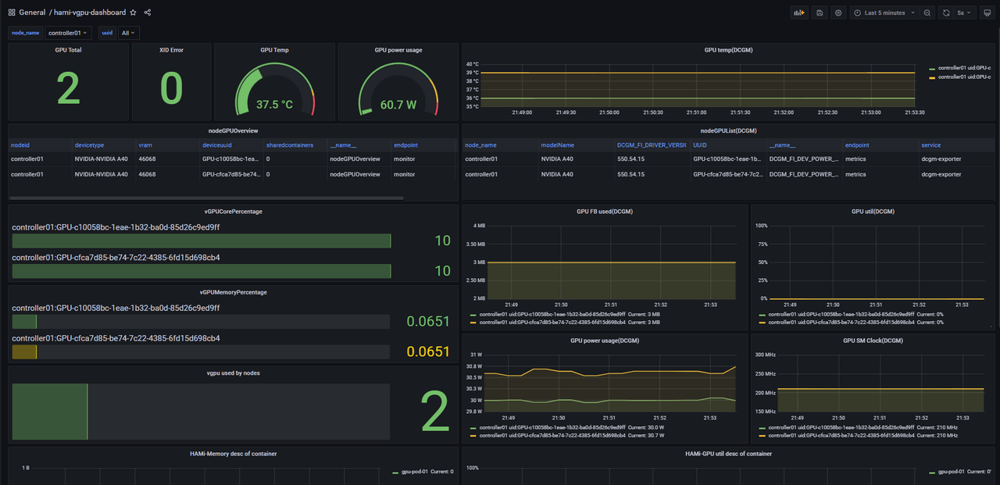

[English](./README.en.md) · [文章目录](../../README.md) · [官网阅读](https://www.theriseunion.com/zh/blog/hami-2-5-0.html)

# HAMi v2.5.0 重磅发布：动态 MIG 支持与稳定性提升

睿思智联 · 2025/02/10 08:00（北京时间）

HAMi 2.5.0 版本重磅发布，引入动态 MIG 支持功能，实现运行时 GPU 资源动态分区。通过改进的稳定性和易用性，显著提升异构计算资源管理效率，为 Kubernetes 环境下的 GPU 资源调度带来新突破。


**[HAMi](https://www.theriseunion.com/zh/blog/project-hami.html) v2.5.0** 版本发布带来了一些令人振奋的更新，特别是引入了**动态 MIG（多实例 GPU）支持**功能。该特性允许用户在运行时动态划分 GPU 资源，无需预先配置 MIG 实例，从而实现更灵活的资源管理。

> [查看完整 2.5.0-Release 信息](https://github.com/Project-HAMi/HAMi/releases/tag/v2.5.0)

update for bugfix：
- [查看完整 2.5.1-Release 信息](https://github.com/Project-HAMi/HAMi/releases/tag/v2.5.1)
- [查看完整 2.5.2-Release 信息](https://github.com/Project-HAMi/HAMi/releases/tag/v2.5.2)
- [查看完整 2.5.3-Release 信息](https://github.com/Project-HAMi/HAMi/releases/tag/v2.5.3)

以下是此次更新的主要亮点：

### 1. **新特性：**
- **动态 MIG 支持**：用户现在可以动态创建 MIG 实例，无需在节点上手动配置。HAMi 根据任务需求自动管理 MIG 实例，[查看如何在 HAMi 中使用 MIG 文档](https://www.theriseunion.com/zh/blog/hami-support-mig.html)。
- **稳定性提升**：修复了多个稳定性问题，包括防止在重装 HAMi 时 GPU 任务崩溃，以及解决使用 `cuMallocAsync` API 的任务相关问题。
- **易用性增强**：

1. 将所有配置整合到单个 `ConfigMap` 中，简化管理流程，[参考文档](https://github.com/Project-HAMi/HAMi/blob/master/docs/config.md)；
2. 部署时自动检测集群版本，避免手动配置 `kube-scheduler`；
3. 优化日志记录并改进 Grafana 监控面板，提升可观测性。



### 2. **稳定性增强：**
解决了 `libvgpu.so` 文件处理的关键问题。在之前版本中，重启 **hami-device-plugin** 时会复制 `libvgpu.so` 文件，可能导致正在运行的 GPU 任务中断。现在通过计算文件的 MD5 哈希值，仅在文件发生变化时才进行复制，有效防止了任务中断。

### 3. **动态 MIG 功能：**
此版本中的动态 MIG 功能是一个重大突破。对于支持 MIG 的 NVIDIA GPU（如 **A100**、**H100** 和 **A30**），用户现在可以启用动态资源分区。主要优势包括：
   - **免除预配置**：HAMi 根据工作负载动态管理 MIG 实例，用户无需预先在节点上配置 MIG 设置
   - **模板支持**：为 A100 等常用 GPU 提供默认 MIG 配置模板，同时支持自定义模板
   - **统一管理**：无论任务运行在传统 GPU 实例还是 MIG 实例上，HAMi 都能统一管理所有资源

### 4. **动态 MIG 工作原理：**
- **按需创建 MIG 实例**：系统根据任务需求自动创建 MIG 实例。例如，当任务请求特定 GPU 资源（如 8GB 显存）时，系统会匹配合适的 MIG 模板来满足需求。
- **无缝集成**：系统可以根据可用资源和任务需求，在传统 GPU 分配（通过 **hami-core**）和 MIG 实例之间动态切换。

> [查看更详细 MIG 设计原理](https://www.theriseunion.com/zh/blog/hami-dynamic-mig.html)

### 5. **部署步骤：**
启用动态 MIG 需要：
   - 修改 `hami-device-plugin` 配置，将节点切换至 **MIG 模式**
   - 重启相关 Pod 以使配置生效
   - 为选定的 GPU（A100、A30 等）在配置中定义 MIG 模板

### 6. **示例与使用：**
使用动态 MIG 时，只需部署一个指定 GPU 需求的 Pod，系统就会自动从资源池中分配 MIG 实例。示例如下：

```yaml
apiVersion: v1
kind: Pod
metadata:
  name: gpu-pod-test
spec:
  containers:
    - name: ubuntu-container
      image: ubuntu:18.04
      command: ["bash", "-c", "sleep 86400"]
      resources:
        limits:
          nvidia.com/gpu: 2
          nvidia.com/gpumem: 8000
```
如果需要强制 Pod 调度到 MIG 节点，可以使用 `nvidia.com/vgpu-mode: "mig"` 注解。

### 总结：
**HAMi v2.5.0** 版本引入的**动态 MIG** 功能显著提升了资源灵活性，实现了运行时 GPU 分区。这是在 Kubernetes 环境下提高 GPU 资源利用率的重要进展，特别适合运行混合工作负载的场景。此版本还包含了稳定性和易用性的改进，使 GPU 资源的管理和监控变得更加便捷。

> 参考资料: 
> - https://github.com/Project-HAMi/HAMi/releases/tag/v2.5.0
> - https://github.com/Project-HAMi/HAMi/blob/master/docs/develop/dynamic-mig.md
> - https://github.com/Project-HAMi/HAMi/blob/master/docs/dynamic-mig-support.md
> - https://www.lixueduan.com/posts/kubernetes/38-hami-v2.5.0-released/

---

[在睿思智联官网阅读本文](https://www.theriseunion.com/zh/blog/hami-2-5-0.html) · [浏览更多文章](https://www.theriseunion.com/zh/blog.html)
