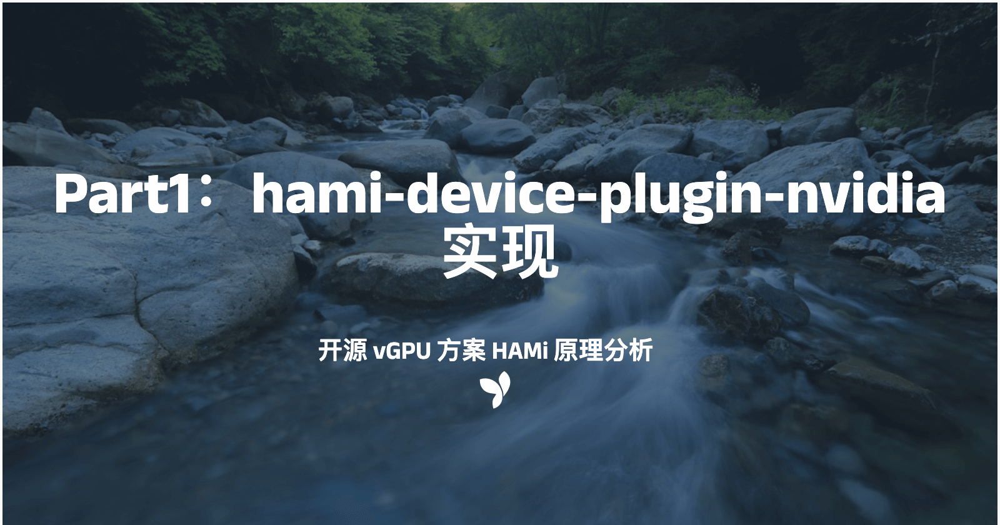

[简体中文](./README.md) · [All articles](../../README.en.md) · [Read on the website](https://www.theriseunion.com/en/blog/hami-analyze-device-plugin.html)

# HAMi vGPU code Analysis Part 1: hami-device-plugin-nvidia

RiseUnion · January 01, 2025 at 08:00 (UTC+08:00)

In-depth analysis of HAMi's device plugin implementation, covering GPU registration, detection, and allocation mechanisms. Explores how it achieves fine-grained GPU resource management through libvgpu.so and environment variables.



Abstract: This is the first article analyzing the implementation principles of the open-source vGPU solution HAMi, focusing on analyzing the implementation principles of hami-device-plugin-nvidia.

> Source: ["HAMi vGPU Implementation Analysis Part1: hami-device-plugin-nvidia Implementation"](https://www.lixueduan.com/posts/kubernetes/29-hami-analyze-1-device-plugin-nvidia/). Thanks to "Exploring Cloud Native" for their continued attention and contributions to HAMi.

Previously, we introduced what HAMi is in [Open Source vGPU Solution: HAMi, Implementing Fine-grained GPU Partitioning](https://www.lixueduan.com/posts/kubernetes/28-hami-isolation-test/), and then tested HAMi's vGPU solution in [Open Source vGPU Solution HAMi: core&memory Isolation Testing](https://www.lixueduan.com/posts/kubernetes/28-hami-isolation-test/).

Next, we'll analyze the implementation principles of vGPU in HAMi step by step. Since there are many aspects involved, it will be divided into several parts:

1. hami-device-plugin-nvidia: How GPU awareness and allocation logic are implemented in HAMi's version of device plugin, and how it differs from NVIDIA's native device-plugin.
2. HAMI-Scheduler: How HAMi handles scheduling, and how advanced scheduling strategies like binpack/spread are implemented
3. HAMi-Core: This is also the core part of the vCUDA solution, how HAMi implements Core&Memory isolation restrictions by intercepting CUDA API

This article is the first part, analyzing the implementation principles of hami-device-plugin-nvidia.

## 1. Overview

NVIDIA has its own device plugin implementation, so the question arises: **Why does HAMi need to implement its own device plugin? What features does hami-device-plugin-nvidia have that NVIDIA's native device plugin doesn't?** With these questions in mind, let's start examining the hami-device-plugin-nvidia source code.

This section requires readers to be familiar with GPU Operator, k8s device plugin, etc., for a smoother reading experience.

**Recommended Reading**:

- [GPU Environment Setup Guide: How to Use GPU in Bare Metal, Docker, K8s and Other Environments](https://www.lixueduan.com/posts/ai/01-how-to-use-gpu/)
- [GPU Environment Setup Guide: Using GPU Operator to Accelerate Kubernetes GPU Environment Setup](https://www.lixueduan.com/posts/ai/02-gpu-operator/)
- [Kubernetes Tutorial (21) - Custom Resource Support: K8s Device Plugin from Principle to Implementation](https://www.lixueduan.com/posts/kubernetes/21-device-plugin/)
- [Kubernetes Tutorial (22) - How GPU is Used When Creating Pod in K8S: device plugin&nvidia-container-toolkit Source Code Analysis](https://www.lixueduan.com/posts/kubernetes/22-pod-use-gpu-in-k8s-analyze/)

> We'll assume readers are familiar with these topics, especially the last two articles

## 2. Program Entry

HAMi first supports NVIDIA GPU by implementing a separate device plugin for nvidia.

- The startup file is in cmd/device-plugin/nvidia
- Core implementation is in pkg/device-plugin/nvidiadevice

> Assuming everyone is familiar with k8s device plugin mechanism, we'll only analyze core code logic here to keep the article concise.

For a device plugin, we generally focus on 3 areas:

- **Register**: Registers the plugin with Kubelet, where ResourceName is an important parameter
- **ListAndWatch**: How the device plugin detects GPU and reports it
- **Allocate**: How the device plugin allocates GPU to Pods

The startup command is in /cmd/device-plugin/nvidia, using `github.com/urfave/cli/v2` to build a command-line tool.

[Code block showing main() function and addFlags() function]

We only need to focus on a few parameters being received:

```bash
&cli.UintFlag{
    Name:    "device-split-count",
    Value:   2,
    Usage:   "the number for NVIDIA device split",
    EnvVars: []string{"DEVICE_SPLIT_COUNT"},
},
&cli.Float64Flag{
    Name:    "device-memory-scaling",
    Value:   1.0,
    Usage:   "the ratio for NVIDIA device memory scaling",
    EnvVars: []string{"DEVICE_MEMORY_SCALING"},
},
&cli.Float64Flag{
    Name:    "device-cores-scaling",
    Value:   1.0,
    Usage:   "the ratio for NVIDIA device cores scaling",
    EnvVars: []string{"DEVICE_CORES_SCALING"},
},
&cli.BoolFlag{
    Name:    "disable-core-limit",
    Value:   false,
    Usage:   "If set, the core utilization limit will be ignored",
    EnvVars: []string{"DISABLE_CORE_LIMIT"},
},
&cli.StringFlag{
    Name:  "resource-name",
    Value: "nvidia.com/gpu",
    Usage: "the name of field for number GPU visible in container",
},
```

- device-split-count: Indicates the number of GPU partitions. Each GPU cannot be allocated more tasks than this configured number. If configured as N, each GPU can have a maximum of N tasks simultaneously.
- device-memory-scaling: Indicates the oversubscription ratio of GPU memory, default 1.0. Values greater than 1.0 indicate enabling virtual memory (experimental feature), not recommended to modify.
- device-cores-scaling: Indicates the oversubscription ratio of GPU cores, default 1.0.
- disable-core-limit: Whether to disable GPU Core Limit, default false, not recommended to modify.
- resource-name: Resource name, recommended to change it, not recommended to use the default `nvidia.com/gpu` as it conflicts with nvidia native one.

## 3. Register

### Register

The Register method implementation is as follows:

[Code block showing Register() implementation]

Core information when registering device plugin:

- **ResourceName**: Resource name, this device plugin will be used when it matches the vGPU resource name requested when creating Pod.
- **Version**: Device plugin version, here it's v1beta1
- **Endpoint**: Device plugin access address, Kubelet will interact with device plugin through this sock.

If we use all default values, ResourceName would be `nvidia.com/vgpu`, Endpoint would be `/var/lib/kubelet/device-plugins/nvidia-vgpu.sock`.

- When Pod Resource requests to use nvidia.com/vgpu resource, this device plugin will handle it for resource allocation, and Kubelet will call device plugin API through /var/lib/kubelet/device-plugins/nvidia-vgpu.sock.
- Conversely, when we request to use `nvidia.com/gpu` in Pod Resource, this ResourceName doesn't match with hami plugin, so it's not handled by hami device plugin nvidia but by nvidia's own device plugin.

### WatchAndRegister

This is a special logic in HAMi device plugin, which adds GPU information on the node to Node object as annotations.

> Here it communicates directly with kube-apiserver instead of using the traditional device plugin reporting process.

**The annotations reported here will be used by HAMi-Scheduler as part of the scheduling basis**, which we'll analyze in detail when discussing HAMi-Scheduler.

[Code blocks showing WatchAndRegister implementation]

### getAPIDevices

Gets GPU information on the Node and assembles it into api.DeviceInfo objects.

[Code blocks showing getAPIDevices implementation]

### Update to Node Annotations

After getting Device information, call kube-apiserver to update Node object's Annotations to store Device information.

[Code blocks showing annotation update]

This should normally go through k8s device plugin interface to report information, but this is HAMi's special logic.

### Demo

Let's look at the Annotations on Node to see what data is recorded here:

```bash
root@j99cloudvm:~# k get node j99cloudvm -oyaml
apiVersion: v1
kind: Node
metadata:
  annotations:
    hami.io/node-handshake: Requesting_2024.09.25 07:48:26
    hami.io/node-nvidia-register: 'GPU-03f69c50-207a-2038-9b45-23cac89cb67d,10,46068,100,NVIDIA-NVIDIA
      A40,0,true:GPU-1afede84-4e70-2174-49af-f07ebb94d1ae,10,46068,100,NVIDIA-NVIDIA
      A40,0,true:'
```

hami.io/node-nvidia-register is the GPU information updated to Node by HAMi's device plugin, formatted:

```bash
GPU-03f69c50-207a-2038-9b45-23cac89cb67d,10,46068,100,NVIDIA-NVIDIA A40,0,true:
GPU-1afede84-4e70-2174-49af-f07ebb94d1ae,10,46068,100,NVIDIA-NVIDIA A40,0,true:
```

The current node has two A40 GPUs,

GPU-03f69c50-207a-2038-9b45-23cac89cb67d: GPU device UUID
10,46068,100: Split into 10 parts, 46068M memory per card, 100 cores (indicating no oversubscription configured)
NVIDIA-NVIDIA: GPU type
A40: GPU model
0: Indicates GPU's NUMA structure
true: Indicates this GPU is healthy
: The final colon is a separator

> Note: This information will be used by hami-scheduler during scheduling, we'll ignore it for now.

### Summary

The Register method consists of two parts:

- Register: Registers the device plugin with kubelet
- WatchAndRegister: Detects GPU information on Node and interacts with kube-apiserver to add this information as annotations to Node object for later use by hami-scheduler.

## 4. ListAndWatch

The ListAndWatch method is used to detect devices on the node and report them to Kubelet.

Since the same GPU needs to be split for multiple Pods to use, HAMi's device plugin also has Device replication operations similar to TimeSlicing.

[Code blocks showing ListAndWatch implementation]

### Summary

ListAndWatch doesn't have much additional logic, mainly similar to TimeSlicing's Device replication operation based on DeviceSplitCount.

Because although HAMi can achieve GPU partitioning, each Pod in k8s will consume the requested Resource, so to conform to k8s logic, physical GPUs are generally replicated to accommodate more GPUs.

## 5. Allocate

HAMi's Allocate implementation includes two parts:

- **HAMi custom logic**: Mainly sets corresponding environment variables based on the resource amount requested in Pod Resource, and mounts libvgpu.so to replace the native driver in Pod
- **NVIDIA native logic**: Sets the `NVIDIA_VISIBLE_DEVICES` environment variable, then lets NVIDIA Container Toolkit allocate GPU to the container

Because HAMi doesn't have the ability to allocate GPU to containers, in addition to HAMi's custom logic, it also includes NVIDIA's native logic.

This way, when Pod has environment variables, NVIDIA Container Toolkit will allocate GPU for it, and HAMi's custom logic replaces libvgpu.so and adds some environment variables to achieve GPU restrictions.

[Code blocks showing Allocate implementation]

### HAMi Custom Logic

Core parts:

1. Add environment variables for resource limitation CUDA_DEVICE_MEMORY_LIMIT_X and CUDA_DEVICE_SM_LIMIT
2. Mount libvgpu.so to Pod for replacement

### NVIDIA Native Logic

- Add environment variable NVIDIA_VISIBLE_DEVICES for GPU allocation, leveraging NVIDIA Container Toolkit to mount GPU to Pod

### Summary

The Allocate method includes three core things:

#### HAMi Custom Logic

- Add resource limitation environment variables CUDA_DEVICE_MEMORY_LIMIT_X and CUDA_DEVICE_SM_LIMIT
- Mount libvgpu.so to Pod for replacement

#### NVIDIA Native Logic

- Add environment variable NVIDIA_VISIBLE_DEVICES for GPU allocation, leveraging NVIDIA Container Toolkit

## 6. Conclusion

Now the working principle of HAMi's NVIDIA device plugin is clear.

First, Register plugin registration can be configured to use a different ResourceName from native nvidia device plugin for distinction.

Additionally, it will start a background goroutine WatchAndRegister to periodically update GPU information to Node object's Annotations for Scheduler use.

Then, ListAndWatch replicates Device according to configuration when detecting devices, allowing the same device to be allocated to multiple Pods.

Finally, the Allocate method mainly does three things:

1. Add `NVIDIA_VISIBLE_DEVICES` environment variable to container, leveraging NVIDIA Container Toolkit for GPU allocation
2. Add Mounts configuration to mount libvgpu.so to container for original driver replacement
3. Add HAMi custom environment variables `CUDA_DEVICE_MEMORY_LIMIT_X` and `CUDA_DEVICE_SM_LIMIT` to container, working with libvgpu.so to implement GPU core and memory limitations

**The core is actually in the Allocate method, adding `CUDA_DEVICE_MEMORY_LIMIT_X` and `CUDA_DEVICE_SM_LIMIT` environment variables to container and mounting libvgpu.so to container for original driver replacement.**

When container starts, CUDA API requests go through libvgpu.so first, then libvgpu.so implements Core & Memory limitations based on environment variables `CUDA_DEVICE_MEMORY_LIMIT_X` and `CUDA_DEVICE_SM_LIMIT`.

Finally answering the questions raised at the beginning: Why does HAMi need to implement its own device plugin? What features does hami-device-plugin-nvidia have that NVIDIA's native device plugin doesn't?

The hami device plugin made several modifications compared to native NVIDIA device plugin:

1. During registration, additionally starts background goroutine WatchAndRegister to periodically update GPU information to Node object's Annotations for Scheduler use.
2. During ListAndWatch, replicates Device according to configuration to allocate the same physical GPU to multiple Pods. This actually exists in native NVIDIA device plugin too, which is the TimeSlicing solution.
3. Added HAMi custom logic in Allocate:
    - Mount libvgpu.so to container for original driver replacement
    - Specify HAMi custom environment variables `CUDA_DEVICE_MEMORY_LIMIT_X` and `CUDA_DEVICE_SM_LIMIT`, working with libvgpu.so to implement GPU core and memory limitations

## 7. FAQ

### Where does libvgpu.so on Node come from?

The Allocate method needs to mount libvgpu.so to Pod, using HostPath mount method, indicating this libvgpu.so exists on the host machine.

So the question is, where does libvgpu.so on the host machine come from?

This is actually packaged in HAMi's device-plugin image, and copied from Pod to host machine when device-plugin starts. Related yaml is as follows:

```yaml
        - name: NVIDIA_MIG_MONITOR_DEVICES
          value: all
        - name: HOOK_PATH
          value: /usr/local
        image: 192.168.116.54:5000/projecthami/hami:v2.3.13
        imagePullPolicy: IfNotPresent
        lifecycle:
          postStart:
            exec:
              command:
              - /bin/sh
              - -c
              - cp -f /k8s-vgpu/lib/nvidia/* /usr/local/vgpu/
        name: device-plugin
        resources: {}
        securityContext:
          allowPrivilegeEscalation: false
          capabilities:
            add:
            - SYS_ADMIN
            drop:
            - ALL
        terminationMessagePath: /dev/termination-log
        terminationMessagePolicy: File
        volumeMounts:
        - mountPath: /var/lib/kubelet/device-plugins
          name: device-plugin
        - mountPath: /usr/local/vgpu
          name: lib
```

---

[Read this article on the RiseUnion website](https://www.theriseunion.com/en/blog/hami-analyze-device-plugin.html) · [Explore more articles](https://www.theriseunion.com/en/blog.html)
