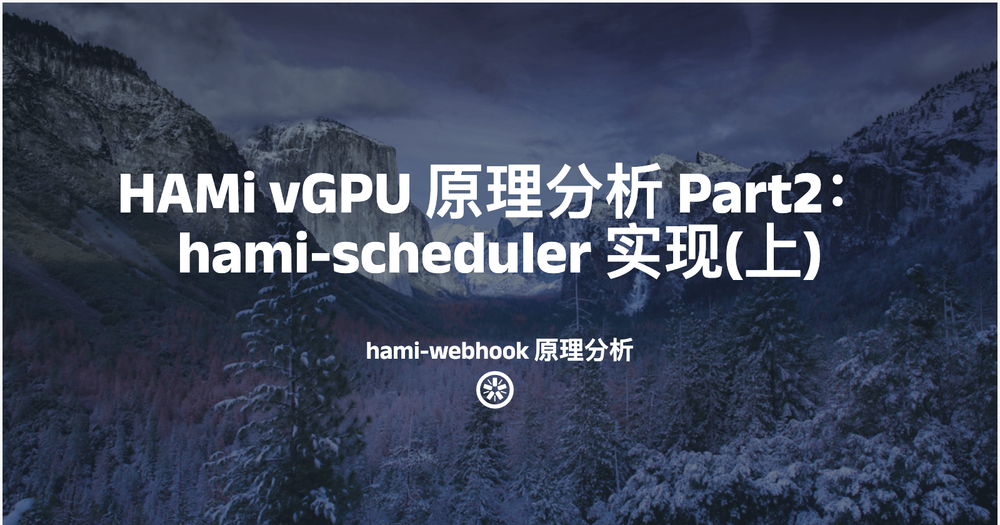

[简体中文](./README.md) · [All articles](../../README.en.md) · [Read on the website](https://www.theriseunion.com/en/blog/hami-analyze-webhook.html)

# HAMi vGPU code Analysis Part2: hami-webhook

RiseUnion · January 01, 2025 at 08:00 (UTC+08:00)

Deep dive into HAMi's webhook mechanism, examining how it intercepts Pod creation requests, manages GPU resource allocation, and integrates with Kubernetes scheduler for efficient vGPU management. Includes detailed source code analysis for developers.



> This article references: ["HAMi vGPU Principle Analysis Part 2: hami-webhook Principle Analysis"](https://www.lixueduan.com/posts/kubernetes/31-hami-analyze-2-webhook/). Thanks to "Exploring Cloud Native" for their continued attention and contribution to HAMi.

In the previous article, we analyzed [hami-device-plugin-nvidia](https://www.theriseunion.com/en/blog/hami-analyze-device-plugin.html) and learned about HAMi's NVIDIA device plugin working principles.

This article is the second part of HAMi principle analysis, focusing on analyzing the hami-scheduler implementation principles.

To implement vGPU-based scheduling, HAMi implemented its own Scheduler: hami-scheduler, which includes basic scheduling logic as well as advanced scheduling strategies like spread & binpack.

The main questions include:

1. How does a Pod use hami-scheduler, since when creating a Pod without specifying SchedulerName, it should use default-scheduler by default
2. How hami-scheduler logic and advanced scheduling strategies like spread & binpack are implemented

Due to the extensive content, it has been split into three articles: hami-webhook, hami-scheduler, and Spread&Binpack scheduling strategies. This article mainly addresses the first question.

> The following analysis is based on HAMi v2.4.0: https://github.com/Project-HAMi/HAMi/releases/tag/v2.4.0

## 1. hami-scheduler Startup Command

hami-scheduler specifically includes two components:

- hami-webhook
- hami-scheduler

Although there are two components, the code is actually placed together, with `cmd/scheduler/main.go` as the startup file: here it's also implemented as a command-line tool using the cobra library.

```go
var (
    sher        *scheduler.Scheduler
    tlsKeyFile  string
    tlsCertFile string
    rootCmd     = &cobra.Command{
       Use:   "scheduler",
       Short: "kubernetes vgpu scheduler",
       Run: func(cmd *cobra.Command, args []string) {
          start()
       },
    }
)

func main() {
    if err := rootCmd.Execute(); err != nil {
       klog.Fatal(err)
    }
}
```

The final start method is as follows:

```go
func start() {
    device.InitDevices()
    sher = scheduler.NewScheduler()
    sher.Start()
    defer sher.Stop()

    // start monitor metrics
    go sher.RegisterFromNodeAnnotations()
    go initMetrics(config.MetricsBindAddress)

    // start http server
    router := httprouter.New()
    router.POST("/filter", routes.PredicateRoute(sher))
    router.POST("/bind", routes.Bind(sher))
    router.POST("/webhook", routes.WebHookRoute())
    router.GET("/healthz", routes.HealthzRoute())
    klog.Info("listen on ", config.HTTPBind)
    if len(tlsCertFile) == 0 || len(tlsKeyFile) == 0 {
       if err := http.ListenAndServe(config.HTTPBind, router); err != nil {
          klog.Fatal("Listen and Serve error, ", err)
       }
    } else {
       if err := http.ListenAndServeTLS(config.HTTPBind, tlsCertFile, tlsKeyFile, router); err != nil {
          klog.Fatal("Listen and Serve error, ", err)
       }
    }
}
```

It first initializes the Device, then starts the Scheduler, followed by starting a Goroutine to continuously parse and obtain specific GPU information from the Annotations previously added to the Node object by the device plugin, and finally starts an HTTP service.

```go
device.InitDevices()

sher = scheduler.NewScheduler()
sher.Start()
defer sher.Stop()

router := httprouter.New()
router.POST("/filter", routes.PredicateRoute(sher))
router.POST("/bind", routes.Bind(sher))
router.POST("/webhook", routes.WebHookRoute())
router.GET("/healthz", routes.HealthzRoute())
```

Where:

- `/webhook` is the Webhook component
- `/filter` and `/bind` are the Scheduler components
- `/healthz` is used for health checks

Next, we'll analyze the implementation of both Webhook and Scheduler through the source code.

## 2. hami-webhook

The Webhook here is a Mutating Webhook, mainly serving the Scheduler.

Its core functionality is: **Based on the ResourceName in the Pod Resource field, determine whether the Pod uses HAMi vGPU. If yes, modify the Pod's SchedulerName to hami-scheduler for scheduling by hami-scheduler; if not, no processing is needed.**

### MutatingWebhookConfiguration Settings

To make the Webhook effective, HAMi creates a `MutatingWebhookConfiguration` object during deployment, with the following content:

```bash
root@test:~# kubectl -n kube-system get MutatingWebhookConfiguration vgpu-hami-webhook -oyaml
apiVersion: admissionregistration.k8s.io/v1
kind: MutatingWebhookConfiguration
metadata:
  annotations:
    meta.helm.sh/release-name: vgpu
    meta.helm.sh/release-namespace: kube-system
  labels:
    app.kubernetes.io/managed-by: Helm
  name: vgpu-hami-webhook
webhooks:
- admissionReviewVersions:
  - v1beta1
  clientConfig:
    caBundle: xxx
    service:
      name: vgpu-hami-scheduler
      namespace: kube-system
      path: /webhook
      port: 443
  failurePolicy: Ignore
  matchPolicy: Equivalent
  name: vgpu.hami.io
  namespaceSelector:
    matchExpressions:
    - key: hami.io/webhook
      operator: NotIn
      values:
      - ignore
  objectSelector:
    matchExpressions:
    - key: hami.io/webhook
      operator: NotIn
      values:
      - ignore
  reinvocationPolicy: Never
  rules:
  - apiGroups:
    - ""
    apiVersions:
    - v1
    operations:
    - CREATE
    resources:
    - pods
    scope: '*'
  sideEffects: None
  timeoutSeconds: 10
```

The specific effect is that when creating a Pod, kube-apiserver will call the webhook corresponding to this service, thus injecting our custom logic.

It focuses on Pod CREATE events:

```yaml
  rules:
  - apiGroups:
    - ""
    apiVersions:
    - v1
    operations:
    - CREATE
    resources:
    - pods
    scope: '*'
```

But excludes the following objects:

```yaml
  namespaceSelector:
    matchExpressions:
    - key: hami.io/webhook
      operator: NotIn
      values:
      - ignore
  objectSelector:
    matchExpressions:
    - key: hami.io/webhook
      operator: NotIn
      values:
      - ignore
```

That is: namespaces or resource objects with the `hami.io/webhook=ignore` label do not go through this Webhook logic.

The requested Webhook is:

```yaml
    service:
      name: vgpu-hami-scheduler
      namespace: kube-system
      path: /webhook
      port: 443
```

Meaning: for Pod CREATE operations that meet the conditions, kube-apiserver will call the service specified by this service, which is our hami-webhook.

Next, let's analyze what exactly hami-webhook does.

### Source Code Analysis

The specific implementation of this webhook is as follows:

```go
// pkg/scheduler/webhook.go#L52
func (h *webhook) Handle(_ context.Context, req admission.Request) admission.Response {
    pod := &corev1.Pod{}
    err := h.decoder.Decode(req, pod)
    if err != nil {
       klog.Errorf("Failed to decode request: %v", err)
       return admission.Errored(http.StatusBadRequest, err)
    }
    if len(pod.Spec.Containers) == 0 {
       klog.Warningf(template+" - Denying admission as pod has no containers", req.Namespace, req.Name, req.UID)
       return admission.Denied("pod has no containers")
    }
    klog.Infof(template, req.Namespace, req.Name, req.UID)
    hasResource := false
    for idx, ctr := range pod.Spec.Containers {
       c := &pod.Spec.Containers[idx]
       if ctr.SecurityContext != nil {
          if ctr.SecurityContext.Privileged != nil && *ctr.SecurityContext.Privileged {
             klog.Warningf(template+" - Denying admission as container %s is privileged", req.Namespace, req.Name, req.UID, c.Name)
             continue
          }
       }
       for _, val := range device.GetDevices() {
          found, err := val.MutateAdmission(c)
          if err != nil {
             klog.Errorf("validating pod failed:%s", err.Error())
             return admission.Errored(http.StatusInternalServerError, err)
          }
          hasResource = hasResource || found
       }
    }

    if !hasResource {
       klog.Infof(template+" - Allowing admission for pod: no resource found", req.Namespace, req.Name, req.UID)
       //return admission.Allowed("no resource found")
    } else if len(config.SchedulerName) > 0 {
       pod.Spec.SchedulerName = config.SchedulerName
    }
    marshaledPod, err := json.Marshal(pod)
    if err != nil {
       klog.Errorf(template+" - Failed to marshal pod, error: %v", req.Namespace, req.Name, req.UID, err)
       return admission.Errored(http.StatusInternalServerError, err)
    }
    return admission.PatchResponseFromRaw(req.Object.Raw, marshaledPod)
}
```

The logic is relatively simple:

1. Determine if the Pod needs to use HAMi-Scheduler for scheduling
2. If needed, modify the Pod's SchedulerName field to hami-scheduler (name is configurable)

### How to Determine Whether to Use hami-scheduler

The Webhook mainly determines based on whether the Pod requests vGPU resources, though there are some special cases.

#### Privileged Mode Pods

First, for privileged mode Pods, HAMi directly ignores them:
```go
if ctr.SecurityContext != nil {
  if ctr.SecurityContext.Privileged != nil && *ctr.SecurityContext.Privileged {
     klog.Warningf(template+" - Denying admission as container %s is privileged", req.Namespace, req.Name, req.UID, c.Name)
     continue
  }
}
```

This is because after enabling privileged mode, the Pod can access all devices on the host, so further restrictions would be meaningless, therefore it's directly ignored.

#### Specific Determination Logic

Then it determines whether hami-scheduler is needed for scheduling based on the Resources in the Pod:

```go
for _, val := range device.GetDevices() {
  found, err := val.MutateAdmission(c)
  if err != nil {
     klog.Errorf("validating pod failed:%s", err.Error())
     return admission.Errored(http.StatusInternalServerError, err)
  }
  hasResource = hasResource || found
}
```

If the Pod Resource requests vGPU resources supported by HAMi, then it needs to be scheduled by HAMi-Scheduler.

The Devices supported by HAMi are those initialized earlier in start:

```go
var devices map[string]Devices

func GetDevices() map[string]Devices {
    return devices
}

func InitDevices() {
    devices = make(map[string]Devices)
    DevicesToHandle = []string{}
    devices[cambricon.CambriconMLUDevice] = cambricon.InitMLUDevice()
    devices[nvidia.NvidiaGPUDevice] = nvidia.InitNvidiaDevice()
    devices[hygon.HygonDCUDevice] = hygon.InitDCUDevice()
    devices[iluvatar.IluvatarGPUDevice] = iluvatar.InitIluvatarDevice()
    //devices[d.AscendDevice] = d.InitDevice()
    //devices[ascend.Ascend310PName] = ascend.InitAscend310P()
    DevicesToHandle = append(DevicesToHandle, nvidia.NvidiaGPUCommonWord)
    DevicesToHandle = append(DevicesToHandle, cambricon.CambriconMLUCommonWord)
    DevicesToHandle = append(DevicesToHandle, hygon.HygonDCUCommonWord)
    DevicesToHandle = append(DevicesToHandle, iluvatar.IluvatarGPUCommonWord)
    //DevicesToHandle = append(DevicesToHandle, d.AscendDevice)
    //DevicesToHandle = append(DevicesToHandle, ascend.Ascend310PName)
    for _, dev := range ascend.InitDevices() {
       devices[dev.CommonWord()] = dev
       DevicesToHandle = append(DevicesToHandle, dev.CommonWord())
    }
}
```

devices is a global variable, InitDevices initializes this variable for use in the Webhook, including NVIDIA, Hygon, Tianshu, Ascend, etc.

Taking NVIDIA as an example to explain how HAMi determines whether a Pod needs its scheduling, the specific implementation of MutateAdmission is as follows:

```go
func (dev *NvidiaGPUDevices) MutateAdmission(ctr *corev1.Container) (bool, error) {
    /*gpu related */
    priority, ok := ctr.Resources.Limits[corev1.ResourceName(ResourcePriority)]
    if ok {
       ctr.Env = append(ctr.Env, corev1.EnvVar{
          Name:  api.TaskPriority,
          Value: fmt.Sprint(priority.Value()),
       })
    }

    _, resourceNameOK := ctr.Resources.Limits[corev1.ResourceName(ResourceName)]
    if resourceNameOK {
       return resourceNameOK, nil
    }

    _, resourceCoresOK := ctr.Resources.Limits[corev1.ResourceName(ResourceCores)]
    _, resourceMemOK := ctr.Resources.Limits[corev1.ResourceName(ResourceMem)]
    _, resourceMemPercentageOK := ctr.Resources.Limits[corev1.ResourceName(ResourceMemPercentage)]

    if resourceCoresOK || resourceMemOK || resourceMemPercentageOK {
       if config.DefaultResourceNum > 0 {
          ctr.Resources.Limits[corev1.ResourceName(ResourceName)] = *resource.NewQuantity(int64(config.DefaultResourceNum), resource.BinarySI)
          resourceNameOK = true
       }
    }

    if !resourceNameOK && OverwriteEnv {
       ctr.Env = append(ctr.Env, corev1.EnvVar{
          Name:  "NVIDIA_VISIBLE_DEVICES",
          Value: "none",
       })
    }
    return resourceNameOK, nil
}
```

First, it checks if the Pod's Resource has the corresponding ResourceName and returns true directly if it does

```go
_, resourceNameOK := ctr.Resources.Limits[corev1.ResourceName(ResourceName)]
if resourceNameOK {
   return resourceNameOK, nil
}
```

The ResourceName for NVIDIA GPU is:

```go
fs.StringVar(&ResourceName, "resource-name", "nvidia.com/gpu", "resource name")
```

If the Pod Resource requests this resource, it needs to be scheduled by HAMi. The same applies to other Resources, so we won't look at them in detail.

> HAMi supports GPUs from manufacturers like NVIDIA, Tianshu, Huawei, Cambricon, Hygon, etc., with default ResourceNames like nvidia.com/gpu, iluvatar.ai/vgpu, hygon.com/dcunum, cambricon.com/mlu, huawei.com/Ascend310, etc.
> Using these ResourceNames will all be scheduled by HAMi-Scheduler.
> PS: These ResourceNames can be configured in their respective device plugins.

If the Pod hasn't directly requested nvidia.com/gpu but has requested resources like gpucore, gpumem, and if the Webhook's DefaultResourceNum is greater than 0, it will also return true and automatically add the nvidia.com/gpu resource request.

```go
_, resourceCoresOK := ctr.Resources.Limits[corev1.ResourceName(ResourceCores)]
_, resourceMemOK := ctr.Resources.Limits[corev1.ResourceName(ResourceMem)]
_, resourceMemPercentageOK := ctr.Resources.Limits[corev1.ResourceName(ResourceMemPercentage)]
```

### Modifying SchedulerName

For Pods meeting the above conditions that need to be scheduled by HAMi-Scheduler, the Webhook will change the Pod's spec.schedulerName to hami-scheduler:

```go
if !hasResource {
    klog.Infof(template+" - Allowing admission for pod: no resource found", req.Namespace, req.Name, req.UID)
    //return admission.Allowed("no resource found")
} else if len(config.SchedulerName) > 0 {
    pod.Spec.SchedulerName = config.SchedulerName
}
```

This way the Pod will be scheduled by HAMi-Scheduler, and next comes the hami-scheduler logic.

There's also a special logic here: if nodeName is directly specified during creation, the Webhook will directly reject it, because specifying nodeName means the Pod doesn't need scheduling at all and will start directly on the specified node, but without going through scheduling, that node might not have enough resources.

```go
if pod.Spec.NodeName != "" {
        klog.Infof(template+" - Pod already has node assigned", req.Namespace, req.Name, req.UID)
        return admission.Denied("pod has node assigned")
}
```

## 3. Summary

The purpose of this Webhook is to modify the scheduler of Pods requesting vGPU resources to hami-scheduler, which will then be used for scheduling.

There are also some special cases:

- For Pods with privileged mode enabled, the Webhook will ignore them and won't switch them to hami-scheduler for scheduling, instead continuing to use the default-scheduler.
- For Pods that directly specify nodeName, the Webhook will directly reject them, intercepting the Pod creation.

Based on these special cases, the following issues might occur, which have been reported multiple times by community members:

- **Privileged mode Pods requesting gpucore, gpumem, and other resources remain in Pending status and cannot be scheduled, with messages indicating nodes don't have gpucore, gpumem, and other resources.**

Because the Webhook skips privileged mode Pods, such Pods will use the default-scheduler for scheduling, and when the default-scheduler checks the Pod's ResourceName, it finds that no Node has gpucore, gpumem, or other resources, so it cannot schedule, leaving the Pod in Pending status.

> PS: gpucore, gpumem are virtual resources and won't be shown on the Node, only hami-scheduler can handle them.

**HAMi Webhook workflow is as follows:**

1. User creates a Pod and requests vGPU resources in the Pod
2. kube-apiserver requests HAMi-Webhook based on MutatingWebhookConfiguration settings
3. HAMi-Webhook detects the Resource in the Pod, finds it's requesting vGPU resources managed by HAMi, so changes the Pod's SchedulerName to hami-scheduler, so this Pod will be scheduled by hami-scheduler.
    - For privileged mode Pods, the Webhook will directly skip without processing
    - For Pods using vGPU resources but specifying nodeName, the Webhook will directly reject
4. Next enters the hami-scheduler scheduling logic, which we'll analyze in the next article~

At this point, we've clarified **why Pods use hami-scheduler and which Pods will use hami-scheduler for scheduling**. It also explains why privileged mode Pods cannot be scheduled.

Next, we'll start analyzing the hami-scheduler implementation.

---

[Read this article on the RiseUnion website](https://www.theriseunion.com/en/blog/hami-analyze-webhook.html) · [Explore more articles](https://www.theriseunion.com/en/blog.html)
