[简体中文](./README.md) · [All articles](../../README.en.md) · [Read on the website](https://www.theriseunion.com/en/blog/hami-beijing-meetup-202512-afterparty.html)

# From 'Compute Available' to 'Compute Efficient': RiseUnion Deep Participation in HAMi Meetup Beijing

RiseUnion · December 29, 2025 at 08:00 (UTC+08:00)

HAMi Meetup Beijing concluded successfully. RiseUnion shares practice transitioning from 'compute available' to 'compute efficient,' covering Kunlunxin P800 vXPU dynamic partitioning, topology-aware scheduling, observability, and HAMi-DRA native resource abstraction evolution.

**On December 27, 2025, in Beijing's Haidian District, "Efficiency Over Scale: HAMi Meetup Beijing" concluded successfully.**

As deep participants and long-term contributors to the HAMi community, **RiseUnion** joined numerous technical partners from CNCF, chip vendors, platform engineering teams, and frontline business units for intensive, engineering-focused discussions on deploying domestic heterogeneous compute in real production environments.

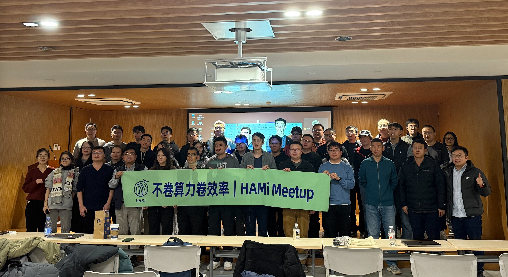

Standing in Beijing at the end of 2025, looking out at the winter outside, we couldn't help but think back to exactly one year ago.

On December 1, 2024, the HAMi community held its first offline salon ([Recap: HAMi Salon First Stop](https://www.theriseunion.com/en/blog/hami-salon-1.html)). Back then, we were still exploring the "possibility" of heterogeneous compute virtualization. Today, a year later, HAMi has taken root in production environments at **200+** enterprises.

---

## Compute Bottlenecks: No Longer Just a Hardware Problem

Compared to last year's technical discussions, this year's Beijing meetup sent a clear signal: the industry's focus is shifting from "can we use domestic compute" to **"how do we deliver domestic compute to production workloads stably, efficiently, and sustainably?"**

As domestic accelerator types continue to diversify, enterprises face evolving core challenges:

* **Architectural complexity**: Multiple architectures coexist, and the heterogeneous characteristics of different GPUs/NPUs cause scheduling complexity to grow exponentially.
* **Resource fragmentation**: As AI inference workloads become more granular, traditional "whole-card allocation" models or improper virtualization approaches lock down large amounts of memory and compute, preventing cross-task reuse and causing severe resource waste.
* **Engineering black boxes**: Scheduling processes aren't observable. Without fine-grained resource metrics, operations remain in a primitive "guesswork" stage.

> **RiseUnion's perspective**: Compute efficiency isn't solved by point tools—it's a systems engineering challenge involving scheduling, virtualization, software stacks, and business patterns working together.

---

## From "Tool" to "Long-Term Scheduling Abstraction"

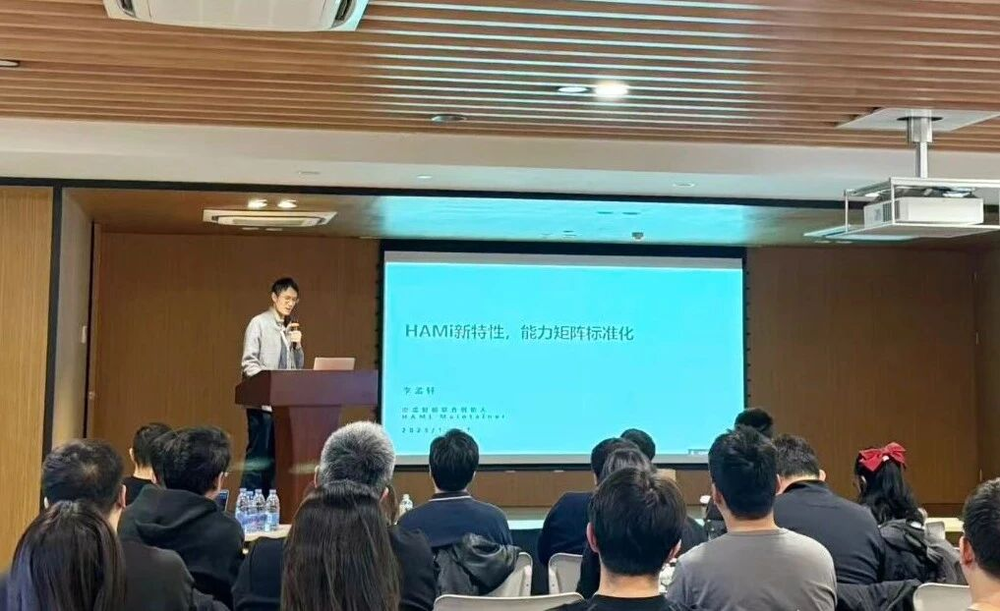
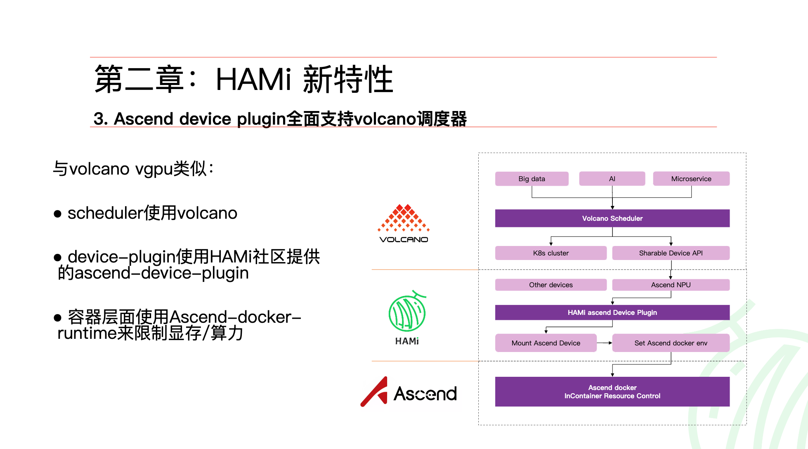

HAMi Maintainer Li Mengxuan discussed HAMi's technical evolution and community roadmap in heterogeneous compute scheduling.

As a CNCF Sandbox project, HAMi completed critical technical leaps over the past year. The meetup revealed several important signals:

1. **Capability standardization**: Systematically mapping maturity matrices for different heterogeneous devices across dimensions like memory isolation and compute control, providing certainty for user selection.
2. **Native architecture**: The upcoming **HAMi-DRA**, based on Kubernetes' native DRA architecture, significantly simplifies scheduling pipelines and enables deep integration with schedulers like Volcano.
3. **Long-term abstraction**: The evolution from Device Plugin to native DRA Driver means heterogeneous compute is being incorporated into Kubernetes' longer-term, evolvable resource model.

---

## Where Are the Real Challenges with Domestic Compute?

In the session *"Accelerating Domestic Compute Compatibility in HAMi v2.7.0,"* RiseUnion R&D Engineer & HAMi Reviewer **Ouyang Luwei** systematically reviewed our real-world engineering practice with **Kunlunxin P800 vXPU** ([Reference: Kunlunxin P800 Virtualization Guide](https://www.theriseunion.com/en/blog/hami-kunlunxin-p800-support.html), [Reference: Rise VAST Full Support for Kunlunxin P800](https://www.theriseunion.com/en/blog/kunlunxin-compatibility.html)).

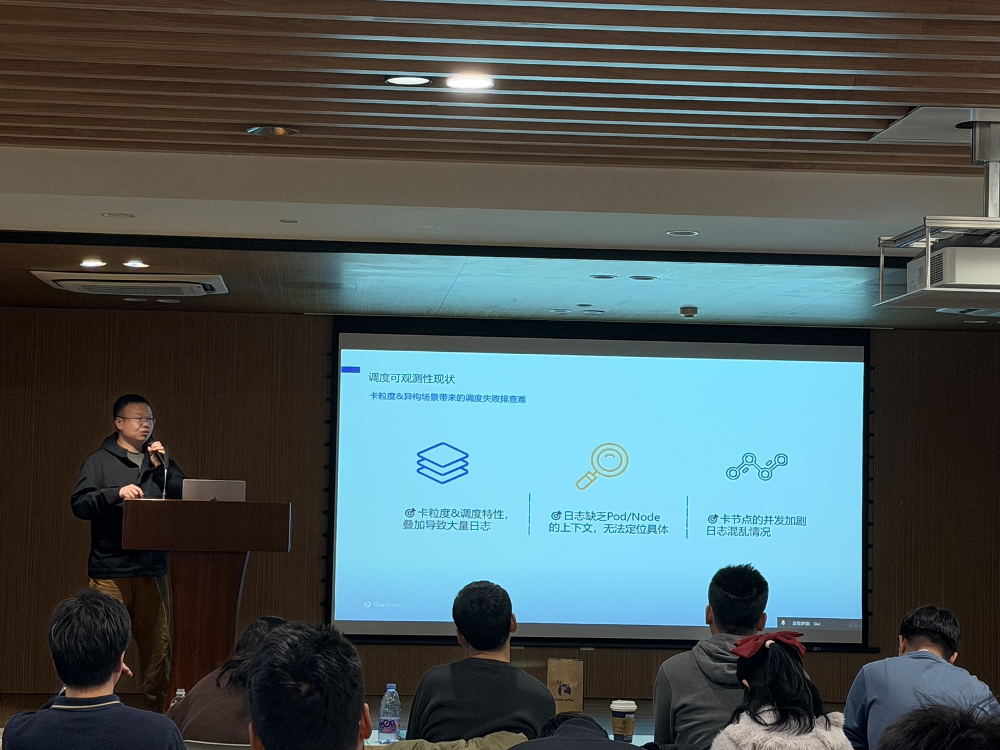
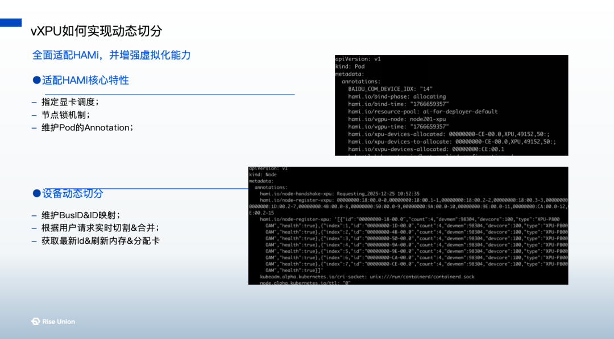

He shared insights across three key areas:

### Fine-Grained Partitioning Isn't the Goal—Stable Delivery Is

After implementing vXPU dynamic partitioning in the P800 scenario, we found that "fine-grained" doesn't equal "efficient." Precise matching of scheduling strategies with resource constraints is what matters.

### Topology Awareness: Unavoidable in Heterogeneous Scheduling

In multi-XPU, multi-node environments, ignoring physical topology and communication relationships leads to scheduling results that are "logically correct but performance disasters." HAMi-Scheduler's topology-aware capabilities play a decisive role in ensuring large-scale task stability.

### Observability Determines Whether Engineering Can Scale

When virtualization combines with heterogeneous scheduling, problem diagnosis becomes exponentially harder. RiseUnion continues investing in scheduling observability, visualizing complete scheduling processes through logs and events, moving operations beyond guesswork.

---

## Practitioners Unite: Multiple Forces Converge

Beijing's energy came from practitioners exploring different dimensions in depth. We observed that heterogeneous compute efficiency has evolved from a single "virtualization technology" to coordinated efforts across three dimensions:

### 1. Business-Driven "Cost Reduction and Efficiency"

**Ke.com** compute platform engineer Wang Ni shared deployment experience with their vGPU inference cluster. Through deep HAMi scheduling, cluster utilization improved approximately **3x**. This proves that in real business scenarios, virtualization technology is no longer synonymous with "performance overhead"—it's a core lever determining AI business ROI.

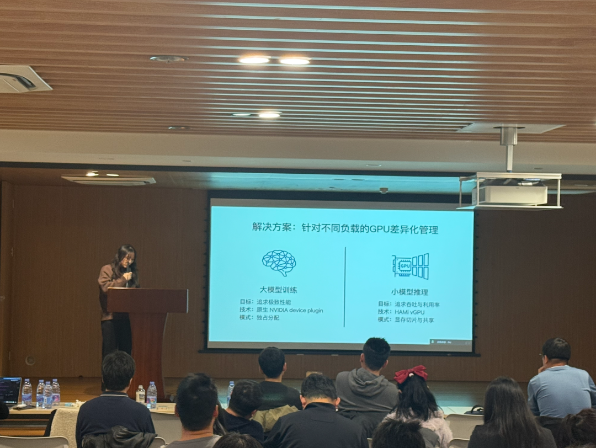
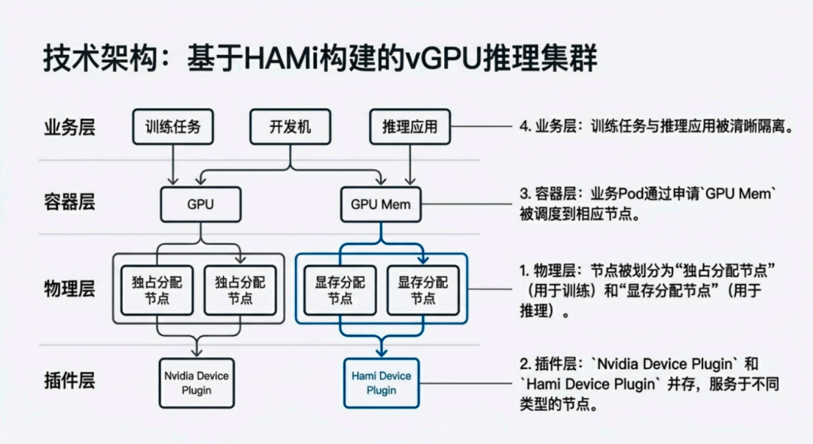

### 2. Software-Hardware Integration "Deep Optimization"

R&D engineer Wang Zhongqin from **Hygon** showcased the latest progress in vDCU software virtualization.

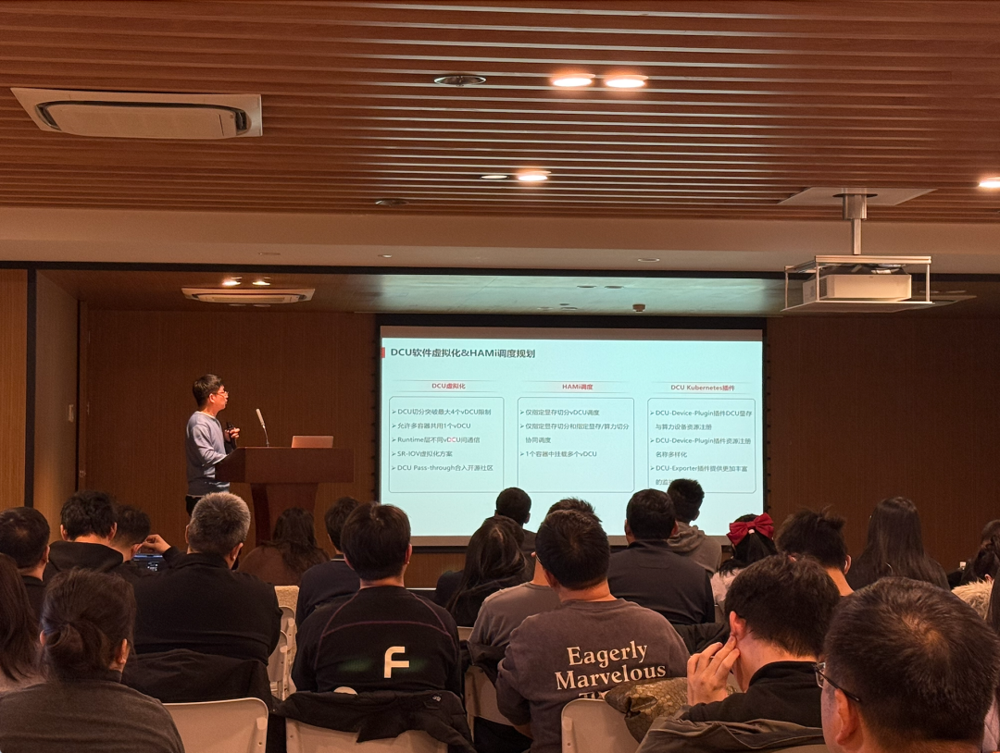
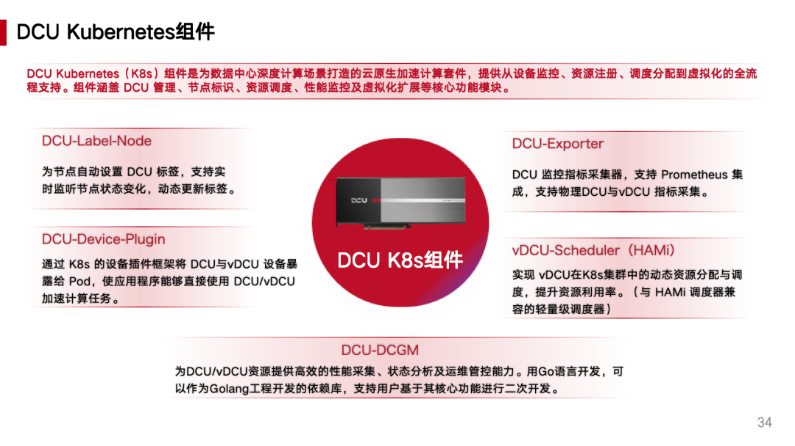

**Qingcheng Jizhi** VP of Technology Ecosystem and Partner He Wanqing demonstrated how their software stack collaborates with HAMi to achieve "dual-layer elasticity."

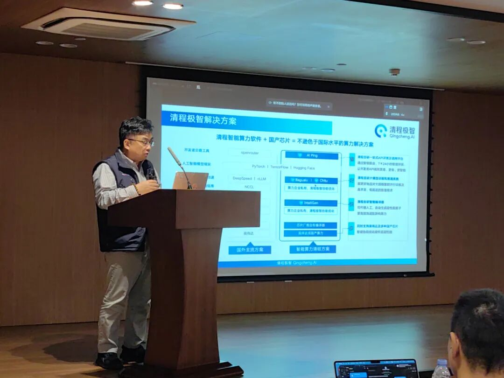
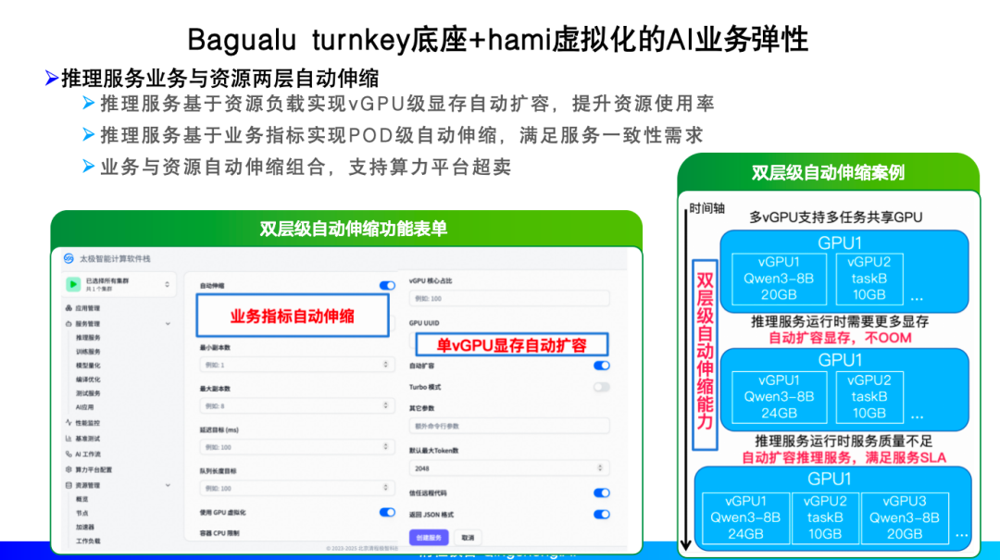

This deep coordination from chip-level instruction sets to upper-layer scheduling frameworks is eliminating the "software-hardware gap" in domestic compute deployment.

### 3. Standard-Led "Architectural Evolution"

R&D engineer & HAMi Approver Yang Shouren from **4Paradigm** shared exploration of **HAMi-Core × DRA** native resource abstraction. HAMi is evolving from a "plugin tool" to a long-term, evolvable resource model in the Kubernetes ecosystem. This means heterogeneous compute is being incorporated into standardized, engineering-oriented tracks, no longer "one vendor, one approach" special projects.

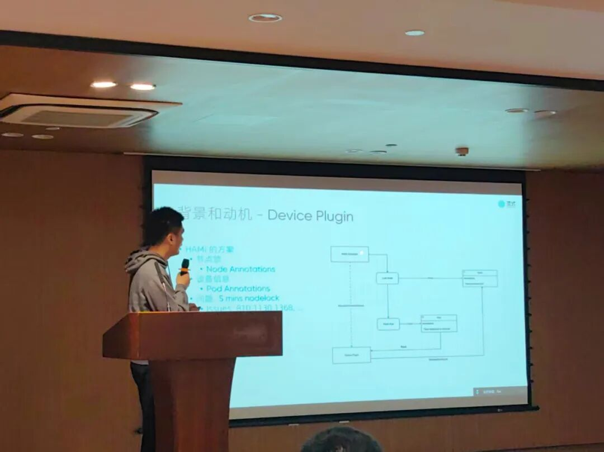
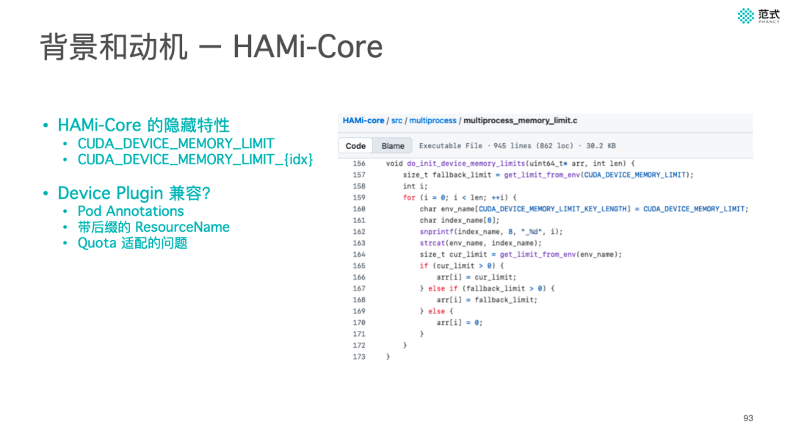

Also from 4Paradigm, James shared HAMi integration practices with the Volcano scheduler in Ascend scenarios. By standardizing registration of key dimensions like memory into Kubernetes' resource model through Mock Device Plugin, allocation precision and resource observability for Ascend compute improved significantly in complex scheduling environments.

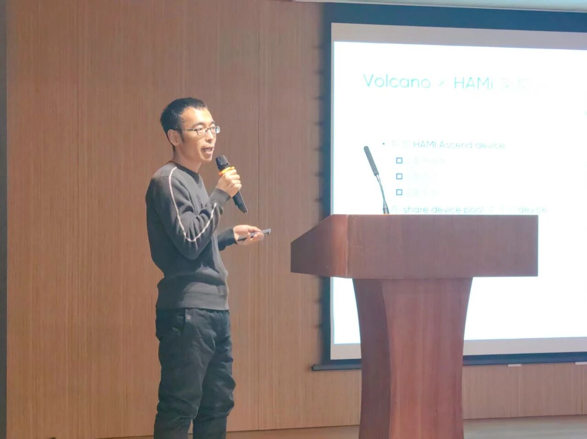
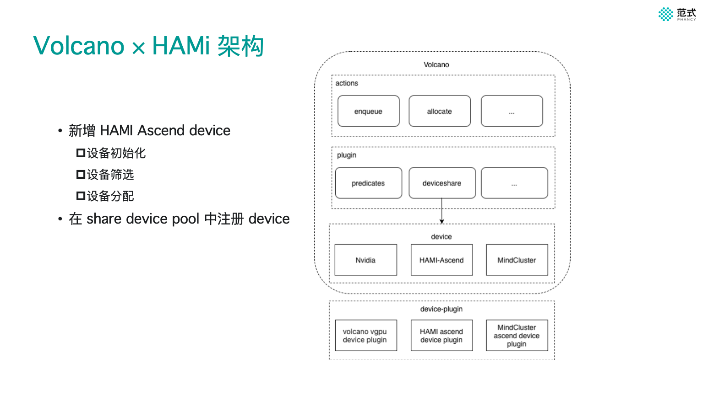

> **RiseUnion's view**: This convergence of multiple forces marks the transition of the domestic compute ecosystem from "adaptation phase" to "fine-grained operations phase."

---

## Closing Thoughts: Efficiency Deserves Long-Termism

From 2024 to 2025, from the first salon to today's Meetup Shanghai and Beijing, RiseUnion's continued investment in the HAMi community stems from our confidence in the goal of "domestic compute deployment."

**"Efficiency over scale"** isn't just a slogan—it's reflected in every commit to the codebase, every optimization in production. Competition in domestic compute is shifting from hardware specs to engineering systems and platform capabilities.

**RiseUnion** will continue to root ourselves in the HAMi community, refining heterogeneous compute scheduling—this "hard but right thing"—into reusable, scalable engineering capability.

> Compute doesn't need to compete on scale. Efficiency deserves long-termism.

**Next stop, we look forward to seeing you again.**

---

[Read this article on the RiseUnion website](https://www.theriseunion.com/en/blog/hami-beijing-meetup-202512-afterparty.html) · [Explore more articles](https://www.theriseunion.com/en/blog.html)
