[English](./README.en.md) · [文章目录](../../README.md) · [官网阅读](https://www.theriseunion.com/zh/blog/hami-beijing-meetup-202512-afterparty.html)

# 从“算力可用”到“算力高效”：睿思智联参与 HAMi Meetup 北京站的实践与思考

睿思智联 · 2025/12/29 08:00（北京时间）

HAMi Meetup 北京站圆满落幕，睿思智联分享从 '算力可用' 到 '算力高效' 的实践。探讨昆仑芯P800 vXPU动态切分、拓扑感知调度、可观测性建设等工程实践，以及HAMi-DRA原生资源抽象演进。助力企业提升算力利用率与运营效率。

**2025 年 12 月 27 日，北京海淀，「不卷算力，卷效率｜HAMi Meetup 北京站」圆满落幕。**

作为 HAMi 社区的深度参与者与长期贡献者，**睿思智联** 与来自 CNCF、芯片厂商、平台工程团队及一线业务方的众多技术伙伴齐聚一堂，围绕国产异构算力在真实生产环境中的落地实践，展开了高密度、强工程属性的技术交流。

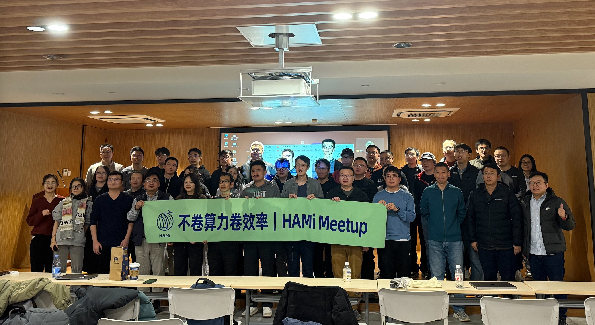

站在 2025 年末的北京现场，望向窗外凛冬，我们不禁想起整整一年前。

2024 年 12 月 1 日，[HAMi 社区](https://www.theriseunion.com/zh/blog/project-hami.html)举办了第一场线下沙龙（[回顾：HAMi 线下沙龙第一站](https://www.theriseunion.com/zh/blog/hami-salon-1.html)）。彼时的我们，还在探讨异构算力虚拟化的“可能性”；而一年后的今天，HAMi 已经在 200+ 企业生产环境中生根发芽。

---

## 算力瓶颈，已不仅是硬件问题

相比一年前的技术探讨，今年的北京站呈现出一个清晰信号：行业关注点正在从“能不能用国产算力”，转向 **“如何把国产算力稳定、高效、可持续地交付给生产业务？”**。

随着国产加速器类型不断丰富，企业面临的核心挑战正在发生转变：

* **架构“复杂化”：** 多架构并存，不同 GPU/NPU 的异构特性让调度复杂度呈指数级上升。
* **资源“碎片化”：** 随着 AI 推理负载走向细碎化，传统的“整卡分配”模型或不当的虚拟化方式，导致大量显存与算力被物理锁死，无法跨任务复用，造成了严重的资源浪费。
* **工程“黑盒化”：** 调度过程不可观测，由于缺乏精细的资源度量手段，运维依然处于“靠猜”的原始阶段。

> **睿思智联的判断：** 算力效率不是单点工具能解决的，而是调度、虚拟化、软件栈与业务形态共同作用的系统工程。

---

## 从“工具”走向“长期调度抽象”

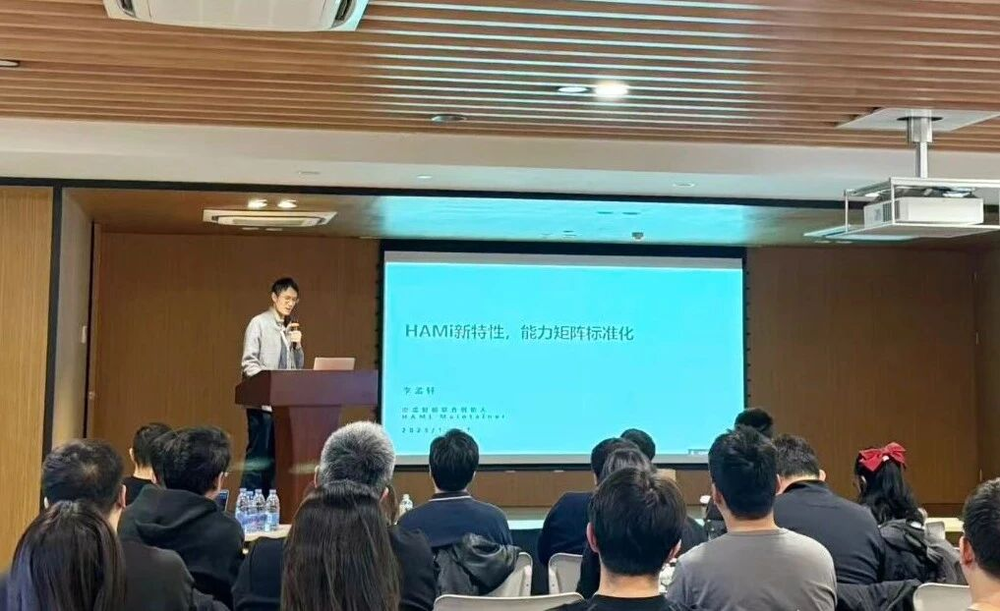
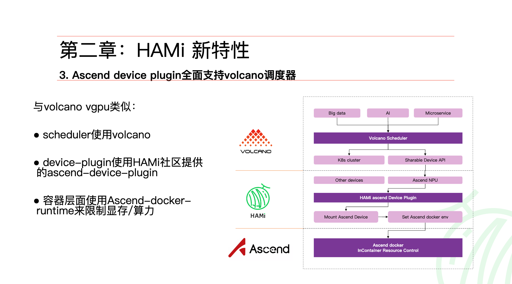

HAMi Maintainer 李孟轩围绕 HAMi 在异构算力调度领域的技术演进与社区规划展开。

作为 CNCF Sandbox 项目，HAMi 在过去一年中完成了关键的技术跳跃。在本次 Meetup 中，社区释放了几个重要信号：

1. **能力“标准化”：** 系统梳理不同异构设备在显存隔离、算力控制等维度的成熟度矩阵，为用户选型提供确定性。
2. **架构“原生化”：** 即将推出的 **HAMi-DRA**，基于 Kubernetes 原生 DRA 架构，显著简化调度链路，实现与 Volcano 等调度框架的深度融合。
3. **抽象“长期化”：** 从 Device Plugin 向原生 DRA Driver 的演进，意味着异构算力正在被纳入 K8s 更长期、可演进的资源模型中。

---

## 国产算力，真正的难点在哪里？

在《HAMi v2.7.0 加速兼容国产算力》分享中，睿思智联研发工程师 & HAMi Reviewer **欧阳陆伟**，系统回顾了我们在 **昆仑芯 P800 vXPU** 场景下的真实工程实践（[参考：昆仑芯 P800 虚拟化指南](https://www.theriseunion.com/zh/blog/hami-kunlunxin-p800-support.html)、[参考：Rise VAST 全面适配昆仑芯 P800](https://www.theriseunion.com/zh/blog/kunlunxin-compatibility.html)）。

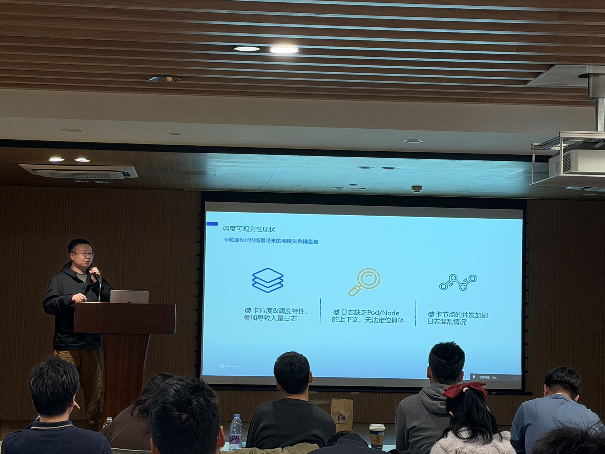
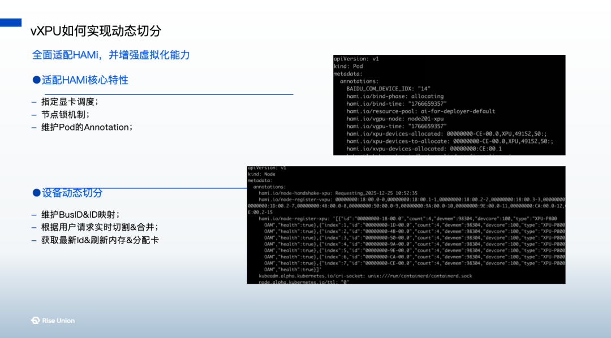

他重点分享了三个层面的经验：

### 细粒度切分不是目的，稳定交付才是
在 P800 场景下实现了 vXPU 的动态切分后，我们发现“切得细”并不等同于“效率高”，调度策略与资源约束的精准匹配才是核心。
### 拓扑感知，是异构调度绕不开的一环
在多 XPU、多节点环境中，如果忽略物理拓扑与通信关系，调度结果极易出现“逻辑正确、性能崩溃”。HAMi-Scheduler 的拓扑感知能力，在保障大规模任务稳定性方面发挥了决定性作用。
### 可观测性，决定工程能否规模化
当虚拟化叠加异构调度，问题定位难度激增。睿思智联持续投入调度可观测性建设，通过日志与事件可视化还原完整调度过程，让运维不再“靠猜”。

---

## 实践者同行：多方力量的汇聚

北京站的火热，源于多方实践者在不同维度的深度探索。我们在现场观察到，异构算力的提效已经从单一的“虚拟化技术”演进为三个维度的协同：

### 1. 业务驱动的“降本增效”

**贝壳找房**算力平台开发工程师王妮，分享了其 vGPU 推理集群的落地经验。通过 HAMi 的深度调度，其集群整体利用率提升了约 **3 倍**。这证明了在真实业务场景中，虚拟化技术不再是“性能损耗”的代名词，而是决定 AI 业务 ROI（投资回报率）的核心杠杆。

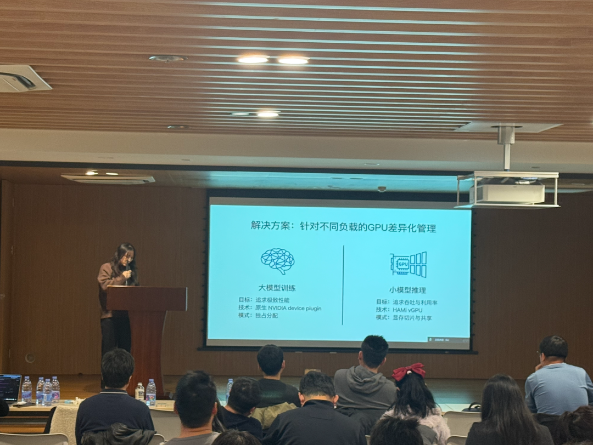
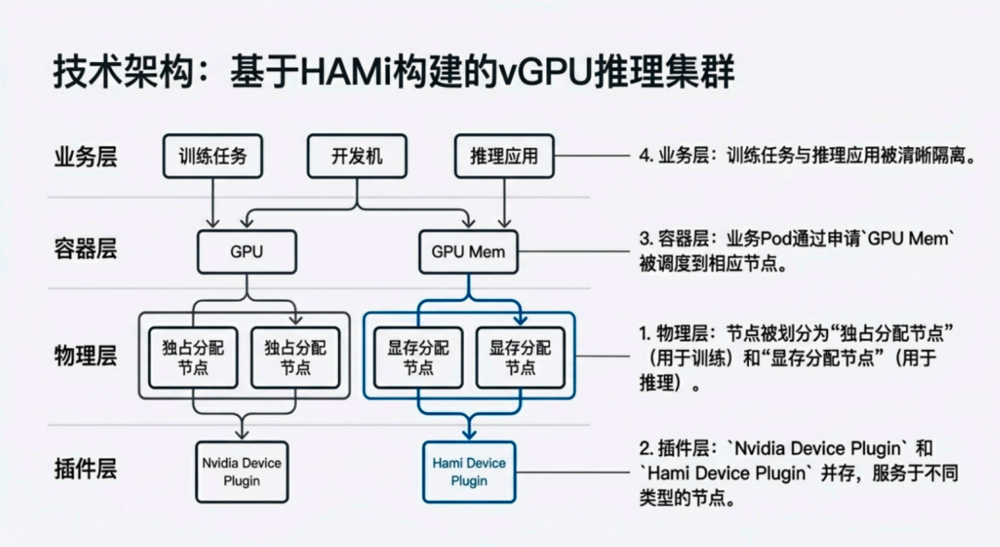

### 2. 软硬结合的“纵深优化”

来自**海光信息**的研发工程师王忠勤的实践展示了 vDCU 软件虚拟化的最新进展。

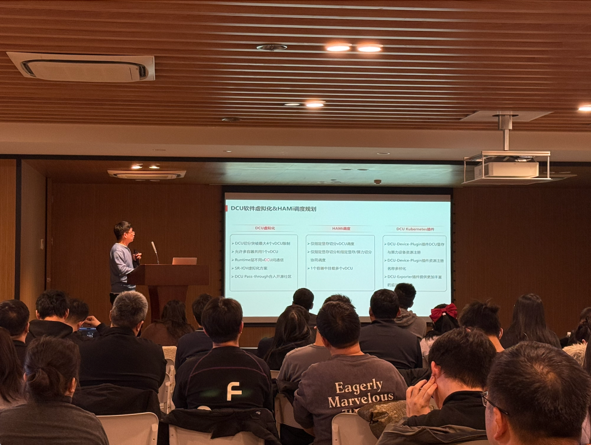
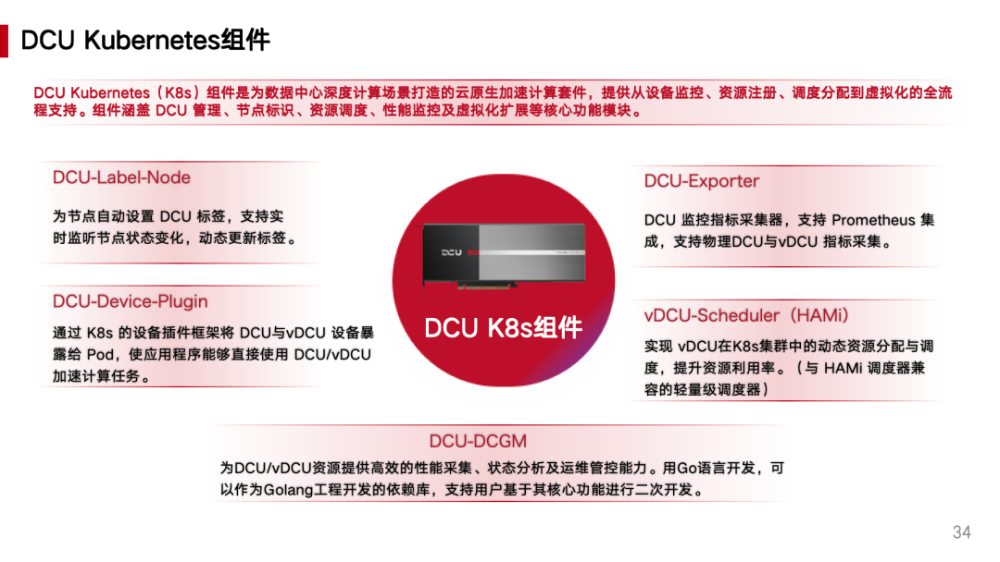

**清程极智**技术生态 VP、合伙人何万青，则展示了其软件栈如何与 HAMi 协同实现“双层弹性”。

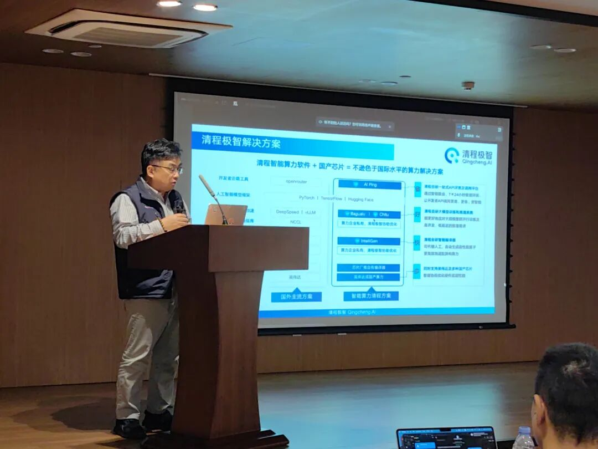
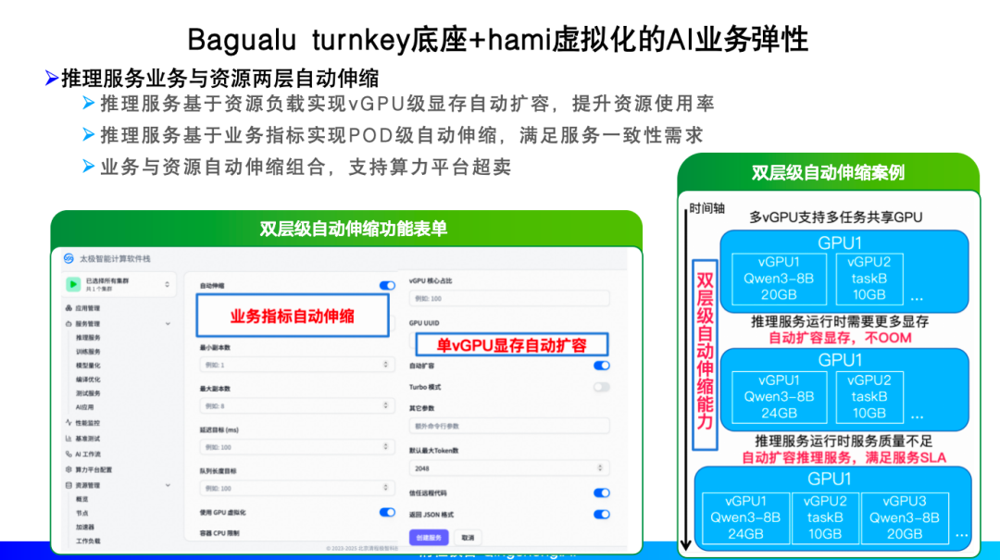

这种从芯片底层指令集到上层调度框架的纵深配合，正在消除国产算力落地的“软硬断层”。

### 3. 标准引领的“架构演进”

来自第四范式研发工程师 & HAMi Approver 杨守仁分享的关于 **HAMi-Core × DRA** 原生资源抽象的探索，HAMi 正在从一个“插件工具”演进为 Kubernetes 生态中长期、可演进的资源模型。这意味着异构算力正在被纳入标准化、工程化的轨道，不再是“一厂一策”的特例工程。

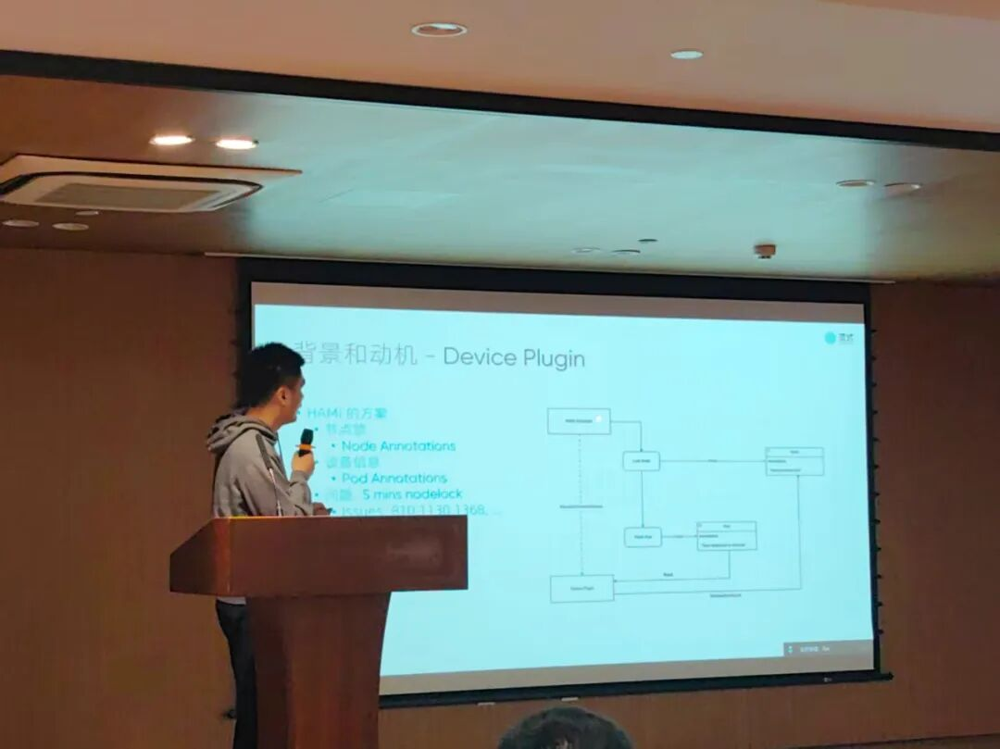
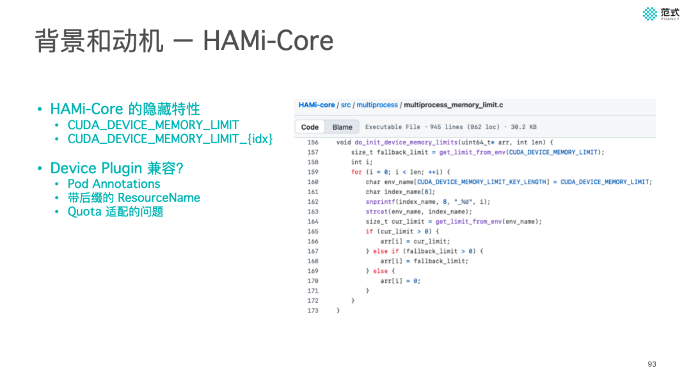

同样来自第四范式的 James，分享了 HAMi 在昇腾（Ascend）场景下与 Volcano 调度器的集成实践。通过 Mock Device Plugin 将显存等关键维度标准化注册至 Kubernetes 资源模型，显著提升了昇腾算力在复杂调度环境下的分配精度与资源可观测性。

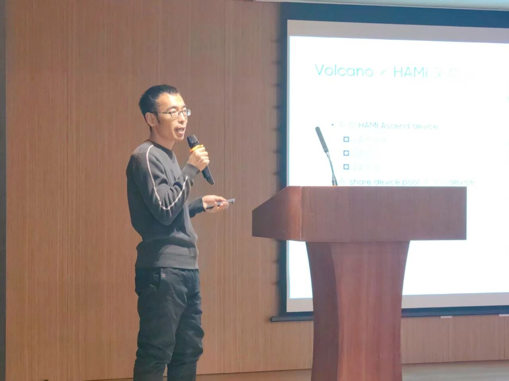
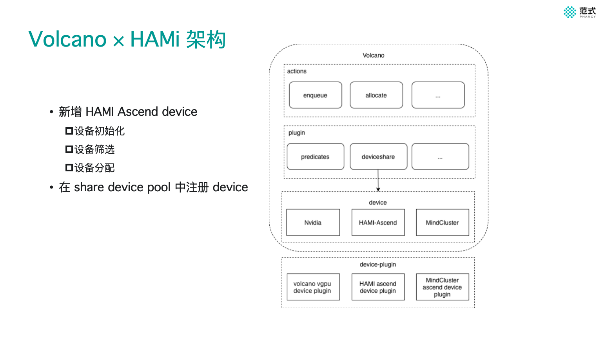

> **睿思智联观点：** 这种多方力量的汇聚，标志着国产算力生态已度过“适配期”，正式进入“精细化运营期”。

---

## 写在最后：效率值得长期主义

从 2024 到 2025，从第一场沙龙到如今的 Meetup 上海站和北京站，睿思智联对 HAMi 社区的持续投入，源于我们对“国产算力落地”这一目标的信心。

**“不卷算力，卷效率”** 不是一句口号，它是我们在代码仓库里的一次次提交，是在生产环境里的一次次调优。国产算力的竞争，正在从硬件参数，走向工程体系与平台能力的竞争。

**睿思智联**将继续扎根 HAMi 社区，把异构算力调度这件“难而正确的事”，持续打磨成可复用、可规模化的工程能力。

> 算力不必内卷，效率值得长期主义。

**下一站，我们期待与你再次相见。**

---

[在睿思智联官网阅读本文](https://www.theriseunion.com/zh/blog/hami-beijing-meetup-202512-afterparty.html) · [浏览更多文章](https://www.theriseunion.com/zh/blog.html)
