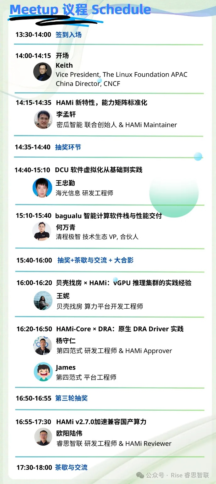

[简体中文](./README.md) · [All articles](../../README.en.md) · [Read on the website](https://www.theriseunion.com/en/blog/hami-beijing-meetup-202512.html)

# HAMi Beijing Meetup: Optimize Efficiency, Not Scale

RiseUnion · December 24, 2025 at 08:00 (UTC+08:00)

HAMi Beijing Meetup 2025: Explore heterogeneous compute scheduling, GPU virtualization, and domestic chip integration. RiseUnion shares HAMi v2.7.0 engineering practices including Kunlunxin P800 vXPU dynamic partitioning and topology-aware scheduling to improve compute utilization.

The recent **HAMi Meetup Shanghai** left us with memorable technical discussions and candid feedback. The message from the community and enterprise practitioners was clear:

> As domestic heterogeneous compute evolves rapidly, the real challenge isn't "do we have compute," but "can we use it **efficiently, reliably, and operationally**."

Building on this consensus, the **HAMi Meetup Beijing** is coming up—another opportunity to explore how compute can be used more effectively.

Beijing, a city that brings together research institutions, industry clusters, and cutting-edge technology, is becoming a key hub for compute efficiency innovation. HAMi will also enter its next phase here—one that's more aligned with real-world enterprise deployment.

As **deep contributors and long-term participants** in the HAMi community, RiseUnion will again join the Beijing meetup, working alongside community members, chip vendors, and enterprise users to tackle real-world deployment challenges for domestic heterogeneous compute. This will be a "no fluff, just practice" deep dive.

---

## From Community to Production: What Real Problems Is HAMi Solving?

HAMi is the only open-source project in the CNCF ecosystem focused on heterogeneous GPU resource sharing. Maintained by **350+ contributors** from **15+ countries**, it's been validated in production at **200+** enterprises and institutions.

In real deployments, we're seeing more and more organizations face similar challenges:

* Multiple domestic GPU / NPU / DCU / XPU architectures coexist, dramatically increasing scheduling complexity;
* Inference workloads are highly fragmented, leading to persistently low memory and compute utilization;
* Chip characteristics vary widely, creating a huge gap between "works" and "works well";
* Scheduling decisions aren't observable, making problems hard to diagnose and operations costly.

What HAMi does isn't replace existing scheduling systems—it's about making heterogeneous compute truly **visible, divisible, schedulable, and reusable** through **lightweight, non-invasive, pluggable** GPU virtualization capabilities.

This is exactly why RiseUnion has been deeply involved in the HAMi community for the long term.

---

## RiseUnion Session Preview

### *Accelerating Domestic Compute Compatibility in HAMi v2.7.0*

At this HAMi Meetup Beijing, RiseUnion R&D Engineer & HAMi Reviewer **Ouyang Luwei** will share insights from real engineering practice.

### What We'll Cover:

#### 1️⃣ Kunlunxin P800 vXPU Dynamic Partitioning Deep Dive

We'll break down vXPU's fine-grained resource partitioning capabilities, systematically explaining how it works in **1/4-card, 1/2-card**, and other virtualization scenarios, along with scheduling coordination mechanisms. We'll show the real benefits of running multiple tasks in parallel on a single card for lightweight inference, development, and testing.

#### 2️⃣ The Engineering Value of XPU Topology-Aware Scheduling

Drawing on Kunlunxin P800's physical topology characteristics, we'll share how to balance performance stability and resource utilization through scheduling strategies like **topology optimization and health assessment** in multi-card training and complex heterogeneous environments—avoiding the "fine-grained but slow" trap.

#### 3️⃣ Visualizing Scheduling Decisions for Faster Troubleshooting

In complex scenarios combining heterogeneous compute and fine-grained partitioning, scheduling issues often happen fast but take forever to diagnose. We'll share how to visualize scheduling decision paths for rapid problem identification and analysis, helping organizations build truly **observable and operational** compute systems.

This isn't lab theory—it's **real-world experience** from RiseUnion's deep integration work with Kunlunxin and other domestic chips, directly applicable to enterprise practice.

---

## Why Attend?

The HAMi Meetup Beijing will cover multiple dimensions—from **community standards and chip capabilities to platform engineering and business practice**:

* HAMi's new features and capability matrix standardization;
* DCU / XPU / GCU software virtualization and Kubernetes practices;
* Production experience scaling vGPU inference clusters;
* Optimizing AI software stacks with virtualization scheduling;
* Next-generation resource abstraction with HAMi-Core × DRA.

Engineers from CNCF, Migua Intelligence, Hygon, Qingcheng Jizhi, Ke.com, 4Paradigm, and RiseUnion will deliver high-density, reusable engineering insights.

This is a serious technical gathering focused on **getting the most out of compute**.

---

## Event Details

* **Date**: Saturday, December 27, 2025, 1:30 PM–6:00 PM
* **Location**: 5th Floor, Building 12, Zhongguancun Innovation Street, Haidian District, Beijing
* **Registration**: Scan the QR code below for free registration (limited seats)

---

## Closing Thoughts

Domestic compute is evolving from "available" to "usable, reliable, and sustainable." This journey depends on open-source community collaboration and continuous feedback from real-world engineering practice.

RiseUnion will continue our deep involvement in the HAMi community, working with more partners to bring **heterogeneous compute scheduling**—this "hard but right thing"—into production environments.

See you in Beijing on December 27.

Let's talk efficiency, not compute wars.

---

[Read this article on the RiseUnion website](https://www.theriseunion.com/en/blog/hami-beijing-meetup-202512.html) · [Explore more articles](https://www.theriseunion.com/en/blog.html)
