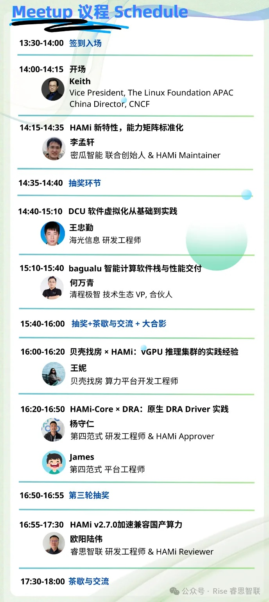

[English](./README.en.md) · [文章目录](../../README.md) · [官网阅读](https://www.theriseunion.com/zh/blog/hami-beijing-meetup-202512.html)

# 不卷算力，卷效率｜HAMi Meetup 北京站 2025

睿思智联 · 2025/12/24 08:00（北京时间）

HAMi Meetup 北京站 2025：探讨异构算力调度优化、GPU虚拟化与国产芯片适配实践。睿思智联分享 HAMi v2.7.0 昆仑芯P800 vXPU动态切分、拓扑感知调度等工程实践，助力企业提升算力利用率与运营效率。

刚刚结束的 **HAMi Meetup 上海站**，给我们留下了许多难忘的技术讨论与真实反馈。来自社区与企业一线的声音高度一致：

> 在国产异构算力快速演进的当下，真正的挑战已经不再是“有没有算力”，而是“算力能不能被 **高效、稳定、可运营** 地用起来”。

基于这些共识，**HAMi Meetup 北京站** 即将到来，让我们一起持续探讨算力如何被高效地使用起来。

北京，这座汇聚科研引擎、产业集群与前沿技术思潮的城市，正在成为算力提效探索的重要坐标。而 HAMi，也将在这里开启下一阶段更贴近企业落地的升级篇章。

作为 **HAMi 社区的深度参与者与长期贡献者**，睿思智联将再次参与北京站 Meetup，与社区伙伴、芯片厂商与企业用户一道，围绕国产异构算力的真实落地问题，展开一次“不讲概念、只讲实践”的深度交流。

---

## 从社区到生产：HAMi 正在解决哪些“真问题”？

HAMi 是目前 CNCF 体系内唯一专注于异构 GPU 资源共享的开源项目。
由来自 **15+** 国家、**350+** 贡献者共同维护，已在 **200+** 企业与机构的生产环境中得到验证。

在实际落地中，我们看到越来越多企业面临相似的现实挑战：

* 国产 GPU / NPU / DCU / XPU 多架构并存，调度复杂度陡增；
* 推理负载碎片化严重，显存与算力利用率长期偏低
* 芯片特性差异大，“能用”和“用好”之间存在巨大鸿沟
* 调度决策不可观测，问题难定位、运维成本高。

HAMi 所做的，不是替换现有调度体系，而是通过**轻量、无侵入、可插拔**的 GPU 虚拟化能力，让异构算力真正“被看见、被切分、被调度、被复用”。

而这，也正是睿思智联长期深度参与 HAMi 社区的核心原因。

---

## 睿思智联分享预告

### 《HAMi v2.7.0 加速兼容国产算力》

在本次 HAMi Meetup 北京站中，
睿思智联研发工程师 & HAMi Reviewer **欧阳陆伟** 将带来一场基于真实工程实践的分享。

### 我们将重点讨论：

#### 1️⃣ 昆仑芯 P800 vXPU 动态切分机制解析
围绕 vXPU 的精细化资源切分能力，系统拆解其在 **1/4 卡、1/2** 卡等多规格虚拟化场景下的实现方式与调度协同机制，展示单卡多任务并行运行在轻量推理、开发测试等场景中的实际收益。

#### 2️⃣ XPU 拓扑感知调度的工程价值
结合昆仑芯 P800 的物理拓扑特性，分享在多卡训练与复杂异构环境下，如何通过 **拓扑寻优、健康度评估** 等调度策略，在性能稳定性与资源利用率之间取得平衡，避免“切得细、跑得慢”。

#### 3️⃣ 调度过程的可视化还原与问题定位
在异构算力 + 细粒度切分叠加的复杂场景中，调度问题往往“发生得很快、定位得很慢”。我们将分享如何通过可视化手段还原调度决策路径，实现问题的快速定位与分析，帮助企业构建真正 **可观测、可运营** 的算力体系。

这些内容并非实验室假设，而是睿思智联在 昆仑芯等国产芯片深度适配项目中的 **真实经验** 总结，可直接复用于企业实践。

---

## 为什么值得来现场？

本次 HAMi Meetup 北京站，将从**社区标准、芯片能力、平台工程到业务实战**，多维度展开：

* HAMi 新特性与能力矩阵标准化；
* DCU / XPU / GCU 软件虚拟化与 Kubernetes 实践；
* vGPU 推理集群的规模化落地经验；
* AI 软件栈与虚拟化调度的协同优化；
* HAMi-Core × DRA 的下一代资源抽象探索。

来自CNCF、密瓜智能、海光信息、清程极智、贝壳找房、第四范式、睿思智联的一线工程师，将带来高密度、可复用的工程实践分享。

这将是一场认真讨论如何 **把算力用到极致** 的技术聚会。

---

## 活动信息一览

* **活动时间**：2025 年 12 月 27 日（周六）13:30–18:00
* **活动地点**：北京市海淀区 · 中关村创业大街 12 号楼 5 层
* **参与方式**：扫描下方二维码免费报名（席位有限）

---

## 写在最后

国产算力的发展，正在从“可用”走向“好用、能用、持续用”。这条路，离不开开源社区的协作，也离不开一线工程实践的持续反馈。

睿思智联将继续深度参与 HAMi 社区建设，与更多伙伴一起，把**异构算力调度**这件“难而正确的事”真正落到生产环境中。

12 月 27 日，北京见。
我们现场聊效率，不卷算力。

---

[在睿思智联官网阅读本文](https://www.theriseunion.com/zh/blog/hami-beijing-meetup-202512.html) · [浏览更多文章](https://www.theriseunion.com/zh/blog.html)
