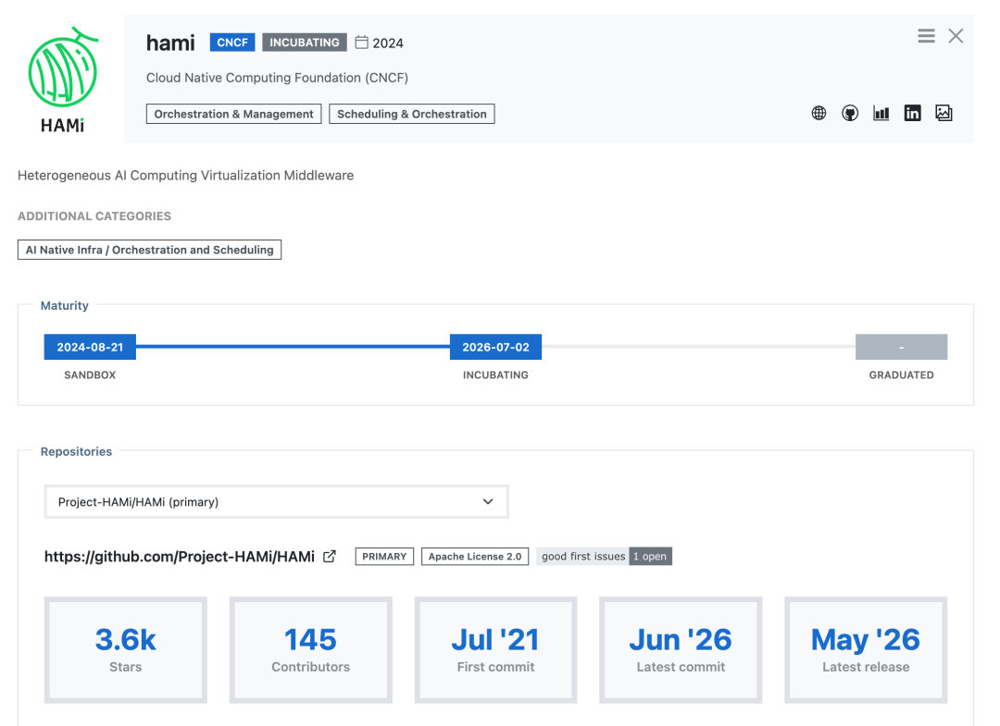
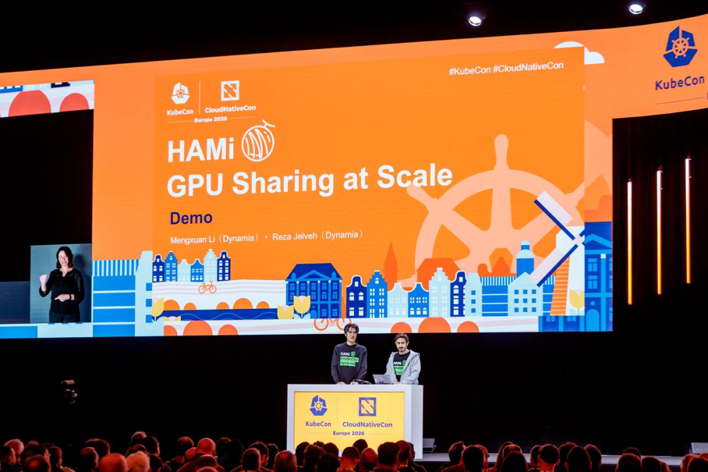

[简体中文](./README.md) · [All articles](../../README.en.md) · [Read on the website](https://www.theriseunion.com/en/blog/hami-cncf-incubating-project.html)

# A Global Community Grew from a Single GPU: Congratulations to HAMi on Becoming a CNCF Incubating Project

RiseUnion · July 07, 2026 at 18:04 (UTC+08:00) · [Original WeChat article (Chinese)](https://mp.weixin.qq.com/s/Bno2ySpcXjr34eKao4ZmCQ)

On July 2, 2026, HAMi received a unanimous CNCF TOC vote and officially advanced from Sandbox to Incubating. It was a moment when an open-source project entered production grade—and a highlight for a global community.

> **Introduction** | On July 2, 2026, HAMi received a unanimous CNCF TOC vote and officially advanced from Sandbox to Incubating. It was a moment when an open-source project entered production grade—and a highlight for a global community.

On July 2, 2026, HAMi received a **unanimous vote** from the CNCF Technical Oversight Committee (TOC) and officially advanced from Sandbox to Incubating.

It was another important leap for HAMi following its entry into the CNCF Sandbox in August 2024.

In CNCF’s maturity model, Sandbox is a proving ground for early-stage projects, while Incubating has firm requirements for technical maturity, security practices, community governance, and production adoption. Advancing to Incubating means HAMi has grown from “a promising new project” into **“trusted infrastructure relied upon by many real production environments.”**

## HAMi Solved a Simple Problem

HAMi, short for Heterogeneous AI Computing Middleware, is GPU/NPU virtualization and scheduling middleware for Kubernetes. The question it answers can be expressed in one sentence:

> **Can multiple tasks safely share one GPU/NPU without interfering with one another?**

Before HAMi appeared, Kubernetes basically scheduled GPUs using a “one Pod exclusively occupies one accelerator” model. If a task did not fully use it, the rest of that expensive accelerator sat idle, leaving utilization low for a long time.

HAMi allocates memory and compute to different workloads on demand, making it possible for multiple tenants to share the same accelerator while requiring **zero changes** to existing workloads. Once HAMi is installed, tasks automatically gain sharing and isolation capabilities.

The project was first open-sourced in July 2021. Since then, under CNCF’s open governance, it has grown into a project with participation from developers around the world.

## Real Production Data Earned Its Incubating Ticket

Today, HAMi has been adopted by **hundreds of organizations**. It is compatible with more than ten kinds of accelerators, including NVIDIA, Huawei Ascend, Cambricon, Hygon DCU, Moore Threads, Enflame, Kunlunxin, and MetaX, making it one of the open-source solutions with the broadest hardware coverage in cloud-native GPU virtualization.

CNCF case studies show implementations across industries:

- **SNOW / NAVER (South Korea)**: Used HAMi to orchestrate more than 1,000 A100 GPUs for 200 million users worldwide. Under a 700% traffic peak, it cut the GPU count in half, saved an estimated **US$17.4 million**, and reduced MTTR by 91%.

- **China Merchants Bank**: Unified multiple types of accelerators, including Kunlunxin, Ascend, and NVIDIA, on one platform, achieved a **100%** hardware pooling rate, and contributed topology-aware scheduling back to the community.

- **NIO**: Increased GPU utilization by about **10 times** in CI pipelines for autonomous-driving workloads.

- **More teams**: Raised average utilization from single digits or the teens to **more than 80%**, directly cutting GPU costs by 30% to 50%.

The ecosystem is converging as well. HAMi-core has completed integrations with the default Kubernetes scheduler, Volcano, Kueue, and Koordinator.

In June 2026, **NVIDIA KAI Scheduler** directly adopted HAMi-core as its built-in capability for hard GPU memory isolation—a substantial endorsement of HAMi’s technical direction.

## An Open-Source Force Stepped onto the Global Stage

Over the past two years, HAMi brought topics including “GPU sharing,” “heterogeneous compute scheduling,” and “AI workload governance” to KubeCon and KubeDay events in Japan, Hong Kong, London, France, and the Netherlands. It was also active in domestic communities such as COSCon, GDPS, and vLLM Meetup.

**2026 has been a year of achievement.**

During a **main-stage keynote** at KubeCon + CloudNativeCon Europe in Amsterdam, the community ran YOLO inference and Qwen3-8B large-model inference simultaneously on one GPU, dividing the accelerator into shareable “compute + memory” units. More than **13,000 attendees** witnessed the demonstration in person.

HAMi thereby became one of the few Chinese open-source projects to appear in a KubeCon EU main-stage keynote.

Two months later at KubeCon India in Mumbai, HAMi once again appeared in a keynote and ran a production-grade large-model service at its booth.

## This Road Was Never Built by One Person

HAMi reached this point not because of any one person or company, but because of **an entire community**.

Thank you to every contributor around the world who submitted code, reported issues, wrote documentation, organized Meetups, explained the project at booths, and answered questions in community groups.

## A Word from a Fellow Traveler: Put Domestic Accelerators to Work for Real

RiseUnion focuses on a more specific and more difficult direction: enabling domestic accelerators to truly run in production environments, remain manageable, and be used well.

Based on HAMi, RiseUnion created Rise VAST, an enterprise heterogeneous compute management platform, and has long focused on adaptation, scheduling, isolation, observability, and operations for domestic accelerators. Faced with the reality that the domestic chip ecosystem is still evolving rapidly and that device-plugin capabilities vary across vendors, RiseUnion continues to accumulate experience in frontline information-technology innovation scenarios and carry out engineering optimizations for domestic accelerator resource partitioning, memory isolation, task scheduling, fault detection, automated operations, and other areas.

The goal of these capabilities is not to stop at “able to connect.” It is to enable domestic accelerators to enter enterprise production systems and support more stable, transparent, and efficient AI training and inference workloads.

> “We are also continuously consolidating the domestic-accelerator adaptation experience accumulated in frontline information-technology innovation scenarios and contributing it back to the HAMi community. If the heterogeneous-compute foundation is to be truly ‘heterogeneous,’ domestic accelerators cannot be the weak link.” — RiseUnion R&D team

HAMi entering the Incubating stage is good news for every team that uses it in production: the more mature the foundation, the more that can grow on top of it. Enabling domestic compute to stand on the **same starting line** as accelerators from international industry leaders on this foundation is precisely what we are willing to continue doing for the long term.

## Join the HAMi Community

Entering Incubating is a new starting point for the HAMi community. Whether you are a developer, an operations engineer, an AI infrastructure leader, or someone evaluating heterogeneous compute solutions, you can find a way to participate:

**🔧 Get started and build together**: Go to GitHub (Project-HAMi/HAMi) to contribute code, report issues, and improve documentation. Every contribution counts.

💬 **Discussion and support**: Join the HAMi WeChat group and community meetings to talk directly with maintainers and users across industries about usage, troubleshooting, and best practices. See the community page for instructions on joining.

If you already use HAMi in production, you are also welcome to share your experience with the community. Your real-world case is the resource that helps others avoid unnecessary detours.

**We look forward to traveling the next stage of HAMi’s journey together.**

---

**Reference links**

- Incubation vote | https://github.com/cncf/toc/issues/1775

- Supported devices | https://project-hami.io/docs/userguide/device-supported

- CNCF case studies | https://project-hami.io/case-studies

- KAI Scheduler adoption | https://project-hami.io/zh/blog/hami-core-adopted-by-nvidia-kai-scheduler

- Project GitHub | https://github.com/Project-HAMi/HAMi

- HAMi Project | [HAMi Advances to CNCF Incubating: Building Heterogeneous Compute Infrastructure for the AI Era with Developers Worldwide](https://mp.weixin.qq.com/s?__biz=Mzk1NzQ1MzEzMQ==&mid=2247486343&idx=1&sn=3b4ff2a1a3e4f9ff4b42707e9558456e&scene=21#wechat_redirect)

### About RiseUnion

Beijing RiseUnion Technology Co., Ltd. (RiseUnion) specializes in AI compute management and scheduling. It has completed compatibility certifications for more than 10 domestic chips and is one of the core contributors to HAMi, a CNCF Sandbox open-source project. The company is a National High-Tech Enterprise, a Beijing Specialized and Innovative SME, and the leader of the AIIC Compute Pooling Working Group. It has achieved large-scale production deployments in finance, government and defense enterprises, transportation, healthcare, and other industries.

RiseUnion is committed to making compute as readily available as water and electricity and to building an intelligent, controllable, and efficient compute foundation for enterprise AI transformation.

---

[Read this article on the RiseUnion website](https://www.theriseunion.com/en/blog/hami-cncf-incubating-project.html) · [Explore more articles](https://www.theriseunion.com/en/blog.html)
