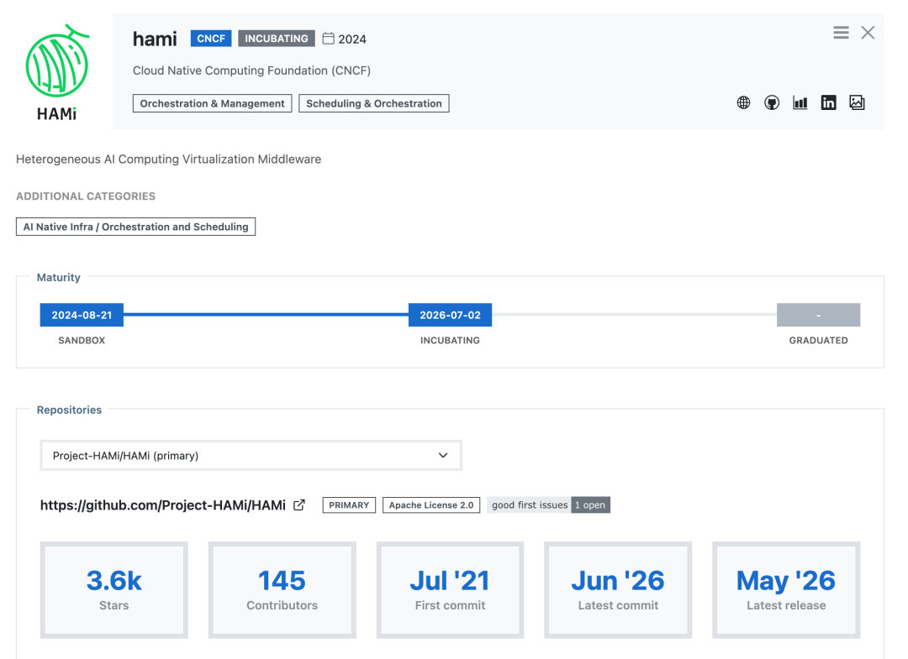
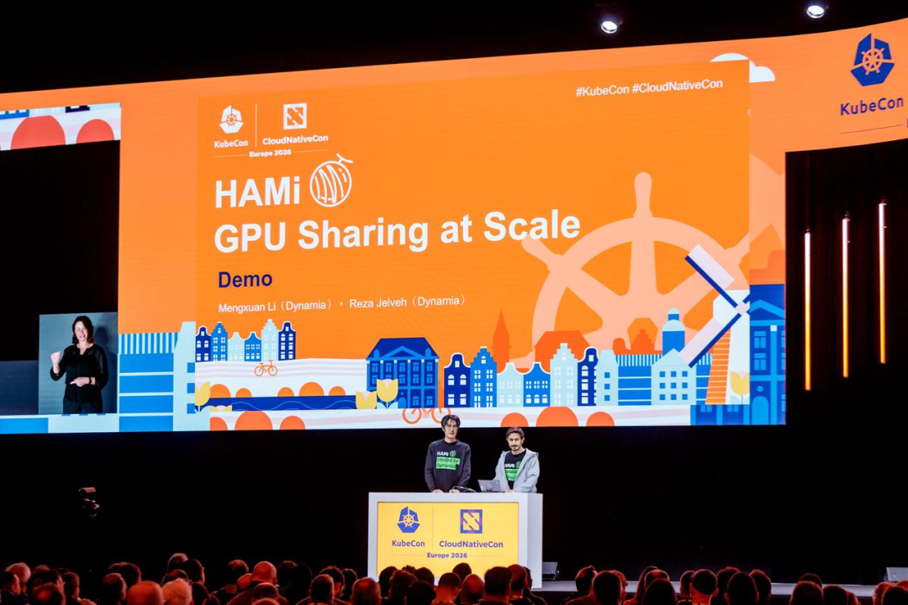

[English](./README.en.md) · [文章目录](../../README.md) · [官网阅读](https://www.theriseunion.com/zh/blog/hami-cncf-incubating-project.html)

# 一张 GPU 上，长出一个全球社区：祝贺 HAMi 晋升 CNCF 孵化项目

睿思智联 · 2026/07/07 18:04（北京时间） · [微信公众号原文](https://mp.weixin.qq.com/s/Bno2ySpcXjr34eKao4ZmCQ)

2026 年 7 月 2 日，HAMi 全票通过 CNCF TOC 投票，从沙箱正式晋级孵化。这是一个开源项目走进生产级的时刻，也是一个全球社区的高光时刻。

> **导语** ｜ 2026 年 7 月 2 日，HAMi 全票通过 CNCF TOC 投票，从沙箱正式晋级孵化。这是一个开源项目走进生产级的时刻，也是一个全球社区的高光时刻。

2026 年 7 月 2 日，HAMi 通过 CNCF 技术监督委员会（TOC）的**全票投票**，正式从沙箱（Sandbox）晋升为孵化（Incubating）项目。

这是继 2024 年 8 月进入 CNCF 沙箱之后，HAMi 又一次重要的跨越。

在 CNCF 的成熟度体系里，沙箱是给早期项目的试验田，而孵化对技术成熟度、安全实践、社区治理和生产采用都有硬门槛。晋级孵化，意味着 HAMi 已经从"一个有潜力的新项目"，长成了 **"被大量真实生产环境依赖的可信基础设施"**。

## HAMi 解决了一个朴素的问题

HAMi, 全称 Heterogeneous AI Computing Middleware，是一个面向 Kubernetes 的 GPU/NPU 虚拟化与调度中间件。它回答的问题只有一句：

> **能不能让多个任务安全地共用一张 GPU/NPU，还互不打扰？**

在它出现之前，Kubernetes 调度 GPU 基本是"一个 Pod 独占一张卡"。一个任务没吃满，整张昂贵的加速器就闲在那儿，利用率长期上不去。

HAMi 把显存和算力按需切给不同负载，让多租户共用同一张卡成为可能；而且对现有业务**零改动**。装上 HAMi，任务就自动获得共享和隔离能力。

项目于 2021 年 7 月首次开源，此后在 CNCF 的开放治理下，已成长为全球开发者共同参与的项目。

## 让它拿到孵化门票的，是真实的生产数据

到今天，HAMi 已被**数百家组织**采用，向下兼容 NVIDIA、华为昇腾、寒武纪、海光 DCU、摩尔线程、燧原、昆仑芯、沐曦 等十余种加速器，是云原生 GPU 虚拟化领域覆盖硬件最广的开源方案之一。

在 CNCF 案例研究里，能看到一批跨行业的落地：

- • **SNOW / NAVER（韩国）**：用 HAMi 编排 1000+ 张 A100，服务全球 2 亿用户，700% 流量峰值下把 GPU 数量减半，估算节省约 **1740 万美元**，MTTR 下降 91%。

- • **招商银行**：把昆仑芯、昇腾、NVIDIA 等多类加速器统一到一个平台，硬件池化率做到 **100%**，并把拓扑感知调度回馈给了社区。

- • **蔚来汽车**：面向自动驾驶负载，CI 流水线 GPU 利用率提升约 **10 倍**。

- • **更多团队**：把平均利用率从个位数、十几个百分点，拉到 **80% 以上**，GPU 成本直接砍掉三到五成。

生态一侧同样在收敛。HAMi-core 已与 Kubernetes 默认调度器、Volcano、Kueue、Koordinator 完成集成。

2026 年 6 月，**NVIDIA KAI Scheduler** 更是把 HAMi-core 直接采纳为其 GPU 显存硬隔离的内置能力——这是对 HAMi 技术路线相当有分量的背书。

## 一支开源力量，站上了全球舞台

过去两年，HAMi 带着"GPU 共享"、"异构算力调度"、"AI 负载治理"等议题，出现在日本、香港、伦敦、法国、荷兰的 KubeCon、KubeDay，也活跃在 COSCon、GDPS、vLLM Meetup 等国内社区。

**2026 年，是收获的一年。**

在 KubeCon + CloudNativeCon Europe（阿姆斯特丹）**主论坛 Keynote** 上，社区在一块 GPU 上同时跑起了 YOLO 推理和 Qwen3-8B 大模型推理，把一张卡拆成可共享的"算力 + 显存"单元，**一万三千多名**与会者现场见证。

HAMi 由此成为登上 KubeCon EU 主论坛 Keynote 的少数中国开源项目之一。

两个月后的 KubeCon India（孟买），HAMi 再次登上 Keynote，并在展台上跑起了生产级大模型服务。

## 这条路，从来不是一个人走出来的

HAMi 能走到今天，靠的不是哪一个人、哪一家公司，而是**一整个社区**。

感谢每一位提交代码、报 issue、写文档、组织 Meetup、在展台讲解、在群里答疑的全球贡献者。

## 一点来自同行者的话：让国产算力卡真正跑起来

睿思智联把重点放在一个更具体也更艰难的方向：让国产算力卡在生产环境里真正跑起来、管得住、用得好。

基于 HAMi，睿思智联打造了企业级异构算力管理平台 Rise VAST，并长期专注于国产算力卡的适配、调度、隔离、可观测与运维能力建设。面对国产芯片生态仍在快速演进、不同厂商设备插件能力差异较大的现实，睿思智联持续在一线信创场景中积累经验，围绕国产卡资源切分、显存隔离、任务调度、故障感知与自动化运维等方向进行工程化优化。

这些能力的目标并不是停留在“能接入”，而是让国产算力卡能够进入企业生产系统，支撑更稳定、更透明、更高效的 AI 训练与推理 workloads。

> “这些在一线信创场景里积累下来的国产卡适配经验，我们也在持续沉淀、回馈给 HAMi 社区。异构算力的底座要真正‘异构’，国产卡这一块就不能是短板。” - 睿思智联研发团队

HAMi 走进孵化阶段，对每一个把它用在生产里的团队都是好消息：底座越成熟，上面能长出的东西就越多。而让国产算力在这个底座上，和国际大厂的卡站上**同一条起跑线**，正是我们愿意长期做下去的事。\

## 一起加入 HAMi 社区

进入孵化，是 HAMi 社区的新起点。不管你是开发者、运维、AI 基础设施负责人，还是正在选型异构算力方案的人，都能找到参与的方式：

**🔧 上手与共建**：到 GitHub（Project-HAMi/HAMi）提代码、报问题、补文档，每一份贡献都算数。

💬 交流与答疑：加入 HAMi 微信群与社区例会，和维护者、各行业用户直接聊使用、排障和最佳实践（入群方式见社区页面）。

如果你已经在生产里用 HAMi，也欢迎把你的实践讲给社区听。你的真实案例，就是帮别人少走弯路的那份财富。

**HAMi 的下一程，期待我们携手同行。**

------------------------------------------------------------------------

**引用链接**

- 孵化投票 ｜ https://github.com/cncf/toc/issues/1775

- 支持设备列表 ｜ https://project-hami.io/docs/userguide/device-supported

- CNCF 案例研究 ｜ https://project-hami.io/case-studies

- KAI Scheduler 采纳 ｜ https://project-hami.io/zh/blog/hami-core-adopted-by-nvidia-kai-scheduler

- 项目 GitHub ｜ https://github.com/Project-HAMi/HAMi

- HAMi Project ｜ [HAMi 晋升 CNCF 孵化项目：与全球开发者共建 AI 时代的异构算力基础设施](https://mp.weixin.qq.com/s?__biz=Mzk1NzQ1MzEzMQ==&mid=2247486343&idx=1&sn=3b4ff2a1a3e4f9ff4b42707e9558456e&scene=21#wechat_redirect)

### 关于睿思智联

北京睿思智联科技有限公司（RiseUnion）专注于AI 算力管理与调度，已完成 10+ 国产芯片兼容认证，是 CNCF Sandbox 开源项目 HAMi 的核心贡献者之一。公司是国家高新技术企业、北京市专精特新中小企业、AIIC 算力池化工作组组长单位，在金融、政企军工、交通、医疗等行业实现大规模生产级落地。

睿思智联致力于让算力像水电一样随取随用，为企业 AI 转型构建智能、可控、高效的算力底座。

---

[在睿思智联官网阅读本文](https://www.theriseunion.com/zh/blog/hami-cncf-incubating-project.html) · [浏览更多文章](https://www.theriseunion.com/zh/blog.html)
